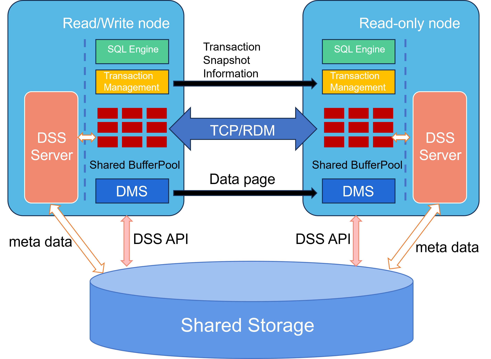

# Resource Pooling Overview

## Availability

This feature has been available since **openGauss 3.1.1**.

## Feature Overview

The resource pooling feature enables the primary and standby nodes to share a single copy of storage, introducing a new High Availability (HA) deployment model. It eliminates the requirement for doubled storage capacity inherent in traditional HA deployments, thereby reducing storage footprint and costs. Additionally, standby nodes support **real-time consistent reads**.

## Architecture

The overall architecture of resource pooling is illustrated below.

**Figure 1** Resource Pooling Architecture  

- **Storage Array**: The storage array device must have the Ultrapath multipathing software installed and must be available.
- **Distributed Storage Service (DSS)**:
  DSS consists of the **DSS API** and the **DSS Server**. The DSS Server runs as an independent process that manages raw storage array devices directly and exposes distributed filesystem-like capabilities. The DSS API is a dynamic library integrated into the database kernel. Through shared memory and the client API library, DSS provides the database with the ability to create, delete, extend, shrink, and read/write files.
- **Distributed Memory Service (DMS)**:
  DMS is a dynamic library integrated into the database kernel. It transfers PAGE contents over TCP or RDMA networks to fuse the memory of the primary and standby nodes, providing memory pooling capabilities. This enables real-time consistent read functionality on standby nodes.
- **RDMA Acceleration**: Primary-standby page exchange can be accelerated via RDMA. This requires **CX5 NICs** and the **OCK RDMA library**.

## Feature Description

- **Shared Storage**: The primary and standby nodes share a single copy of data, significantly reducing storage capacity requirements compared to traditional HA.
- **Page Exchange**: Removes the reliance on log shipping and introduces real-time page exchange between the primary and standby. Standby nodes support real-time consistent reads.
- **Low Latency Option**: By default, page exchange occurs over TCP. To reduce exchange latency, the **OCK RDMA library** can be optionally enabled to accelerate real-time consistent read performance.

## Customer Value

Resource pooling solves the problem of doubled storage capacity in traditional HA deployments, effectively reducing Total Cost of Ownership (TCO). Furthermore, by supporting real-time consistent reads on standby nodes, it fully utilizes the computing power of multi-node clusters.

## Feature Description

Resource pooling relies on two proprietary components to enable shared storage:

1.  **Distributed Storage Service (DSS)**:
    DSS comprises the DSS API and DSS Server. It supports NoF/NoF+ interfaces. The DSS Server is an independent process managing raw storage devices, while the DSS API is a library integrated into the database. Together, they provide file management capabilities (creation, deletion, extension, and I/O) via shared memory.
2.  **Distributed Memory Service (DMS)**:
    DMS is a dynamic library integrated into the database. It fuses primary and standby memory via TCP/RDMA to facilitate real-time page exchange, enabling real-time consistent reads on standby nodes.

**Storage Pooling Implementation:**
Unlike traditional database creation, resource pooling classifies directories into three types based on their sharing nature:
- **Instance-exclusive (Non-shared)**: Exists only on the local node.
- **Instance-exclusive (Shared)**: Managed by the instance but stored on shared storage.
- **Cluster-wide Shared**: Shared among all instances.

Directories requiring sharing must reside on the storage array, while non-shared directories reside on local disks. When building a standby node, only instance-specific directories need to be created; the cluster-wide shared directory structure is not recreated. This mode introduces new GUC parameters and switches the system table storage format from heap to **segment-page**.

**Memory Pooling Implementation:**
DMS enables real-time page exchange, ensuring that once a transaction commits on the primary, it is immediately visible on the standby (Read Committed isolation level), eliminating read lag.

**Performance Optimization:**
Enabling the OCK RDMA library for page exchange can reduce standby consistent read latency by at least **20%** compared to TCP-based exchange.

## Constraints

- **Storage Array Requirement**: The solution requires a storage array supporting **SCSI-3 PR** (Persistent Reserve Out/In and INQUIRY) for IO Fencing, and **SCSI-3 CAW** (Compare and Write) for shared disk locking (e.g., Huawei Dorado 5000 V3).
- **Scale**: Supports up to **1 primary and 7 standbys**.
- **Table Format**: Due to metadata update frequency constraints, only **segment-page tables** are supported. Heap tables are not supported.
- **Deployment Topology**:
  - Supports only single-array deployments (Primary and Standby must reside on the same storage array).
  - Does **not** support disaster recovery (multi-array) deployments or hybrid deployments across different arrays.
  - Does **not** support cascading standbys.
  - Does **not** support Ceph storage.
- **Hardware Acceleration**: RDMA acceleration requires **CX5 NICs** and the **OCK RDMA library**.
- **Maintenance Operations**: Does **not** currently support standby rebuild, node replacement, or node repair.
- **Upgrade**: Does **not** support upgrades between resource pooling mode and traditional standalone mode.
- **Tooling Limitations**: The following tools and functions are **disabled** in resource pooling mode:
  - `gs_xlogdump_xid`, `gs_xlogdump_lsn`, `gs_xlogdump_tablepath`, `gs_xlogdump_parsepage_tablepath`
  - `gs_verify_and_tryrepair_page`, `gs_repair_page`, `gs_repair_file`
- **Logical Replication**: Subscription/Publication features (DDL nodes: `T_CreatePublicationStmt`, `T_AlterPublicationStmt`, `T_CreateSubscriptionStmt`, `T_AlterSubscriptionStmt`, `T_DropSubscriptionStmt`) are **not supported**.
- **Table Types**: **Global Temporary Tables** are not supported.
- **Index Types**: **Hash indexes** are not supported.
- **Operational Behavior**:
  - In a **Failover** scenario, if the old primary attempts to rejoin the cluster, it must wait for the failover process to complete.
  - In a **Switchover** scenario, if the promotion fails (e.g., due to concurrent node restarts), the original primary must be restarted.
