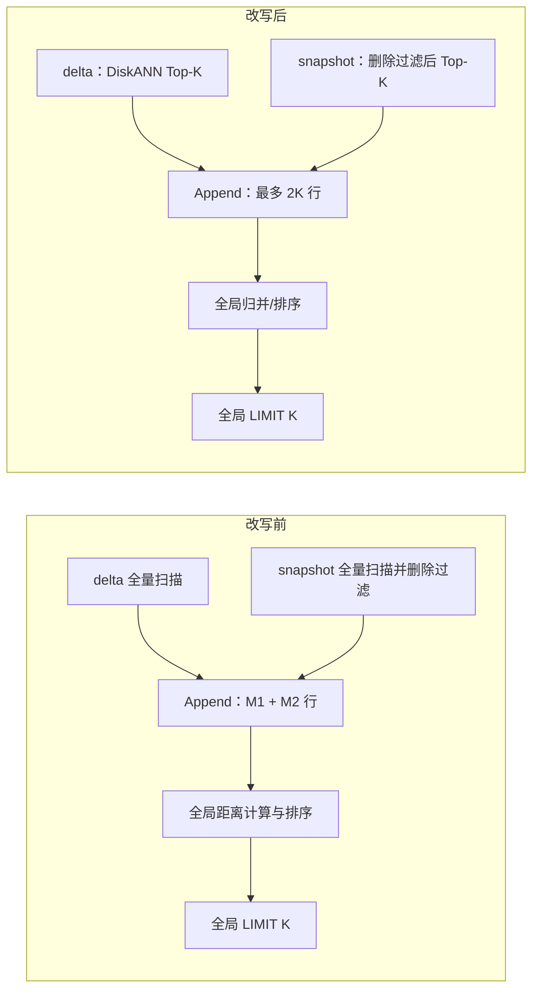
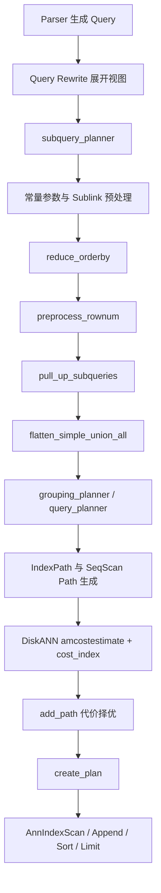
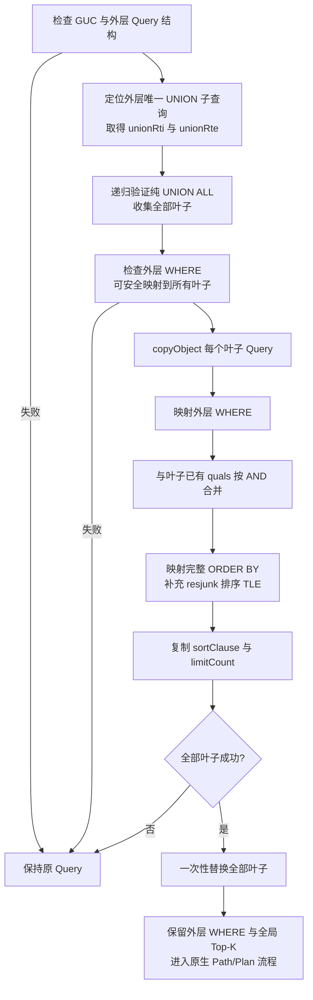
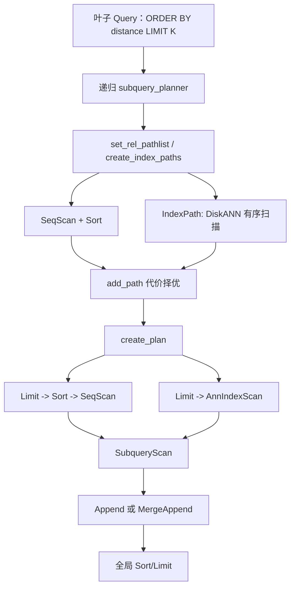

# openGauss master：UNION ALL 分支级 WHERE 过滤与 DiskANN Top-K 协同下推详细设计

| 项目 | 内容 |
|---|---|
| 文档状态 | 详细设计，可直接进入开发 |
| 基准分支 | openGauss `master` |
| 基准提交 | 官方 `upstream/master`：`33f3e1485758e2d27287b608f89f5e2515451c30` |
| 功能名称 | `UNION ALL` 分支级外层 `WHERE` 过滤与 DiskANN Top-K（`ORDER BY + LIMIT`）协同下推 |
| 实现层次 | Query 树逻辑改写；复用原生 `IndexPath`、`AnnIndexScan`、DiskANN Index AM 和 Limit |
| 核心收益 | 外层 WHERE 先映射到各分支并完成过滤，再执行分支近邻 Top-K；保证过滤语义正确，并将全局排序输入由 `ΣMi` 降为不超过 `N×K` |

## 1. master 核验结论

本设计以实际拉取、编译并运行验证的 openGauss 官方 `master` 工作树为准，不再把 HNSW 当作目标索引。本地 `origin/master` 是缺少标准构建脚本的历史 fork，不作为本设计基准。

### 1.1 DiskANN 已进入 master 主干

| 核验项 | master 实际结果 | 设计影响 |
|---|---|---|
| Index AM | `pg_am` 内置 `diskann`，`DISKANN_AM_OID = 8303` | 不新增索引 AM |
| AM 回调 | 已有 build、insert、beginscan、gettuple、rescan、endscan、delete/vacuum、cost、options、handler | 逻辑优化复用现有 AM |
| Path | `plancat.cpp` 将 DiskANN 标为 ANN；仍使用原生 `IndexPath` | 不新增 `DiskAnnPath` |
| Plan | ANN IndexPath 在 `createplan.cpp` 中生成 `AnnIndexScan` | 不新增 `DiskAnnScan` 计划节点 |
| 扫描方向 | `amcanorderbyop=true`，`amcanbackward=false` | 仅支持升序距离 Top-K |
| 索引能力 | `amcanmulticol=false`、`amcaninclude=false`、`amcanparallel=false` | 本功能不承诺多列、INCLUDE、Index Only Scan 或并行索引扫描 |
| 回归用例 | 已有 `diskann_vector.sql`，并进入 `parallel_schedule0` | 新用例在此基础上增加 UNION ALL 下推覆盖 |

DiskANN 主体源码：

- `src/gausskernel/storage/access/datavec/diskann.cpp`
- `src/gausskernel/storage/access/datavec/diskannbuild.cpp`
- `src/gausskernel/storage/access/datavec/diskannscan.cpp`
- `src/gausskernel/storage/access/datavec/diskannutils.cpp`
- `src/gausskernel/storage/access/datavec/diskanndelete.cpp`
- `src/include/access/datavec/diskann.h`

### 1.2 master 的 DiskANN 距离语义

| 距离语义 | 查询算子 | DiskANN opclass | opfamily OID | 是否支持 |
|---|---:|---|---:|---|
| L2 | `<->` | `vector_l2_ops` | 8400 | 是 |
| Inner Product | `<#>` | `vector_ip_ops` | 8401 | 是 |
| Cosine | `<=>` | `vector_cosine_ops` | 8402 | 是 |
| L1 | `<+>` | 无 DiskANN opclass | — | 否 |

上表只记录本文核验的官方 `upstream/master` 提交 `33f3e148...` 的基线结果，不是对其他分支、后续版本或历史 fork 的永久约定。正式实施前必须以目标开发分支当前代码仓的实际内容重新核验，至少检查 `pg_am.h`、`pg_operator.data`、`pg_opfamily.h`、`pg_opclass.h`、`pg_amop.data` 及相关升级 SQL；如果当前代码仓的定义与本文表格不一致，以当前代码仓及其生成的系统 Catalog 为准，并同步更新设计表、断言和回归用例，不能为了匹配本文而沿用过期 OID 或算子名称。

L2、Cosine 和 Inner Product 的操作符同样必须重新核验。不能预设 L2 永远是 `<->`、Cosine 永远是 `<=>`，也不能仅凭操作符字符串判断距离语义；必须同时确认操作符 OID、底层函数语义、`vector, vector -> float8` 类型签名，以及它在 DiskANN opfamily 中作为 ordering operator 的 Catalog 关系。在上述 master 基线中 cosine 是 `<=>`、L1 `<+>` 没有 DiskANN opclass，因此原 HNSW 文档中“`<+>` 可用于该优化”的结论不适用于该快照。

### 1.3 编译和运行验证记录

| 验证 | 结果 |
|---|---|
| master 分支/提交 | 官方 `upstream/master` / `33f3e148...` |
| 标准构建方式 | 依据官方编译指南，使用仓库标准 Makefile 流程；为适配本机内存，并发设为 4 |
| DiskANN 五个核心对象 | `diskann.o`、`diskannbuild.o`、`diskannscan.o`、`diskannutils.o`、`diskanndelete.o` 全部编译通过 |
| 完整 `gaussdb` 编译与链接 | 通过，生成约 553 MB 的 debug `gaussdb` |
| 安装 | 完整编译后执行 `make install -sj1` 通过，日志结束语为 `openGauss installation complete.`；单线程安装避免客户端共享库并行复制竞态 |
| 实例验证 | `gs_initdb` 与单节点启动通过，测试实例监听 `127.0.0.1:55433` |
| DiskANN DDL | `CREATE INDEX ... USING diskann (embedding vector_l2_ops)` 成功，`indisvalid=t`、`indisready=t` |
| DiskANN 执行计划 | `EXPLAIN ANALYZE` 实测生成 `Limit -> Ann Index Scan using diskann_smoke_l2_idx`，返回 Top-3 |
| 仓内回归证据 | master 已提供 `diskann_vector.sql` 及期望文件；期望计划为 `Limit -> Ann Index Scan`，但这属于仓库基线证据，不等同于本次运行结果 |

本次实测计划：

```text
Limit (actual rows=3 loops=1)
  -> Ann Index Scan using diskann_smoke_l2_idx on diskann_smoke
       Order By: embedding <-> '[0.3,0.4,0.5,0.6,0.7,0.8]'::vector
```

据此可以确认：官方 master **已在源码、Catalog、AM、Path/Plan、编译安装和实际运行层面支持 DiskANN**。

首次并行安装时曾出现 `libpq_ce.so.5` 被提前复制、`gsql` 缺少 `pqPutc` 符号的问题；保持编译产物不变并执行 `make install -sj1` 后，源目录和安装目录的 `libpq_ce.so.5.5` 大小一致，安装库已导出 `pqPutc`。最终 `gaussdb`、`gsql` 均可直接启动，不再需要 `LD_PRELOAD`。这是安装并发竞态，不是 DiskANN 功能缺陷。

上述验证分为四个层次：源码存在只能证明仓库已经包含 DiskANN 实现；对象文件编译通过只能证明相关代码可以编译；仓库中的回归期望文件只能说明官方预期生成相应计划；本地实例实际完成建索引并执行查询，才能证明 DiskANN 在当前编译安装环境中可以运行。本节分别记录这四类证据，最终的“当前环境可用”结论以完整实例运行结果为准。

### 1.4 UNION ALL 现状实测

官方 master 在默认代价参数下，纯 `UNION ALL` 与带 `NOT EXISTS` 分支的视图都没有生成分支级 Top-K：

```text
Limit
  -> Sort
       Sort Key: embedding <-> query_vector
       -> Result
            -> Append
                 -> Seq Scan on delta
                 -> Seq Scan / Hash Right Anti Join on snapshot
```

这证明本设计要补齐的不是 DiskANN AM 本身，而是分支级 `ORDER BY + LIMIT` 生成和安全的 Path/Plan 衔接。

另一个必须在实现外层 WHERE 前处理的 master 缺陷：即使 SQL **没有外层 WHERE**，设置 `enable_seqscan=off` 使 UNION ALL 子关系选择 DiskANN 有序 `IndexPath` 后，`EXPLAIN` 也会触发 `SIGSEGV`。本次 core 对应的关键调用栈为：

```text
create_merge_append_plan
  -> create_indexscan_plan
       -> find_ec_member_for_expr() 返回 NULL
       -> createplan.cpp:3072 解引用 em->em_datatype
```

core 中确认：

```text
em                                  = NULL
indexorderby expr                   = 0x7a335fc9f888
EC 中对应 child member.em_expr      = 0x7a335fc9f888  -- 与 expr 同一地址
child member.em_is_child            = true
child member.em_datatype            = 701             -- FLOAT8OID
IndexPath parent.reloptkind          = RELOPT_OTHER_MEMBER_REL
IndexPath parent.relid               = 6
IndexPath parent.relids              = 0x40
child member.em_relids               = 0x40            -- 与 parent.relids 匹配
```

这说明排序表达式对应的 `EquivalenceMember` **已经存在**，并不是外层 WHERE 或 ORDER BY 下推“漏建 EC member”。真正根因在 `create_indexscan_plan()`：

```cpp
em = find_ec_member_for_expr(pathkey->pk_eclass, expr, NULL);
```

`find_ec_member_for_expr()` 的规则是：child EC member 只有在其 `em_relids` 与传入的 `relids` 相等时才参与匹配。此处传入 `NULL`，因此与当前 IndexPath 完全匹配的 child member 被主动跳过，函数返回 `NULL`；代码没有判空就访问 `em->em_datatype`，最终崩溃。

#### 1.4.1 实现约束：不得把问题错误归因于外层 WHERE

外层 WHERE 的 Query 树改写阶段只负责生成正确的叶子表达式，不负责创建或修改 `EquivalenceClass/EquivalenceMember`。EC 由后续优化器根据排序表达式和 PathKey 构建。实现时明确禁止：

- 在 `preptopk.cpp` 中手工创建、补写或修改 EC member；
- 为绕过 core 而关闭外层 WHERE 下推；
- 仅禁止 `MergeAppend` 就认为问题已经解决。

调用栈虽然经过 `create_merge_append_plan()`，但空指针发生在 child DiskANN `IndexPath` 的 `create_indexscan_plan()` 中。即使最终采用 `Append + Global Sort + Limit`，只要 Append 子路径仍是带 `indexorderbys/pathkeys` 的 child DiskANN IndexPath，就仍可能进入同一段代码并崩溃。因此，MergeAppend 回退不是根本修复。

#### 1.4.2 推荐修复：直接从 indexorderby 表达式取得类型

此处只是为了取得排序表达式的数据类型，再从 `pathkey->pk_opfamily` 查找排序操作符，不需要依赖 EC member。推荐与本地 PostgreSQL 12/16 的 `create_indexscan_plan()` 做法一致，改为：

```cpp
Assert(list_length(best_path->path.pathkeys) ==
       list_length(indexorderbys));

i = 0;
forboth (pathkeyCell, best_path->path.pathkeys,
         exprCell, indexorderbys) {
    PathKey *pathkey = (PathKey *)lfirst(pathkeyCell);
    Expr *expr = (Expr *)lfirst(exprCell);
    Oid exprtype = exprType((Node *)expr);
    Oid sortop;

    sortop = get_opfamily_member(pathkey->pk_opfamily,
                                 exprtype,
                                 exprtype,
                                 pathkey->pk_strategy);
    if (!OidIsValid(sortop))
        ereport(ERROR,
            (errcode(ERRCODE_OPTIMIZER_INCONSISTENT_STATE),
             errmsg("missing sort operator for index ORDER BY")));

    indexorderbyops[i++] = sortop;
}
```

本次 core 中 `exprType(expr)` 为 `FLOAT8OID(701)`，与被跳过的 child member 的 `em_datatype` 一致。该方案消除了“为取类型而查 EC member”的不必要依赖，同时保留 openGauss 为有损 GiST/ANN ORDER BY 向执行器传递 `indexorderbyops` 的现有能力。

如果暂时保留 EC 查找，至少必须传入 child IndexPath 的关系集合并判空：

```cpp
Relids relids =
    (best_path->path.parent->reloptkind == RELOPT_OTHER_MEMBER_REL)
        ? best_path->path.parent->relids
        : NULL;

em = find_ec_member_for_expr(pathkey->pk_eclass, expr, relids);
if (em == NULL)
    ereport(ERROR, ...);  /* 禁止空指针解引用 */
```

但该方案仍不如直接使用 `exprType(expr)` 简洁、稳健，不能作为首选实现。

#### 1.4.3 修复顺序

```text
先修复 create_indexscan_plan 的 child IndexPath 类型获取
  -> 验证无外层 WHERE 的 UNION ALL DiskANN EXPLAIN 不崩溃
  -> 再实现外层 WHERE 安全检查和叶子映射
  -> 最后同时验证 MergeAppend 与 Append + Global Sort 两种计划
```

当前工作树中的下面代码只是定位 core 时加入的临时隔离逻辑，正式实现必须删除：

```cpp
if (outerQual != NULL) {
    elog(DEBUG1, "... rejecting query with WHERE clause ...");
    return;
}
```

删除后应改为调用本文定义的完整检查：

```cpp
if (!check_outer_qual_pushdown_safe(
        outer, unionRti, unionRte, leaves, &reason))
    return;
```

随后在每个 `leafCopy` 上按“映射外层 WHERE → 与原 quals 合并 → 映射 ORDER BY → 设置 LIMIT”的顺序执行 `prepare_leaf_diskann_topk()`。不得为了通过防崩溃用例而继续无条件拒绝外层 WHERE。

生成 `MergeAppend` 前仍需要验证所有分支的排序 PathKey 与外层排序要求兼容；不兼容时使用下面的正确性回退：

```text
Limit
  -> Global Sort
       -> Append
            -> 分支局部 Top-K
            -> 分支局部 Top-K
```

但这个回退只解决“能否利用分支有序性进行归并”的问题，不能替代 `create_indexscan_plan()` 的空指针修复。

core 文件分析时，当前 `gaussdb` 的时间戳比 core 晚约 7 分钟。调用栈、结构字段、表达式地址和 relids 可以相互印证上述结论；正式缺陷回归应保留生成 core 时具有相同 Build ID 的二进制和符号文件，避免后续源码行号变化影响取证。

## 2. 建设目标与边界

### 2.1 目标 SQL

视图由 delta 与经过删除过滤的 snapshot 两个分支构成：

```sql
CREATE VIEW gs_1w_1bucket AS
SELECT *
FROM gs_1w_1bucket_delta_4997793162136393935
UNION ALL
SELECT *
FROM gs_1w_1bucket_snapshot_4997793162136393935 s
WHERE NOT EXISTS (
    SELECT 1
    FROM gs_1w_1bucket_delete_4997793162136393935 d
    WHERE d.row_id = s.row_id
);
```

用户执行 L2 Top-K：

```sql
SELECT *
FROM gs_1w_1bucket
ORDER BY embedding <-> '[0.1,0.2,0.3,12.8]' ASC
LIMIT 10;
```

优化器在 Query 树中等价转换为：

```sql
SELECT *
FROM (
    (
        SELECT *
        FROM gs_1w_1bucket_delta_4997793162136393935
        ORDER BY embedding <-> '[0.1,0.2,0.3,12.8]' ASC
        LIMIT 10
    )
    UNION ALL
    (
        SELECT *
        FROM gs_1w_1bucket_snapshot_4997793162136393935 s
        WHERE NOT EXISTS (
            SELECT 1
            FROM gs_1w_1bucket_delete_4997793162136393935 d
            WHERE d.row_id = s.row_id
        )
        ORDER BY embedding <-> '[0.1,0.2,0.3,12.8]' ASC
        LIMIT 10
    )
) u
ORDER BY embedding <-> '[0.1,0.2,0.3,12.8]' ASC
LIMIT 10;
```

实际代码只复制和修改 Query 节点，不拼接 SQL 文本，也不重新进入 Parser。

### 2.2 改写前后数据流



### 2.3 本期支持

- 外层是单一视图或子查询上的 `SELECT ... [WHERE ...] ORDER BY ... LIMIT ...`；`WHERE` 可选，存在时必须能安全映射并下推到全部 UNION ALL 分支，同时保留外层原始 WHERE 作为首版语义保护。
- 视图展开后的顶层集合运算是纯 `UNION ALL`，分支数量不限。
- `ORDER BY` 至少包含一个 DiskANN 支持的 vector 距离键；向量排序键数量不限。
- 完整 ORDER BY 列表一起下推，包括用于稳定结果的普通标量 tie-breaker。
- 所有排序键均为 `ASC NULLS LAST`。
- 支持目标开发分支当前 Catalog 中已注册为 DiskANN ordering operator 的 L2、cosine 和 inner product；本文 master 基线对应 `<->`、`<=>`、`<#>`，正式实施时不得跳过代码仓复核而直接采用这些名称或 OID。
- 叶子允许 WHERE、JOIN 和相关 `NOT EXISTS`；满足安全条件的外层 WHERE 可下推到所有叶子，局部 Top-K 必须位于叶子全部过滤语义之后。
- 外层全局 ORDER BY 与 LIMIT 始终保留。
- 单机和 openGauss 原生分布式规划均复用现有节点。

### 2.4 不进行本优化、回退原计划

- `UNION`、`INTERSECT`、`EXCEPT`。
- `DESC`、`NULLS FIRST`、升降序混排。
- `<+>` L1：master DiskANN 无对应 opclass。
- `OFFSET`、`LIMIT ALL`、`FETCH ... PERCENT`、`FETCH ... WITH TIES`。
- 外层查询结构不符合“单一 UNION ALL 子查询数据源”，例如外层存在 JOIN 或多个 FROM 项。
- 外层包含会改变行数或求值层次的结构，例如聚合、`GROUP BY`、`HAVING`、`DISTINCT`、Window、CTE、行锁或 SRF。
- 外层 WHERE 无法完整、安全地映射到所有 UNION ALL 叶子，例如含 SubLink、volatile 函数、相关外层 Var、whole-row/系统列，或者至少一个叶子存在列映射或类型不匹配。
- 安全屏障视图，或排序/LIMIT/目标列中存在 volatile 函数。
- 叶子已有 ORDER BY、LIMIT/OFFSET 或集合操作。
- 排序表达式不能从外层输出列安全映射到全部 UNION 叶子。

这里的“回退”是指不执行本次 Top-K 下推，SQL 仍按 openGauss 原生流程生成计划并正常执行，不是向用户返回语法或执行错误。这些限制针对首版安全改写，并不表示复杂场景永远无法优化。

## 3. 逻辑等价性

设 `U = R1 UNION ALL ... UNION ALL Rn`，`TopK(R,O,K)` 表示按完整顺序 O 取 K 行：

```text
TopK(U, O, K)
= TopK(
    TopK(R1, O, K) UNION ALL ... UNION ALL TopK(Rn, O, K),
    O,
    K)
```

一行若在自身分支中排在 K 名以后，该分支已有至少 K 行排在它之前，所以它不可能进入全局前 K。等价成立必须同时满足：

1. 集合操作为保留重复行的 `UNION ALL`。
2. 各分支使用完全相同的排序表达式、方向、NULLS 规则和 K。
3. 外层全局排序和 LIMIT 不删除。
4. 分支 LIMIT 位于该分支所有 JOIN、WHERE、NOT EXISTS 等语义之后。

snapshot 分支必须保持：

```text
snapshot -> NOT EXISTS(delete) -> ORDER BY -> LIMIT K
```

禁止改成：

```text
snapshot -> ORDER BY -> LIMIT K -> NOT EXISTS(delete)
```

后者会让已删除近邻占用候选名额，造成少行或漏行。

距离相同时 SQL 可能没有确定顺序。建议业务使用唯一键形成全序：

```sql
ORDER BY embedding <-> $1 ASC, row_id ASC
LIMIT 10;
```

逻辑等价和 ANN 召回率分开验收：关闭 ANN 路径验证改写的精确等价；启用 DiskANN 验证计划、性能和既有召回率。

## 4. 优化器接入位置

### 4.1 master 现有主链路



### 4.2 新增改写点

在 `subquery_planner()` 中，放在 `reduce_orderby()`、`preprocess_rownum()` 之后，`pull_up_subqueries()` 之前：

```cpp
#ifndef ENABLE_MULTIPLE_NODES
    preprocess_rownum(root, parse);
    DEBUG_QRW("After preprocess rownum");
#endif

    preprocess_union_all_diskann_topk(root);
    DEBUG_QRW("After union all diskann top-k pushdown");

    parse->jointree = (FromExpr*)pull_up_subqueries(root, (Node*)parse->jointree);
```

理由：此时视图已经展开，仍能看到 `RTE_SUBQUERY + SetOperationStmt`；UNION ALL 尚未拉平，能够安全修改叶子 Query；后续 Path、Plan 和执行器保持原生流程。

## 5. 可改写性检查

### 5.1 外层 Query

| 检查项 | 必须满足 |
|---|---|
| 命令 | `CMD_SELECT` |
| FROM | 恰好一个 `RangeTblRef`，对应 `RTE_SUBQUERY` |
| 外层 quals | `NULL`：允许；非 `NULL`：必须通过 `check_outer_qual_pushdown_safe()`，并能映射到所有 UNION ALL 叶子 |
| 排序 | 非空；每个键均为 `ASC NULLS LAST` |
| 排序表达式 Var | 当前层所有 `Var` 必须满足 `varlevelsup=0` 且 `varno=UNION 子查询 RTE 的 rtindex`；禁止整行 Var、系统列及其他 RTE 引用 |
| DiskANN 键 | 至少一个排序表达式属于 DiskANN vector ordering opfamily |
| LIMIT | `limitCount != NULL`，无 OFFSET/PERCENT/WITH TIES |
| 复杂语义 | 无聚合、group/having/distinct/window/CTE/rowmark/SRF/ROWNUM/setOperations |
| 安全 | 非 security barrier，深层无 volatile 表达式 |

`SELECT *` 不是硬条件。只要外层 WHERE 和每个排序表达式都能通过可见输出列映射到所有叶子，就可改写。

这里的“恰好一个”是指外层 `jointree->fromlist` 中只有一个有效数据源，而且它是目标 UNION ALL 子查询；不是指 UNION 只有一个分支。实现不能用 `list_length(outer->rtable) == 1` 判断，因为 `rtable` 可能含有视图展开产生的辅助 RTE。建议函数名保留为 `get_single_union_subquery_rte()` 时，在注释中明确 `single` 表示“外层唯一有效 FROM 项”；若允许调整命名，`get_only_from_union_subquery_rte()` 更直观。外层 JOIN 或多个数据源首版回退，因为 JOIN 可能过滤、复制行或改变最终 Top-K。

### 5.2 DiskANN 排序算子识别

不能只比较 `<->` 等名称。单个向量排序表达式必须满足：

1. 去除无语义 Relabel 后为二元 `OpExpr`。
2. 两侧参数是 `VECTOROID`，结果是 `FLOAT8OID`。
3. 通过当前系统 Catalog 确认 `opno` 是目标开发分支某个 DiskANN opfamily 的 ordering operator；本文记录的 opfamily 8400、8401、8402 仅是 master 快照基线，不能脱离实际代码仓直接硬编码。
4. 通过 opfamily/amop 的 Catalog 关系确认对应索引 AM 为当前代码仓定义的 `DISKANN_AM_OID`。
5. 排序方向为 forward/ASC；DiskANN `amcanbackward=false`，不得用反向扫描模拟 DESC。

依据顺序必须明确：正式实施前，先以目标开发分支当前代码仓重新核验 AM、opfamily、opclass、操作符及其距离语义；实现运行时，再以当前数据库系统 Catalog 中的实际类型签名、ordering operator/opfamily/AM 关系作为是否命中的最终依据。本文列出的 OID、L2/Cosine/IP 操作符名称只用于记录 `33f3e148...` 快照、辅助 Debug 断言和构造该快照的回归基线，不是跨分支或跨版本的固定接口。若三者不一致，优先级为“目标代码仓及其生成 Catalog > 本文基线值”。

### 5.3 UNION ALL 树

递归访问 `SetOperationStmt`：

```text
op  == SETOP_UNION
all == true
```

内部节点必须继续是纯 UNION ALL；叶子必须是指向 `RTE_SUBQUERY` 的 `RangeTblRef`。遍历 UNION ALL 树时，只要有一个分支无法作为独立 Query 安全增加 `ORDER BY + LIMIT`，或者各分支输出列无法一一对应，就完全不做 Top-K 改写，保持原查询不变。UNION DISTINCT、INTERSECT、EXCEPT、非子查询叶子及列数或类型不一致均属于此类回退条件。

### 5.4 叶子 Query

叶子可包含 JOIN、WHERE、NOT EXISTS，但必须满足：

- 自身无 sortClause、limitCount、limitOffset 和 setOperations。
- 无 agg/group/having/distinct/window/CTE/rowmark/SRF/ROWNUM。
- targetList 可按“第 N 个非 resjunk 输出列”映射 UNION 输出。
- 排序键映射后不包含外层 Var、Sublink 或 volatile 函数。
- 排序键涉及的每个输出列在全部叶子中具有与 UNION 输出一致的类型、typmod 和 collation。外层 `ORDER BY` 使用的是 UNION 统一输出后的值。如果某个叶子的原始输出还需要经过类型转换或 collation 调整，才能成为这个统一输出，那么不能直接在转换前的叶子上排序并取 Top-K。
- 映射后的叶子局部 `Var` 必须能在该叶子自己的 `rtable` 中解析，且 `varlevelsup=0`；叶子输出表达式若本身依赖更高查询层，首版拒绝。
- 任一叶子失败即全部放弃，禁止只改写部分分支。

### 5.5 LIMIT

- 正式 SQL 接口使用普通写法 `LIMIT 3`，不能要求用户写成 `LIMIT '3'::bigint`。
- openGauss 可能把普通整数 LIMIT 表示为顶层安全隐式 `int4 -> int8` 转换节点。检查时调用 `strip_implicit_coercions()` 只用于识别其底层非负整数 `Const`；向叶子写入时仍 `copyObject(outer->limitCount)`，保留原始转换和执行语义。
- 直接的非负 `int8 Const`，以及经安全隐式转换得到的 `int2/int4/int8 Const`：支持；K=0 可直接不改写。
- `PARAM_EXTERN` 指客户端绑定的 LIMIT 参数，例如 `LIMIT $2`。改写时将引用同一 `paramid` 的 Param 节点复制到每个 UNION 叶子的 `limitCount`；每次执行中，外层和所有叶子读取相同的 K，因此 Top-K 改写保持等价。
- `gplan` 中如果无法取得 LIMIT 参数的具体值，仅在 DiskANN 代价计算中使用 openGauss 对未知 LIMIT 的默认估值 `K_est`，并将其限制在 `[1, N]`。不得把未知 K 当成 0 或极小值，以免低估 DiskANN 搜索成本。该估值只影响路径成本和计划选择，执行器仍使用客户端传入的真实 K。
- 显式窄化转换、可能溢出的转换、volatile、Sublink 或其他复杂 LIMIT 表达式：拒绝。

## 6. Query 树改写算法

### 6.1 两阶段提交



为实现“全部叶子成功后一次性提交”，`preptopk.cpp` 内部可以定义一个普通辅助结构，临时保存每个叶子的原 `RangeTblEntry` 地址和改写后的 `Query` 副本。该结构只在本次预处理过程中使用，不写入 Query、Path 或 Plan 树，也不需要新增 `NodeTag`、`copyObject()`、`equal()` 或序列化支持。全部叶子校验成功后，才统一替换各 `ownerRte->subquery`；任一叶子失败则不修改原 Query 树：

```cpp
typedef struct DiskAnnTopKPreparedLeaf {
    RangeTblEntry *ownerRte;
    Query *rewrittenQuery;
} DiskAnnTopKPreparedLeaf;
```

### 6.2 主入口伪代码

```cpp
void preprocess_union_all_diskann_topk(PlannerInfo *root)
{
    Query *outer = root->parse;
    Index unionRti = 0;
    RangeTblEntry *unionRte = NULL;
    Node *outerQual = NULL;
    List *leaves = NIL;
    List *prepared = NIL;
    ListCell *lc = NULL;
    DiskAnnTopKRejectReason reason = TOPK_ACCEPTED;

    if (!u_sess->attr.attr_sql.enable_union_all_diskann_topk_pushdown)
        return;
    if (!check_outer_query_structure(outer, &reason))
        return;

    unionRte = get_single_union_subquery_rte(outer, &unionRti);
    if (unionRte == NULL || unionRte->security_barrier)
        return;
    if (!collect_pure_union_all_leaves(unionRte->subquery, &leaves))
        return;

    outerQual = outer->jointree == NULL ? NULL : outer->jointree->quals;
    if (!check_outer_qual_pushdown_safe(outer,
                                        unionRti,
                                        unionRte,
                                        leaves,
                                        &reason))
        return;

    /* Prepare 第一阶段：复制全部叶子，不修改任何 ownerRte->subquery。 */
    foreach (lc, leaves) {
        RangeTblEntry *leafRte = (RangeTblEntry *)lfirst(lc);
        Query *copy = (Query *)copyObject(leafRte->subquery);

        prepared = lappend(prepared,
            make_prepared_leaf(leafRte, copy));
    }

    /* Prepare 第二阶段：只改写 Query 副本，原 Query 树仍保持不变。 */
    foreach (lc, prepared) {
        DiskAnnTopKPreparedLeaf *item =
            (DiskAnnTopKPreparedLeaf *)lfirst(lc);

        if (!prepare_leaf_diskann_topk(
                outer,
                unionRti,
                unionRte,
                outerQual,
                item->rewrittenQuery,
                &reason)) {
            /* 临时对象由规划器 MemoryContext 统一回收。 */
            return;
        }
    }

    /* Commit：这是唯一修改原 Query 树的位置。 */
    commit_prepared_leaves(prepared);
}
```

`collect_pure_union_all_leaves()` 返回的 `leaves` 列表只保存每个叶子的 `RangeTblEntry *`；对应原 Query 可通过 `leafRte->subquery` 取得。Prepare 阶段不得修改 `ownerRte->subquery` 或其他原 Query 节点。任一副本准备失败时直接返回，临时对象由规划器 MemoryContext 在规划结束时统一回收；只有 `commit_prepared_leaves()` 可以把全部 `rewrittenQuery` 一次性写回各 `ownerRte->subquery`。

三个入口辅助函数的职责必须互不重叠：

| 函数 | 负责什么 | 不负责什么 |
|---|---|---|
| `check_outer_query_structure()` | 检查 `SELECT`、外层唯一 FROM 形态、ORDER BY、LIMIT、聚合/窗口等整体结构；不深入判断 WHERE 的列映射 | 不取得叶子，不修改 Query |
| `get_single_union_subquery_rte(..., &unionRti)` | 返回目标 `unionRte` 及其在外层 `rtable` 中从 1 开始的编号 `unionRti`；`single` 指外层唯一有效 FROM 数据源 | 不表示 UNION 只有一个分支，不检查谓词 |
| `check_outer_qual_pushdown_safe(..., leaves, &reason)` | 检查外层 WHERE 的表达式安全性，并证明其中每个 UNION 输出列都能映射到每个叶子 | 不修改叶子，不做部分下推 |

`unionRti` 是外层 WHERE/ORDER BY 中 `Var.varno` 使用的 RTE 编号；`unionRte` 是 `rt_fetch(unionRti, outer->rtable)` 得到的 `RangeTblEntry *`，其 `subquery` 指向 UNION ALL Query。完整 WHERE 检查必须看到叶子输出，因此先收集叶子，再调用 `check_outer_qual_pushdown_safe()`；若把表达式级初筛放在收集叶子之前，也只能作为快速失败检查，不能代替该完整检查。

`prepare_leaf_diskann_topk()` 的内部顺序固定为：

```text
映射外层 WHERE
→ 与叶子已有 quals 按 AND 合并
→ 映射完整 ORDER BY
→ 设置叶子 LIMIT
```

对应伪代码：

```cpp
static bool prepare_leaf_diskann_topk(Query *outer,
                                      Index unionRti,
                                      RangeTblEntry *unionRte,
                                      Node *outerQual,
                                      Query *leafCopy,
                                      DiskAnnTopKRejectReason *reason)
{
    if (outerQual != NULL) {
        /*
         * 将外层 WHERE 中引用 UNION 输出列的 Var，按可见输出列序号
         * 替换为当前叶子 TargetList 中的真实表达式。
         * 例如 outer.title -> delta.title / snapshot.title。
         * 失败时 reason 记录列映射、类型或表达式安全性原因。
         */
        Expr *mappedQual = map_outer_qual_to_leaf(
            outer, unionRti, unionRte, leafCopy,
            (Expr *)outerQual, reason);
        if (mappedQual == NULL)
            return false;

        /*
         * 使用 make_and_qual() 将映射后的外层 WHERE 与叶子原有
         * jointree->quals 合并，不能覆盖叶子已有的 NOT EXISTS 等条件。
         * 合并结果保证所有过滤都发生在叶子局部 Top-K 之前。
         */
        if (!append_outer_qual_to_leaf(leafCopy, mappedQual))
            return false;
    }

    /*
     * 将外层完整 ORDER BY 映射到当前叶子：通过叶子 TargetList
     * 重建 Var/RTE 引用，复用或补充 resjunk 排序 TLE，并生成叶子
     * 本地 sortClause。任一排序键失败时整个叶子准备失败。
     */
    if (!map_full_order_by_to_leaf(
            outer, unionRti, unionRte, leafCopy, reason))
        return false;

    /*
     * 复制外层 LIMIT 到叶子，形成分支级 Top-K。复制原节点而不是
     * 重新构造常量，以支持普通 LIMIT 3 并保留其安全隐式转换或 Param。
     * 外层 ORDER BY/LIMIT 和外层 WHERE 均不在本函数中删除。
     */
    leafCopy->limitCount = copyObject(outer->limitCount);
    leafCopy->limitOffset = NULL;
    leafCopy->limitIsPercent = false;
    leafCopy->limitWithTies = false;

    /* 这里只完成叶子副本 Prepare；真正替换原叶子由统一 Commit 完成。 */
    return true;
}
```

提交时只替换叶子副本，不清空 `outer->jointree->quals`。因此首版中叶子先过滤以减少局部 Top-K 输入，外层原始 WHERE 仍保留并对最多“分支数 × K”行做语义保护。后续即使原生优化阶段再次移动或消除等价谓词，也不属于本预处理函数主动删除外层 WHERE。

### 6.3 ORDER BY 映射

外层排序项常为 resjunk：

```sql
SELECT row_id, title
FROM gs_1w_1bucket
ORDER BY embedding <-> $1, row_id
LIMIT 10;
```

不能把外层排序表达式直接 `copyObject()` 到叶子，也不能假定不同 Query 的 `varno` 恰好相同。`varno` 只在所属 Query 的 `rtable` 中有意义，即使外层和叶子都显示 `varno=1`，它们也可能指向完全不同的 RTE。

映射流程：

1. 通过 `SortGroupClause.tleSortGroupRef` 找到外层 TargetEntry。
2. 先用 `checkExprHasSubLink(sortExpr)` 拒绝含嵌套 Query 的排序表达式，再用 `contain_vars_of_level_or_above(sortExpr, 1)` 拒绝直接引用更高查询层的 Var。
3. 在已经排除 SubLink 和跨层引用的前提下，使用 `pull_vars_of_level(sortExpr, 0)` 提取排序表达式中属于当前外层 Query 的列引用。每一项都必须是普通 `Var`，并满足 `varno=unionRti`、`varattno>0`；此时 `varlevelsup=0` 可作为防御性断言。这里的 `unionRti` 指外层 FROM 中唯一的 UNION ALL 子查询 RTE，因此这些 Var 引用的是 UNION 的统一输出，而不是某个具体叶子。随后根据 `varattno` 表示的输出列序号，在每个 UNION 叶子中分别找到对应的 TargetEntry 并完成表达式替换；任一叶子无法映射则整次放弃。
4. `varattno` 表示 UNION 子查询暴露的第 N 个输出属性。按非 resjunk 可见序号定位 UNION 输出列，并校验类型、typmod、collation。
5. 按同一个可见输出序号定位每个叶子的 TargetEntry。为避免依赖叶子原 TargetEntry 的偶然 `resno`，构造临时映射 tlist：为每个非 resjunk 输出项新建临时 TargetEntry，将 `resno` 规范化为 `1..N`，其 `expr` 只读引用叶子 Query 副本中对应的输出表达式。`ReplaceVarsFromTargetList()` 在实际替换时会复制该表达式，生成独立的叶子排序表达式。
6. 复用 `ReplaceVarsFromTargetList(..., unionRti, 0, unionRte, leafMapTlist, REPLACEVARS_REPORT_ERROR, ...)`，只对排序表达式做替换。外层 Var 被整个替换为叶子 TLE 表达式，而不是只修改 `varno`。
7. 仅校验本次由外层 `ORDER BY` 映射得到的叶子排序表达式 `mappedExpr`，不遍历或限制叶子 Query 原有的 `jointree/quals`。`mappedExpr` 中的所有 Var 必须是叶子本地引用，满足 `varlevelsup=0`，且 `varno` 落在 `[1, list_length(leaf->rtable)]` 并可由 `rt_fetch()` 解析；同时不得包含 SubLink、PlaceHolderVar、Aggref、WindowFunc 或 volatile 函数。叶子 `WHERE` 中原有的 `EXISTS/NOT EXISTS` 允许保留，并在局部 `ORDER BY + LIMIT` 之前执行。
8. 若叶子 targetList 已有 `equal()` 的表达式则复用，否则追加 resjunk TLE；用 `assignSortGroupRef()` 分配叶子本地 sortgroupref。
9. 复制 `SortGroupClause`，仅把 `tleSortGroupRef` 改为叶子 TLE 的 sortgroupref；`sortop`、`eqop`、方向和 NULLS 语义保持不变。
10. 完整 ORDER BY 的所有键均成功后，再复制 `limitCount`。任何一步失败，丢弃全部叶子副本。

建议直接复用 openGauss 已有基础设施：

| 目的 | 原生函数 | 本设计用法 |
|---|---|---|
| 找到排序表达式 | `get_sortgroupclause_tle()` | 由 `tleSortGroupRef` 找外层排序 TLE |
| 收集当前层 Var | `pull_vars_of_level()` | 在已排除 SubLink 和跨层引用后，验证所有本层列引用都来自唯一 UNION RTE 的普通输出列 |
| 按目标表替换 Var | `ReplaceVarsFromTargetList()` | 将外层输出列替换为叶子输出表达式 |
| 查找已有表达式 | `tlist_member()` | 避免重复添加 resjunk TLE |
| 分配排序引用 | `assignSortGroupRef()` | 生成叶子本地 `tleSortGroupRef` |

`ChangeVarNodes()` 和 `OffsetVarNodes()` 解决的是 RTE 编号重写问题：前者把指定 RTE 编号替换为另一个编号，后者在合并 rtable 等场景下对 RTE 编号统一增加偏移量。它们不会根据子查询 targetList 展开投影，因此无法把表示“UNION 第 N 个输出列”的外层 Var 替换为叶子第 N 个 TargetEntry 中的完整表达式；本改写必须使用 `ReplaceVarsFromTargetList()` 完成这种投影替换。

`IncrementVarSublevelsUp()` 只用于表达式已经被复制并放入更深 Query 后，调整其中仍然引用原查询层或更高查询层的 `varlevelsup` 等层级字段；它既不移动表达式，也不展开投影。本设计首版拒绝排序表达式中的相关外层引用，并将 UNION 输出 Var 直接替换成 `varlevelsup=0` 的叶子本地表达式，因此正常路径不调用该函数。尤其不得对整个叶子 Query 调用它，否则会破坏叶子原有 `EXISTS/NOT EXISTS` 中已经正确的相关引用。若后续支持 correlated/LATERAL 排序表达式，只能对替换后仍保留的真正外层引用选择性调整层级。

```cpp
TargetEntry *tle = makeTargetEntry(mappedExpr,
    list_length(leaf->targetList) + 1,
    NULL,
    true);
tle->ressortgroupref = assignSortGroupRef(tle, leaf->targetList);
leaf->targetList = lappend(leaf->targetList, tle);

leaf->sortClause = mappedSortClause;
leaf->limitCount = copyObject(outer->limitCount);
leaf->limitOffset = NULL;
leaf->limitIsPercent = false;
leaf->limitWithTies = false;
```

### 6.4 Var、RTE 与查询层级的正确性契约

以如下排序项为例：

```sql
ORDER BY u.embedding <-> $1, u.row_id
```

外层 Query 中的节点可能是：

```text
OpExpr <->
├─ Var {varno=1, varattno=3, varlevelsup=0}   -- 外层 rtable[1]：RTE_SUBQUERY u
└─ Param $1
```

若某个叶子中 `embedding` 实际来自 `rtable[2]`，正确的下移结果必须由该叶子的 targetList 推导为：

```text
OpExpr <->
├─ Var {varno=2, varattno=7, varlevelsup=0}   -- 叶子 rtable[2]：真实基表列
└─ Param $1
```

不能得到下面两种结果：

```text
Var {varno=1, varattno=3, varlevelsup=0}  -- 错：沿用了外层 RTE 编号
Var {varno=1, varattno=3, varlevelsup=1}  -- 错：仍指向外层 u，而不是叶子基表
```

字段处理规则：

| 字段 | 下移规则 |
|---|---|
| `varno` | 从叶子 TargetEntry 的表达式取得，不能沿用外层值 |
| `varattno` | 先作为 UNION 输出属性序号定位叶子输出，再采用叶子表达式中的真实属性号 |
| `varlevelsup` | 新生成的排序表达式位于叶子本层，叶子局部列必须为 0 |
| `varnoold/varoattno` | 随叶子表达式副本保留其真实来源；不能保留外层视图 RTE 来源 |
| `vartype/vartypmod/varcollid` | 与 UNION 输出及排序算子逐项核对；不一致则拒绝改写 |

特别注意 snapshot 分支已有的相关子查询：

```sql
WHERE NOT EXISTS (
    SELECT 1 FROM topk_delete d
    WHERE d.row_id = s.row_id
)
```

在 `NOT EXISTS` 内，`d.row_id` 是子查询本地 `varlevelsup=0`，`s.row_id` 是对 snapshot Query 的外层引用 `varlevelsup=1`。新增 ORDER BY 只修改叶子副本的 `targetList/sortClause/limitCount`，不得对整个叶子 Query 调用 `IncrementVarSublevelsUp()`，否则会把这组已经正确的相关引用一起改坏。

首版明确拒绝排序表达式中的以下引用：

- `varlevelsup>0` 的相关外层 Var；
- 排序表达式中不得出现引用其他同层 RTE 的 Var。具体而言，所有 `varlevelsup=0` 的 Var 都必须满足 `varno=unionRti`；如果某个 Var 的 `varno` 不等于 `unionRti`，说明外层排序还依赖目标 UNION ALL 子查询之外的其他表或子查询，首版拒绝下推；
- `varattno=0` 的 whole-row Var 或负数系统属性；
- LATERAL、SubLink、PlaceHolderVar 中携带的跨层引用。

如果后续支持 correlated/LATERAL 排序表达式，应单独设计：UNION 输出 Var仍按投影替换，真正的外层 Var在向叶子下移一层时才增加 `varlevelsup`。两类 Var不能统一执行 `IncrementVarSublevelsUp()`。

### 6.5 映射伪代码与提交前校验

```cpp
static Expr *map_sort_expr_to_leaf(Query *outer,
                                   Index unionRti,
                                   RangeTblEntry *unionRte,
                                   Query *leaf,
                                   Expr *outerExpr)
{
    ListCell *lc = NULL;

    /* 首版不支持嵌套 Query，也不允许直接引用更高查询层。 */
    if (checkExprHasSubLink((Node *) outerExpr) ||
        contain_vars_of_level_or_above((Node *) outerExpr, 1))
        return NULL;

    List *vars = pull_vars_of_level((Node *) outerExpr, 0);

    /* 所有本层列引用都必须来自 UNION RTE 的普通可见输出列。 */
    foreach (lc, vars) {
        Node *node = (Node *) lfirst(lc);
        if (!IsA(node, Var))
            return NULL;

        Var *v = (Var *) node;
        Assert(v->varlevelsup == 0);
        if (v->varno != unionRti || v->varattno <= 0)
            return NULL;
    }

    /*
     * 为当前叶子构造只包含非 resjunk 输出列的临时映射 tlist，
     * 并将 resno 规范化为 1..N，使外层 Var.varattno 能按 UNION
     * 可见输出序号定位叶子表达式，而不依赖叶子原 TLE 的 resno。
     */
    List *leafMapTlist = build_visible_output_map_tlist(leaf);

    /*
     * 对外层排序实际引用的输出列（vars），逐列校验 UNION 统一输出
     * 与当前叶子对应表达式的 type、typmod 和 collation 一致；
     * 任一列不一致时，当前叶子映射失败并触发整次改写回退。
     */
    if (!validate_union_leaf_output_types(unionRte->subquery,
                                          leafMapTlist,
                                          vars))
        return NULL;

    Expr *mapped = (Expr *) ReplaceVarsFromTargetList(
        (Node *) outerExpr,
        unionRti,
        0,
        unionRte,
        leafMapTlist,
        REPLACEVARS_REPORT_ERROR,
        0,
        NULL);

    if (!leaf_local_expr_is_valid(leaf, mapped))
        return NULL;
    return mapped;
}
```

`leaf_local_expr_is_valid()` 只能遍历传入的 `mappedExpr`；参数 `leaf` 仅用于解析和校验其中的叶子本地 Var，不得把整个 `leaf` Query 作为表达式检查对象。叶子原有 `WHERE` 中的 `EXISTS/NOT EXISTS` 不属于本函数的拒绝范围。该函数至少完成以下检查：

1. 遍历映射表达式中当前层全部 Var，断言 `varlevelsup=0`、非特殊 varno，并可由 `rt_fetch(varno, leaf->rtable)` 解析。
2. 检查 `exprType/exprTypmod/exprCollation` 与外层排序 TLE 一致。
3. 检查复制后的 `SortGroupClause.sortop/eqop` 对该类型仍有效。
4. 检查 `mappedExpr` 中没有未替换的跨层引用、SubLink、volatile 或 SRF。
5. Debug 构建记录 `outer(varno,varattno,levelsup) -> leaf(varno,varattno,levelsup)`，但不输出向量常量。

整个过程必须在 `copyObject(leaf->query)` 上进行；仅当所有叶子的全部排序键都通过校验后，才一次性替换原 RTE 中的 `subquery`。这样映射失败不会留下半改写 Query 树。

### 6.6 外层 WHERE 下推与局部 Top-K

#### 6.6.1 语义约束

外层 WHERE 不能在局部 Top-K 之后执行。对于：

```sql
SELECT row_id, title, embedding
FROM docs_union
WHERE title LIKE 'delta%'
ORDER BY embedding <-> '[0.1,0.2,0.3,0.4]'::vector
LIMIT 3;
```

正确的逻辑顺序是：

```text
每个 UNION ALL 叶子
  -> 原有 WHERE/JOIN/NOT EXISTS
  -> 映射后的外层 WHERE
  -> ORDER BY vector_distance
  -> LIMIT K
  -> Append
  -> 全局 ORDER BY
  -> 全局 LIMIT K
```

不能改写成：

```text
叶子 -> ORDER BY vector_distance -> LIMIT K -> 外层 WHERE
```

否则，过滤条件不满足的近邻会提前占用 K 个名额，导致结果少行或漏行。

#### 6.6.2 可下推条件

首版仅允许整个外层 WHERE 作为一个谓词复制到每个 UNION ALL 叶子，并要求：

1. 谓词中的所有当前层 Var 均引用 UNION RTE 的可见输出列；
2. 不包含 `varlevelsup > 0` 的外层引用、LATERAL、SubLink、PlaceHolderVar 或 whole-row Var；
3. 不包含 volatile 函数、集合返回函数、聚合或窗口函数；
4. UNION 输出列与每个叶子对应 TargetEntry 的 type、typmod、collation 一致；
5. 安全屏障视图、外层 JOIN 和其他 RTE 引用均拒绝；
6. 所有叶子都能完成映射时才提交，任一叶子失败则整次改写回退。

`AND`、`OR`、比较、`IS NULL`、`LIKE` 等只依赖 UNION 输出列的稳定谓词可以下推。例如：

```sql
WHERE title LIKE 'delta%'
  AND row_id > 0
```

如果谓词含有不能安全映射的部分，不拆分、不部分下推，直接回退；首版不尝试对 OR 分支做选择性拆分。

完整检查的代码顺序建议如下。`outerQual == NULL` 是正常可改写场景；叶子原有 quals 不在这里检查或拒绝：

```cpp
static bool check_outer_qual_pushdown_safe(
    Query *outer,
    Index unionRti,
    RangeTblEntry *unionRte,
    List *leaves,
    DiskAnnTopKRejectReason *reason)
{
    /*
     * 这里只检查外层 Query 自己的 WHERE；叶子原有 WHERE/NOT EXISTS
     * 已经属于叶子语义，不在本函数中遍历或拒绝。
     */
    Node *outerQual = outer->jointree->quals;

    /* 外层没有 WHERE 是正常支持场景，不需要生成叶子过滤条件。 */
    if (outerQual == NULL)
        return true;

    /*
     * 首版不复制含子查询的外层谓词。SubLink 可能包含相关 Var，
     * 下移一层后需要重新计算 varlevelsup 和相关参数，直接复制不安全。
     * set_reject_reason() 记录原因并返回 false。
     */
    if (checkExprHasSubLink(outerQual))
        return set_reject_reason(
            reason, TOPK_REJECT_QUAL_CONTAINS_SUBLINK);

    /*
     * volatile 函数的结果或副作用可能随调用次数变化。谓词下推后还会
     * 保留外层 WHERE，可能导致重复求值，因此必须整体回退。
     */
    if (contain_volatile_functions(outerQual))
        return set_reject_reason(
            reason, TOPK_REJECT_QUAL_CONTAINS_VOLATILE);

    /*
     * SRF、聚合和窗口函数会改变行数或依赖特定查询层级，不能作为
     * 普通逐行过滤条件直接复制到每个 UNION ALL 叶子。
     */
    if (expression_returns_set(outerQual) ||
        contain_agg_clause(outerQual) ||
        contain_window_function(outerQual))
        return set_reject_reason(
            reason, TOPK_REJECT_OUTER_QUAL_UNSAFE);

    /*
     * 验证外层 WHERE 的所有当前层 Var 都来自目标 UNION RTE：
     * varno 必须等于 unionRti，varlevelsup 必须为 0，varattno 必须
     * 是普通可见输出列；拒绝其他 RTE、whole-row 和系统列引用。
     */
    if (!all_qual_vars_reference_union_output(outerQual,
                                               unionRti,
                                               reason))
        return false;

    /*
     * 对每个叶子只读检查列映射：外层 Var.varattno=N 必须能定位到
     * 叶子第 N 个非 resjunk 输出表达式，并且 type、typmod、collation
     * 与 UNION 的统一输出一致。任一叶子失败时整个改写回退。
     */
    if (!qual_outputs_match_every_leaf(outerQual,
                                       unionRti,
                                       unionRte,
                                       leaves,
                                       reason))
        return false;

    /* 本函数只证明“全部叶子可下推”，不修改 outer 或任何叶子 Query。 */
    return true;
}
```

`qual_outputs_match_every_leaf()` 只读检查每个叶子的可见 TargetList：找不到对应输出时返回 `QUAL_VAR_MAPPING_FAILED`，找到但 type/typmod/collation 不一致时返回 `QUAL_TYPE_MISMATCH`。实际表达式复制和替换仍在叶子副本的 `map_outer_qual_to_leaf()` 中完成。

#### 6.6.3 Var/RTE 映射

外层谓词中的 Var 不能直接复制到叶子。必须按 UNION 输出列序号，通过叶子可见 TargetList 重新映射：

```text
outer Var {varno=unionRti, varattno=2, varlevelsup=0}
    -> delta leaf TargetEntry -> delta_docs.title
    -> snapshot leaf TargetEntry -> snapshot_docs.title
```

其中：

- `unionRti` 是目标 UNION 子查询在 `outer->rtable` 中从 1 开始的编号，外层 `Var.varno` 用它说明“当前列来自哪个 FROM 项”；
- `unionRte` 是 `rt_fetch(unionRti, outer->rtable)` 返回的具体 `RangeTblEntry *`，其 `rtekind` 应为 `RTE_SUBQUERY`，`subquery` 指向 UNION ALL Query；
- 叶子输出信息是每个叶子 Query 的非 resjunk TargetEntry。外层 `Var.varattno=N` 必须用 UNION 第 N 个可见输出列，映射为该叶子第 N 个可见输出表达式。

复用 `ReplaceVarsFromTargetList()` 完成替换，并对映射结果执行与 ORDER BY 相同的检查：

```cpp
static Expr *map_outer_qual_to_leaf(Query *outer,
                                    Index unionRti,
                                    RangeTblEntry *unionRte,
                                    Query *leaf,
                                    Expr *outerQual,
                                    DiskAnnTopKRejectReason *reason);
```

映射后的叶子本地 Var 必须满足 `varlevelsup=0`，且 `varno` 能由叶子 `rtable` 解析。不得修改叶子原有 `NOT EXISTS` 中的相关引用，也不得对整个叶子 Query 调用 `IncrementVarSublevelsUp()`。

#### 6.6.4 叶子 Query 改写

在 `copyObject(leaf->query)` 上进行改写。外层 WHERE 映射成功后，与叶子原有条件使用 AND 合并：

```cpp
leafCopy->jointree->quals =
    make_and_qual(leafCopy->jointree->quals, (Node *)mappedQual);
```

“合并叶子已有 quals”中的 `quals` 就是 `leafCopy->jointree->quals`，即叶子原有 WHERE。该步骤绝不能用映射后的外层 WHERE 覆盖原条件。例如 snapshot 叶子原有删除过滤：

```sql
WHERE NOT EXISTS (
    SELECT 1 FROM topk_delete d WHERE d.row_id = s.row_id
)
```

外层存在 `WHERE title LIKE 'delta%'` 时，snapshot 叶子必须得到：

```sql
WHERE NOT EXISTS (
        SELECT 1 FROM topk_delete d WHERE d.row_id = s.row_id
      )
  AND s.title LIKE 'delta%'
```

delta 叶子若原来没有 WHERE，则其 `quals` 直接成为映射后的 `delta.title LIKE 'delta%'`。叶子原有 `NOT EXISTS` 属于叶子本地语义，不因其中含 SubLink 而触发 `QUAL_CONTAINS_SUBLINK`；该拒绝原因只针对准备下推的外层 WHERE。

然后再增加 ORDER BY 和 LIMIT：

```text
映射外层 WHERE
  -> 与 leaf original quals 按 AND 合并
  -> ORDER BY distance
  -> LIMIT K
```

因此物理计划树中 `Limit` 必须位于执行这些过滤条件的节点之上，即先过滤、再取局部 K。所有叶子均完成 WHERE、ORDER BY、LIMIT 改写后，才一次性替换原 RTE 的 subquery；不得出现部分叶子已改写的中间状态。

首版不删除外层 `outer->jointree->quals`。叶子过滤用于保证局部 Top-K 正确，外层再次过滤作为语义保护；重复处理的输入最多为“分支数 × K”行，通常远小于未下推时的数据量。待完整等价性验证后，可以另行评估删除重复外层谓词，但不属于本期实现。

#### 6.6.5 计划形态

允许的目标计划为：

```text
Limit                                    -- 全局 K
  -> Sort                                 -- 全局距离排序
       -> Append
            -> Subquery Scan
                 -> Limit                  -- 分支 K
                      -> Ann Index Scan
                           Filter: mapped outer WHERE
            -> Subquery Scan
                 -> Limit                  -- 分支 K
                      -> NOT EXISTS / JOIN
                           -> Ann Index Scan
                                Filter: mapped outer WHERE
```

过滤后的结果才进入每个分支的局部 Top-K。若某叶子不能生成 DiskANN 路径，可以使用 `Seq Scan + Sort + Limit`，但不能删除该叶子的局部 LIMIT。

#### 6.6.6 回退规则

以下情况保持原始 Query，不做任何部分改写：

- 外层 WHERE 引用 UNION RTE 以外的 RTE；
- 谓词含外层相关 Var、SubLink、LATERAL、volatile 函数或安全屏障语义；
- 任一 UNION 叶子的输出列无法与外层谓词逐项匹配；
- 任一叶子已有不兼容的 ORDER BY、LIMIT、集合操作或查询层级；
- WHERE 映射成功前无法证明“过滤发生在局部 LIMIT 之前”。

回退时原查询结果、Query 树和计划生成流程均保持不变。

## 7. Path、代价和 Plan

### 7.1 原生 Path/Plan 衔接



不新增 DiskANN 专用 Path、Plan 或执行节点。DiskANN 已通过：

```text
IndexOptInfo.isAnnIndex
  -> create_index_path(..., isAnnIndex=true)
  -> IndexPath.path.pathtype = T_AnnIndexScan
  -> createplan.cpp
  -> AnnIndexScan
```

### 7.2 目标计划形态

```text
Limit  (global K)
  -> Sort / Merge  (input <= branch_count × K)
       -> Append
            -> Subquery Scan on delta_topk
                 -> Limit  (branch K)
                      -> Ann Index Scan using delta_embedding_diskann
                           Order By: embedding <-> query_vector
            -> Subquery Scan on snapshot_topk
                 -> Limit  (branch K)
                      -> Ann Index Scan using snapshot_embedding_diskann
                           Order By: embedding <-> query_vector
                           Filter/Join: NOT EXISTS(delete) 完成后再限流
```

若某分支 DiskANN 路径不可用或代价不占优，该分支可以使用：

```text
Subquery Scan
  -> Limit K
       -> Sort / top-N heapsort
            -> Seq Scan + Filter
```

功能正确性不要求每个分支都使用 DiskANN；要求每个分支都有语义正确的局部 Top-K。

### 7.3 DiskANN 当前代价模型的真实边界

master 的 `diskanncostestimate_internal()`：

1. 没有 `indexorderbys` 时把成本置为 `DBL_MAX`。
2. 有序扫描时令 `numIndexTuples = indexinfo->tuples`。
3. 调用 `genericcostestimate()`。
4. 把 startup cost 设为 total cost。

它当前**不读取** `root->parse->limitCount`，也未把 `diskann_probes`、PQ、候选扩展和 K 纳入模型。`cost_index()` 中读取 LIMIT 的 ANN 特殊逻辑仅对 `HNSW_AM_OID` 生效，不能沿用旧文档“下推 LIMIT 后 DiskANN 代价自然感知 K”的结论。

下推本身仍然有两个确定收益：

- 每个分支的 Limit 在执行阶段最多向 Append 输出 K 行。
- 父 Limit 只请求 K 行时，`AnnIndexScan` 不再消费无关的后续结果。

但若希望优化器在无 Hint 情况下稳定选中 DiskANN，需同步完善 DiskANN Top-K 代价。

### 7.4 DiskANN K 感知代价设计

在 `diskanncostestimate_internal()` 中增加 K、过滤选择率和索引参数输入，建议模型：

```text
K_query       = 常量 LIMIT；参数 LIMIT 使用保守估值
S_filter      = 索引后过滤的估算选择率，限制在 [epsilon, 1]
K_need        = min(N, ceil(K_query / S_filter))
C_probe       = min(N, max(K_need, diskann_probes))

Cost_startup  = C_entry
              + C_pq_init(enable_pq, pq_m)
              + C_graph_io(C_probe, index_pages, cache_ratio)
              + C_distance(C_probe, dimension, enable_pq)

Cost_heap     = pages_fetched(C_probe, correlation) * random_page_cost
              + C_probe * cpu_tuple_cost

Cost_total    = Cost_startup + Cost_heap + C_recheck(K_need)
```

要求：

- `K_query` 来自当前叶子 Query 的 limitCount，因此本次逻辑下推能真正影响路径成本。
- 过滤选择率只放大候选数，不改变 SQL 行数估算。
- `diskann_probes` 既影响成本也影响召回；不得只作为固定常量忽略。
- PQ 开启时区分低成本近似距离与最终重排/回表成本。
- 缺少校准统计时采用保守默认值，并保留 SeqScan+Sort 竞争路径。
- `gplan` 中参数化 LIMIT 无法常量化时，复用 `estimate_limit_offset_count()` 得到 openGauss 对未知 LIMIT 的默认估值 `K_est`，将其限制到 `[1, N]` 后仅用于 DiskANN 代价计算；不得使用 0 或极小值低估搜索成本，也不能引入 master 中不存在的常量。执行器仍使用客户端传入的真实 K。

代价模型增强是性能验收项，不改变 Query 改写的逻辑等价性。

### 7.5 MergeAppend 与分布式计划

`MergeAppend` 不是固定承诺。若距离表达式是 resjunk，`convert_subquery_pathkeys()` 可能无法把叶子有序性映射到外层，此时计划为 `Append + global Sort + Limit`；即便如此，全局排序输入仍从 `ΣMi` 降到 `N×K`。

必须区分两个独立问题：

1. `create_indexscan_plan()` 应直接用 `exprType(indexorderby)` 查找 `indexorderbyops`，保证 child DiskANN IndexPath 无论位于 MergeAppend 还是普通 Append 下都能安全生成 Plan；不得通过 `find_ec_member_for_expr(..., NULL)` 取得类型。
2. `MergeAppend` 候选只在所有分支 PathKey 与外层排序要求兼容时生成；不兼容时回退为 `Append + global Sort + Limit`。该回退处理的是排序归并能力，不是 child IndexPath 空指针的修复手段。

若实现增加 Path 阶段的 EC 映射诊断，检查 child member 时必须使用对应 `subpath->parent->relids`，不能传 `NULL`；诊断失败只表示不能构造该 MergeAppend，不能据此认定 WHERE/ORDER BY 的 Query 树映射缺少 EC member。

多节点下复用原生 Stream/RemoteQuery/Limit：

```text
Global Limit K
  -> Global Sort / Merge
       -> Append
            -> Branch Final Limit K
                 -> Stream / RemoteQuery
                      -> DN Local Limit / Ann Index Scan
            -> Branch Final Limit K
                 -> Stream / RemoteQuery
                      -> DN Local Limit / Ann Index Scan + delete filter
```

DN 局部 Limit 只用于减少网络数据，不能替代汇总该分支全部 DN 后的 Branch Final Limit。DiskANN `amcanparallel=false` 表示单个索引扫描本身不承诺并行，不妨碍不同分支或不同 DN 按原生方式执行。

## 8. 代码改造清单

### 8.1 新增优化器文件

新增 `src/gausskernel/optimizer/prep/preptopk.cpp`，只负责：

- 外层 Query 安全检查。
- DiskANN ordering operator/opfamily 校验。
- 纯 UNION ALL 叶子递归收集。
- 外层 WHERE 安全检查与叶子谓词下推。
- 完整 ORDER BY 跨层映射。
- 叶子 Query 的 copy/prepare/commit。

对外仅暴露：

```cpp
extern void preprocess_union_all_diskann_topk(PlannerInfo *root);
```

建议的文件内函数：

```cpp
static bool check_outer_query_structure(
    Query *outer, DiskAnnTopKRejectReason *reason);
static bool set_reject_reason(DiskAnnTopKRejectReason *out,
                              DiskAnnTopKRejectReason reason);
static bool is_diskann_vector_order_expr(Node *expr);
static RangeTblEntry *get_single_union_subquery_rte(
    Query *outer, Index *unionRti);
static bool collect_pure_union_all_leaves(Query *query, List **leaves);
static bool check_outer_qual_pushdown_safe(
    Query *outer,
    Index unionRti,
    RangeTblEntry *unionRte,
    List *leaves,
    DiskAnnTopKRejectReason *reason);
static Expr *map_outer_qual_to_leaf(Query *outer,
                                    Index unionRti,
                                    RangeTblEntry *unionRte,
                                    Query *leaf,
                                    Expr *outerQual,
                                    DiskAnnTopKRejectReason *reason);
static bool append_outer_qual_to_leaf(Query *leaf, Expr *mappedQual);
static bool leaf_query_is_safe(Query *leaf);
static Node *map_outer_expr_to_leaf(...);
static bool limit_count_is_supported(Node *limitCount,
                                     DiskAnnTopKRejectReason *reason);
static DiskAnnTopKPreparedLeaf *make_prepared_leaf(
    RangeTblEntry *ownerRte, Query *rewrittenQuery);
static bool prepare_leaf_diskann_topk(
    Query *outer,
    Index unionRti,
    RangeTblEntry *unionRte,
    Node *outerQual,
    Query *leafCopy,
    DiskAnnTopKRejectReason *reason);
static void commit_prepared_leaves(List *prepared);
```

`get_single_union_subquery_rte()` 中的 `single` 表示“外层唯一有效 FROM 项”，不是“UNION 只有一个叶子”。如果团队采用更直观的 `get_only_from_union_subquery_rte()` 命名，上述声明及调用点应整体替换，不能同时保留两个含义相同的实现。

### 8.2 修改文件

| 文件 | 修改内容 |
|---|---|
| `src/gausskernel/optimizer/prep/Makefile`、`CMakeLists.txt` | 纳入 `preptopk.cpp` |
| `src/include/optimizer/prep.h` | 声明入口 |
| `src/gausskernel/optimizer/plan/planner.cpp` | 在子查询拉平前调用 |
| `src/gausskernel/optimizer/plan/createplan.cpp` | 修复 child DiskANN IndexPath 的 `indexorderbyops` 类型获取：使用 `exprType(indexorderby)`，校验排序操作符有效性，禁止对 NULL EC member 解引用 |
| `src/include/knl/knl_session.h` 或对应 SQL GUC 属性头 | 增加 session bool |
| `src/common/backend/utils/misc/guc/guc_sql.cpp` | 注册 GUC |
| `src/gausskernel/storage/access/datavec/diskann.cpp` | 增强 K 感知代价模型 |
| `src/test/regress/sql/diskann_union_all_topk.sql` | 功能、外层 WHERE 下推、拒绝、计划、等价性测试 |
| `src/test/regress/expected/diskann_union_all_topk.out` | 期望结果 |
| `src/test/regress/parallel_schedule0` | 注册回归 |

GUC：

```text
enable_union_all_diskann_topk_pushdown
```

首个合入版本建议 `PGC_USERSET`、`NODE_ALL`、默认 false；全套验收通过后再决定是否默认开启。

### 8.3 明确不改

- 不新增 Path/Plan/PlanState 类型。
- 不修改 `diskanngettuple` 搜索算法。
- 不新增 INCLUDE、多列、Index Only Scan 或 backward scan 能力。
- 不重写 Append、MergeAppend、Stream、RemoteQuery、Limit 执行器。
- 不依赖 Hint 实现正式功能；Hint 只用于回归中隔离验证索引可执行性。

## 9. 最小测试用例集

### 9.1 基础表、视图与 DiskANN 索引

```sql
CREATE TABLE topk_delta (
    row_id bigint PRIMARY KEY,
    title text,
    embedding vector(4)
);

CREATE TABLE topk_snapshot (LIKE topk_delta);
CREATE TABLE topk_delete (row_id bigint PRIMARY KEY);

CREATE INDEX topk_delta_l2_diskann
ON topk_delta USING diskann (embedding vector_l2_ops);

CREATE INDEX topk_snapshot_l2_diskann
ON topk_snapshot USING diskann (embedding vector_l2_ops);

CREATE INDEX topk_delta_cos_diskann
ON topk_delta USING diskann (embedding vector_cosine_ops);

CREATE INDEX topk_snapshot_cos_diskann
ON topk_snapshot USING diskann (embedding vector_cosine_ops);

CREATE VIEW gs_1w_1bucket AS
SELECT * FROM topk_delta
UNION ALL
SELECT s.*
FROM topk_snapshot s
WHERE NOT EXISTS (
    SELECT 1 FROM topk_delete d WHERE d.row_id = s.row_id
);

ANALYZE topk_delta;
ANALYZE topk_snapshot;
ANALYZE topk_delete;
```

数据量至少 10 万行/分支，并覆盖不同分布和不同删除比例；十几行数据只能验证功能，不能稳定验证自动路径选择。

### 9.2 必须改写

以下操作符写法来自本文 master 快照基线。正式实施和执行回归前，必须先按目标开发分支当前代码仓与系统 Catalog 的核验结果替换或确认 L2、Cosine、IP 操作符，不能把示例中的 `<->`、`<=>`、`<#>` 当作跨版本固定约定。

```sql
SET enable_union_all_diskann_topk_pushdown = on;

-- L2
EXPLAIN (VERBOSE ON, COSTS OFF)
SELECT * FROM gs_1w_1bucket
ORDER BY embedding <-> '[0.1,0.2,0.3,0.4]' ASC
LIMIT 10;

-- cosine
EXPLAIN (VERBOSE ON, COSTS OFF)
SELECT * FROM gs_1w_1bucket
ORDER BY embedding <=> '[0.1,0.2,0.3,0.4]' ASC
LIMIT 10;

-- 完整排序键必须一起下推
EXPLAIN (VERBOSE ON, COSTS OFF)
SELECT * FROM gs_1w_1bucket
ORDER BY embedding <-> '[0.1,0.2,0.3,0.4]' ASC,
         row_id ASC
LIMIT 10;
```

计划断言：

- 两个 UNION 叶子各有一个局部 Limit。
- 外层仍有全局 Limit。
- 匹配索引且代价占优时出现 `Ann Index Scan using ...diskann`。
- snapshot 的删除过滤发生在分支 Limit 之前。
- 不固定节点编号、成本数值或必须使用 MergeAppend。

### 9.3 DiskANN 单索引基线

```sql
CREATE TABLE diskann_smoke (
    id serial PRIMARY KEY,
    embedding vector(6)
);

INSERT INTO diskann_smoke(embedding) VALUES
('[0.1,0.2,0.3,0.4,0.5,0.6]'),
('[0.7,0.8,0.9,1.0,1.1,1.2]'),
('[0.2,0.3,0.4,0.5,0.6,0.7]');

CREATE INDEX diskann_smoke_l2
ON diskann_smoke USING diskann (embedding vector_l2_ops);

EXPLAIN (COSTS OFF)
SELECT /*+ indexscan(diskann_smoke diskann_smoke_l2) */ id
FROM diskann_smoke
ORDER BY embedding <-> '[0.3,0.4,0.5,0.6,0.7,0.8]'
LIMIT 3;
```

期望形态：

```text
Limit
  -> Ann Index Scan using diskann_smoke_l2 on diskann_smoke
       Order By: embedding <-> query_vector
```

### 9.4 UNION ALL child DiskANN Plan 防崩溃专项

先执行不含外层 WHERE 的最小复现，隔离 `create_indexscan_plan()` 缺陷与 WHERE 改写：

```sql
SET enable_union_all_diskann_topk_pushdown = on;
SET enable_seqscan = off;

EXPLAIN (VERBOSE, COSTS OFF)
SELECT *
FROM gs_1w_1bucket
ORDER BY embedding <-> '[0.1,0.2,0.3,0.4]'::vector
LIMIT 2;
```

再执行包含可安全下推外层 WHERE 的场景：

```sql
EXPLAIN (ANALYZE, VERBOSE, COSTS OFF, TIMING OFF)
SELECT *
FROM gs_1w_1bucket
WHERE title LIKE 'keep%'
ORDER BY embedding <-> '[0.1,0.2,0.3,0.4]'::vector
LIMIT 2;
```

两条语句必须同时满足：

- 不出现 `SIGSEGV`，连接和数据库进程保持正常；
- child DiskANN IndexPath 能完成 `create_indexscan_plan()`，生成的 `indexorderbyops[0]` 为有效 OID；
- Debug/白盒断言 `exprType(indexorderby) == FLOAT8OID`，且 `get_opfamily_member()` 返回有效排序操作符；
- 计划允许是 `MergeAppend`，也允许是 `Append + Global Sort`，不能把固定计划形态作为正确性前提；
- 无 WHERE 用例失败时，禁止将问题归因于 `map_outer_qual_to_leaf()` 或缺少外层谓词 EC member；
- 有 WHERE 用例还需验证过滤发生在各分支局部 Limit 之前。

回归必须分别覆盖 child DiskANN IndexPath 位于 `MergeAppend` 和普通 `Append + Global Sort` 下的 Plan 生成路径。若 SQL 成本难以稳定得到两种计划，应增加优化器白盒用例直接构造对应 Path，而不是通过永久关闭 MergeAppend 掩盖问题。

### 9.5 精确结果等价

关闭 ANN/索引路径，分别保存改写前后结果，并双向 `EXCEPT ALL`：

```sql
SET enable_indexscan = off;
SET enable_bitmapscan = off;

SET enable_union_all_diskann_topk_pushdown = off;
CREATE TEMP TABLE result_before AS
SELECT * FROM gs_1w_1bucket
ORDER BY embedding <-> '[0.1,0.2,0.3,0.4]', row_id
LIMIT 10;

SET enable_union_all_diskann_topk_pushdown = on;
CREATE TEMP TABLE result_after AS
SELECT * FROM gs_1w_1bucket
ORDER BY embedding <-> '[0.1,0.2,0.3,0.4]', row_id
LIMIT 10;

SELECT count(*)
FROM (
    (SELECT * FROM result_before EXCEPT ALL SELECT * FROM result_after)
    UNION ALL
    (SELECT * FROM result_after EXCEPT ALL SELECT * FROM result_before)
) diff;
```

期望 `count = 0`。

### 9.6 外层 WHERE 下推专项

先构造“距离最近的行不满足 WHERE”的数据。查询向量为零向量时，正确 Top-3 应为 `12、4、5`：前三条 delta 近邻均被 WHERE 排除，snapshot 的 `11` 又被原有 `NOT EXISTS` 排除。

```sql
TRUNCATE topk_delta, topk_snapshot, topk_delete;

INSERT INTO topk_delta VALUES
(1, 'drop-d1', '[0.001,0,0,0]'),
(2, 'drop-d2', '[0.002,0,0,0]'),
(3, 'drop-d3', '[0.003,0,0,0]'),
(4, 'keep-d4', '[0.100,0,0,0]'),
(5, 'keep-d5', '[0.200,0,0,0]');

INSERT INTO topk_snapshot VALUES
(11, 'keep-s11-deleted', '[0.040,0,0,0]'),
(12, 'keep-s12',         '[0.050,0,0,0]'),
(13, 'drop-s13',         '[0.010,0,0,0]'),
(14, 'keep-s14',         '[0.300,0,0,0]');

INSERT INTO topk_delete VALUES (11);

ANALYZE topk_delta;
ANALYZE topk_snapshot;
ANALYZE topk_delete;
```

计划形态验证必须使用正常用户写法 `LIMIT 3`：

```sql
SET enable_union_all_diskann_topk_pushdown = on;
SET enable_seqscan = off;

EXPLAIN (ANALYZE, VERBOSE, COSTS OFF, TIMING OFF)
SELECT row_id, title, embedding
FROM gs_1w_1bucket
WHERE title LIKE 'keep%'
ORDER BY embedding <-> '[0,0,0,0]'::vector
LIMIT 3;
```

计划断言：

- 每个 UNION ALL 叶子均包含映射后的 `title LIKE 'keep%'` 过滤条件；
- 每个叶子的局部 Limit 位于该过滤条件以及已有 `NOT EXISTS` 之后；
- 本预处理函数输出的 Query 树仍保留外层原始 WHERE 和全局 Sort/Limit；后续原生优化可能消除重复过滤，不能只依靠最终计划中是否显示第二个 Filter 判断；
- 匹配索引且代价占优时，叶子出现 `Ann Index Scan`。

逻辑等价性验证关闭 ANN/索引路径，避免把近似召回差异误判为改写错误：

```sql
SET enable_indexscan = off;
SET enable_bitmapscan = off;
SET enable_seqscan = on;

SET enable_union_all_diskann_topk_pushdown = off;
CREATE TEMP TABLE where_before AS
SELECT row_id, title
FROM gs_1w_1bucket
WHERE title LIKE 'keep%'
ORDER BY embedding <-> '[0,0,0,0]'::vector
LIMIT 3;

SET enable_union_all_diskann_topk_pushdown = on;
CREATE TEMP TABLE where_after AS
SELECT row_id, title
FROM gs_1w_1bucket
WHERE title LIKE 'keep%'
ORDER BY embedding <-> '[0,0,0,0]'::vector
LIMIT 3;

SELECT count(*) AS diff_count
FROM (
    (SELECT * FROM where_before EXCEPT ALL SELECT * FROM where_after)
    UNION ALL
    (SELECT * FROM where_after EXCEPT ALL SELECT * FROM where_before)
) d;

RESET enable_indexscan;
RESET enable_bitmapscan;
RESET enable_seqscan;
```

期望 `diff_count=0`，并且两份结果均为 `12、4、5`。另外按下表覆盖谓词结构和映射边界：

| 用例 | 示例 | 期望 |
|---|---|---|
| AND | `title LIKE 'keep%' AND row_id > 0` | 所有叶子整体下推 |
| OR | `title LIKE 'keep%' OR title IS NULL` | 整个 OR 表达式下推，不拆分 |
| IS NULL | `title IS NULL` | 所有叶子整体下推 |
| WHERE + 叶子 NOT EXISTS | 本节 fixture | 两个条件都在局部 Limit 前，结果为 `12、4、5` |
| 不同叶子 RTE 编号 | 第 9.10 节视图增加外层 WHERE | 映射到各叶子的真实列，不复制外层 varno |
| 任一叶子映射失败 | 类型、collation 或输出表达式不兼容 | 所有叶子均不提交 |

### 9.7 NOT EXISTS 专项

构造 snapshot 距离最近的 10 行全部进入 delete 表，合法行从第 11 行开始；同时增加可安全下推的外层 WHERE。开启改写后仍必须返回 10 条满足 WHERE 且未删除的行，并与关闭改写结果双向 `EXCEPT ALL` 一致。此用例同时阻止“先 Top-K、后删除过滤”和“覆盖叶子原有 quals”两类错误实现。

### 9.8 参数 LIMIT

```sql
PREPARE p(vector, bigint) AS
SELECT * FROM gs_1w_1bucket
ORDER BY embedding <-> $1
LIMIT $2;

EXPLAIN (VERBOSE ON, COSTS OFF)
EXECUTE p('[0.1,0.2,0.3,0.4]', 10);
```

自定义计划中参数常量化时检查 DiskANN 成本使用 K=10；`gplan` 中仍为 Param 时检查局部 Limit 语义正确、代价使用未知 LIMIT 的默认估值。

### 9.9 必须拒绝

```sql
-- DiskANN 不支持 backward scan
SELECT * FROM gs_1w_1bucket
ORDER BY embedding <-> '[1,2,3,4]' DESC LIMIT 10;

-- DiskANN master 不支持 L1 opclass
SELECT * FROM gs_1w_1bucket
ORDER BY embedding <+> '[1,2,3,4]' LIMIT 10;

-- NULLS FIRST
SELECT * FROM gs_1w_1bucket
ORDER BY embedding <-> '[1,2,3,4]' NULLS FIRST LIMIT 10;

-- OFFSET
SELECT * FROM gs_1w_1bucket
ORDER BY embedding <-> '[1,2,3,4]' LIMIT 10 OFFSET 5;

-- 普通排序
SELECT * FROM gs_1w_1bucket ORDER BY row_id LIMIT 10;

-- 外层过滤含 SubLink，无法安全下推，必须回退
SELECT * FROM gs_1w_1bucket
WHERE row_id IN (SELECT row_id FROM topk_delete)
ORDER BY embedding <-> '[1,2,3,4]' LIMIT 10;

-- 外层过滤含 volatile 函数，必须回退
SELECT * FROM gs_1w_1bucket
WHERE random() < 0.5
ORDER BY embedding <-> '[1,2,3,4]' LIMIT 10;

-- 外层存在其他 RTE/JOIN，首版必须回退
SELECT g.*
FROM gs_1w_1bucket g
JOIN topk_delete x ON x.row_id = g.row_id
WHERE x.row_id > 0
ORDER BY g.embedding <-> '[1,2,3,4]' LIMIT 10;
```

还必须覆盖 UNION DISTINCT、INTERSECT、EXCEPT、外层 JOIN、DISTINCT、GROUP、Window、叶子已有 LIMIT/ORDER BY、volatile 表达式和非 vector 同名算子。

### 9.10 RTE/Var 映射与 varlevelsup 专项

构造两个叶子中目标列位于不同 RTE 编号的视图，防止实现仅仅复制外层 `varno`：

```sql
CREATE TABLE topk_dim (
    row_id bigint PRIMARY KEY,
    enabled boolean NOT NULL
);

CREATE VIEW topk_rte_mapping_v AS
SELECT d.row_id, d.title, d.embedding
FROM topk_dim x
JOIN topk_delta d ON d.row_id = x.row_id
WHERE x.enabled
UNION ALL
SELECT s.row_id, s.title, s.embedding
FROM topk_snapshot s
JOIN topk_dim y ON y.row_id = s.row_id
WHERE y.enabled
  AND NOT EXISTS (
      SELECT 1
      FROM topk_delete z
      WHERE z.row_id = s.row_id
  );

EXPLAIN (VERBOSE ON, COSTS OFF)
SELECT *
FROM topk_rte_mapping_v
WHERE title LIKE 'keep%'
ORDER BY embedding <-> '[0.1,0.2,0.3,0.4]', row_id
LIMIT 10;
```

验收点：

- 两个叶子的 WHERE 和 ORDER BY 均引用各自真实的 `title/embedding/row_id` 来源，不引用外层视图 RTE。
- `EXPLAIN VERBOSE` 能正常生成计划，不出现 `variable not found in subplan target list`、EC 映射失败或错误列。
- `NOT EXISTS` 中 `z.row_id` 保持子查询本地引用，`s.row_id` 保持向上一层的相关引用；下推后结果与关闭 GUC 双向 `EXCEPT ALL` 为 0。
- Debug/白盒用例直接检查改写后的 Query：新增 WHERE 和排序表达式的所有叶子本地 Var 都是 `varlevelsup=0` 且 `rt_fetch()` 成功，原 `NOT EXISTS` 中的相关 `s.row_id` 仍为 `varlevelsup=1`；`outer->jointree->quals` 仍非 NULL。
- 增加负例：排序表达式含 `varlevelsup>0`、其他同层 RTE、whole-row Var 或需要 setop 类型/排序规则转换时，整个改写必须回退，不能报错或留下部分叶子已修改。

### 9.11 性能矩阵

| 维度 | 建议取值 |
|---|---|
| UNION 分支数 | 2、4、8、16 |
| 每分支行数 | 10 万、100 万、1000 万 |
| K | 10、100、1000 |
| `diskann_probes` | 32、128、512 |
| 过滤选择率 | 100%、10%、1% |
| 索引覆盖 | 全部分支有索引、部分有索引、全部无索引 |
| 部署 | 单机、多节点 |

记录 planning time、execution time、每分支 A-Rows、全局排序输入行数、索引页/heap 页、网络行数、召回率。目标是全局排序输入不超过 `N×K`，并确保 K 感知代价能在 DiskANN 占优时自动选中该路径。

## 10. 可观测性与回退

GUC：

```sql
SET enable_union_all_diskann_topk_pushdown = off;
```

关闭后恢复 master 原始规划流程，无需重建索引、视图或重启。

DEBUG 日志只记录是否改写、叶子数、K 类型和拒绝原因，不输出向量字面量或完整 Query 树。拒绝原因建议统一为：

```cpp
typedef enum DiskAnnTopKRejectReason {
    TOPK_ACCEPTED = 0,
    TOPK_REJECT_OUTER_NOT_SIMPLE,
    TOPK_REJECT_UNSUPPORTED_LIMIT,
    TOPK_REJECT_UNSUPPORTED_SORT_DIRECTION,
    TOPK_REJECT_NO_DISKANN_VECTOR_ORDER_EXPR,
    TOPK_REJECT_NOT_PURE_UNION_ALL,
    TOPK_REJECT_UNSAFE_LEAF_QUERY,
    TOPK_REJECT_EXPR_MAPPING_FAILED,
    TOPK_REJECT_OUTER_VAR_IN_SORT,
    TOPK_REJECT_INVALID_LEAF_VAR_MAPPING,
    TOPK_REJECT_SETOP_TYPE_COERCION,
    TOPK_REJECT_VOLATILE_EXPR,
    TOPK_REJECT_SECURITY_BARRIER,
    TOPK_REJECT_OUTER_QUAL_UNSAFE,
    TOPK_REJECT_QUAL_VAR_MAPPING_FAILED,
    TOPK_REJECT_QUAL_TYPE_MISMATCH,
    TOPK_REJECT_QUAL_CONTAINS_SUBLINK,
    TOPK_REJECT_QUAL_CONTAINS_VOLATILE
} DiskAnnTopKRejectReason;
```

日志输出时去掉 `TOPK_REJECT_` 前缀，形成以下稳定文本：

```text
OUTER_NOT_SIMPLE
UNSUPPORTED_LIMIT
UNSUPPORTED_SORT_DIRECTION
NO_DISKANN_VECTOR_ORDER_EXPR
NOT_PURE_UNION_ALL
UNSAFE_LEAF_QUERY
EXPR_MAPPING_FAILED
OUTER_VAR_IN_SORT
INVALID_LEAF_VAR_MAPPING
SETOP_TYPE_COERCION
VOLATILE_EXPR
SECURITY_BARRIER
OUTER_QUAL_UNSAFE
QUAL_VAR_MAPPING_FAILED
QUAL_TYPE_MISMATCH
QUAL_CONTAINS_SUBLINK
QUAL_CONTAINS_VOLATILE
```

外层 WHERE 相关原因码含义如下；它们是 DEBUG/测试诊断标识，不是返回给客户端的 SQL 错误码。命中后保持原查询并继续走原生规划流程：

| 原因码 | 含义 | 典型场景 |
|---|---|---|
| `OUTER_QUAL_UNSAFE` | 外层 WHERE 整体不满足安全下推要求，且没有更具体的原因 | whole-row Var、系统列、PlaceHolderVar、SRF、聚合/窗口节点等暂不支持表达式；外层 JOIN/多 FROM 项更早返回 `OUTER_NOT_SIMPLE` |
| `QUAL_VAR_MAPPING_FAILED` | 已确认是 UNION 输出 Var，但无法映射到至少一个叶子的可见输出表达式 | 输出位置缺失、resjunk/复杂投影超出当前映射能力 |
| `QUAL_TYPE_MISMATCH` | 找到了叶子输出表达式，但 type、typmod 或 collation 与 UNION 统一输出不一致 | 叶子值仍需类型或 collation 转换才能形成 UNION 输出 |
| `QUAL_CONTAINS_SUBLINK` | 准备下推的外层 WHERE 含 `EXISTS`、`IN (SELECT ...)` 或标量子查询 | 首版不处理相关层级和子查询复制；叶子原有 NOT EXISTS 不受影响 |
| `QUAL_CONTAINS_VOLATILE` | 外层 WHERE 含 `random()`、`clock_timestamp()` 等 volatile 函数 | 下移或外层保留会改变求值次数，首版回退 |

检查时优先返回最具体的原因：`QUAL_CONTAINS_SUBLINK` → `QUAL_CONTAINS_VOLATILE` → `QUAL_VAR_MAPPING_FAILED` → `QUAL_TYPE_MISMATCH` → `OUTER_QUAL_UNSAFE`。`VOLATILE_EXPR` 保留用于 ORDER BY、LIMIT 或叶子准备阶段的非 WHERE volatile 表达式，不能与 `QUAL_CONTAINS_VOLATILE` 混用。

## 11. 验收标准

### 11.1 正确性

- `enable_seqscan=off` 时，无外层 WHERE 和有安全外层 WHERE 的 UNION ALL DiskANN `EXPLAIN` 均不得崩溃；数据库进程必须保持存活。
- 允许场景在精确路径下，开关前后双向 `EXCEPT ALL` 为 0。
- 外层全局 ORDER BY/LIMIT 始终存在。
- 外层 WHERE 为 NULL 时正常改写；非 NULL 时必须映射到所有叶子，否则所有叶子一起回退。
- 本预处理函数提交后仍保留 `outer->jointree->quals`，不主动删除外层原始 WHERE。
- 所有 UNION ALL 叶子全部下推或全部不下推，不允许部分提交。
- 映射后的外层 WHERE 必须与叶子已有 quals 按 AND 合并，不能覆盖原条件；NOT EXISTS 等叶子语义先完成，分支 Limit 在全部过滤结果之上执行。
- WHERE + snapshot `NOT EXISTS` 场景开关前后双向 `EXCEPT ALL` 为 0；最近行不满足 WHERE 时仍返回正确的 K 行。
- 根据目标开发分支当前 Catalog 中的 DiskANN opfamily 关系识别 L2、Cosine、IP ordering operator；本文 master 基线中的 `<->`、`<=>`、`<#>` 应命中，`<+>` 和同名非 vector 算子不误命中。若目标分支定义不同，先更新基线和用例再验收。
- OFFSET、WITH TIES、PERCENT、DESC、NULLS FIRST 和复杂外层 Query 被拒绝。

### 11.2 计划

- child DiskANN IndexPath 位于 MergeAppend 或普通 Append 下时，均能安全完成 `create_indexscan_plan()`；`indexorderbyops` 中不存在无效 OID。
- `preptopk.cpp` 不创建或修改 EquivalenceClass/EquivalenceMember；EC 由后续原生优化流程生成。
- 每个可改写叶子出现局部 Limit。
- 最终计划或改写后的 Query 白盒检查必须证明：叶子 Filter/JOIN/NOT EXISTS 先执行，局部 Limit 位于其上方；不能出现先局部 LIMIT 再执行外层 WHERE 的形态。
- DiskANN 匹配且代价占优时出现 `Ann Index Scan`。
- 全局排序输入估算和实际行数不超过所有叶子局部输出之和。
- 不出现新的自定义 Path、Plan 或执行节点。
- 不强制要求 MergeAppend。

### 11.3 性能

- 全局排序输入从 `ΣMi` 降为不超过 `N×K`。
- DiskANN 分支不再被全量距离计算/Sort 计划替代，除非代价确实不占优。
- 相同 `diskann_probes` 下，下推前后召回语义无额外下降。
- planning time 不因改写出现不可接受增长；叶子数 2/4/8/16 记录曲线。

## 12. 实施顺序

1. 增加 GUC、声明、空入口和编译文件清单。
2. 先修复 `create_indexscan_plan()`：用 `exprType(indexorderby)` 取得类型、校验排序操作符 OID，完成无外层 WHERE 的 child DiskANN 防崩溃回归。
3. 实现 `check_outer_query_structure()`、DiskANN Catalog/opfamily 识别、目标 UNION RTE/Rti 定位和纯 UNION ALL 叶子收集。
4. 实现普通 `LIMIT 3` 及安全隐式 `int4 -> int8` 转换节点识别，复制时保留原 `limitCount`。
5. 实现外层 WHERE 安全检查：SubLink/volatile/其他 RTE 拒绝及精确原因码。
6. 实现 WHERE 的 Var/RTE 到各叶子 TargetList 映射，并与叶子已有 quals 按 AND 合并；不得手工创建或修改 EC member。
7. 实现按可见输出序号映射完整 ORDER BY：复用 `ReplaceVarsFromTargetList()`，正确处理 RTE、`varno/varattno/varlevelsup` 与 resjunk TLE。
8. 实现 copy/prepare/commit 两阶段 Query 改写；提交叶子时保留外层原始 WHERE。
9. 接入 `subquery_planner()`，完成 WHERE、NOT EXISTS、不同叶子 RTE 编号和双向 `EXCEPT ALL` 专项。
10. 分别完成 MergeAppend 与 Append + Global Sort 下的 child DiskANN Plan 生成回归，确认两者均不崩溃。
11. 完善 `diskanncostestimate_internal()` 的 K/选择率/probes/PQ 代价。
12. 完成 L2/cosine/IP、参数 LIMIT、拒绝和全量回退测试。
13. 完成单机、多节点性能和召回率验收。
14. 根据回归结果决定 GUC 默认值。

## 13. 代码审查清单

- 是否基于 Query 树实现，未拼接 SQL。
- 是否在 UNION ALL 拉平前改写。
- 是否先修复 child DiskANN `create_indexscan_plan()`：使用 `exprType(indexorderby)` 而非 `find_ec_member_for_expr(..., NULL)` 获取排序表达式类型，并检查 `get_opfamily_member()` 返回有效 OID。
- 是否避免把 child EC member 被 `relids=NULL` 跳过的问题误判为 WHERE/ORDER BY 映射没有创建 EC；`preptopk.cpp` 是否完全不手工维护 EC。
- 是否理解仅禁止 MergeAppend 不能根治问题，并同时测试 child DiskANN 位于 MergeAppend 与普通 Append 下的 Plan 生成。
- 是否把外层结构检查、目标 UNION 定位、叶子收集和 WHERE 完整安全检查分开，且完整 WHERE 检查发生在取得 `unionRti/unionRte/leaves` 之后。
- `get_single_union_subquery_rte()` 的 `single` 是否只表示外层唯一有效 FROM 数据源，而未错误限制 UNION 只能有一个叶子；是否检查 `jointree->fromlist` 而非简单判断 `rtable` 长度。
- 是否按 vector 类型和 DiskANN opfamily 识别，而非只比较算子名。
- 是否在实施前重新核验目标开发分支当前代码仓和生成 Catalog 中的 L2、Cosine、IP 操作符语义、OID、类型签名及 DiskANN opfamily 关系，而不是直接照抄本文 master 基线的 `<->`、`<=>`、`<#>` 和 8400/8401/8402。
- 是否复制完整 ORDER BY 和 K，保留外层全局 Top-K。
- 是否支持普通 `LIMIT 3` 产生的安全隐式 `int4 -> int8` 转换节点，而不是要求 `LIMIT '3'::bigint`；是否只剥离转换做检查并复制原始节点。
- 外层 WHERE 非 NULL 时，是否映射到全部叶子或全部回退；是否拒绝 SubLink、volatile、其他 RTE 和无法证明等价的表达式。
- 是否把映射后的外层 WHERE 与叶子已有 quals 按 AND 合并，未覆盖 snapshot 的 `NOT EXISTS` 等原条件。
- 是否保留 `outer->jointree->quals` 作为首版语义保护，并确认局部 Limit 位于全部过滤节点之上。
- 是否按非 resjunk 可见输出序号映射，未依赖 resno 恒等。
- 是否通过叶子 targetList 替换整个外层 Var，而不是仅改写 `varno`。
- 是否保证新增叶子排序表达式中的局部 Var 均为 `varlevelsup=0`，并可在叶子 `rtable` 中解析。
- 是否保持叶子原有 SubLink 中的相关 Var 层级不变，未对整个叶子 Query 执行 `IncrementVarSublevelsUp()`。
- 是否同步验证类型、typmod、collation 和 `SortGroupClause.sortop/eqop`。
- 是否先验证所有叶子，再一次性提交。
- 是否把局部 Limit 放在叶子全部过滤/JOIN/NOT EXISTS 之后。
- 是否拒绝 OFFSET、WITH TIES、DESC、NULLS FIRST 和复杂 Query。
- 是否覆盖 UNION ALL 拉平与未拉平两种原生规划形态。
- 是否复用 `IndexPath + AnnIndexScan + Append + Limit`。
- 是否修正 DiskANN 当前不感知 LIMIT K 的成本缺口。
- 是否把逻辑等价测试和 ANN 召回测试分开。
- 是否覆盖“最近多行不满足 WHERE”、WHERE + NOT EXISTS、AND/OR/IS NULL、不同叶子 RTE 编号、双向 `EXCEPT ALL` 以及 SubLink/volatile/外层 JOIN 全量回退。

---

本设计的核心是：在 openGauss master 已有 DiskANN AM 和 `AnnIndexScan` 基础上，把全局 Top-K 安全地下推到纯 UNION ALL 的每个叶子，再由原生优化器完成 DiskANN、顺序扫描、Append、全局排序和 Limit 的成本选择。功能不新增执行节点；为让优化器稳定选中 DiskANN，需要同时补齐 DiskANN 的 K 感知代价。
