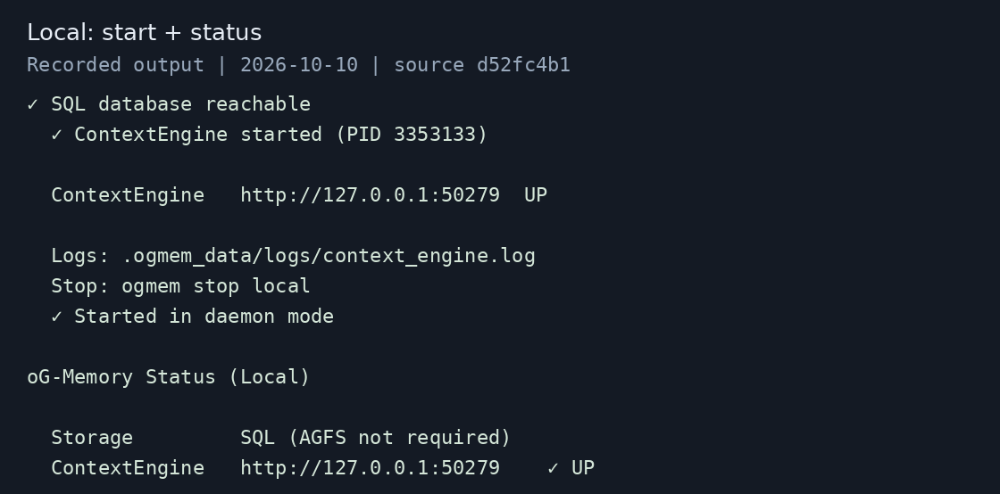
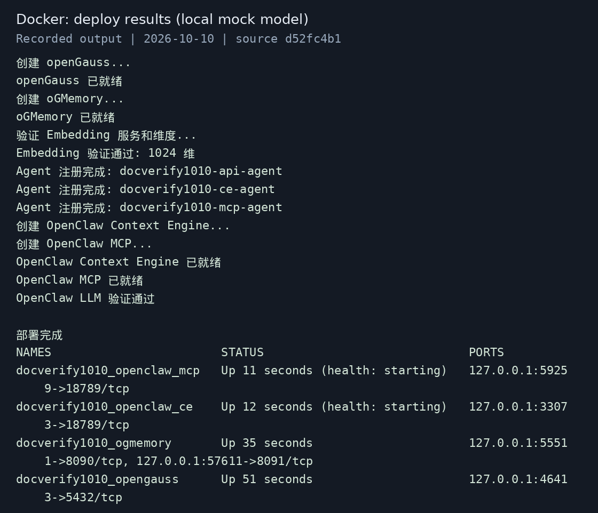
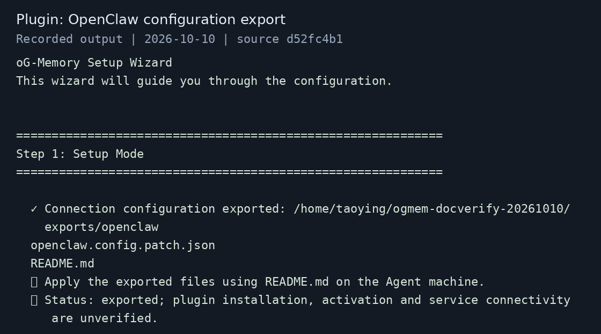

# oGMemory 快速安装

按下面顺序操作：**安装 CLI → 选择一种模式 → 检查运行结果**。以下命令使用 Linux Bash，在 `oGMemory` 项目根目录执行。

| 模式 | 适用场景 | 需要准备 |
| --- | --- | --- |
| Local | 本机启动 oGMemory | Python 3.11+、已有数据库、LLM 和 Embedding 服务 |
| Docker | 一次部署数据库、oGMemory 和 OpenClaw | Python 3.11+、Docker、ARM64、LLM 和 Embedding 服务 |
| Plugin | 为已有 Agent 生成接入配置 | Python 3.11+、已有 Agent 和已启动的 oGMemory |

## 1. 安装 CLI

```bash
git clone --branch dev https://atomgit.com/opengauss/oGMemory.git
cd oGMemory
python3 -m venv .venv
source .venv/bin/activate
python -m pip install --upgrade pip
python -m pip install -e .
ogmem --help
```

显示 `onboard`、`start`、`stop` 等子命令即安装成功。重新打开终端后，先进入项目并激活 `.venv`。依赖下载失败时，检查 pip 镜像源或使用 `--index-url https://pypi.org/simple` 重试。

Local、Docker 需要填写 LLM 和 Embedding 的 URL、模型、API Key；Embedding 还需填写实际向量维度。OpenAI 兼容 Embedding 接口选择 `openai`。服务认证 Key 与模型 API Key 是不同的凭据。

## 2. 选择一种安装模式

### Local：连接已有数据库

默认使用 openGauss 的 SQL 和向量存储，不需要 AGFS。先请数据库管理员为已有应用用户创建 PG 兼容数据库并授权（替换 `your_user`）：

```sql
CREATE DATABASE ogmemory OWNER your_user DBCOMPATIBILITY 'PG';
\c ogmemory
GRANT USAGE, CREATE ON SCHEMA public TO your_user;
```

选择未占用的 HTTP 端口，再运行向导（默认 8090；端口通过参数指定）：

```bash
ogmem onboard --mode local --port 8090
```

依次填写 LLM、Embedding、数据库配置，连接串示例：

```text
host=127.0.0.1 port=5432 dbname=ogmemory user=your_user password=your_password
```

向导中的选项按以下方式选择：

- `Initialize schema?`：首次安装选 **Yes**，在已有数据库中创建所需的表和索引；检查或初始化失败时，修正错误后重新运行向导。
- `Run pip install -e . ?`：已完成第 1 节的依赖安装，选 **No**，跳过重复安装。
- `Start services now?`：选 **Yes** 可立即启动；也可以选 **No**，先保存配置，再执行下面的命令启动。

如果已在向导中启动，只需执行 `ogmem status`；否则执行：

```bash
ogmem start local --daemon
ogmem status
```

**成功标志：ContextEngine 为 UP。** 配置默认保存为 `config/ogmem.yaml`；已有 `OGMEM_CONFIG`（包括 `config/.env` 中的设置）时使用它指定的文件。



*实测日志图：启动及状态检查成功；图中 50279 是测试端口，实际以向导配置为准。*

准备第 3 节的验证参数；将端口和服务 Key 改成实际值：

```bash
export OGMEM_URL='http://127.0.0.1:8090'
export OG_ACCOUNT_ID='acct-demo' OG_USER_ID='u-alice' OG_API_AGENT_ID='main'
export OGMEM_SERVICE_KEY=''  # 启用认证时填写该身份的服务 Key
```

### Docker：一体化部署

当前 quickstart 使用 **ARM64 发布镜像**，不自动构建当前源码。先确认 `docker info` 成功，再选择未占用端口和唯一实例名：

```bash
ogmem onboard --mode docker \
  --instance-name demo \
  --opengauss-port 15432 --port 18090 --mcp-port 18091 \
  --openclaw-ce-port 18790 --openclaw-mcp-port 18791
```

填写模型配置，模型服务须能被宿主机及容器访问。Docker 默认地址池耗尽时，需由管理员为实例分配可用子网后重试。`Start containers now?` 选 **Yes**；选 No 时执行向导打印的完整启动命令。配置保存在 `.ogmem_data/onboard-docker/ogmemory.env`。

部署成功后：

```bash
source .ogmem_data/onboard-docker/ogmemory-runtime.env
export OGMEM_URL="http://${PUBLISH_IP}:${OGMEM_HTTP_HOST_PORT}"
export OGMEM_SERVICE_KEY="${OG_TENANT_API_KEY}"
docker ps --filter "name=${INSTANCE_NAME}_"
```

**成功标志：四个容器启动，模型预检和 MCP 探测通过。** 账号、用户和 Agent 身份由运行参数载入，继续第 3 节时保留这些值。



*实测日志图：四个容器部署及连通性检查通过，使用本地模拟模型；不代表真实模型抽取效果。测试端口与上面的示例端口不同。*

OpenClaw 对话示例、重建及数据清理见 [Docker 一键部署与体验指南](https://gitcode.com/opengauss/oGMemory/blob/dev/deploy/user-quickstart/README_zh.md)。

### Plugin：接入已有 Agent

以 OpenClaw 为例（先启动 oGMemory）：

```bash
ogmem onboard --mode plugin --agent openclaw
```

填写 Agent 可访问的 oGMemory HTTP 基础地址（如 `http://127.0.0.1:8090`，不加 `/api/v1`）、服务 Key 和身份。远程 Agent 应填写服务器地址。

向导生成 `ogmem-client-config/openclaw/openclaw.config.patch.json` 和 `README.md`。**按生成的 README 安装插件、合并配置并重启 Gateway**，再检查：

```bash
openclaw plugins list
openclaw config get plugins.slots.contextEngine
```

检查命令须使用与 Gateway 相同的运行用户及配置路径，避免读取另一份配置。

**成功标志：插件已启用，槽位为 `og-memory-context-engine`。** 向导只生成配置，不安装 Agent、不启动服务，也不自动修改 Agent 配置。



*实测日志图：仅验证配置导出；插件安装、启用和连接须在 Agent 上执行上述步骤确认。*

其他 Agent 使用 `ogmem onboard --help` 查看选项；未适配的 Agent 可导出 MCP 配置：

```bash
ogmem onboard --mode plugin --agent other --mcp-url http://127.0.0.1:18091/mcp
```

按导出 README 应用配置。Local 仅启动 HTTP 服务时，还需启动 MCP（`ogmem mcp --transport streamable-http`）；Docker 已发布 MCP 端点。

## 3. 验证服务

Local 或 Docker 设置上述参数后执行：

```bash
curl -fsS "${OGMEM_URL}/api/v1/health"
```

返回健康状态表示 HTTP 服务可连接。**健康检查不能代替模型调用验证。** 下面使用新会话写入和检索；真实模型调用会产生费用。

<details>
<summary>展开：写入一条信息，再从新会话检索</summary>

```bash
python - <<'PY'
import json, os, uuid
identity = {k: os.environ[v] for k, v in [
    ("accountId", "OG_ACCOUNT_ID"), ("userId", "OG_USER_ID"),
    ("agentId", "OG_API_AGENT_ID")]}
requests = [
    ("ogmem-write.json", {**identity, "sessionId": uuid.uuid4().hex,
      "forceExtract": True, "wait": True,
      "messages": [{"role": "user", "content": "我的名字是 Alice，我是一名后端工程师。"}]}),
    ("ogmem-query.json", {**identity, "sessionId": uuid.uuid4().hex,
      "prompt": "Alice 是做什么工作的？"})]
for path, data in requests:
    with open(path, "w", encoding="utf-8") as f:
        json.dump(data, f, ensure_ascii=False)
PY

curl -sS --max-time 600 "${OGMEM_URL}/api/v1/after_turn" \
  -H 'Content-Type: application/json' -H "X-API-Key: ${OGMEM_SERVICE_KEY}" \
  -H "X-Account-ID: ${OG_ACCOUNT_ID}" -H "X-User-ID: ${OG_USER_ID}" \
  --data-binary @ogmem-write.json -w '\nHTTP_STATUS:%{http_code}\n'

curl -sS --max-time 120 "${OGMEM_URL}/api/v1/compose" \
  -H 'Content-Type: application/json' -H "X-API-Key: ${OGMEM_SERVICE_KEY}" \
  -H "X-Account-ID: ${OG_ACCOUNT_ID}" -H "X-User-ID: ${OG_USER_ID}" \
  --data-binary @ogmem-query.json -w '\nHTTP_STATUS:%{http_code}\n'

rm -f ogmem-write.json ogmem-query.json
```

写入应返回 HTTP 200、`ok: true`，并确认处理完成；失败、仍在处理或超时应查看日志。检索应返回 HTTP 200，并在上下文中包含 Alice 的职业。`compose` 返回记忆上下文，不直接生成最终回答；召回归档原文也不能单独证明抽取成功。

</details>

## 4. 停止或修改配置

| 操作 | 命令或步骤 |
| --- | --- |
| Local 日志 | `ogmem logs --service ogmem` |
| Local 修改配置 | `ogmem stop local` → 重跑向导 → `ogmem start local --daemon` |
| Docker 日志 | `docker logs "${INSTANCE_NAME}_ogmemory" --tail 100` |
| Docker 停止 | `docker stop "${INSTANCE_NAME}_openclaw_ce" "${INSTANCE_NAME}_openclaw_mcp" "${INSTANCE_NAME}_ogmemory" "${INSTANCE_NAME}_opengauss"` |
| Docker 修改配置 | 修改 `ogmemory.env`，执行向导打印的同一部署命令重建；默认保留数据 |
| Plugin 修改配置 | 重新导出并按 README 合并；输出冲突时指定新的 `--output-dir` |

Local 重复向导允许复用或修改配置，保留额外自定义项；配置变化会备份，运行中禁止重新配置。更多参数见 [配置说明](ogmem_configuration.md)，接口见 [API 说明](ogmem_api.md)。

## 5. 卸载

**先找到自己的安装方式，只执行对应小节。** 如果 Agent 已接入 oGMemory，先按 Plugin 小节解除接入，再卸载服务。

| 你的安装方式 | 卸载后会发生什么 | 记忆数据是否保留 |
| --- | --- | --- |
| Local | 停止本地服务，卸载 `ogmem` 命令 | 保留在原数据库或数据目录 |
| Docker | 删除本实例的四个容器和网络 | 保留在原实例数据目录 |
| Plugin | Agent 停止使用 oGMemory | 保留在 oGMemory 服务端 |

默认步骤保留数据。**只有确定以后不再需要这些记忆时，才执行“可选：删除数据”。**

### Local 卸载

**在哪里执行：** 在安装 oGMemory 的机器上，进入安装时的 `oGMemory` 项目目录。以下命令使用本教程创建的 `.venv`；如果你的虚拟环境在其他位置，请替换路径。

**第 1 步：停止服务。**

```bash
source .venv/bin/activate
ogmem stop local
```

确认停止成功后，再继续；停止失败时先查看报错，不要直接删除安装环境。

**第 2 步：卸载命令行工具。**

```bash
python -m pip uninstall context-engine
```

按提示输入 `y` 确认。`context-engine` 是 oGMemory 的 Python 包名。完成后，本虚拟环境中的 `ogmem` 命令被移除，数据库和配置仍保留。

**第 3 步（可选）：删除专用虚拟环境。**

如果 `.venv` 只用于 oGMemory，可以删除它及其依赖包；其他程序也在使用这个环境时，跳过此步。

```bash
deactivate
rm -rf -- .venv
```

<details>
<summary>可选：连同 Local 配置和记忆数据一起删除</summary>

1. 备份需要保留的记忆和配置。
2. 删除本实例实际使用的配置文件及备份，默认是 `config/ogmem.yaml`；设置过 `OGMEM_CONFIG` 时，删除它指向的文件。只清理 `config/.env` 中属于 oGMemory 的设置。
3. 本教程的 SQL 模式把记忆保存在数据库中。若 `ogmemory` 数据库仅供本实例使用，用数据库所有者或管理员连接 **`postgres` 数据库**，再执行：

   ```sql
   DROP DATABASE ogmemory;
   ```

   数据库名称不同请替换；仍有连接时，先确认并停止使用它的服务。**共享数据库不要删除。**
4. 按配置中的实际路径清理本实例的数据目录和日志。`.ogmem_data` 还可能存放 Docker 数据，不要直接删除整个目录。

</details>

### Docker 卸载

**在哪里执行：** 在运行容器的机器上，进入执行 Docker 向导时的 `oGMemory` 项目目录。

**第 1 步：确认要卸载的实例。**

```bash
source .ogmem_data/onboard-docker/ogmemory-runtime.env
printf '实例名称：%s\n数据目录：%s\n' "$INSTANCE_NAME" "$STACK_DIR"
docker ps -a --filter "name=${INSTANCE_NAME}_"
```

本教程的实例名是 `demo`。确认输出属于要卸载的实例，再继续。使用自定义运行环境文件时，替换 `source` 后的路径；文件加载失败时不要继续。

**第 2 步：停止并删除这四个容器，再删除网络。**

```bash
docker stop "${INSTANCE_NAME}_openclaw_ce" "${INSTANCE_NAME}_openclaw_mcp" \
  "${INSTANCE_NAME}_ogmemory" "${INSTANCE_NAME}_opengauss"
docker rm "${INSTANCE_NAME}_openclaw_ce" "${INSTANCE_NAME}_openclaw_mcp" \
  "${INSTANCE_NAME}_ogmemory" "${INSTANCE_NAME}_opengauss"
docker network rm "${INSTANCE_NAME}_ogmemory_net"
```

完成后，本实例的服务停止，容器和网络被删除。**数据库、记忆、镜像仍保留。** 保留实例数据目录中的 `secrets.env`，以及生成的 `ogmemory.env`、`ogmemory-runtime.env`，以后可用原部署命令重建容器。

<details>
<summary>可选：连同 Docker 记忆数据一起删除</summary>

先完成上面的容器删除，再备份需要保留的数据。按本教程部署的 `demo` 实例，数据目录如下：

```bash
ls -ld -- .ogmem_data/onboard-docker/ogmemory-demo
```

确认目录正确、数据不再需要后执行；**此命令会删除数据库和全部记忆，无法恢复：**

```bash
sudo rm -rf -- .ogmem_data/onboard-docker/ogmemory-demo
```

实例名或部署目录不同，请替换为第 1 步显示的实际数据目录。确认 `ogmemory.env`、`ogmemory-runtime.env` 不再用于其他实例后，再删除这两个文件。

如需一并卸载 `ogmem` 命令，在安装它的虚拟环境中执行 `python -m pip uninstall context-engine`。Docker 软件和其他实例不需要卸载。

</details>

### Plugin 卸载（以 OpenClaw 为例）

**在哪里执行：** 在运行 OpenClaw 的机器上，使用启动 Gateway 时的用户和配置环境。Plugin 向导只生成配置，删除导出目录不能解除已生效的接入。

**第 1 步：恢复 OpenClaw 原来的记忆引擎。**

备份当前生效的 `openclaw.json`，找到 `plugins.slots.contextEngine`，将 `og-memory-context-engine` 改回接入前的引擎。接入前没有这一项时，删除 `contextEngine` 这一项。保留同级的其他配置，并确保修改后仍是合法 JSON。

**第 2 步：移除或停用 oGMemory 插件。**

- 如果你通过 `openclaw plugins install` 安装了插件，执行：

  ```bash
  openclaw plugins uninstall og-memory-context-engine --keep-files
  ```

  按提示确认；这会解除安装登记，保留插件源文件。
- 如果插件随镜像内置，在 `openclaw.json` 中将 `plugins.entries.og-memory-context-engine.enabled` 改为 `false`，并删除该条目中的 `config`（包含连接地址和密钥）。

如果曾在 `plugins.allow` 或 `plugins.load.paths` 中添加 oGMemory，也移除对应项；保留其他插件。

**第 3 步：重启并确认解除接入。**

按原来的服务或容器管理方式重启 Gateway，然后执行：

```bash
openclaw plugins list
```

确认 `og-memory-context-engine` 已被移除或处于停用状态。

**第 4 步（可选）：删除导出的配置。**

在生成配置时的 `oGMemory` 项目目录执行；使用过自定义输出目录时，请替换路径：

```bash
rm -rf -- ogmem-client-config/openclaw
```

其他 Agent：按导出目录中的 README 找到生效配置，移除 oGMemory 的插件、Hook 或 MCP 接入及密钥，重启 Agent，再删除导出目录。通用 MCP 模式默认导出到 `ogmem-client-config/mcp`。

**到这里，Agent 已停止使用 oGMemory，服务端记忆仍保留。** 如果 oGMemory 服务也不再使用，再执行 Local 或 Docker 卸载步骤。
