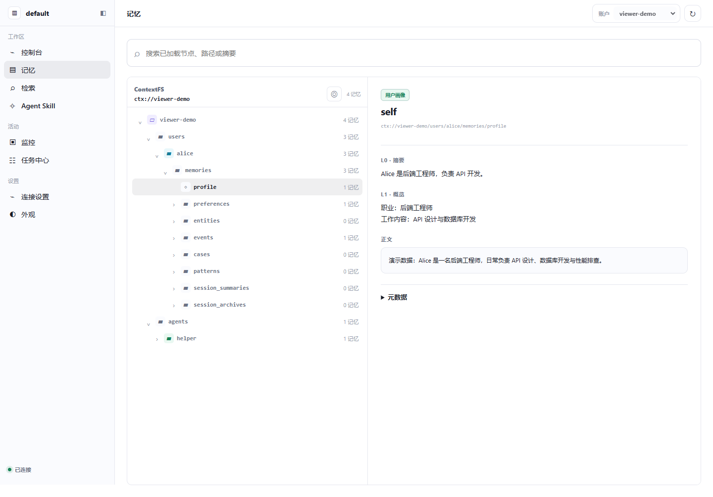
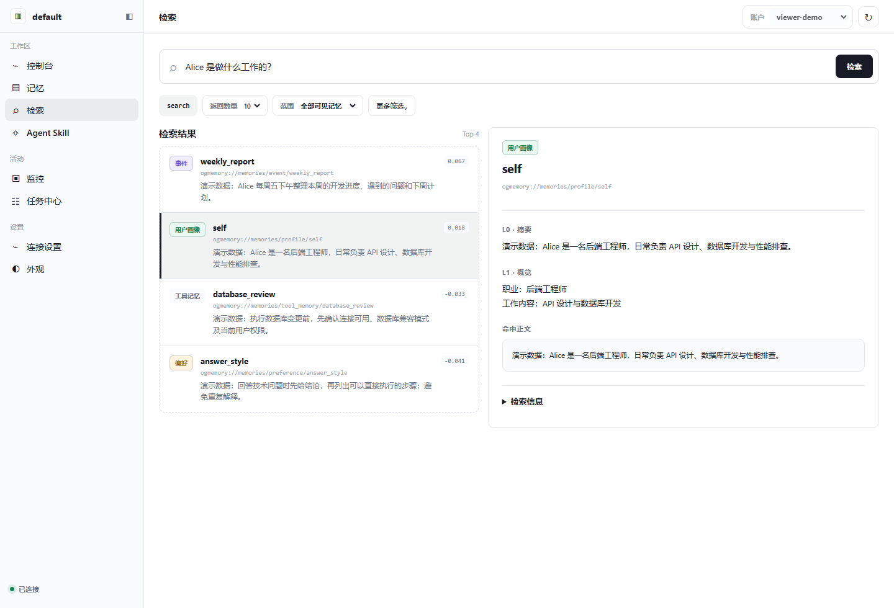
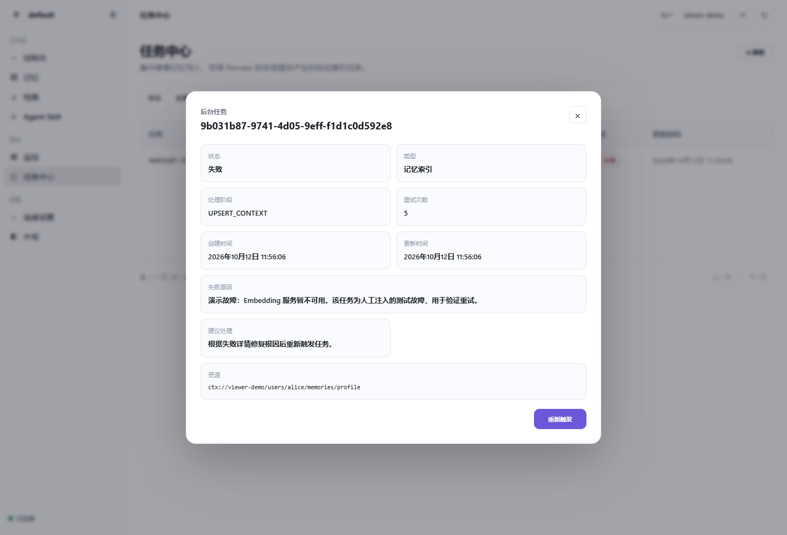

# oGMemory 记忆可视化

记忆查看器用于浏览已保存的记忆、查看分层内容、验证检索结果，以及检查模型用量和后台任务。它内置于 oGMemory HTTP 服务，**无需单独安装前端**。

先按 [安装指南](ogmem_install.md) 启动服务，再按下面步骤操作。

## 1. 打开页面

在浏览器中打开 oGMemory 的 HTTP 地址，加上 `/memory-viewer/`：

| 部署方式 | 地址示例 |
| --- | --- |
| Local，HTTP 端口为 8090 | `http://127.0.0.1:8090/memory-viewer/` |
| Docker，HTTP 映射端口为 18090 | `http://127.0.0.1:18090/memory-viewer/` |
| 已有 Agent 使用 Plugin | 打开它连接的 oGMemory 服务地址，而不是 Agent 的 Gateway 地址 |

端口以实际配置为准。`8091` 等 MCP 端口不提供这个页面。

**版本要求：** 当前源码包含记忆查看器；quickstart 使用的 `ogmemory:poc_0807` 发布镜像不包含该功能。建议先用当前源码的 Local 模式体验；Docker 需使用包含可视化功能的镜像，仅重启旧镜像不会增加页面。

### 服务在远程服务器上

浏览器中的 `127.0.0.1` 指向浏览器所在机器。如果服务仅监听服务器本地地址，可以通过 SSH 转发访问。例如，服务器 HTTP 端口为 18090：

```bash
ssh -N -L 18090:127.0.0.1:18090 -p 22 your_user@server_ip
```

将 SSH 端口、用户名、服务器地址改为实际值；Local 服务使用 8090 时，也应替换转发端口。保持该终端运行。浏览器使用命令中 `-L` 后的第一个端口；上面的示例打开 `http://127.0.0.1:18090/memory-viewer/`。

## 2. 设置认证和查看范围

- **未启用权限控制**：通常不需要填写 Key，页面按服务默认身份显示数据。
- **已启用权限控制**：点击左侧 **连接设置**，填写 oGMemory **服务 API Key**，点击 **保存并刷新**。这里不是 LLM 或 Embedding 的模型密钥。

页面根据 Key 的权限显示账户、用户和 Agent：

| 身份 | 可以查看的范围 |
| --- | --- |
| Root | 可切换其管理的账户 |
| 账户管理员 | 本账户内的用户和 Agent |
| 普通成员 | 自己和授权共享的记忆 |

选择对应账户，并在目录树中展开用户或 Agent。写入时使用的身份与当前查看范围不一致，可能看不到相应记忆。

## 3. 浏览记忆

1. 点击左侧 **记忆**。
2. 展开目录树，找到用户画像、偏好、事件、工具记忆或会话归档等目录。
3. 点击一个节点，在右侧查看内容。

| 内容 | 含义 |
| --- | --- |
| L0 · 摘要 | 简短说明，用于快速判断内容是否相关 |
| L1 · 概览 | 比摘要更详细的内容概述 |
| 正文 | 保存的完整内容 |
| 元数据 | 节点的类型、时间等附加信息，以实际返回字段为准 |



*展开 alice 的目录并点击 profile，可在右侧查看摘要、概览和正文。*

顶部搜索框用于**过滤已加载的节点、路径或摘要**，不是全库语义检索。服务刚写入数据后，可点击刷新，再展开相关目录。

**体验示例：** 完成安装指南中 Alice 的写入示例后，选择同一用户，查看相关记忆或会话归档。看到归档原文说明会话内容已保存，不代表模型一定抽取出了独立的结构化记忆。

## 4. 验证检索

1. 点击左侧 **检索**。
2. 输入问题，例如 `Alice 是做什么工作的？`。
3. 选择 **范围** 和 **返回数量**，点击 **检索**。
4. 点击结果，在右侧查看摘要、概览、命中正文及检索信息。

**更多筛选** 支持记忆类型、最低分数和 Session ID。第一次验证可先不设置这些条件，避免过滤掉预期结果。

这里返回的是相关记忆，**不会直接生成最终问答答案**。目录中有内容但检索不到时，先确认身份范围，再查看索引任务是否完成。



*提交问题后点击结果查看命中内容；本图使用模拟向量，排序与分数不作为检索质量依据。*

## 5. 查看运行情况

| 页面 | 用途 |
| --- | --- |
| 控制台 | 查看可见用户、Agent、记忆和 Skill 概况，以及 LLM / Embedding 用量 |
| Agent Skill | 查看已发布的 Skill 文档 |
| 监控 | 检查服务、存储、模型、索引等组件状态 |
| 任务中心 | 查看记忆写入、目录更新和会话提交产生的后台索引任务 |

模型用量页默认展示最近 **14 天**趋势，日期按 **UTC** 统计，Token 以模型返回并被服务记录的用量为准。

在 **任务中心** 点击任务查看状态、处理阶段和失败信息。修复失败原因后，若后端支持手动重试，可点击 **重新触发**；只有失败任务支持该操作。它会重新安排后台处理，不是单纯刷新页面。



*该失败任务为人工注入的演示故障。实测点击“重新触发”后返回 HTTP 200，任务重新排队并完成处理。*

页面主要用于查看和检索；新增记忆仍通过 Agent 或 HTTP API 完成，写入与验证步骤见 [安装指南](ogmem_install.md)。

## 6. 常见问题

| 现象 | 检查方法 |
| --- | --- |
| 页面无法打开 | 检查服务是否启动、HTTP 端口是否正确；远程服务确认网络或 SSH 转发 |
| 返回 404 | 确认地址包含 `/memory-viewer/`，检查运行代码或镜像是否包含查看器 |
| 页面能打开，但数据请求返回 401 / 403 | 在连接设置中检查服务 Key 是否有效、权限是否足够 |
| 目录为空 | 确认当前账户、用户和 Agent；检查记忆是否已抽取并保存，不能只看对话已结束 |
| 目录有数据，检索没有结果 | 检查查询范围和筛选条件，再到任务中心检查索引任务 |
| 没有“重新触发”按钮 | 任务可能不是失败状态，或当前存储后端不支持手动重试 |
| 模型用量为空 | 检查服务是否已有用量记录；页面不会凭空补齐历史统计 |

查看服务日志：

```bash
# Local
ogmem logs --service ogmem

# Docker：先载入部署运行参数
source .ogmem_data/onboard-docker/ogmemory-runtime.env
docker logs "${INSTANCE_NAME}_ogmemory" --tail 100
```

配置文件及修改方法见 [配置指南](ogmem_configuration.md)，接口见 [API 说明](ogmem_api.md)。
