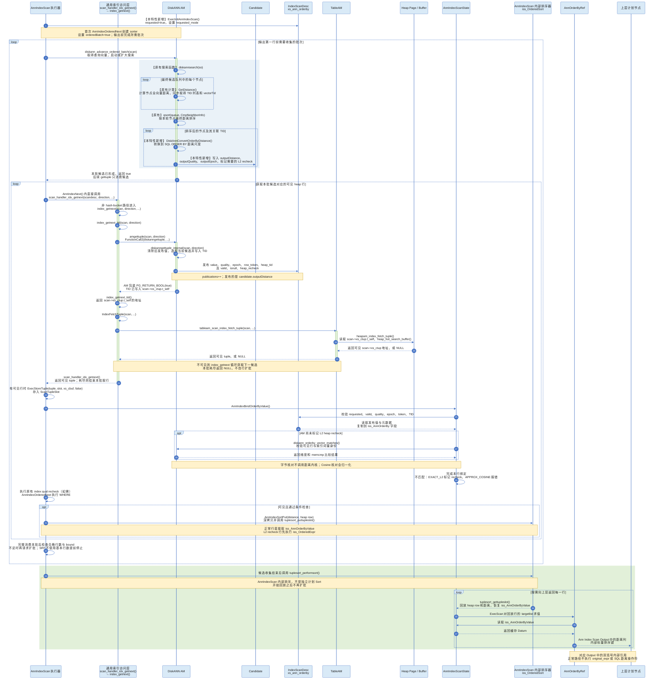

# ANN 距离复用源码深度解读

本文按“计划准备 → AM 计算与发布 → heap 取行 → 距离绑定与重算 → 有序输出 → 表达式引用 → 验证证据”的顺序，解读 ANN ORDER BY 距离复用特性。此前逐问积累的代码、字段解释、例子和边界讨论均归入对应章节；原问题可通过文末索引直接查找。分析基线为：

- 源码仓库：`/home/qiumc/data/code/cpp/openGauss-server`
- 基线提交：`84f0a21f543da7ffaa9582d44d0ff0772068c9ae`
- 距离复用对象：DiskANN `Ann Index Scan`
- 相关 GUC：`ann_orderby_distance_reuse = off|l2|cosine|all`
- 本轮结构整理：2026-09-17；文中的源码行号是基线定位参考，代码移动后请优先按函数名查找
- 本文状态约定：“当前实现”指上述基线行为；“改进建议/尚未实现”不代表内核已经支持

本文所说的“没有重复计算”，必须区分两类计算：

1. DiskANN 为图搜索、候选比较和最终 rerank 所做的 AM 内部距离计算。这是索引搜索本身需要的，可能对多个候选、多轮执行，不能也不应声称只有一次。
2. AM 已经得到当前候选的最终距离后，执行器为了 `ORDER BY` 或投影再次执行 SQL 操作符 `<->`／`<=>`。距离复用特性要消除的是这一类重复计算。

---

<a id="overview"></a>

## 1. 阅读导航与核心数据流

### 1.1 先明确复用的对象

双括号只能证明 EXPLAIN 发现了 `AnnOrderByRef`，不能单独证明运行时没有执行原距离表达式。完整证明需要把下面的控制流串起来：

```text
DiskANN AM 计算最终候选距离
    ↓
转换到 SQL ORDER BY 距离尺度
    ↓
保存到 candidate.outputDistance
    ↓
发布到 IndexScanDesc.xs_ann_orderby
    ↓
可见 heap 行与该发布值完成身份绑定
    ↓
有序候选物化直接读取 iss_AnnOrderByValue
    ↓
AnnOrderByRef 执行时直接返回 iss_AnnOrderByValue
```

<a id="contents"></a>

### 1.2 阅读顺序与目录

首次阅读按章节顺序建立完整调用链；只定位某个问题时使用[附录 A](#question-index)。如果重点是证明“没有重复计算”，先阅读本节数据流和第 2 章时序图，再用第 12 章证据表逐项核验。

| 章节 | 主要解决的问题 |
|---|---|
| [2. 完整执行时序](#sequence) | 搜索、发布、取行、排序、Output 怎样衔接；保留完整泳道和全部步骤 |
| [3. 计划改写与执行初始化](#planning) | 距离何时变成引用；requested 和 requested_mode 分别管什么 |
| [4. AM 搜索、rerank 与转换](#am-distance) | GetDistance 是否原有、返回什么；L2 开方和 Cosine 转换在哪做 |
| [5. 候选缓存与扫描生命周期](#candidate-state) | outputDistance/Quality/Epoch、so、scanEpoch 及 rescan 防串值 |
| [6. AM 逐行发布](#am-publication) | candidate 如何写入 xs_ann_orderby；publications 统计什么 |
| [7. 通用索引层与可见行](#heap-fetch) | TID 与 tuple 的区别；调用/返回关系、GPI、TableAM 及 slot 安装 |
| [8. Slot 内存与并发](#slot-memory) | 浅引用、深拷贝、pin、页锁及并发 INSERT/UPDATE/DELETE |
| [9. 行绑定与 recheck](#row-binding) | 校验每个字段的原因、错绑来源、L2 重算及 Cosine 当前报错策略 |
| [10. 候选排序与保序边界](#ordering) | AM rerank 与内部 sorter 的关系；什么时候能省掉排序 |
| [11. 距离引用与 EXPLAIN](#references) | 两套表达式引擎如何读缓存；双括号与上层槽位引用 |
| [12. 代码证据与动态核验](#verification) | 哪些场景还会重算；计数器、跟踪方式及 UNION ALL 分支归因 |
| [附录 A. 原问题索引](#question-index) | 按以前的问题直接跳到新章节 |
| [附录 B. 源码定位表](#source-index) | 按职责定位文件和关键函数 |

### 1.3 三个经常混淆的层次

| 层次 | 本文使用的名称 | 实际含义 |
|---|---|---|
| AM 内的标量 | `distance`、`outputDistance` | 内部 rerank 值与转换后的可用排序值；二者的尺度可能不同 |
| 节点之间的交接 | `xs_ann_orderby`、`iss_AnnOrderByValue` | 前者是 AM 发布通道，后者是执行器对当前行/回放行的缓存 |
| 计划和客户端输出 | EXPLAIN `Output`、最终 SELECT 列 | 扫描 targetlist 可包含内部排序键；客户端未必显示该键 |

阅读异常处理和排序章节时还要区分：候选距离数值是否正确、已选候选的输出顺序是否正确、ANN 是否召回全表真实 Top-K。这是三个分别需要验证的问题。

<a id="sequence"></a>

## 2. 完整执行时序与逐步说明

### 2.1 阅读泳道与当前有序路径

下图对应启用距离复用的普通 Heap DiskANN 有序路径。浅蓝色表示 AM 计算、转换和候选缓存，浅绿色表示执行器物化、排序及投影，黄色说明框标出边界。State、Candidate、Channel 泳道表示所属状态/字段的读写，并非独立线程；带函数名的箭头按代码中的调用方向理解，字段传递和返回箭头按文字标注理解。

这里明确区分两个阶段：`AnnIndexOrderedNext()` 先通过 `diskann_advance_ordered_batch()` 搜索并形成整批候选，再通过通用索引层逐行获取 TID 和可见 heap 行。`orderedBatch=true` 时，`diskanngettuple_internal()` 只消费本批候选，不在其内部再次启动搜索。旧图把“取 TID 触发搜索”和“执行器先形成批次”合在一起，本图按当前代码拆开。

### 2.2 完整 Mermaid 时序图




### 2.3 全部 38 步：调用、字段流转和原问答编号

下表与图中 `autonumber` 一一对应。原 34 步的每项说明均保留；新增“推进批次、返回已形成批次、条件检查、扩批判定”4 个动作并调整调用顺序。原编号列用于查找之前的问题。`Note`、`loop`、`opt`、`rect` 和 `activate/deactivate` 不占步骤号；不可见/不合格候选及耗尽分支按图中说明跳过后续行处理。

| 新步骤 | 原编号 | 动作 | 是否由距离复用及后续修复新增 | 说明 |
|---:|---:|---|---|---|
| 1 | 1 | 执行器设置 `xs_ann_orderby.requested/requested_mode` | 是 | `requested` 是扫描级布尔总开关：表示本次执行已通过计划、物理索引、执行形态和 GUC 复核，AM 必须准备并按候选行发布可复用距离；`requested_mode` 是从当前 GUC 复制的运行期允许模式位图，说明允许发布 L2、Cosine 或两者，供 AM 选择转换分支并校验距离质量 |
| 2 | 新增 | diskann_advance_ordered_batch(scan) | 有序协议新增 | AnnIndexOrderedNext 设置 orderedBatch 后，在本批取行之前调用；从 scan->opaque 取得 so，准备查询向量、确定搜索宽度并启动 diskannsearch。 |
| 3 | 7 | `diskannsearch()` | 否 | 原有 DiskANN 搜索入口。当前主路径由 `diskann_advance_ordered_batch` 调用；gettuple 不再次启动本轮搜索。 |
| 4 | 8 | `GetDistance()` | 否 | 原有的逐候选最终全向量距离计算；后来扩展输出参数以刷新身份信息。`full_distance_evaluations` 在最终候选循环中计数，不涵盖图搜索的全部距离调用。 |
| 5 | 9 | `qsort(queue, CmpNeighborInfo)` | 否 | 原有候选队列重排 |
| 6 | 10 | `DiskAnnConvertOrderByDistance()` | 是 | 把原有 AM 距离转换到 SQL `ORDER BY` 尺度 |
| 7 | 11 | 写入 `outputDistance/outputQuality/outputEpoch` | 是 | 为发布和安全复用保存数值、质量和扫描代次 |
| 8 | 新增 | 本批形成后返回执行器 | 有序协议新增 | 返回 true 表示本轮已处理，执行器开始消费候选；空输出不必然表示搜索耗尽，达到迭代上限/无有效搜索条件才结束推进。 |
| 9 | 2 | `AnnIndexNext()` 调用 `scan_handler_idx_getnext()` | 否 | 这是 C/C++ 代码中的直接函数调用，不是将两段代码平铺在一起；当前正在执行 `AnnIndexNext()`，它在非 UStore 分支的取行循环内调用 `scan_handler_idx_getnext()`，从而进入通用索引扫描层 |
| 10 | 3 | `scan_handler_idx_getnext()` 进入 `index_getnext()` | 否 | `scan_handler_idx_getnext()` 先区分普通索引与 bucket 索引；对“bucket + 全局分区索引”还会进入跨分区、跨 bucket 路径。本特性当前支持的普通非 bucket 扫描会直接调用 `index_getnext()` |
| 11 | 4 | `index_getnext()` 调用 `index_getnext_tid()` | 否 | 从“取可见 tuple”通用循环进入“取下一个索引候选 TID”的通用 AM 分派函数 |
| 12 | 5 | `index_getnext_tid()` 调用 DiskANN `amgettuple` | 否 | 第 12 步发生在第 11 步调用进入的 `index_getnext_tid()` 内部；它根据 `relam` 选中 DiskANN AM，通过 `FunctionCall2` 回调 `diskanngettuple()` |
| 13 | 6 | `diskanngettuple()` 调用 `diskanngettuple_internal()` | 否 | DiskANN SQL AM 包装进入内部实现 |
| 14 | 12 | 写入 `scan->xs_ann_orderby` | 是 | 向 AM/执行器专用通道发布当前候选距离及身份 |
| 15 | 13 | DiskANN `amgettuple` 返回 `true` | 发布部分是新增 | TID 已写入 `scan->xs_ctup.t_self`，布尔返回协议是原有的 |
| 16 | 14 | `index_getnext_tid()` 返回 TID 指针 | 否 | 返回 `&scan->xs_ctup.t_self` |
| 17 | 15 | `index_getnext()` 调用 `IndexFetchTuple()` | 否 | 通用索引层根据当前 `scan` 请求可见 heap 行 |
| 18 | 16 | `IndexFetchTuple()` 调用 TableAM | 否 | 调用 `tableam_scan_index_fetch_tuple(scan, ...)` |
| 19 | 17 | TableAM 进入 HeapAM 查找 | 否 | `heapam_index_fetch_tuple()` 读取 `scan->xs_ctup.t_self` 并调用 `heap_hot_search_buffer()` |
| 20 | 18 | HeapAM 把可见 `&scan->xs_ctup` 或 `NULL` 返回 TableAM | 否 | 在 heap page 上完成 HOT/MVCC 查找 |
| 21 | 19 | TableAM 把可见 tuple 或 `NULL` 返回通用索引层 | 否 | 不可见则 `index_getnext()` 继续取下一 TID |
| 22 | 20 | `scan_handler_idx_getnext()` 把 tuple 返回 `AnnIndexNext()` | 否 | 通用索引层退回 AnnIndexScan 执行器 |
| 23 | 21 | `ExecStoreTuple()` 把可见 tuple 存入 `ScanTupleSlot` | 否 | 普通 Heap 分支浅引用 tuple 并保持 buffer pin |
| 24 | 22 | `AnnIndexBindOrderByValue()` | 是 | 可见行出现后，才校验并绑定已发布距离 |
| 25 | 23 | 校验 `xs_ann_orderby` 通道 | 是 | `AnnIndexBindOrderByValue()` 先使当前 state 失效，再检查 `requested`、`valid`、`isnull`、质量、`heap_recheck`、`scan_epoch`、`row_token`及 TID 有效性，并要求发布 TID 与当前可见行位于同一 heap block；为允许 HOT 成员，这里不要求 offset 完全相等。缺失、过期或串行时报错 |
| 26 | 24 | 读取发布距离和元数据 | 是 | 这是对 `IndexScanDesc` 共享状态的直接读取，不是真实的函数返回；代码把 `value/isnull/quality/heap_recheck/epoch/token` 复制到 `AnnIndexScanState.iss_AnnOrderBy*` |
| 27 | 25 | `diskann_orderby_vector_matches()` | 是 | 在 AM 未要求 heap recheck 时，取当前可见 heap 行的向量，与当前 DiskANN 候选节点中保存的向量做身份核对，防止旧索引的 TID 复用/合并导致距离绑到错行 |
| 28 | 26 | DiskANN 返回向量字节比较结果 | 是 | 比较维度并对 `float` 数组执行 `memcmp()`；可能包含 detoast/归一化，但不调用 L2/Cosine 距离内核。向量已被 AM 标记 L2 recheck 时跳过这次字节核对。 |
| 29 | 27 | 完成当前可见行与距离的身份绑定 | 是 | 向量匹配时保留已复制的 AM 距离；不匹配时，近似 Cosine 不允许静默回退而报错，精确 L2 则标记 `iss_AnnOrderByHeapRecheck=true`，后续仅对该行重算 |
| 30 | 新增 | index qual recheck 与 WHERE | 原有过滤，有序路径协调调用 | AnnIndexNext 完成必要的 indexqualorig 检查；AnnIndexOrderedNext 再执行 iss_OrderedQual。过滤失败跳过该行，不写入 sorter；避免 ExecScan 回放时重复执行同一个 WHERE。 |
| 31 | 28 | `AnnIndexSortPut()` 物化合格候选 | 是 | WHERE 过滤通过后，正常复用路径直接取 `iss_AnnOrderByValue`；将距离与 heap tuple 深拷贝后写入 `iss_OrderedSort`，内部调用通用 `tuplesort_puttupleslot()` |
| 32 | 新增 | 判断是否需要下一批 | 有序协议新增 | 必须消费完整批次（包括合并 TID）后再检查 qualified 与 limitCount；不足则扩大搜索，搜索上限等仍生效。目标含 SRF 时 bound=0，不以基本行数证明 Limit 已满足。 |
| 33 | 29 | `tuplesort_performsort()` 完成候选排序 | 调用点是新增 | `AnnIndexOrderedNext()` 收集完必要的完整 DiskANN batch 后，按第 1 列 `float8` 距离升序排序；`tuplesort` 框架本身是 openGauss 原有通用能力 |
| 34 | 30 | `tuplesort_gettupleslot()` 按排序结果回放 | 调用点是新增 | 从内部排序器取回“距离 + heap tuple payload”，重建 heap tuple 并存入 scan slot，同时把该回放行的距离重新写入 `iss_AnnOrderByValue`，避免误用收集阶段最后一行的值。重算键同样随 tuple 保存和回放，回放时清除 heap recheck 标志。 |
| 35 | 31 | 执行器对回放行的 targetlist 做投影求值 | 框架原有，节点新增 | `ExecScan()` 在 `AnnIndexOrderedNext()` 返回 scan slot 后执行通用投影；当距离 target entry 已被优化器改写时，求值对象是新的 `AnnOrderByRef` |
| 36 | 32 | `AnnOrderByRef` 读取 `iss_AnnOrderByValue` | 是 | 两套表达式执行引擎均先校验 scan state、`valid` 和 `quality`；正常路径只读取标量 Datum，不执行 `fallback/original_expr` |
| 37 | 33 | `AnnIndexScanState` 向 `AnnOrderByRef` 返回缓存 Datum | 是 | 设置 `isNull`、累加读取计数，并返回 `iss_AnnOrderByValue`；只有显式 L2 heap recheck 或未启用复用时才评估 fallback 表达式 |
| 38 | 34 | 距离作为 Ann Index Scan 的内部标量排序键交给上层 | 输出框架原有，值来源新增 | 上层 `Result`/`Merge Append`/`Limit` 消费的是 targetlist 投影结果；EXPLAIN 中的双层括号表明该表达式由内部 `AnnOrderByRef` 提供，正常路径不再执行 SQL 向量距离操作符 |


<a id="planning"></a>

## 3. 计划改写与执行初始化

先确定扫描输出是否改成距离引用，再根据本次实际打开的索引、扫描形态和 GUC 建立发布契约。这两次判定分别发生在规划期和执行初始化期。

<a id="planner-rewrite"></a>

### 3.1 规划期：把扫描距离表达式替换为 AnnOrderByRef

入口是 `rewrite_ann_orderby_distance_walker()`：

```cpp
foreach (lc, scan->scan.plan.targetlist) {
    TargetEntry* tle = (TargetEntry*)lfirst(lc);

    if (equal(tle->expr, orderExpr)) {
        AnnOrderByRef* ref = makeNode(AnnOrderByRef);
        ref->orderby_index = 0;
        ref->quality = (int)quality;
        ref->original_expr = tle->expr;
        tle->expr = (Expr*)ref;
    }
}
```

位置：`src/gausskernel/optimizer/plan/planner.cpp:713-725`。

这里有三个关键点：

1. 只替换 `AnnIndexScan` 自己 targetlist 中、与 `indexorderbyorig` 完全相等的表达式。
2. targetlist 的实际执行节点从 `OpExpr(<->)` 变成 `AnnOrderByRef`。
3. 原 `OpExpr` 只保存在 `original_expr` 中供回退和反解析使用。

替换在所有计划完成 `setrefs` 后执行：

```cpp
if (u_sess->attr.attr_sql.ann_orderby_distance_reuse != ANN_ORDERBY_REUSE_OFF)
    rewrite_ann_orderby_distance_refs(glob, top_plan);
```

位置：`src/gausskernel/optimizer/plan/planner.cpp:1140-1147`。

这可以证明正常计划中，扫描输出槽位的求值入口已经不再是原 `OpExpr`。但是，因为 `original_expr` 仍在树中，仅检查计划树中是否还能找到 `<->` 并不能判断是否会执行，还必须继续看表达式执行函数。

<a id="request-channel"></a>

### 3.2 执行初始化：requested 与 requested_mode

这两个字段共同形成“执行器→DiskANN AM”的扫描级请求契约，但职责不同：

```cpp
typedef struct AnnOrderByDistanceChannel {
    bool requested;      /* 本次扫描是否要求 AM 发布距离 */
    int requested_mode;  /* 本次扫描允许复用的距离类型位图 */
    /* 后续还有 valid/value/quality/epoch/token/TID 等当前行字段 */
} AnnOrderByDistanceChannel;
```

#### 3.2.1 requested：是否启用这条 AM 发布通道

`requested` 是一个 `bool` 总开关，回答的是“**本次物理扫描是否要求 DiskANN AM 提供可复用的 `ORDER BY` 距离**”。它不表示当前行已经有一个可用值；后者由逐行更新的 `valid` 表示。

| `requested` | 含义 | DiskANN AM 行为 |
|---|---|---|
| `false` | 执行器没有建立距离复用契约 | `DiskAnnConvertOrderByDistance()` 直接返回 `false`，AM 不生成、不发布专用距离值，执行器保留原始 SQL 表达式路径 |
| `true` | 执行器要求 AM 对本次扫描履行发布契约 | AM 必须对候选距离做尺度转换并逐候选发布；如果某个候选没有准备好 `outputDistance`，按内部契约破坏报错，不应静默把上一行的值或不明距离交给上层 |

执行器不是只要看到 DiskANN 就把它设成 `true`。只有以下条件同时成立才请求复用：

```text
计划中确实有 AnnOrderByRef
&& 实际扫描形态受支持
&& 运行期索引距离质量 == 计划中记录的质量
&& 当前 GUC 允许该距离质量
```

其中“扫描形态受支持”还要求：不是 index-only scan、不是 UStore、不是分区扫描、`dop <= 1`、不是反向扫描、当前 relation 存在且不是 bucket relation。因此，`requested=true` 表示执行器已完成了运行期复核，不是单纯复制优化器的决定。

#### 3.2.2 requested_mode：本次扫描允许发布哪种距离

`requested_mode` 是 `int` 位图，值来自执行开始时的 `ann_orderby_distance_reuse` GUC：

```cpp
ANN_ORDERBY_REUSE_OFF    = 0,
ANN_ORDERBY_REUSE_L2     = 1 << 0,  /* 1 */
ANN_ORDERBY_REUSE_COSINE = 1 << 1,  /* 2 */
ANN_ORDERBY_REUSE_ALL    = 1 | 2    /* 3 */
```

| GUC 值 | `requested_mode` | 允许的转换/发布分支 |
|---|---:|---|
| `off` | `0` | 不允许任何复用；前置判定也不会把 `requested` 设为 `true` |
| `l2` | `1` | 只允许 L2：DiskANN 内部平方 L2 经 `sqrt()` 转成 SQL `<->` 尺度，质量为 `EXACT_L2` |
| `cosine` | `2` | 只允许 Cosine：按 DiskANN 内部公式转成 SQL Cosine 距离，质量为 `APPROX_COSINE` |
| `all` | `3` | 允许 L2 或 Cosine；不表示一次扫描同时计算两种距离，实际只会进入当前物理索引/opclass 对应的一个分支 |

AM 在两个地方使用这个位图：

1. 转换阶段：`DiskAnnConvertOrderByDistance()` 同时检查实际距离函数、归一化函数和对应模式位，只能进入获得授权的 L2 或 Cosine 分支。
2. 发布阶段：`diskanngettuple_internal()` 再次核对 `outputQuality` 与模式位，防止把“类型不对”或来源不清的距离发给执行器。

`requested_mode` 保存的是这次扫描启动时经执行器复核后的 GUC 快照，AM 不需要在热路径中自行重新解读会话状态。这也使“执行器允许什么”和“AM 实际发布什么”可以按同一个扫描级契约校验。

#### 3.2.3 为什么两个字段都要有

```text
requested      = 要不要发布（布尔总开关）
requested_mode = 允许发布哪种距离（语义/能力位图）
```

只有 `requested` 不够：AM 不知道执行器此次允许 L2 还是 Cosine，也不能核验发布值的质量类型。只有 `requested_mode` 也不够：它只表示会话允许哪些类型，不能证明当前计划确实安装了 `AnnOrderByRef`、执行形态受支持，以及上层会消费这个值。

例如，计划要求 `EXACT_L2` 时：

| 执行时 GUC | 结果 |
|---|---|
| `off` | `requested=false`，不启用 AM 发布 |
| `cosine` | 模式不允许 `EXACT_L2`，`requested=false` |
| `l2` | `requested=true, requested_mode=1`，只能发布 L2 |
| `all` | `requested=true, requested_mode=3`，但该扫描仍只生成 L2，不会额外计算 Cosine |

这两个字段在 `RelationGetIndexScan()` 中随整个 `xs_ann_orderby` 通道被显式清零。这一点很重要：`IndexScanDesc` 本身使用 `palloc()` 而不是 `palloc0()`，不能依赖隐式零初始化。因此，如果上述运行期条件中任何一项不成立，它们会可靠地保持 `requested=false, requested_mode=0`，通道按失败关闭方式工作。

对应第 2 章时序图，`diskannsearch()`、`GetDistance()` 和 `qsort()` 分别是新编号第 3、4、5 步（原问答第 7、8、9 步），函数及 rerank 逻辑原先就已存在；当前有序路径由 `diskann_advance_ordered_batch()` 启动搜索。本特性从新编号第 6 步的转换开始，消费第 4 步已经算好的结果。

<a id="am-distance"></a>

## 4. AM 搜索、最终 rerank 与距离尺度转换

本章先分清已有计算和新增逻辑，再跟踪一个内部距离如何转换为 SQL 排序键。缓存字段的所有权和有效期放在第 5 章，逐行发布放在第 6 章。

<a id="distance-history"></a>

### 4.1 原有逻辑与本次新增：GetDistance 的历史来源

结论：**这次距离复用没有新增这次 `GetDistance()` 距离计算。它是 DiskANN 原有的最终候选 rerank；本特性复用了它已经算出的 `queue->_data[i].distance`。**

在距离复用首个提交 `9595275a29e` 之前，基线代码已经是：

```cpp
SearchFixedPoint(so);

for (size_t i = 0; i < queue->size(); i++) {
    queue->_data[i].distance =
        GetDistance(so, queue->_data[i].id, NULL, NULL);
}

qsort(&(queue->_data[0]), queue->size(),
      sizeof(Neighbor), CmpNeighborInfo);
```

Git 基线：`098d77c8b76d56eace4af8fddaf8d94b394b996c`，当时位于 `diskannscan.cpp:356-362`。`git blame` 还显示该循环和原始调用最早来自已有提交 `c9893dcb3dd`（`diskann search support`）。

距离复用首个提交对这段调用最初只增加了统计：

```diff
 for (size_t i = 0; i < queue->size(); i++) {
     queue->_data[i].distance = GetDistance(...);
+    so->scan->xs_ann_orderby.full_distance_evaluations++;
 }
```

真正新增的复用逻辑发生在 `GetDistance()` 之后：

```text
原有 GetDistance() 结果
    ↓
DiskAnnConvertOrderByDistance()
    ↓
candidate.outputDistance
    ↓
xs_ann_orderby.value
    ↓
iss_AnnOrderByValue
```

后续提交 `dc7e06d9222` 把原来的调用：

```cpp
GetDistance(so, id, NULL, NULL)
```

改为：

```cpp
GetDistance(so, id,
            heaptids, &heaptidsLength,
            &vectorTid)
```

这个改动是在**同一次原有距离计算**时顺便刷新候选 TID 和向量所有者身份，用于防止把节点距离绑定给错误行；并没有在循环外再增加一次 `GetDistance()`。

因此，性能语义应准确描述为：

> AM 内原有最终 rerank 仍然执行；本特性在它之后保存、转换并发布已有结果，从而消除执行器再次执行 SQL 距离操作符的开销。

<a id="getdistance"></a>

### 4.2 GetDistance 的返回值及 for + qsort 的职责

`GetDistance()` 不返回排好序的列表。它一次只读取一个 DiskANN 节点的完整向量，计算“当前查询向量到这个候选向量”的距离，并返回一个 `float` 标量：

```cpp
float GetDistance(DiskAnnScanOpaque so,
                  BlockNumber blk,
                  ItemPointer heaptids,
                  uint8* heaptidsLength,
                  ItemPointer vectorTid)
{
    ...
    Vector* vec = (Vector*)DatumGetPointer(dst);
    ...
    float distance = DatumGetFloat8(
        FunctionCall2Coll(so->procinfo,
                          so->collation,
                          so->value,
                          PointerGetDatum(vec)));
    ...
    return distance;
}
```

位置：`src/gausskernel/storage/access/datavec/diskannscan.cpp:748-783`。

参数 `heaptids` 虽然是一个数组，但它装的是该索引节点关联的 heap 行身份，不是距离列表，更不是排序结果；函数的距离返回值仍然只有一个。

真正的最终 rerank 是“逐候选重算距离 + 整体排序”两个步骤合起来：

```cpp
/* 第一步：给队列里的每个候选重新计算完整向量距离 */
for (size_t i = 0; i < queue->size(); i++) {
    queue->_data[i].distance = GetDistance(
        so,
        queue->_data[i].id,
        queue->_data[i].heaptids,
        &queue->_data[i].heaptidsLength,
        &queue->_data[i].vectorTid);
}

/* 第二步：按刚刚得到的标量距离重排整个候选队列 */
if (queue->size() > 1) {
    qsort(&(queue->_data[0]),
          queue->size(),
          sizeof(Neighbor),
          CmpNeighborInfo);
}
```

位置：`src/gausskernel/storage/access/datavec/diskannscan.cpp:581-593`。

所以准确关系是：

```text
GetDistance(candidate 1) → distance 1
GetDistance(candidate 2) → distance 2
GetDistance(candidate 3) → distance 3
                   ...
                    ↓
         qsort(queue, CmpNeighborInfo)
                    ↓
       得到按最终距离排列的候选队列
```

“原有最终全向量 rerank”描述的是整个 `for + qsort` 代码块，不是说一次 `GetDistance()` 会返回一个列表。时序图已将两步拆开。

<a id="raw-distance"></a>

### 4.3 原始距离、标准通道与 SQL 距离的区别

原始实现并非完全不返回距离，而是把 `cand->distance` 写入通用索引 AM 的 ORDER BY 值通道：

```cpp
DiskAnnCandidatesData* cand = &so->candidates[so->curpos];
scan->xs_ctup.t_self = cand->heapTid;
scan->xs_recheck = false;

if (scan->numberOfOrderBys > 0) {
    scan->xs_orderbyvals[0] = Float8GetDatum(cand->distance);
    scan->xs_orderbynulls[0] = false;
    scan->xs_recheckorderby = false;
}
```

这是距离复用特性之前基线 `098d77c8b76d56eace4af8fddaf8d94b394b996c` 的 `diskanngettuple_internal()`。

这里需要区分两个输出通道：

```text
原始 cand->distance
    ↓
xs_orderbyvals[0]
    ↓
索引 AM 的有序性／ORDER BY 协议

heap 中的 embedding + query vector
    ↓ SQL <-> / <=> 表达式
扫描节点 targetlist
    ↓
EXPLAIN 的 Output / 上层计划节点
```

`xs_orderbyvals[0]` 不是扫描节点 targetlist 的输出列，也不会自动让：

```sql
SELECT embedding <-> query_vector AS distance
```

直接读取 AM 值。没有距离复用时，targetlist 中仍是普通 `OpExpr`，执行器需要对可见 heap 行执行 SQL 距离操作符。这就是关闭复用后 EXPLAIN 中 Ann Index Scan `Output` 只有单层括号的原因。

原始 `cand->distance` 的数值尺度取决于 DiskANN opclass 支持函数：

| opclass | `GetDistance()` 使用的支持函数 | 原始 `cand->distance` | SQL 操作符结果 |
|---|---|---|---|
| `vector_l2_ops` | `vector_l2_squared_distance()` | L2 平方距离 | `<->` 返回开平方后的 L2 距离 |
| `vector_cosine_ops` | 归一化向量上的 `vector_negative_inner_product()` | 负内积内部值 | `<=>` 返回 `1 + raw` 的 Cosine 距离 |

以 L2 为例：

```text
原始 AM 值 cand->distance = 25
原始 xs_orderbyvals[0]     = 25
SQL <-> Output             = 5
```

平方距离和开平方后的距离具有相同升序关系，所以原实现可以用 `25` 完成索引候选排序；但如果上层需要真正的 SQL 距离值，仍要重新执行 `<->` 得到 `5`。

本特性新增的是专用 `xs_ann_orderby` 复用通道及 SQL 尺度转换：

```text
cand->distance = 25                  原有 AM 内部结果
    ↓ DiskAnnConvertOrderByDistance
cand->outputDistance = 5             本特性新增字段
    ↓
xs_ann_orderby.value = 5             本特性新增专用通道
    ↓
iss_AnnOrderByValue = 5
    ↓
AnnOrderByRef 直接返回 5
```

<a id="l2-conversion"></a>

### 4.4 L2 转换：25 → 5 的实际调用和赋值

上面的 `25 → 5` 在真实代码中分为“转换”和“写入候选”两步。转换发生时 `DiskAnnCandidatesData candidate` 尚未构造，原始值实际位于 `queue->_data[i].distance`。

第一步，调用转换函数：

```cpp
double outputDistance = 0.0;
AnnOrderByDistanceQuality outputQuality =
    ANN_ORDERBY_DISTANCE_UNAVAILABLE;
DiskAnnDistanceSource distanceSource =
    DISKANN_DISTANCE_FULL_INTERNAL;

bool outputDistanceReady = DiskAnnConvertOrderByDistance(
    so,
    queue->_data[i].distance,  /* 例如平方距离 25 */
    distanceSource,
    &outputDistance,
    &outputQuality);
```

位置：`src/gausskernel/storage/access/datavec/diskannscan.cpp:629-634`。

第二步，L2 分支在 `DiskAnnConvertOrderByDistance()` 中执行开平方：

```cpp
if (so->procinfo->fn_oid == L2_FUNC_OID &&
    so->normprocinfo == NULL &&
    (scan->xs_ann_orderby.requested_mode &
        ANN_ORDERBY_REUSE_L2) != 0) {
    if (std::isnan(rawDistance) || rawDistance < 0.0f) {
        ereport(ERROR, ...);
    }

    *outputDistance = sqrt((double)rawDistance);
    *quality = ANN_ORDERBY_DISTANCE_EXACT_L2;
    scan->xs_ann_orderby.output_conversions++;
    return true;
}
```

位置：`src/gausskernel/storage/access/datavec/diskannscan.cpp:62-72`。当 `rawDistance=25` 时：

```text
*outputDistance = sqrt(25) = 5
```

<a id="cosine-conversion"></a>

### 4.5 Cosine 转换：归一化负内积、加 1 与范围修正

Cosine 分支的完整转换代码是：

```cpp
if (so->procinfo->fn_oid == IP_FUNC_OID &&
    so->normprocinfo != NULL &&
    (scan->xs_ann_orderby.requested_mode &
        ANN_ORDERBY_REUSE_COSINE) != 0) {
    if (!std::isfinite(rawDistance)) {
        ereport(ERROR,
            (errcode(ERRCODE_INTERNAL_ERROR),
             errmsg("DiskANN produced a non-finite cosine distance")));
    }

    double distance = 1.0 + (double)rawDistance;
    *outputDistance = Min(Max(distance, 0.0), 2.0);
    *quality = ANN_ORDERBY_DISTANCE_APPROX_COSINE;
    scan->xs_ann_orderby.output_conversions++;
    return true;
}
```

三个进入条件缺一不可：

| 条件 | 作用 |
|---|---|
| `so->procinfo->fn_oid == IP_FUNC_OID` | DiskANN 内部距离支持函数是 `vector_negative_inner_product()` |
| `so->normprocinfo != NULL` | 查询向量和索引向量走了 L2 归一化，因此负内积才能按 Cosine 语义转换；也用来区分“原始 inner product opclass” |
| `requested_mode & ANN_ORDERBY_REUSE_COSINE` | 当前 GUC/执行计划确实允许复用 Cosine 距离 |

Cosine 转换的数学来源是：

```text
q̂ = q / ||q||
x̂ = x / ||x||

AM 内部负内积：
rawDistance = -(q̂ · x̂)

SQL Cosine distance：
1 - cosine_similarity
= 1 - (q̂ · x̂)
= 1 + rawDistance
```

`GetScanValue()` 在 `so->normprocinfo != NULL` 时对查询向量调用 `l2_normalize`；Cosine opclass 的索引构建/插入路径也保存归一化向量。随后 `GetDistance()` 通过 `so->procinfo` 调用 `vector_negative_inner_product()`：

```cpp
float distance = DatumGetFloat8(FunctionCall2Coll(
    so->procinfo,
    so->collation,
    so->value,          /* 归一化查询向量 */
    PointerGetDatum(vec)/* 索引内的归一化向量 */));
```

`vector_negative_inner_product()` 的核心是：

```cpp
return -VectorInnerProduct(a->dim, a->x, b->x);
```

因此不会在 `DiskAnnConvertOrderByDistance()` 中重新扫描向量或重新计算内积；这里只对已有的一个标量执行加 1 和范围修正。

三个边界例子：

| 归一化后的关系 | `q̂·x̂` | `rawDistance` | `outputDistance` |
|---|---:|---:|---:|
| 同方向 | `1` | `-1` | `0` |
| 正交 | `0` | `0` | `1` |
| 反方向 | `-1` | `1` | `2` |

`std::isfinite()` 拒绝 `NaN` 和正负无穷；`Min(Max(distance, 0.0), 2.0)` 用于消除浮点误差导致的轻微越界，例如内积因舍入误差变成 `1.0000001`。当前实现将输出质量标记为 `ANN_ORDERBY_DISTANCE_APPROX_COSINE`，执行器和优化器会按近似排序值的契约限制它的用途。

<a id="store-converted-distance"></a>

### 4.6 转换完成后：分别保存内部距离和输出距离

第三步，构造候选时把转换前后两个值分别保存：

```cpp
DiskAnnCandidatesData candidate = {
    ...
    .distance = (double)queue->_data[i].distance, /* 25 */
    .outputDistance = outputDistance,             /* 5  */
    .outputDistanceReady = outputDistanceReady,
    ...
};
```

位置：`src/gausskernel/storage/access/datavec/diskannscan.cpp:636-649`。

所以更符合实际代码的时序是：

```text
queue->_data[i].distance = 25
    ↓ DiskAnnConvertOrderByDistance(rawDistance=25)
局部变量 outputDistance = 5
    ↓ 构造 DiskAnnCandidatesData
candidate.distance = 25
candidate.outputDistance = 5
```

这一步只对已经存在的标量平方距离执行一次 `sqrt()`；它不会重新加载两个向量，也不会再次调用 `GetDistance()` 或 `VectorL2SquaredDistance()`。

之所以不直接把所有 `xs_orderbyvals` 当作可投影 SQL 距离，是因为该通道只表达索引 ORDER BY 协议，未携带本特性所需的距离来源、质量、epoch、row token 和 heap 行身份。尤其 approximate cosine 不能伪装成通用精确 SQL 操作符结果，所以代码为距离复用单独建立了 `xs_ann_orderby`。

<a id="candidate-state"></a>

## 5. 候选缓存、扫描状态与生命周期

AM 计算完距离之后，还要同时保存值、质量、来源、就绪状态和代次。仅有一个 double 数值，不能证明它可用于当前查询、当前行。

<a id="candidate-fields"></a>

### 5.1 候选构造及逐字段赋值

这一步对应 `diskannsearch()` 构造 `DiskAnnCandidatesData candidate`。首先由转换函数产生距离值和质量：

```cpp
double outputDistance = 0.0;
AnnOrderByDistanceQuality outputQuality = ANN_ORDERBY_DISTANCE_UNAVAILABLE;
DiskAnnDistanceSource distanceSource = DISKANN_DISTANCE_FULL_INTERNAL;

bool outputDistanceReady = DiskAnnConvertOrderByDistance(
    so,
    queue->_data[i].distance,
    distanceSource,
    &outputDistance,
    &outputQuality);
```

然后写入候选对象：

```cpp
DiskAnnCandidatesData candidate = {
    .id = queue->_data[i].id,
    .heapTid = queue->_data[i].heaptids[j],
    .distance = (double)queue->_data[i].distance,
    .outputDistance = outputDistance,
    .outputDistanceReady = outputDistanceReady,
    .heapRecheck = outputDistanceReady &&
        outputQuality == ANN_ORDERBY_DISTANCE_EXACT_L2 &&
        !ItemPointerEquals(&queue->_data[i].vectorTid,
                           &queue->_data[i].heaptids[j]),
    .outputQuality = outputQuality,
    .distanceSource = distanceSource,
    .outputEpoch = outputDistanceReady ? so->scanEpoch : 0
};
```

位置：`src/gausskernel/storage/access/datavec/diskannscan.cpp:629-649`。

图中三个名称与代码字段的对应关系为：

| 图中字段 | 实际赋值 | 含义 |
|---|---|---|
| `outputDistance` | `.outputDistance = outputDistance` | 已转换到 SQL ORDER BY 尺度的距离 |
| `outputQuality` | `.outputQuality = outputQuality` | 距离质量，例如 exact L2 或 approximate cosine |
| `outputEpoch` | `.outputEpoch = outputDistanceReady ? so->scanEpoch : 0` | 该值属于哪一次 scan/rescan；距离未就绪时写 0，禁止后续复用 |

这三个字段可以概括为：

```text
outputDistance = 值是什么
outputQuality  = 这个值允许按什么语义使用
outputEpoch    = 这个值属于哪一次扫描
```

<a id="output-distance"></a>

### 5.2 outputDistance：对外使用的标量距离

`outputDistance` 不是图搜索过程中未经解释的内部分数，而是已经通过 `DiskAnnConvertOrderByDistance()` 转换到 SQL ORDER BY 所需尺度的值。

例如，L2 的 AM 内部值是平方距离：

```text
rawDistance = 25
outputDistance = sqrt(25) = 5
```

执行器后续复用的是 `5`，而不是内部平方距离 `25`。这样它才能和 SQL `<->` 的返回尺度一致。

对 Cosine，代码按当前 DiskANN 契约执行 `1 + rawDistance` 并限制到 `[0,2]`。因此 `outputDistance` 表示“对外可消费的距离值”，而结构中的 `.distance` 表示 AM 内部最终距离；二者不能混用。

字段类型是 `double`，但当前生产它的 `GetDistance()` 返回 `float`。把它存入 `double` 不会凭空增加原始计算精度；这里的作用是统一后续通道和 SQL `float8` 的存储类型。

<a id="output-quality"></a>

### 5.3 outputQuality 与 distanceSource：语义质量和计算来源

`outputQuality` 告诉优化器和执行器这个数值是什么性质，而不是给出一个“误差百分比”。当前枚举包括：

```cpp
ANN_ORDERBY_DISTANCE_UNAVAILABLE
ANN_ORDERBY_DISTANCE_EXACT_L2
ANN_ORDERBY_DISTANCE_APPROX_COSINE
```

它主要用于决定：

- 当前 GUC 的 `l2`、`cosine` 或 `all` 是否允许读取这个值；
- 规划期 `AnnOrderByRef.quality` 与运行时 AM 发布质量是否一致；
- 发生行身份不确定时，是否允许 exact L2 做一次 heap recheck；
- approximate cosine 是否必须拒绝进入会改变 SQL 语义的消费者。

因此，即使两个 `outputDistance` 数字恰好相同，`EXACT_L2` 和 `APPROX_COSINE` 也不能互换。质量不匹配时执行器会报错或不启用复用，而不是把任意数值当作合法排序距离。

`outputQuality` 也不等于 `distanceSource`：前者描述输出距离的语义质量，后者描述它来自全向量最终计算、搜索估算还是 PQ 估算。当前复用还要求 `distanceSource == DISKANN_DISTANCE_FULL_INTERNAL`。

<a id="output-epoch"></a>

### 5.4 outputEpoch：结果所属的 scan/rescan 代次

`outputEpoch` 是 scan/rescan 代次号，不是时间戳、事务 ID 或行号。每次 `diskannrescan_internal()` 都会递增 `so->scanEpoch`，随后新候选记录新的 epoch。

<a id="scan-state"></a>

### 5.5 so 的分配、传递及 scanEpoch 生命周期

`so` 不是 SQL 参数、GUC 参数，也不是执行器额外传入的 `scanEpoch`。它是 `DiskAnnScanOpaque`，即指向 `DiskAnnScanOpaqueData` 的指针，代表一次 DiskANN 索引扫描的 AM 私有状态：

```cpp
struct DiskAnnScanOpaqueData {
    Relation rel;
    IndexScanDesc scan;
    /* 其他 DiskANN 扫描状态 */
    uint64 scanEpoch;
    uint64 rowToken;
};
typedef struct DiskAnnScanOpaqueData *DiskAnnScanOpaque;
```

它的生命周期分为四步。

1. `diskannbeginscan_internal()` 创建通用的 `IndexScanDesc scan`，再分配 DiskANN 私有状态 `so`：

   ```cpp
   scan = RelationGetIndexScan(index, nkeys, norderbys);
   so = (DiskAnnScanOpaque)palloc(sizeof(DiskAnnScanOpaqueData));
   so->scan = scan;
   so->scanEpoch = 0;
   so->rowToken = 0;
   ```

2. AM 把这个私有指针挂到通用扫描描述符的 `opaque` 字段：

   ```cpp
   scan->opaque = so;
   ```

   `opaque` 就是“由具体索引 AM 自己解释的不透明私有指针”。核心执行器只保存和传递 `IndexScanDesc`，不需要理解 `DiskAnnScanOpaqueData` 的内部字段。

3. `rescan` 或 `gettuple` 回调只收到 `scan`，DiskANN 再从 `scan->opaque` 取回同一个 `so`：

   ```cpp
   DiskAnnScanOpaque so = (DiskAnnScanOpaque)scan->opaque;
   ```

   `diskannrescan_internal()` 在取回它后执行 `so->scanEpoch++`。`diskanngettuple_internal()` 也以同样方式取回 `so`。

4. 搜索函数显式接收这个 `so`。非 `orderedBatch` 路径由 `diskanngettuple_internal()` 调用；本文主时序图的有序路径由 `diskann_advance_ordered_batch(scan)` 从同一个 `scan->opaque` 取回 `so` 后调用：

   ```cpp
   diskannsearch(so);
   ```

   所以，在 `diskannsearch(DiskAnnScanOpaque so)` 内部看，`so` 确实是该函数的入参；但再往上一层看，它并非由执行器直接构造并传入，而是 DiskANN 在 `beginscan` 时创建、借助 `scan->opaque` 跨回调保存的私有状态。

非 `orderedBatch` 路径的完整传递关系可简化为：

```text
diskannbeginscan_internal()
    分配 so
    so->scanEpoch = 0
    scan->opaque = so
           ↓
diskannrescan_internal(scan)
    so = scan->opaque
    so->scanEpoch++
           ↓
diskanngettuple_internal(scan)
    so = scan->opaque
    diskannsearch(so)
           ↓
diskannsearch(so)
    candidate.outputEpoch = so->scanEpoch
```

在本文有序路径中，上图中“取回 `so` 后启动 `diskannsearch()`”的调用者换成 `diskann_advance_ordered_batch()`；后续 `diskanngettuple_internal()` 只消费已经形成的本批候选。两种路径使用同一个 `scan->opaque`，不会各自再分配一个 `so`。

因此，`so->scanEpoch` 的含义是“当前这个 DiskANN 扫描对象的扫描代次”，而不是全局计数器。两个并发的 `IndexScanDesc` 各有自己的 `so` 和 `scanEpoch`，互不干扰。

它解决的问题是：同一个执行器节点可能因为参数化查询、Nested Loop、预编译语句或 rescan 换了查询向量。旧候选的数值即使仍在内存中，也不能用于新一轮扫描。例如：

```text
第一次扫描：query_vector = q1，scanEpoch = 7
候选距离：outputDistance = 5，outputEpoch = 7

发生 rescan

第二次扫描：query_vector = q2，scanEpoch = 8
旧候选仍是 outputEpoch = 7，因此禁止发布
```

发布前的检查是：

```cpp
cand->outputEpoch != so->scanEpoch
```

不相等就说明候选属于旧扫描状态，代码报错，防止把 `q1` 的距离当成 `q2` 的距离。

epoch 只证明“属于本次扫描”，不能独自证明“属于当前行”。同一 epoch 内仍要结合 `heapTid`、`row_token`、可见 heap 行以及向量身份校验完成逐行绑定。

<a id="candidate-validity"></a>

### 5.6 值、质量、代次和 ready 的联合有效性

| 缺少字段 | 可能发生的问题 |
|---|---|
| 没有 `outputDistance` | 没有可供排序和投影复用的标量值 |
| 没有 `outputQuality` | 可能把近似 Cosine 当成 exact L2，或者在错误的 GUC/消费者下使用 |
| 没有 `outputEpoch` | rescan 后可能把旧 query vector 的距离交给新一轮扫描 |

另外还有 `outputDistanceReady` 作为总有效位。只有它为 `true` 时，`outputDistance`、`outputQuality` 和 `outputEpoch` 才构成可发布结果；否则 `outputEpoch` 被写成 0，发布路径会拒绝继续。

`outputDistance` 和 `outputQuality` 的具体值由 `DiskAnnConvertOrderByDistance()` 写入输出参数：

```cpp
/* L2 */
*outputDistance = sqrt((double)rawDistance);
*quality = ANN_ORDERBY_DISTANCE_EXACT_L2;

/* Cosine */
double distance = 1.0 + (double)rawDistance;
*outputDistance = Min(Max(distance, 0.0), 2.0);
*quality = ANN_ORDERBY_DISTANCE_APPROX_COSINE;
```

位置：`src/gausskernel/storage/access/datavec/diskannscan.cpp:62-86`。

`so->scanEpoch` 在每次 `diskannrescan_internal()` 时递增：

```cpp
so->scanEpoch++;
so->rowToken = 0;
scan->xs_ann_orderby.scan_epoch = so->scanEpoch;
DiskAnnInvalidateOrderByDistance(scan);
```

位置：`src/gausskernel/storage/access/datavec/diskannscan.cpp:128-132`。因此旧 scan 生成的候选即使残留，也会因为 `candidate.outputEpoch != so->scanEpoch` 在发布前被拒绝。

<a id="am-publication"></a>

## 6. AM 逐行发布与候选交接

本章把“写入 candidate”和“发布给执行器”分开：候选可以提前整批计算，但 gettuple 每次只交付当前候选的 TID 和对应通道元数据。

<a id="publication"></a>

### 6.1 从 candidate 到 xs_ann_orderby 的四步交接

这条注释对应 `diskanngettuple_internal()` 中把当前候选写入专用 AM 通道的代码。完整数据来源分为四步。

第一步，最终候选的内部距离经过输出尺度转换：

```cpp
double outputDistance = 0.0;
AnnOrderByDistanceQuality outputQuality = ANN_ORDERBY_DISTANCE_UNAVAILABLE;
DiskAnnDistanceSource distanceSource = DISKANN_DISTANCE_FULL_INTERNAL;
bool outputDistanceReady = DiskAnnConvertOrderByDistance(
    so, queue->_data[i].distance, distanceSource,
    &outputDistance, &outputQuality);
```

位置：`src/gausskernel/storage/access/datavec/diskannscan.cpp:629-634`。

第二步，把转换结果保存到每个 `DiskAnnCandidatesData`：

```cpp
DiskAnnCandidatesData candidate = {
    .heapTid = queue->_data[i].heaptids[j],
    .distance = (double)queue->_data[i].distance,
    .outputDistance = outputDistance,
    .outputDistanceReady = outputDistanceReady,
    .outputQuality = outputQuality,
    .distanceSource = distanceSource,
    .outputEpoch = outputDistanceReady ? so->scanEpoch : 0
};
```

位置：`src/gausskernel/storage/access/datavec/diskannscan.cpp:636-649`。结构定义位于 `src/include/access/datavec/diskann.h:565-580`。

第三步，`diskanngettuple_internal()` 取得当前候选：

```cpp
DiskAnnCandidatesData* cand = &so->candidates[so->curpos];
```

位置：`src/gausskernel/storage/access/datavec/diskannscan.cpp:460-463`。

第四步，在确认执行器请求了复用，并完成来源、epoch、质量和 GUC 模式校验后，将候选字段写入 `IndexScanDesc.xs_ann_orderby`：

```cpp
if (scan->xs_ann_orderby.requested) {
    /* 前面先检查 distanceSource、outputEpoch、quality 和 requested_mode */
    scan->xs_ann_orderby.value = Float8GetDatum(cand->outputDistance);
    scan->xs_ann_orderby.isnull = false;
    scan->xs_ann_orderby.valid = true;
    scan->xs_ann_orderby.quality = cand->outputQuality;
    scan->xs_ann_orderby.heap_recheck = cand->heapRecheck;
    scan->xs_ann_orderby.scan_epoch = so->scanEpoch;
    scan->xs_ann_orderby.row_token = ++so->rowToken;
    scan->xs_ann_orderby.heap_tid = cand->heapTid;
    scan->xs_ann_orderby.publications++;
}
```

位置：`src/gausskernel/storage/access/datavec/diskannscan.cpp:498-518`。

### 6.2 发布字段、row_token 与两个 value 的区别

图中“发布 `value、quality、epoch、row_token、heap_tid`”与代码的逐字段对应关系是：

| 图中名称 | 通道字段 | 来源 | 含义 |
|---|---|---|---|
| `value` | `scan->xs_ann_orderby.value` | `Float8GetDatum(cand->outputDistance)` | 已转成 SQL `ORDER BY` 尺度的当前候选距离 |
| `quality` | `scan->xs_ann_orderby.quality` | `cand->outputQuality` | `EXACT_L2` 或 `APPROX_COSINE` 等语义/质量标签 |
| `epoch` | `scan->xs_ann_orderby.scan_epoch` | `so->scanEpoch` | 该发布值所属的 scan/rescan 代次 |
| `row_token` | `scan->xs_ann_orderby.row_token` | `++so->rowToken` | 本 epoch 内每次发布都递增的一次性行令牌 |
| `heap_tid` | `scan->xs_ann_orderby.heap_tid` | `cand->heapTid` | 发布距离所属的 heap 行身份 |

还会同时发布三个辅助状态：`isnull=false`、`valid=true` 和 `heap_recheck=cand->heapRecheck`。`publications++` 只是发布次数统计。

这里的 `scan->xs_ann_orderby.value` 容易和 `so->value` 混淆：

- `so->value` 是本次索引搜索的查询向量，供 DiskANN 计算距离。
- `scan->xs_ann_orderby.value` 是当前候选已经算好的一个 `float8` 距离标量，供执行器复用。

赋值前已经验证 `cand->outputEpoch == so->scanEpoch`，所以通道发布的是当前 `so->scanEpoch`，而不是不经检查地直接复制 `cand->outputEpoch`。两者在正常路径必须相等。

### 6.3 每次 gettuple 先失效，publications 不等于输出行数

另外，每次 `diskanngettuple_internal()` 刚进入时都会先执行：

```cpp
DiskAnnInvalidateOrderByDistance(scan);
```

它会将上一个候选的 `valid`、`value`、`quality`、`row_token` 和 `heap_tid` 清空，然后才发布当前候选。这使“一次 gettuple 发布”与“一个候选身份”严格对应，防止不可见、被过滤或扫描耗尽时把上一行距离交给下一行。

因此，图中的“发布”具体指：

```text
cand->outputDistance
    ↓ Float8GetDatum
scan->xs_ann_orderby.value
```

`publications++` 只是记录“AM 成功为一个候选填充了一次距离通道”，它不参与距离计算，也不是把结果发送给客户端。真正把通道值绑定到可见 heap 行的是后面的 `AnnIndexBindOrderByValue()`。

还要注意，发布发生在 AM 返回候选时，早于 heap 可见性确认。不可见候选可能被 heap 访问层跳过，下一次 `diskanngettuple_internal()` 又会先调用 `DiskAnnInvalidateOrderByDistance()` 清空旧发布。因此 `publications` 统计的是 AM 发布尝试，不保证与最终输出行数完全相等；可见行绑定成功后，执行器才允许 `AnnOrderByRef` 读取该值。

<a id="heap-fetch"></a>

## 7. 通用索引层、TID 与可见 heap 行

AM 返回 TID 后，通用索引框架负责读取当前快照可见行。下面先说明各层职责，再展开发布到 slot 的实际衔接代码。

<a id="generic-index"></a>

### 7.1 scan_handler 与 index_getnext 的调用关系

原图中的 `scan_handler / index_getnext` 不是一个函数名，`/` 也不表示代码运算。它是把下面两层通用逻辑合并为一个 Mermaid 参与者的简写：

| 层次 | 实际函数 | 职责 |
|---|---|---|
| 扫描形态分派包装层 | `scan_handler_idx_getnext()` | 先判断索引 relation 是否拥有 bucket：非 bucket 调用 `index_getnext()`；普通 bucket 调用 `hbkt_idx_getnext()`；同时是 bucket 和全局分区索引时调用 `cross_level_index_getnext()` |
| 普通索引取行层 | `index_getnext()` | 循环调用 `index_getnext_tid()` 向索引 AM 取 TID，再调用 `IndexFetchTuple()` 取可见 heap tuple；如果该 TID 没有可见版本，继续取下一个 TID |

因此，在当前距离复用支持的非 bucket 场景中，真实调用链是：

```text
AnnIndexNext()
    ↓ 直接调用
scan_handler_idx_getnext()
    ↓ RELATION_OWN_BUCKET(...) == false
index_getnext()
    ├─ index_getnext_tid()  → 索引 AM 取候选 TID
    └─ IndexFetchTuple()    → TableAM/HeapAM 取可见行
```

<a id="tid-return"></a>

### 7.2 index_getnext_tid 返回的是位置指针

`index_getnext_tid(scan, direction)` 返回的**不是 tuple**，而是 `ItemPointer`，即 `ItemPointerData *`。`ItemPointerData` 只包含 heap 页的块号 `ip_blkid` 和页内槽位号 `ip_posid`，也就是 SQL 中通常所说的物理 TID/`ctid`。

```cpp
typedef struct ItemPointerData {
    BlockIdData ip_blkid;  /* heap block/page number */
    OffsetNumber ip_posid; /* item offset within that page */
} ItemPointerData;

typedef ItemPointerData* ItemPointer;
```

它的返回契约是：

```text
索引 AM amgettuple()
    ├─ 找到候选：把 TID 写入 scan->xs_ctup.t_self，返回 true
    └─ 没有候选：返回 false

index_getnext_tid()
    ├─ found == true  → 返回 &scan->xs_ctup.t_self
    └─ found == false → 返回 NULL
```

`scan->xs_ctup` 的类型确实是 `HeapTupleData`，但此时 AM 只借用其中的 `t_self` 字段传递位置；`t_data`、`t_len` 等完整 tuple 内容尚未由这一步取得。返回值也不是新分配或深拷贝的 TID，而是指向 `IndexScanDesc` 内部字段的指针；后续取下一个索引候选时该字段会被改写。

真正的 heap tuple 要等下一步 `IndexFetchTuple(scan, ...)` 使用这个 TID，经 TableAM/HeapAM 做 MVCC/HOT 可见性查找后才能返回。因此两步应区分为：

```text
index_getnext_tid() = 取“去哪里找行”的位置
IndexFetchTuple()   = 到该位置查找当前快照可见的完整行
```

<a id="am-dispatch"></a>

### 7.3 通用入口如何分派到 DiskANN AM

图中第 11 步和第 12 步（原问答第 4、5 步）是包含关系，不是并列的两件事：

```text
第 11 步：index_getnext()
            ↓ 直接调用
          index_getnext_tid(scan, direction)
            │
            │ 第 12 步发生在 index_getnext_tid() 内部
            ↓
          根据 scan->indexRelation->rd_rel->relam 选择 AM
            ↓ DiskANN
          GET_SCAN_PROCEDURE(amgettuple)
            ↓ FunctionCall2(...)
          diskanngettuple(scan, direction)
```

第 11 步只进入 openGauss 的通用 TID 获取入口，它并不直接包含 DiskANN 算法。第 12 步才是该通用入口根据当前索引的 AM OID，把请求分派到 DiskANN 具体实现。DiskANN 在 `use_index_am_routine()` 的内置无 amhandler 列表中，所以当前实际路径是从 `pg_am.amgettuple` 取得 `diskanngettuple` 的 `FmgrInfo`，再用 `FunctionCall2()` 调用，而不是 `rd_amroutine->amgettuple()` 函数指针分支。

返回时按相反方向层层退回：

```text
diskanngettuple() 返回 true，且 scan->xs_ctup.t_self 已写入
    ↓
index_getnext_tid() 返回 &scan->xs_ctup.t_self
    ↓
index_getnext() 拿到 TID，继续调用 IndexFetchTuple()
```

这里的“通用”指代码属于 openGauss 通用索引扫描框架，不是 DiskANN 专用搜索逻辑。图中现已把参与者名称改成 `scan_handler_idx_getnext() → index_getnext()`，明确表示本场景下的调用方向。

<a id="gpi"></a>

### 7.4 GPI 命中后的 heap 分区切换

把这个过程称为“全局索引路由”不够严谨。**GPI 的确就是一个覆盖所有表分区的大索引 relation；扫描时只搜这一个索引，不存在在多个索引之间选择或路由。**

真正发生的是：从这个唯一的 GPI 命中一个索引项之后，根据索引项中携带的分区 OID，把后续 heap fetch 的目标 relation 切换到对应表分区。因此准确名称应是**GPI 命中后的目标 heap 分区切换**。索引命中后不能只凭 TID 取 heap 行，还必须知道该 TID 属于哪个分区。

例如：

```text
分区表 orders
    ├─ p2025
    └─ p2026

从唯一 GPI 命中的索引项：partitionOid = p2026，TID = (42,3)
```

`(42,3)` 只是分区这个 relation 内的块号和行号；`p2025` 和 `p2026` 都可能存在同样的 TID。通用索引层因此要执行：

```text
索引 AM 返回候选 TID，并记录 currPartOid
    ↓
IndexScanNeedSwitchPartRel() 发现目标分区变了
    ↓
GPIGetNextPartRelation() 打开/复用目标分区 Relation
    ↓
scan->heapRelation = xs_gpi_scan->fakePartRelation
    ↓
IndexFetchTuple() 在正确分区内根据 TID 取行
```

如果这个表同时还是 bucket 表，候选行的定位信息实际上变成“分区 OID + bucket ID + TID”，`cross_level_index_getnext()` 就要同时切换目标分区和目标 bucket。

对当前 ANN 距离复用特性，执行器运行期门禁已明确排除分区扫描和 bucket relation，所以上述 GPI/跨 bucket 分支不是本特性的生效路径。它出现在解读中，只是因为 `AnnIndexNext()` 调用的 `scan_handler_idx_getnext()` 本身是一个能处理多种索引形态的通用包装层。

<a id="tid-heap-bridge"></a>

### 7.5 AM 发布、TID 返回、TableAM 取行与 slot 安装

按第 2 章整理后的顺序图编号（原问答第 12～22 步对应新编号第 14～24 步）：

- 第 14 步：`diskanngettuple_internal()` 把当前候选距离发布到 `scan->xs_ann_orderby`。
- 第 15～16 步：DiskANN `amgettuple` 返回成功，`index_getnext_tid()` 从同一个 `scan` 返回候选 TID。
- 第 17 步：`index_getnext()` 调用同层的 `IndexFetchTuple()`。
- 第 18～21 步：`IndexFetchTuple()` 经 TableAM/HeapAM 读取该 TID 并执行 HOT/MVCC 可见性查找，再将 tuple 返回通用索引层。
- 第 22～23 步：可见 tuple 返回 `AnnIndexNext()`，然后通过 `ExecStoreTuple()` 存入 `ScanTupleSlot`。
- 第 24 步：`AnnIndexBindOrderByValue()` 将第 14 步发布的距离与当前可见行绑定。

当前图已将“AnnIndexScan 执行器 → 通用索引层 → DiskANN AM → 通用索引层 → TableAM → HeapAM → AnnIndexScan 执行器”完整展开。真实代码不是 AM 直接调用 Heap，也不是把距离作为 heap 访问参数传递。这些模块依靠同一个 `IndexScanDesc scan` 对象衔接：

```text
scan->xs_ann_orderby     保存当前候选的距离及身份元数据
scan->xs_ctup.t_self     保存当前候选的 heap TID
diskanngettuple...=true  表示 AM 成功准备了一个候选
```

第一段衔接代码位于 `diskanngettuple_internal()`。它先把候选 TID 写入通用扫描描述符：

```cpp
DiskAnnCandidatesData* cand = &so->candidates[so->curpos];
scan->xs_ctup.t_self = cand->heapTid;
```

随后在同一个 `scan` 上发布距离通道：

```cpp
scan->xs_ann_orderby.value = Float8GetDatum(cand->outputDistance);
scan->xs_ann_orderby.quality = cand->outputQuality;
scan->xs_ann_orderby.scan_epoch = so->scanEpoch;
scan->xs_ann_orderby.row_token = ++so->rowToken;
scan->xs_ann_orderby.heap_tid = cand->heapTid;
scan->xs_ann_orderby.valid = true;
```

最后返回“找到候选”：

```cpp
so->curpos++;
found = true;
return found;
```

注意源码赋值顺序：`xs_ctup.t_self` 在发布通道之前已经写入，但只有当通道也填好且函数返回 `true` 后，通用索引层才能观察到这个 TID。因此顺序图表达的是模块间可观察的逻辑顺序，不是函数内每条 C++ 赋值的先后顺序。

第二段衔接发生在通用索引层的 `index_getnext_tid()`。它调用 DiskANN `amgettuple`，成功后从同一个 `scan` 返回 TID：

```cpp
found = DatumGetBool(FunctionCall2(
    procedure, PointerGetDatum(scan), Int32GetDatum(direction)));

if (!found)
    return NULL;

return &scan->xs_ctup.t_self;
```

DiskANN 的 SQL AM 包装函数只是把这个布尔结果向上返回：

```cpp
bool result = diskanngettuple_internal(scan, direction);
PG_RETURN_BOOL(result);
```

第三段由 `index_getnext()` 先取 TID，再调用 TableAM 获取可见行：

```cpp
tid = index_getnext_tid(scan, direction);
if (tid == NULL)
    break;

tuple = IndexFetchTuple(scan, has_cur_xact_write);
if (tuple != NULL)
    return tuple;
```

`IndexFetchTuple()` 内部实际进入 TableAM：

```cpp
fetchedTuple = tableam_scan_index_fetch_tuple(
    scan, &all_dead, has_cur_xact_write);
```

最后 `AnnIndexNext()` 通过 `scan_handler_idx_getnext()` 收到可见 tuple，把它放入 slot，然后才将第 14 步的通道值绑定给这条可见行：

```cpp
tuple = scan_handler_idx_getnext(scandesc, direction, ...);
ExecStoreTuple(tuple, slot, indexScan->xs_cbuf, false);
AnnIndexBindOrderByValue(node, indexScan);
```

其中“把 tuple 放入 slot”精确对应的是 `ExecStoreTuple()` 这一句。完整的普通 Heap 分支代码是：

```cpp
slot = node->ss.ss_ScanTupleSlot;

if ((tuple = scan_handler_idx_getnext(
        scandesc,
        direction,
        InvalidOid,
        InvalidBktId,
        &node->ss.ps.state->have_current_xact_date)) == NULL) {
    break;
}

/* hash bucket 路径可能已切换当前 index scan */
indexScan = GetIndexScanDesc(scandesc);

(void)ExecStoreTuple(
    tuple,               /* 要存入的可见 heap tuple */
    slot,                /* node->ss.ss_ScanTupleSlot */
    indexScan->xs_cbuf,  /* tuple 所在 heap buffer */
    false);              /* tuple 指向页内存，slot 不负责 pfree */

AnnIndexBindOrderByValue(node, indexScan);
```

`ExecStoreTuple()` 并不重新读表，也不计算距离。它只是把 `scan_handler_idx_getnext()` 已经取得的可见 heap tuple 安装到执行器的扫描 slot，使后续 qual、targetlist 和 `AnnIndexBindOrderByValue()` 能以这条行为当前行工作。

<a id="sibling-calls"></a>

### 7.6 index_getnext_tid 与 IndexFetchTuple 是同级顺序调用

所以完整衔接链是：

```text
DiskANN 取得 cand
  ├─ scan->xs_ctup.t_self = cand->heapTid
  ├─ scan->xs_ann_orderby = cand 的距离及身份
  └─ return true
          ↓
index_getnext()
  ├─ 第一个同级调用：tid = index_getnext_tid(scan, direction)
  │                         └─ 返回 &scan->xs_ctup.t_self
  └─ 第二个同级调用：tuple = IndexFetchTuple(scan, ...)
                            └─ TableAM 获取可见 heap tuple
          ↓
AnnIndexNext() 把 tuple 放入 slot
          ↓
AnnIndexBindOrderByValue() 校验并绑定 scan->xs_ann_orderby
```

这里的两个调用是“父函数中顺序平铺的兄弟调用”，不是 `index_getnext_tid()` 内部调用 `IndexFetchTuple()`：

```text
index_getnext()
  ├─ index_getnext_tid()
  └─ IndexFetchTuple()
```

二者的数据衔接也不是把 `tid` 作为实参传给 `IndexFetchTuple()`。`index_getnext_tid()` 已经把 TID 保存在 `scan->xs_ctup.t_self`；`IndexFetchTuple(scan, ...)` 接收同一个 `scan`，TableAM 再从其中读取当前 TID。局部变量 `tid` 在 `index_getnext()` 中主要用于判断是否扫描结束，以及分区切换等控制逻辑。

如果该 TID 没有可见 heap 行，`index_getnext()` 会继续取下一个 TID；下一次 `diskanngettuple_internal()` 会先清除上一次通道，再发布新候选。因此执行器不会把不可见候选的距离绑到下一条可见行。

图中的 `GetDistance()` 是 AM 为最终候选执行的必要距离计算；图搜索扩展阶段仍可能对多个节点计算距离。复用所消除的是 `candidate.outputDistance` 已经产生以后，排序器和扫描投影对同一行再次执行 SQL 距离操作符。

<a id="slot-memory"></a>

## 8. Slot 内存所有权、buffer pin 与并发行为

slot 先浅引用当前可见 tuple；需要跨候选保存时，再为排序物化深拷贝。两种生命周期不能混用，pin 也不能代替长期保存候选。

<a id="slot-storage"></a>

### 8.1 ExecStoreTuple：浅引用、所有权与延迟解包

结论：在这里的正常 Heap 分支中，**不会深拷贝 tuple 内容**。slot 主要保存原 `HeapTuple` 指针，并为 tuple 所在 buffer 增加 pin，以保证指向 heap page 的内存在 slot 使用期间不会失效。

`ExecStoreTuple()` 本身主要是转调 TableAM slot 实现：

```cpp
TupleTableSlot* ExecStoreTuple(
    Tuple tuple, TupleTableSlot* slot,
    Buffer buffer, bool should_free)
{
    /* 只有 tuple/slot 格式不同时才可能转换 */
    tableam_tslot_store_tuple(
        tuple, slot, buffer, should_free, false);
    return slot;
}
```

对应的 Heap slot 实现 `heap_slot_store_heap_tuple()` 直接赋值：

```cpp
slot->tts_tuple = tuple;
slot->tts_mintuple = NULL;
slot->tts_nvalid = 0;
```

这里没有 `heap_copytuple()` 或复制 `tuple->t_data` 的 `memcpy`，所以 tuple header/data 不会因这次存入而产生一份独立副本。`tts_nvalid = 0` 表示 slot 还没有将任何列解包到 `tts_values/tts_isnull`；后续读取属性时再按需延迟 deform。对 pass-by-reference 类型，解包后的 Datum 仍可能指向这个物理 tuple 的内存。

为避免这个浅引用变成悬空指针，Heap slot 会保持 buffer pin：

```cpp
slot->tts_buffer = buffer;
if (BufferIsValid(buffer)) {
    IncrBufferRefCount(buffer);
}
```

slot 被清空或换到另一个 buffer 时，再执行：

```cpp
ReleaseBuffer(slot->tts_buffer);
```

<a id="buffer-pin"></a>

### 8.2 buffer pin、引用计数及 content lock 的区别

openGauss 读取 heap page 时，通常会把某个磁盘块放到 shared buffer pool 中的一个 buffer frame。`Buffer` 是这个 frame 的句柄，tuple 中的 `t_data` 可以直接指向 frame 里的 page 内存。

如果该 frame 无人使用，buffer 替换器可以选它作为 victim，用它装入另一个磁盘块。那么原来指向这块 frame 的 `tuple->t_data` 就不再代表原行。

pin 的行为就是向 buffer manager 声明：

```text
我还在使用这个 buffer frame。
在我 unpin 之前，不能将该 frame 替换成其他磁盘块。
```

替换器选择 victim 时明确要求 shared refcount 为 0：

```cpp
if (BUF_STATE_GET_REFCOUNT(local_buf_state) == 0) {
    /* Found a usable buffer */
}
```

因此，只要还有 pin，该 frame 就不会被 buffer replacement 复用为别的 block，tuple 指向的 page 地址就不会因为 frame 被替换而失效。

本路径的引用关系可以简化为：

```text
IndexFetchTuple()
    已持有 scan 的 buffer pin
           ↓
ExecStoreTuple()
    slot->tts_tuple = tuple
    slot->tts_buffer = buffer
    IncrBufferRefCount(buffer)   // slot 再持有一份引用
           ↓
后续 qual / targetlist / AnnIndexSortPut 读取 tuple
           ↓
ExecClearTuple(slot)
    ReleaseBuffer(slot->tts_buffer)
```

`IncrBufferRefCount()` 只能用在当前 backend **已经 pin** 的 buffer 上：

```cpp
Assert(BufferIsPinned(buffer));
ref->refcount++;
ResourceOwnerRememberBuffer(CurrentResourceOwner, buffer);
```

这里的 `ref->refcount` 是当前 backend 的 private refcount。同一 backend 对同一 buffer 的多次引用会在 private refcount 中累加；第一次 pin 才会让 shared buffer 状态中的全局 refcount 增加。当 private refcount 降到 0 时，`UnpinBuffer()` 才减少 shared refcount。`ResourceOwnerRememberBuffer()` 还能让异常退出时的资源清理机制知道该 pin。

pin 与 buffer content lock 不是一回事：

| 机制 | 主要保证 | 不保证什么 |
|---|---|---|
| buffer pin | frame 不被回收并改装为其他 block；指向 page 的内存地址继续有效 | 不互斥其他 backend 对 page 内容的合法修改 |
| content share/exclusive lock | 在查看或改变 page 结构时协调并发访问 | 释锁后不保证 frame 仍常驻 |
| MVCC snapshot | 决定某个 tuple 版本对当前查询是否可见 | 不管理 buffer frame 的生命周期 |

因此，pin 不是“锁住这行不让别人更新”，也不是事务行锁。它主要解决内存生命周期：既然 slot 只浅引用 page 内 tuple，就必须保证这个 page frame 在读取期间不被换走。

<a id="pin-concurrency"></a>

### 8.3 pin 对 INSERT、UPDATE、DELETE 和清理的影响

通常不会。这里 slot pin 住的是 `indexScan->xs_cbuf` 所代表的 **heap page buffer**，目的是保持当前 tuple 指针有效；它不是 DiskANN 索引页锁，也不是表锁或行锁。

普通插入向某个 heap page 写入时，会获取该 buffer 的 exclusive content lock。普通 `BUFFER_LOCK_EXCLUSIVE` 与 pin 计数是两套机制：其他 backend 持有 pin，不代表它仍持有 content lock。因此，只要当前读者已释放 content share lock，插入者仍可以获取 exclusive content lock，在页的可用空间中增加新 tuple。

```text
读者：pin=yes，content lock=no
插入者：可获取 exclusive content lock，在可用空间插入
```

但有两类间接影响：

1. 页面 prune、删除 line pointer 或压缩整理可能使别的 backend 持有的 page 内指针失效，因此这类操作需要 `LockBufferForCleanup()`。它不仅要求 exclusive content lock，还要观察到没有其他 backend 持有 pin。源码明确等待 shared pin count 只剩清理者自己的 1：

   ```cpp
   if (BUF_STATE_GET_REFCOUNT(buf_state) == 1) {
       /* exclusive lock + only our own pin */
       return;
   }
   ```

   因此长时间 pin 可能延迟 VACUUM/prune/cleanup。如果插入想通过 prune 旧 tuple 来回收页内空间，该清理优化可能暂时做不了；插入通常可以换用 FSM 找到的其他页或扩展新页，而不是被这个普通 pin 直接禁止。

2. 如果错误地长期 pin 住大量 buffer，可替换 frame 会变少，极端时可出现 `no unpinned buffers available`，这会间接拖慢或阻断包括插入在内的所有需要新 buffer 的操作。这属于 pin 泄漏/过度持有的资源问题，不是单个正常短期 pin 的常规行为。

对当前 AnnIndexScan 流程，pin 只持有到当前 tuple 被 qual/距离绑定/深拷贝完成，随后 slot 清空就释放，所以对并发插入的影响通常可以忽略。

普通 `UPDATE/DELETE` 也不会因为另一个 backend 仅仅 pin 了该 heap page 而被直接禁止。MVCC `UPDATE` 会写入一个新 tuple 版本，并修改旧版本的 `xmax/infomask/t_ctid` 等 tuple header 元数据；`DELETE` 也会修改旧 tuple 的 `xmax/infomask`。这些操作通过 exclusive content lock、tuple/transaction lock 和 MVCC 协调，不是由 buffer pin 互斥。

所以“不影响修改”的准确边界是：

| 并发操作 | 仅由另一 backend 的 pin 导致禁止吗 | 仍可能等待什么 |
|---|---|---|
| 插入新 tuple | 否 | page content lock、表/事务锁 |
| MVCC UPDATE 产生新版本 | 否 | 同行 tuple lock、更新者事务、page content lock |
| DELETE 标记旧版本 | 否 | 同行 tuple lock、删除者事务、page content lock |
| prune/移动 tuple 数据/删除 line pointer/压缩页 | 会受影响 | cleanup lock 要等待其他 backend 释放 pin |

也就是说，pin 保证的不是“这个 page 的任意字节都不得修改”。旧 tuple header 的 MVCC 元数据仍可发生合法变化；它保证的是底层 frame 不被替换，以及会让现有 page 内指针失效的结构性清理必须等待 pin 释放。

对本特性而言，slot 不会长时间 pin 住所有候选页。`AnnIndexSortPut()` 会先将当前 tuple 深拷贝到独立内存，然后 slot 就可以清空并释放 pin。长期持有大量 pin 会减少可替换 buffer，还可能阻碍需要 cleanup lock 的页清理，因此不应用 pin 代替候选物化。

<a id="tuple-copy"></a>

### 8.4 跨候选保存时的深拷贝与 TableAM 例外

本调用的 `should_free=false` 意味着 slot 不拥有 tuple 内存，清空时不能对 `slot->tts_tuple` 执行 `pfree`。它仍会释放自己持有的 buffer pin。因此更准确的概括是：

```text
浅保存 tuple 指针
    + 保持 buffer pin
    + 设置 slot 状态/所有权
    + 列数据延迟解包
    ≠ 深拷贝 tuple 数据
```

但是，本特性的内部有序候选需要跨越后续扫描保存多行，不能继续依赖当前 page 指针。因此 `AnnIndexSortPut()` 稍后会显式深拷贝：

```cpp
HeapTuple tuple = ExecCopySlotTuple(slot);
```

并把 tuple header 和 `tuple->t_data` 复制进 tuplesort 使用的 payload。所以要区分两个时点：

| 时点 | 操作 | 是否深拷贝 |
|---|---|---|
| `AnnIndexNext()` 取得当前行 | `ExecStoreTuple(..., buffer, false)` | 否，指针 + buffer pin |
| 收集内部排序候选 | `ExecCopySlotTuple(slot)` | 是，生成独立 HeapTuple |

还有一个通用层例外：如果 tuple 物理格式与 slot 的 TableAM 格式不同，`ExecStoreTuple()` 可能先调用 `HeapToUHeap()` 或 `UHeapToHeap()` 转换。但对当前这个普通 Heap DiskANN 路径，tuple 和 slot 格式一致，不走该转换分支。

上述表述针对普通 Heap 分支。Ustore 分支没有单独调用 `ExecStoreTuple()`，而是将目标 `slot` 直接传给：

```cpp
IndexGetnextSlot(scandesc, direction, slot, ...)
```

由该函数直接填充 slot。两个分支汇合后都会执行 `AnnIndexBindOrderByValue(node, indexScan)`。

<a id="row-binding"></a>

## 9. 当前行绑定、身份校验与距离 recheck

可见行进入 ScanTupleSlot 后，执行器才有条件判断 AM 距离属于谁。本章依次解释绑定函数、各判定的作用、不匹配来源、当前 L2/Cosine 策略及尚未实现的恢复建议。

<a id="bind-value"></a>

### 9.1 AnnIndexBindOrderByValue 的接口与职责

一句话概括：

> `AnnIndexBindOrderByValue()` 在 heap 层已经找到当前快照可见行之后，证明 DiskANN AM 发布的距离新鲜、类型正确且确实属于这条可见行，然后把它从 `IndexScanDesc` 的 AM 通道复制到 `AnnIndexScanState`，供内部排序和 `AnnOrderByRef` 消费。

它是一个 `void` 函数，没有返回值：

```cpp
static void AnnIndexBindOrderByValue(AnnIndexScanState* node,
                                     IndexScanDesc scan)
```

| 参数/状态 | 函数从中取什么 |
|---|---|
| `node` | 计划期望的距离质量、上一条已绑定行的 epoch/token、当前已安装可见 heap 行的 scan slot |
| `scan` | AM 发布通道 `xs_ann_orderby`、当前 heap tuple 位置 `xs_ctup.t_self`、DiskANN 索引 relation 及其第一个索引键列 |
| 成功输出 | 写入 `node->iss_AnnOrderByValue/Valid/Quality/Epoch/RowToken/HeapRecheck` 等字段 |

<a id="bind-timing"></a>

### 9.2 调用时机：必须先取到可见 heap 行

`AnnIndexNext()` 中的顺序是：

```cpp
tuple = scan_handler_idx_getnext(...);  /* 索引 TID + MVCC/HOT 可见行 */

ExecStoreTuple(tuple, slot,
               indexScan->xs_cbuf,
               false);                  /* 当前可见行进入 scan slot */

AnnIndexBindOrderByValue(node,
                         indexScan);     /* 此时才绑定 AM 距离 */
```

不能在 `index_getnext_tid()` 刚返回时就绑定，因为索引 TID 对应的 heap 版本可能对当前快照不可见，`index_getnext()` 会抛弃它并继续请求下一个候选。只有 `IndexFetchTuple()` 已返回可见行后，执行器才知道当前真正要处理的是哪条行。

<a id="invalidate-value"></a>

### 9.3 保留上一行代次信息，立即使旧距离失效

```cpp
AnnOrderByDistanceChannel* channel = &scan->xs_ann_orderby;
uint64 previousEpoch = node->iss_AnnOrderByEpoch;
uint64 previousToken = node->iss_AnnOrderByRowToken;

AnnIndexInvalidateOrderByValue(node);
```

先保存 `previousEpoch/previousToken`，是为了后面判断新发布值是否比上一行新。`AnnIndexInvalidateOrderByValue()` 则立即清除容易串行的当前值：

```cpp
node->iss_AnnOrderByValid = false;
node->iss_AnnOrderByHeapRecheck = false;
node->iss_AnnOrderByIsNull = true;
node->iss_AnnOrderByValue = (Datum)0;
node->iss_AnnOrderByQuality = ANN_ORDERBY_DISTANCE_UNAVAILABLE;
```

注意，该失效函数故意不清除 `iss_AnnOrderByEpoch/RowToken`，因为它们是检测“下一行是否误用上一行发布值”的历史水位。

<a id="reuse-disabled"></a>

### 9.4 本次执行没启用复用时，保持失效并返回

```cpp
if (node->iss_AnnOrderByExpectedQuality ==
        ANN_ORDERBY_DISTANCE_UNAVAILABLE) {
    return;
}
```

`iss_AnnOrderByExpectedQuality` 在 `ExecInitAnnIndexScan()` 中只有通过运行期 GUC、扫描形态和索引质量复核后才会设为 L2 或 Cosine。如果仍是 `UNAVAILABLE`，该行使用 `AnnOrderByRef` 内保存的 fallback 原始表达式，函数不会尝试消费 AM 通道。

<a id="channel-checks"></a>

### 9.5 一次完成通道契约、新鲜度和粗粒度行定位校验

原代码将所有失败条件合并为一个 fail-closed 判定：

```cpp
if (!channel->requested || !channel->valid || channel->isnull ||
    channel->quality != node->iss_AnnOrderByExpectedQuality ||
    (channel->heap_recheck &&
     channel->quality != ANN_ORDERBY_DISTANCE_EXACT_L2) ||
    channel->scan_epoch == 0 || channel->row_token == 0 ||
    !ItemPointerIsValid(&channel->heap_tid) ||
    !ItemPointerIsValid(&scan->xs_ctup.t_self) ||
    ItemPointerGetBlockNumber(&channel->heap_tid) !=
        ItemPointerGetBlockNumber(&scan->xs_ctup.t_self) ||
    (channel->scan_epoch == previousEpoch &&
     channel->row_token <= previousToken)) {
    ereport(ERROR,
        (errcode(ERRCODE_INTERNAL_ERROR),
         errmsg("DiskANN did not publish a valid ORDER BY distance "
                "for the current row")));
}
```

| 判定 | 防止的问题 |
|---|---|
| `requested` | 执行器未建立复用契约时，却意外消费 AM 字段 |
| `valid && !isnull` | AM 未发布本候选的距离，或发布值不可用 |
| `quality == expectedQuality` | L2 计划读到 Cosine 值，或 Cosine 计划读到 L2 值 |
| `heap_recheck` 只能配 `EXACT_L2` | 这是当前严格质量契约：不允许个别 Cosine 行从 AM 的“显式归一化后内积”路径静默切换到 SQL `cosine_distance()` 路径；两者数学尺度相同，区别只在有限精度求值步骤 |
| `scan_epoch != 0` | 排除未初始化的扫描代次 |
| `row_token != 0` | 排除未绑定到任何候选的默认状态 |
| 两个 TID 均有效 | 排除索引候选或 heap 行身份不完整 |
| 两个 TID 的 block number 相同 | 防止把 A 页候选的距离绑到 B 页行；不比较 offset，是因为 HOT 可见成员可能与索引根 tuple 槽位不同，但 HOT 链不跨 heap page |
| 同 epoch 下 `row_token` 必须递增 | 防止下一条可见行重复使用上一个候选的发布值；rescan 时 epoch 改变，token 可以从头计数 |

一旦执行器已选中距离复用，这些条件失败不会静默回退到 SQL 距离函数，因为“缺少/过期/串行的 AM 发布值”表明内部契约已被破坏，静默回退可能掩盖误绑定。

<a id="copy-value"></a>

### 9.6 把通道值复制到当前 AnnIndexScan 执行状态

```cpp
node->iss_AnnOrderByValue = channel->value;
node->iss_AnnOrderByIsNull = false;
node->iss_AnnOrderByValid = true;
node->iss_AnnOrderByHeapRecheck = channel->heap_recheck;
node->iss_AnnOrderByQuality = channel->quality;
node->iss_AnnOrderByEpoch = channel->scan_epoch;
node->iss_AnnOrderByRowToken = channel->row_token;
```

这一步只复制标量 Datum 和元数据，不复制向量，也不重新执行距离函数。`IndexScanDesc` 通道是 AM 写、执行器读的交接区；`AnnIndexScanState` 才是本执行节点对当前可见行的稳定绑定状态。

<a id="vector-match"></a>

### 9.7 做精粒度向量身份核对

“同一 heap block”只是粗粒度定位，不能证明 DiskANN 节点中的向量就属于当前可见行。因此，AM 未提前标记 heap recheck 时，函数继续校验向量：

```cpp
if (!node->iss_AnnOrderByHeapRecheck) {
    AttrNumber attno =
        scan->indexRelation->rd_index->indkey.values[0];
    bool isnull = false;
    Datum vector = tableam_tslot_getattr(
        node->ss.ss_ScanTupleSlot, attno, &isnull);

    if (isnull ||
        !diskann_orderby_vector_matches(scan, vector)) {
        if (channel->quality !=
                ANN_ORDERBY_DISTANCE_EXACT_L2) {
            ereport(ERROR,
                (errcode(ERRCODE_INDEX_CORRUPTED),
                 errmsg("DiskANN distance belongs to a "
                        "different heap vector"),
                 errhint("REINDEX this legacy index before "
                         "reusing approximate cosine distances.")));
        }
        node->iss_AnnOrderByHeapRecheck = true;
    }
}
```

实现过程是：

1. 通过 `indkey.values[0]` 找到 DiskANN 索引的向量键对应的 heap 属性号。
2. 从已安装到 `ScanTupleSlot` 的可见行中读出该向量。
3. `diskann_orderby_vector_matches()` 找到当前 DiskANN candidate 节点保存的向量；Cosine opclass 会先把 heap 向量做与索引一致的归一化。
4. 比较向量维度，再对 `float` 数组执行 `memcmp()`。这是身份字节核对，不是 L2/Cosine 距离计算。

<a id="binding-invariants"></a>

### 9.8 绑定结果的不变式与尚未完成的重算

正常返回且 `iss_AnnOrderByValid == true` 时，已绑定的是“发布事件与当前可见行的关联及其处理策略”。要区分可以直接使用的数值与等待 recheck 的数值：

```text
发布事件已绑定当前 ScanTupleSlot 中的可见 heap 行
    且距离质量 == 计划中 AnnOrderByRef 期望质量
    且不是上一行或上一次 rescan 残留的发布值

HeapRecheck == false：iss_AnnOrderByValue 可直接用于当前行
HeapRecheck == true ：当前只允许精确 L2，必须先重算
                     此时缓存里仍可能是节点代表距离，不能直接消费
```

它不做的事情也要明确：

- 不向 DiskANN 搜索新候选；
- 不做 MVCC/HOT 查找，这已由 `IndexFetchTuple()` 完成；
- 正常命中时不调用向量距离内核；
- 不执行 WHERE，不负责候选排序；
- 不直接返回 Datum，而是把安全绑定的值写入 `AnnIndexScanState`。

<a id="mismatch-causes"></a>

### 9.9 身份不匹配的来源：TID、重复节点与历史索引

这里必须先区分两个概念：

* `heapTid != vectorTid` 只表示**物理行位置不同**，不等于向量不同。一个 DiskANN 节点只有一份用于搜索的向量，但 `heaptids[]` 可以挂多个 heap TID。若这些行确实是完全相同的向量，非 owner TID 与 `vectorTid` 不同是合法的“重复向量合并”，不是错误。当前 L2 路径会对此保守地设置 `heapRecheck`；Cosine 路径则继续做向量字节核对。
* `diskann_orderby_vector_matches()` 返回 false 才表示**当前可见 heap 行的向量与节点保存的向量不一致**。此时 AM 计算的距离确实不能直接归属于当前可见行。

出现第二种情况的来源主要有以下几类：

1. **历史重复合并规则过宽。** 旧版本的 `FindDuplicateNeighbor()` 先用
   `res.distance <= DISKANN_DISTANCE_THRESHOLD` 找候选，再直接调用
   `AddDuplicateNeighbor()`。这个阈值只是近邻筛选，不是向量相等证明；例如两个 L2 平方距离约为 `1e-12` 的向量可能被放进同一个节点，但它们的 `float` 分量并不相同。节点最终只保存其中一份向量，另一条 TID 取到的就是“别的向量的距离”。当前版本在目标节点的排他锁下再次比较维度和 `memcmp()`，只有字节完全相同才允许合并；这个修复不能自动修复已经建立的旧索引，旧索引需要 `REINDEX`。
2. **历史漏清理后发生的 TID 复用。** DiskANN 的物理删除统一延迟到 VACUUM，以保证事务回滚和旧快照安全；在清理前，`heaptids[]` 保留已删除或对当前快照不可见的 TID 本身是正常的，TableAM 会检查可见性。正常 VACUUM 必须先清理相关索引引用，再允许 heap 槽位安全复用，不能把“VACUUM 尚未完成”单独认定为错行根因。这里防御的是旧版本未正确清理索引引用、而对应 heap 槽位已经被新行复用的遗留状态：相同物理 TID 此时可能指向另一条向量。当前 `diskannbulkdelete_internal()` 清理失效 TID，并在 owner 已死时使 `itup->t_tid` 失效；这些维护补强并不能倒推出旧索引从未发生过地址复用。
3. **合并节点的 owner 与幸存 TID 生命周期不同。** 历史即时删除路径会从 `heaptids[]` 删除目标 TID，但只要还有幸存者，节点的索引向量和原 `itup->t_tid` 仍保留。当前正常 DML 已改为延迟到 VACUUM 清理；VACUUM 会独立检查并失效已死 owner，不能将历史删除函数的保留行为误读为当前 VACUUM 的行为。正常的完全重复向量对此没有问题；若节点来自旧的近似合并、owner 已过期或索引维护曾中断，幸存 TID 就可能不再拥有该节点保存的向量。当前插入路径只有在 stored vector 与新向量字节完全相同时，才允许把新 TID 重新设为 owner。
4. **HOT/MVCC 只解释 offset 不同，不应单独造成向量不匹配。** 索引层返回根 TID 后，TableAM 可能沿 HOT 链找到同一 heap block 内当前快照可见的成员，因此绑定检查只要求 block 相同而不要求 offset 相同。如果索引有效且向量列没有变化，HOT 成员的向量仍应与索引向量相同；若可见成员的向量已经变化却没有相应的新索引项，说明存在过期索引状态或维护异常，而不是 HOT 本身允许向量变更。
5. **需要额外证据确认的维护/恢复缺陷或页面损坏。** 如怀疑旧版本构建或维护缺陷、WAL 恢复缺陷、人工修改或硬件损坏，需要结合索引页及日志进一步验证；正常崩溃恢复、旧格式或构建中断本身不等于索引必然损坏。只有这些问题已经造成可读取的节点向量与可见行不一致时，才会进入这里讨论的 mismatch 分支；页面无法解析、向量维度非法等结构异常不能承诺通过 L2 recheck 恢复。Cosine 的这一 mismatch 分支目前使用索引损坏错误码，L2 对可处理的行级不一致则标记重算。

因此，身份核对不是为了处理普通的浮点误差，而是为了防止“节点只算了一份向量距离，却把这份距离发布给另一条可见 heap 行”。新建索引在当前精确字节比较规则下不会因为近似距离阈值而产生新的错误合并；若仍观察到 mismatch，应优先检查索引是否由修复前版本建立、历史 bulkdelete 是否曾漏清理、owner 生命周期是否正确，以及是否有实际的恢复/索引页损坏证据。

<a id="mismatch-policy"></a>

### 9.10 当前实现为什么区分 L2 与 Cosine

这里的“不匹配”专指**当前可见 heap 行的向量字节，与 AM 计算该发布距离时使用的 DiskANN 节点向量不匹配**，不是“AM L2 数值与 SQL L2 数值有小数误差”。一旦向量身份不同，AM 发布的距离从语义上就不属于当前 heap 行。

更根本的原因不是“数学上 L2 天生可以重算、Cosine 天生不可以”，而是当前实现给两类 AM 输出声明了不同的质量契约：

```text
L2 AM 输出     = ANN_ORDERBY_DISTANCE_EXACT_L2
Cosine AM 输出 = ANN_ORDERBY_DISTANCE_APPROX_COSINE
```

L2 路径中，AM 对完整原始向量调用 `vector_l2_squared_distance()`：

```text
raw_l2 = VectorL2SquaredDistance(query, index_vector)
AM output = sqrt(double(raw_l2))
```

SQL `l2_distance()` 使用的也是：

```text
SQL L2 = sqrt(double(VectorL2SquaredDistance(query, heap_vector)))
```

所以当前 heap 向量与索引节点向量不同时，用 SQL `<->` 重算的虽然是“另一个行向量的距离”，但算法和数值尺度与其他 AM L2 行完全相同，可以安全地放入同一排序集。

Cosine 路径不同。DiskANN 在构建/扫描时先把原始向量归一化并物化成 `float` 分量，然后 `GetDistance()` 调用负内积：

```text
q_norm = float_vector(q / ||q||)
x_norm = float_vector(x / ||x||)
raw_cosine = -VectorInnerProduct(q_norm, x_norm)
AM output = clamp(1 + raw_cosine, 0, 2)
```

而 SQL `cosine_distance()` 直接对原始向量求值：

```text
SQL cosine = 1 - dot(q, x) /
                 sqrt(dot(q, q) * dot(x, x))
```

在实数数学上，这两个公式完全等价：SQL 暴力 Cosine 也做了归一化，只是把“除以两个模长”放在最后，没有把归一化向量显式物化出来。两者都是 `[0,2]` 上的 `1-cos(q,x)`，不是两种不同的距离尺度。

当前代码的唯一实质差别是有限精度求值路径：AM 把归一化后的每个分量重新存成 `float`，然后累加内积；SQL 直接累加原始向量的内积和两个模长，最后相除。分量舍入、累加顺序及最后的 `[0,2]` 截断可以导致末位小数不完全相等。本特性因此保守地把 AM 结果标记为 `APPROX_COSINE`；这个 `APPROX` 不是说它换了距离定义，也不是 PQ 距离（该复用路径已拒绝 `enablePQ`）。

若只对身份不匹配的一行执行 SQL Cosine fallback，排序集就会变成：

```text
大部分行：AM 归一化后内积的 APPROX_COSINE
异常这行：SQL 原始向量公式的精确 Cosine
```

两类数值在数学上可比，但当前实现采取“同一排序集不对个别行静默切换浮点求值路径”的严格策略，所以选择报错。这个策略主要是为了避免 Top-K 边界恰好存在近乎相等的距离时，个别行因浮点路径不同而改变次序；它不是因为 SQL Cosine 和 AM Cosine 根本不可比。

如果产品语义接受正常的浮点末位差异，并且距离只用于 ANN 排序，那么允许 SQL Cosine recheck 是可以辩护的简化方案。若要严格保持当前 AM 数值路径，则应实现“Cosine AM 同路径 recheck”：对当前 heap 向量复制 AM 的归一化、`float` 物化、负内积和 `1 + raw` 转换过程。所以这是**当前实现与严格质量契约的限制**，不是 Cosine 距离的数学禁令。

| 情况 | 处理 | 原因 |
|---|---|---|
| 向量匹配 | 保留 `iss_AnnOrderByValid=true`，直接复用 AM 距离 | 已证明发布距离属于当前可见行 |
| 不匹配 + `EXACT_L2` | 设置 `iss_AnnOrderByHeapRecheck=true` | SQL L2 和 AM 转换后的 L2 均是同一精确尺度，允许后续对这一行评估 fallback 原始表达式并缓存结果 |
| 不匹配 + `APPROX_COSINE` | 报 `ERRCODE_INDEX_CORRUPTED`，提示 `REINDEX` | AM 与 SQL 均是同一 Cosine 尺度，但当前严格契约不允许仅个别行切换浮点求值路径；同时也不能继续使用已证明属于别的向量的旧距离 |

<a id="l2-recheck"></a>

### 9.11 L2 heap recheck：触发、求值、缓存及能力边界

L2 的 `heap recheck` 是**当前可见 heap 行级别的距离重算**，不是重新执行 DiskANN 图搜索，也不是把整个候选集重新扫描一遍。它解决的是“AM 只用节点代表向量算了一次距离，但当前返回的 TID 可能是该节点关联的另一个 heap 行”这个问题。

触发来源有两种：

1. AM 在 `diskannsearch()` 展开节点的多个 `heaptids[]` 时，发现当前 TID 与保存节点向量的 `vectorTid` 不同，就在 `DiskAnnCandidatesData` 中设置：

   ```cpp
   .heapRecheck = outputDistanceReady &&
       outputQuality == ANN_ORDERBY_DISTANCE_EXACT_L2 &&
       !ItemPointerEquals(&queue->_data[i].vectorTid,
                          &queue->_data[i].heaptids[j])
   ```

   这是保守策略：即使多个 TID 实际上是完全相同的向量，也宁可多算一次 L2，也不根据 TID 数量或节点合并历史猜测向量相同。
2. 如果 AM 没有提前标记，而 `AnnIndexBindOrderByValue()` 在可见 heap 行进入 slot 后发现 `diskann_orderby_vector_matches()` 为 false，则对 exact L2 设置 `iss_AnnOrderByHeapRecheck=true`。Cosine 当前不走这个例外，而是报错。

以旧索引可能错误合并的情况为例：

```text
DiskANN 节点保存向量 A，AM 计算 d(A, query) = 5
节点 heaptids[] 还包含一条向量为 B 的 heap TID
当前可见行实际是 B，正确距离应为 d(B, query) = 7
```

recheck 后，这条行不会继续使用 AM 发布的 `5`，而是对当前 slot 中的 B 执行原始 L2 表达式，排序键改为 `7`。如果 B 与 A 完全相同，重算结果仍然是 5，只是多付出一次计算成本。

当前代码有两条消费路径：

**有序物化路径（`AnnIndexOrderedNext()`）**：

```cpp
if (expectedQuality != UNAVAILABLE && !iss_AnnOrderByHeapRecheck)
    distance = iss_AnnOrderByValue;       /* 正常命中，直接复用 */
else
    distance = ExecEvalExprSwitchContext(iss_OrderedExpr, ...);

AnnIndexSortPut(node, slot, distance, isnull);
```

recheck 行直接执行 `iss_OrderedExpr`（原始 `embedding <-> query`），把这个值和 heap tuple 一起写入 AnnIndexScan 内部的 `tuplesort`。因此，最终排序使用的是当前可见 heap 行的距离，而不是节点代表向量的距离。

**普通投影/引用路径（`AnnOrderByRef`）**：

```cpp
if (iss_AnnOrderByHeapRecheck) {
    iss_AnnOrderByValue = ExecEvalExpr(runtime->fallback,
                                       econtext,
                                       &iss_AnnOrderByIsNull, NULL);
    iss_AnnOrderByHeapRecheck = false;
}
return iss_AnnOrderByValue;
```

第一次读取该行的距离引用时执行 fallback，并把结果写回
`iss_AnnOrderByValue`；同一行的第二个距离引用直接读缓存，不会再算一次。下一行开始前，`AnnIndexInvalidateOrderByValue()` 会清除当前绑定状态。

对 L2 而言，AM 原始值通常是节点向量的平方 L2，正常复用前已转换为：

```text
AM output = sqrt(squared_l2(node_vector, query))
```

recheck 使用当前 heap 向量重新执行：

```text
fallback = sqrt(squared_l2(heap_vector, query))
```

两者都是 SQL `<->` 的同一精确距离尺度，所以允许这一行从 AM 值切换为原始表达式值，不会混合平方距离和开方距离，也不会改变距离定义。

需要明确 recheck 的边界：

- 它修复的是**已返回候选的距离归属和排序键**，不能找回索引候选集中原本遗漏的行；旧索引图或 TID 映射严重损坏时仍需 `REINDEX`。
- 它会重新读取当前 heap 向量并执行一次 `O(dim)` L2 计算，因此该行不再享受“零重复距离计算”；正常 owner 行仍可直接复用 AM 值。
- 它只允许在通道质量为 `EXACT_L2` 时发生。当前代码把 `heap_recheck + APPROX_COSINE` 判为协议错误；[9.12 节讨论的 Cosine 同口径 recheck](#cosine-recovery) 尚未实现。

L2 标记 recheck 后，重算不在 `AnnIndexBindOrderByValue()` 内发生。有序候选路径会在 `AnnIndexOrderedNext()` 中调用 `ExecEvalExprSwitchContext(node->iss_OrderedExpr, ...)`，将重算值与 heap tuple 一起放入内部 sorter；普通投影路径则由 `ExecEvalAnnOrderByRef()` 评估 `runtime->fallback`。

<a id="cosine-recovery"></a>

### 9.12 Cosine 恢复方案讨论（尚未实现）

本节保留此前对可用性和恢复策略的讨论；以下同口径重算与整次扫描降级均是改进建议，尚未由本文基线实现。

对于“遇到身份不匹配就持续报错是否合理”，需要同时考虑正确性保护和可用性恢复：报错能阻止错误复用，但不是完整的恢复方案。当前 Cosine 分支把所有 `diskann_orderby_vector_matches() == false` 都映射成
`ERRCODE_INDEX_CORRUPTED`，这是一个**fail-closed（宁可停止也不冒险复用）**策略，但它把两种不同问题混在了一起：

| 类型 | 是否还能读取当前 heap 向量 | 直接报错是否必要 |
|---|---:|---|
| 已确认的旧版本非等值合并；有效发布事件对应一条可见、向量合法的候选行 | 是 | 可设计按当前 heap 向量同口径重算的兼容路径 |
| 历史 TID 复用、owner 异常，尚未证明候选与当前行关联可靠 | 可能 | 能读到向量不足以证明可以恢复；还须检查行关联和候选集完整性 |
| 通道缺失/过期、epoch 或 row token 错误、跨 block 关联 | 不一定 | 当前报内部契约错误；禁用复用的安全路径需另行设计 |
| 节点向量为空/维度损坏或索引页损坏 | 不一定 | 必须处理结构异常；关闭距离复用不能修复索引 |

直接报错的实际问题有两个：

1. 查询被中止，即使当前 heap 行和查询向量都可正常读取，仍然无法返回结果；当前没有自动恢复路径，需要用户判断是否重建索引，或在查询前关闭 Cosine 复用。后者只能绕开该专用错误分支，不能修复候选召回或结构问题，具体限制见本节末尾。
2. `ERRCODE_INDEX_CORRUPTED` 会把“历史索引映射不严谨但可恢复”的情况误报成“物理索引已经损坏”，不利于运维判断。

若希望保持当前规定的 AM 浮点求值路径，不能只把 Cosine 的错误改成“调用原始 SQL 表达式一次”就结束。这样会让同一次扫描出现两种求值来源：其他行使用 AM 的“归一化为 `float` 后负内积再 `1 + raw`”值，异常行使用 SQL 的原始向量公式。两者数学尺度相同，但有限精度路径不同，Top-K 边界可能发生变化；更重要的是，若 TID 本身已经指向错误的业务行，重算距离只能修复这个行的距离，不能修复 ANN 候选召回。

如果实施恢复能力，应先验证发布事件与可见行的绑定，再区分以下两级；这不是简单去掉现有 ERROR：

1. **可恢复的身份不匹配：按 AM 同口径重算。** 发布事件、epoch/token 和候选行关联已经验证，仅节点代表向量与该合法可见行不同时，才可讨论扩大 `heapRecheck` 的适用范围；当前 heap 向量还必须非 NULL、维度有效，查询向量及归一化函数可用。执行器增加一个与 AM 完全相同的 recheck：Cosine 重新归一化 heap 向量、物化为 `float`、调用同一个负内积函数，还要保留 `GetDistance()` 返回 `float` 时的舍入步骤，再执行 `clamp(1 + raw, 0, 2)`；L2 继续执行 `sqrt(squared_l2)`。有序路径在批次形成后会释放/清空 `so->value`，因此真正实现时必须为本轮查询向量定义有效的取值来源和生命周期，不能假设 gettuple 阶段它仍存在。这样所有进入同一个 sorter 的值仍属于同一距离尺度和同一浮点路径，不需要报错。
2. **协议/结构异常：分别处理，不静默消费无效距离。** 通道缺失、epoch/token 不匹配、跨 block 关联仍是内部契约错误，不能认为 `REINDEX` 必然修复。确有索引结构损坏时才按损坏处理并考虑重建。对可以安全关闭复用的能力问题，可设计在首行输出前选择整次扫描的原始路径；这也需要明确状态清理和是否重扫，不能把一个过期 AM 值伪装成普通 SQL 值。

在同口径恢复尚未实现时，可在会话中于查询执行前设置
`ann_orderby_distance_reuse = off`，或使用 `l2` 仅关闭 Cosine 复用，避开这一专用 mismatch 报错分支。该 GUC 按会话/执行控制，并非索引属性；关闭后恢复原始距离表达式求值，不代表修复历史候选丢失、索引损坏，也不能保证查询不会遇到其他错误。不能把“Cosine mismatch 永远报错”当作长期产品语义，只能把它视为当前实现尚未具备同口径恢复能力时的保守保护。

<a id="ordering"></a>

## 10. 候选物化、内部排序与保序边界

先看 AM rerank 已经保证了什么，再看哪些后续操作可能改变最终键或跨批顺序。前两节保留同一反例的两个观察角度：节点代表距离和展开后的行距离；随后给出 sorter 调用及可省略条件。

<a id="rerank-order"></a>

### 10.1 AM rerank 的对象与保序范围

AM 内部并不是没有 rerank。当前 DiskANN 的流程是：

```text
SearchFixedPoint()
    → 图搜索阶段得到候选节点（可能是估算距离/PQ 距离）
    → GetDistance() 对候选节点保存的向量做最终全向量距离计算
    → qsort(queue, CmpNeighborInfo) 按节点最终距离排序
    → 将每个节点展开为一个或多个 heapTid
```

对应代码在 `diskannscan.cpp`：`diskannsearch()` 中约 581 行调用 `GetDistance()`，约 591 行对 `queue` 排序；`GetDistance()` 约 748 行从 DiskANN 节点页读取**一份节点向量**并计算距离。

这个 rerank 已经解决了“搜索阶段估算分数不够准确”的问题，但没有解决“最终输出行的排序键可能不同”的问题，原因是 rerank 的粒度不同：

| 阶段 | 排序对象 | 距离使用的向量 | 能否看到当前可见 heap 行 |
|---|---|---|---|
| DiskANN AM rerank | 节点 `queue` | 节点页保存的代表向量 | 不能 |
| `AnnIndexScan` 内部排序 | 展开后的 heap 行 | AM 发布值，或当前行 recheck 值 | 可以 |

例如 AM rerank 得到：

```text
节点 A = 1
节点 C = 2
```

但节点 A 关联两个 TID：

```text
tid1 的向量 = A，距离 = 1
tid2 的向量 = B，L2 recheck 后距离 = 10
tid3 的向量 = C，距离 = 2
```

AM 的节点 rerank 顺序仍然完全正确：`A(1) < C(2)`；但展开到最终行后，正确顺序应是：

```text
tid1(1), tid3(2), tid2(10)
```

而不是 AM 按节点展开时可能产生的：

```text
tid1(1), tid2(10), tid3(2)
```

此外，AM rerank 阶段还没有完成 heap 的 MVCC/HOT 可见性处理，也不能执行任意 SQL `WHERE`。纯过滤本身保持已有顺序，但过滤后的合格行不足会驱动扩批；后续扩批可能发现更近候选。因此“本轮节点队列已排好序”不自动等于“最终选中候选集已经全局有序”。

因此，内部 `tuplesort` 不是在重复做 AM rerank，也不是对所有行再次计算向量距离。它只对已经经过 heap 取行和必要 recheck 的**最终标量距离**排序：正常行直接使用 AM 发布值，只有身份未证明的 L2 行才执行一次 fallback。AM rerank 负责“节点距离准确”，执行器排序负责“最终 heap 行顺序正确”。

如果 AM 已承诺最终行级比较键全局非递减，且 heap 处理不再改变键，就可以省掉重复排序。这既可以由一节点一行实现，也可以由相同向量的多 TID 安全展开或 AM 自己完成跨批次归并来实现；仅知道执行过 `GetDistance()` 和单轮 `qsort()`，还没有得到这个保证。

<a id="row-order"></a>

### 10.2 heap recheck 如何改变最终行序

DiskANN 的“保序”不能等同于 B-tree 那种“每一条最终 heap 行都已经按 SQL ORDER BY 键严格递增”。当前 AM 先对 DiskANN **节点**的代表距离排序；这里“有序”允许相同距离，即非递减，并非要求严格递增：`diskannsearch()` 中 `GetDistance()` 刷新节点距离，然后对 `queue` 执行 `qsort(CmpNeighborInfo)`。但执行器最后要输出的是节点展开后的可见 heap 行，二者之间还隔着节点展开、可见性检查和扩批，需要逐项判断是否影响键或候选顺序：

1. 一个节点可能通过 `heaptids[]` 展开成多条 heap 行；节点只有一份代表向量和一个 AM 距离。
2. 非 owner TID 的 L2 候选可能触发 heap recheck。重算后的当前行距离不再等于节点代表距离。
3. TableAM 会做 MVCC/HOT 查找，`WHERE`/index qual 还可能过滤掉部分行；只有拿到可见行后，执行器才知道该行是否能进入最终排序集。单纯删除行会保留原有相对顺序，并不直接构成重排理由；它可能使合格行不足，从而触发下面的扩批。
4. DiskANN 采用逐步扩大搜索宽度的 ANN 搜索。后续扩大轮次可能发现更近的节点；先把早一轮结果直接交给上层，可能形成跨轮次逆序。

例如，节点顺序按代表向量距离为 `A=1`、`C=2`，但节点 A 展开出两条 TID：

```text
AM 节点顺序：A(tid1), A(tid2), C(tid3)
代表距离：   1,       1,       2
```

其中 `tid1` 的向量确实是 A，`tid2` 因旧索引合并实际是 B，L2 recheck 得到距离 10。最终行级排序键变成：

```text
tid1 = 1，tid2 = 10，tid3 = 2
```

如果直接相信 AM 的节点顺序，输出就是 `1, 10, 2`，已经违反 SQL `ORDER BY` 的非递减顺序。只要某个候选的最终距离要到 heap 层才能确定，AM 在返回 TID 时就无法证明完整的行级顺序。

因此，当前 `AnnIndexOrderedNext()` 的内部排序承担的是“最终行级比较键物化”职责：

```text
AnnIndexNext() 取可见行
    → 正常行读取 iss_AnnOrderByValue，recheck 行执行原 L2
    → AnnIndexSortPut(distance, heap tuple)
    → tuplesort_performsort()
    → 按最终距离回放给上层
```

这就是为什么计划树中没有独立的 `Sort` 节点，但执行器内部仍然有 `tuplesort`。计划层可以继续把 `Ann Index Scan` 当作提供 ORDER BY 路径的节点；内部排序是在该节点内部完成必要的 heap 可见性、距离重算和候选物化之后，再兑现这个路径承诺。当前已经兑现同一排序键顺序时，再对同一个键增加独立 `Sort` 往往是重复工作；但独立 Sort 本身并不必然阻止 UNION ALL 分支下推，若未来改由优化器显式表达重排，应同步定义路径有序性、成本和 Limit 的位置。

省略排序的核心条件是：AM 对最终输出行提供的实际比较键已经全局非递减，后续处理不改变这个键序。一节点一行、无需 recheck 是便于证明的情形，但一节点多条完全相同向量也可以输出 `1, 1, 2`，不会凭空破坏有序性。当前代码仍兼容旧的非等值合并节点、历史身份异常和多批次搜索，尚未实现有序性已获证明时的 sorter 跳过路径。

<a id="sort-output"></a>

### 10.3 内部 sorter、距离回放与计划 Output 的衔接

图里有两个容易混淆的“output”：

1. `candidate.outputDistance` 是 DiskANN 候选结构中的内部字段，保存已经转换到 SQL ORDER BY 尺度的距离。它不是计划里的 `Output`。
2. `Ref -->> Upper` 的“`Ann Index Scan Output` 中的距离列”才对应下面这行 EXPLAIN：

   ```text
   Ann Index Scan ...
         Output: delta_t.row_id, ((delta_t.embedding <-> query_vector))
   ```

其实际执行过程是：扫描 targetlist 对 `AnnOrderByRef` 求值，`AnnOrderByRef` 从 `iss_AnnOrderByValue` 读取标量 `Datum`，再把这个槽位交给父节点。双括号只是把该内部引用反解析成原 SQL 表达式后的显示形式。

原问答图用 `State -> Sort` 表示“缓存距离进入排序器”的数据流。本次完整图把实际调用者明确为执行器，因此第 31 步对应的是 `Exec -> Sort`；`State` 只是缓存字段的所属状态，不会自行调用函数。Mermaid 源码中的箭头为：

```text
Exec->>Sort: AnnIndexSortPut(distance, heap row)<br/>深拷贝并调用 tuplesort_puttupleslot()
```

这里的 `Sort` 泳道是 `AnnIndexScan` 节点内部的 `iss_OrderedSort`／tuplesort，它不是执行计划树中的独立 `Sort` 节点。因此 delta 分支的 EXPLAIN 可以只有：

```text
Limit
  -> Ann Index Scan
```

而不显示额外的 `Sort`。该内部排序器也不是 EXPLAIN 的 `Output` 行；它和扫描 targetlist 最终引用的是同一份 `iss_AnnOrderByValue`。

原图中的 `AnnIndexSortPut() / tuplesort_performsort()` 使用 `/` 只是想简写两个先后发生的动作，不表示除法，也不表示二选一。更准确的完整过程是：

1. `AnnIndexOrderedNext()` 在候选收集阶段逐行调用 `AnnIndexSortPut()`。
2. `AnnIndexSortPut()` 把 `(distance, heap tuple)` 写入 `iss_OrderedSort`，其内部调用 `tuplesort_puttupleslot()`；这一步是“放入待排序集合”，还没有完成全局排序。
3. 需要的候选批次全部收集完成后，`AnnIndexOrderedNext()` 调用一次 `tuplesort_performsort()`，让 tuplesort 按第一列 `distance` 完成排序。
4. 后续每次取一行时，调用 `tuplesort_gettupleslot()` 按排序结果回放，并把取出的距离重新放入 `iss_AnnOrderByValue`，供 `AnnOrderByRef` 读取。

对应的核心代码结构是：

```cpp
while (diskann_advance_ordered_batch(scan)) {
    for (;;) {
        TupleTableSlot* next = AnnIndexNext(node);
        ...
        distance = node->iss_AnnOrderByValue;
        AnnIndexSortPut(node, next, distance, isnull);
    }
}

tuplesort_performsort(node->iss_OrderedSort);

/* 后续调用逐行回放 */
tuplesort_gettupleslot(node->iss_OrderedSort, true,
                       node->iss_OrderedSlot, NULL);
```

这整个过程表示的是：先把所选批次中的可见、满足 WHERE 的候选连同已经算好的距离完整收集起来，再按这个标量距离统一排序，最后有序交给上层。它不重新读取两个向量，也不重新执行 `<->`；正常复用路径中，排序键只是 `iss_AnnOrderByValue` 里的 `float8 Datum`。

对于 `SELECT row_id ... ORDER BY distance`，该距离在最外层查询语义上是 `resjunk` 工作列，供 `Limit`、`Merge Append` 或 `Sort` 使用。为了穿过 UNION ALL／子查询边界，分支内可能暂时把合成距离键作为非 `resjunk` 输出列传递；到最外层仍按排序工作列处理并由 junk filter 去掉，因此客户端最终只收到 `row_id`。

正常命中路径中，只有最后两步的 `Datum` 复制和引用读取，不会调用原 SQL 操作符的距离函数。原表达式虽然保留在 `original_expr` 中，但只作为失效或兼容场景的 fallback，并不会在正常命中路径执行。

<a id="skip-sort"></a>

### 10.4 无 recheck、跨批次顺序与省略排序的条件

没有 recheck，并不意味着一定可以取消内部排序。它只说明当前每条候选行都可以直接使用 AM 发布的距离，没有自动证明 AM 已经按**整个最终输出集**完成了排序。下面区分核心保证和便于建立保证的常见情形：

| 条件 | 是否可以省略内部排序 |
|---|---|
| 每个节点一条 heap 行，或多条行的最终键已证明相同 | 可以排除非等值 TID 展开风险；一节点一行并非必要条件 |
| 所有候选都有最终 `outputDistance`，且没有 L2/Cosine recheck | 只消除了“行级距离未知”这一类排序风险 |
| 只消费一个完整且已按最终键排序的批次 | 可以考虑直接返回；单批次本身也不是必要条件 |
| 多个批次各自有序，但没有跨批保证 | 需在输出前统一排序/归并，不能把有序批次直接拼接 |
| 多个批次已经由 AM 保证整个返回序列有序 | 执行器无需仅因“多批次”再排序 |
| AM 能证明 `amgettuple()` 返回的是最终 heap 行距离的全局非递减序列 | 才能安全流式返回 |

例如，没有任何 recheck 时，第一批可能按距离返回：

```text
第一批：10, 20, 30
```

扩展搜索后又发现：

```text
第二批：5, 25, 35
```

如果已经把第一批直接交给上层，最终顺序就会变成 `10, 20, 30, 5...`。此时即使每一行的距离都来自 AM、没有任何重复计算，也仍然需要跨批次排序或归并。

相反，如果能够预先证明最终比较键全局非递减，则可以直接消费 AM 顺序，不创建 `tuplesort`。单批次、节点一行、无 recheck 是一种容易理解的充分情形，不是唯一情形；多批次或相同向量的多 TID 只要同样满足保证也可省略排序。当前实现没有 `recheck_count == 0` 的跳过逻辑，扫描初期尚未遇到 recheck 也无法证明后面永远没有。

`WHERE`/MVCC 本身通常只是删除不合格行，不会改变已知距离之间的相对顺序；但它们可能导致继续扩批。ANN 候选集没有包含全表真实 Top-K，则属于召回问题，与已选候选是否有序独立，不能用来单独论证必须增加 Sort。

<a id="global-order"></a>

### 10.5 AM 已经全局有序时，还需不需要 Sort

不需要再为同一个比较键排序。这里的前提是：AM 返回的候选映射到最终 heap 行后，实际交给上层的 ORDER BY 键仍构成全局非递减序列，后续处理不改变键或破坏该序列。AM 可以自行排序或归并，也可以有多个内部批次；执行器关心的是完整返回序列的保证。

以下几种情形可据此区分：

- 一节点多条完全相同向量，展开为 `1, 1, 2`，仍然有序；不要求节点与行必须一一对应。
- 多个批次各自有序，但拼接后为 `10, 20, 30, 5`，不满足全局有序。
- 多批次已经在 AM 内统一排序/归并，返回 `5, 10, 20, 25, 30, 35`，执行器不需重复排序。
- 单纯 WHERE/MVCC 过滤从有序序列删去部分行，保留相对顺序；若为补足行数启动扩批，还要继续满足跨批顺序保证。
- 对非负平方 L2 执行 `sqrt()`，或者对负内积执行 `clamp(1 + raw, 0, 2)`，这些标量转换本身单调非递减，不会单独要求再次排序。若回退为另一条向量或另一求值路径，则要重新核对实际键序。

这些是省略排序的语义条件，当前代码尚无“AM 已证明全局有序则跳过 sorter”的分支。`ExecInitAnnIndexScan()` 对满足条件的 DiskANN Heap、单个 float8 ORDER BY 路径设置 `iss_DiskannOrdered`；`AnnIndexOrderedNext()` 仍创建 `tuplesort`。该重排协议与距离复用 GUC 分开：在这些受支持路径上，关闭复用也会采用内部排序，只是键改为原表达式求值。

若后续开发流式路径，保证必须在首行输出前建立，并覆盖后续可能发生的 recheck/扩批；已经输出前缀后才看到逆序，不能靠重新排序剩余行补救。`ordered_complete` 之类能力标志只是可讨论的接口设计，本文基线没有这个字段。

这里的“全局”指实际选中并输出的候选序列。它不意味着 ANN 已找齐全表真实 Top-K；只要候选序列的最终键已经有序，即使召回是近似的，也不需要为了“近似召回”本身再做一遍排序。

<a id="references"></a>

## 11. 表达式执行、距离引用与 EXPLAIN 显示

上一章已经把当前回放行的标量放回 iss_AnnOrderByValue。本章沿 targetlist 的求值路径，检查两套表达式执行引擎是否直接读取它，再解释 EXPLAIN 为何重复显示同一段 SQL 文本。

<a id="expression-engines"></a>

### 11.1 AnnOrderByRef 在两套表达式引擎中的求值

openGauss 有传统递归表达式引擎和扁平化表达式引擎，两条路径都必须成立。

#### 11.1.1 传统递归表达式引擎

初始化 `AnnOrderByRef` 时，把实际回调设为 `ExecEvalAnnOrderByRef`：

```cpp
state->evalfunc = ExecEvalAnnOrderByRef;
runtime->fallback = ExecInitExprByRecursion(ref->original_expr, parent);
```

位置：`src/gausskernel/runtime/executor/execQual.cpp:6115-6128`。

注意：`ExecInitExprByRecursion()` 只是编译 fallback 表达式，不是执行距离计算。

正常命中时，`ExecEvalAnnOrderByRef()` 的核心代码是：

```cpp
scanstate->iss_AnnOrderByReads++;
*isNull = scanstate->iss_AnnOrderByIsNull;
return scanstate->iss_AnnOrderByValue;
```

位置：`src/gausskernel/runtime/executor/execQual.cpp:4319-4345`。

这条分支没有调用 `ExecEvalExpr(runtime->fallback, ...)`，也没有调用 `l2_distance()` 或任何向量距离内核。

只有两种情况下才执行 fallback：

```cpp
/* 旧索引的 L2 行身份需要 heap recheck */
scanstate->iss_AnnOrderByValue = ExecEvalExpr(runtime->fallback, ...);

/* 本次执行没有启用 AM 距离通道 */
return ExecEvalExpr(runtime->fallback, ...);
```

位置：`src/gausskernel/runtime/executor/execQual.cpp:4327-4349`。

#### 11.1.2 扁平化表达式引擎

`ExecInitExprRec()` 把节点编译为专用 opcode：

```cpp
scratch.opcode = EEOP_ANN_ORDERBY_REF;
```

位置：`src/gausskernel/runtime/executor/execExpr.cpp:1487-1501`。

解释器执行该 opcode 时，正常分支同样只有：

```cpp
*op->resvalue = scanstate->iss_AnnOrderByValue;
*op->resnull = scanstate->iss_AnnOrderByIsNull;
scanstate->iss_AnnOrderByReads++;
```

位置：`src/gausskernel/runtime/executor/execExprInterp.cpp:1378-1412`。

因此，无论 `enable_expr_fusion` 开关如何，正常命中路径都不会执行 `runtime->fallback`。

<a id="explain-brackets"></a>

### 11.2 EXPLAIN 双括号与上层槽位引用

双括号由 EXPLAIN 专门生成。`show_plan_tlist()` 对 `AnnIndexScan` 中的 `AnnOrderByRef` 额外套一层显示括号：

```cpp
if (IsA(plan, AnnIndexScan) && IsA(tle->expr, AnnOrderByRef)) {
    char* referencedOutput = psprintf("(%s)", output);
    ...
}
```

位置：`src/gausskernel/optimizer/commands/explain.cpp:3756-3769`。

`AnnOrderByRef` 的反解析又会显示它保存的 `original_expr`，所以用户看到的仍然是：

```text
((embedding <-> query_vector))
```

这是一种“该输出是内部距离引用”的计划标识，不是运行时调用计数。

上层 `Limit`、`Result`、`Merge Append` 的 `Output` 也可能反复显示相同距离文本，但这不表示每层都重新计算。距离复用改写发生在 `set_plan_references()` 之后；上层节点已经通过 `OUTER_VAR`／槽位列号引用子节点输出。EXPLAIN 为可读性向下展开这些 `Var`，于是多个节点看起来都输出同一个距离表达式。执行器实际只是传递同一个标量槽位。

因此，不能用下面的方式推导计算次数：

```text
EXPLAIN 中距离文本出现 N 次 ⇒ 距离计算 N 次       // 错误
EXPLAIN 出现双括号 ⇒ 运行时一定没有 fallback       // 也不充分
```

<a id="verification"></a>

## 12. 不重复计算的代码证据与动态核验

本章按评审问题组织证据。第 3～11 章已经逐步解释实现，这里保留关键代码摘录，方便把“计划已改写”和“运行时未求值原表达式”连成可检查的证据链。

### 12.1 五层代码证据如何互相支撑

| 证据层 | 核验对象 | 详细说明 |
|---|---|---|
| 1. 计划 | 扫描 targetlist 的 OpExpr 已替换为 AnnOrderByRef | [3.1](#planner-rewrite) |
| 2. 表达式 | 两套引擎正常命中均直接返回缓存 Datum | [11.1](#expression-engines) |
| 3. 当前行 | 值已通过 epoch/token/质量/行关联检查 | [9.1～9.8](#bind-value)、下方 12.2 摘录 |
| 4. 排序 | 物化和回放均使用标量，正常行不再计算距离 | [10.3](#sort-output)、下方 12.3 摘录 |
| 5. 值来源 | 标量来自 AM 原有最终距离计算及转换 | [4～6 章](#am-distance)、下方 12.4 摘录 |

只完成其中一层不足以证明所有运行路径都不重算；需结合 12.5 的分支矩阵和 12.6～12.7 的运行期证据。

<a id="evidence-bind"></a>

### 12.2 证据摘录：运行期准入与当前行绑定

执行初始化阶段只有在以下条件一致时才向 AM 请求距离：

- 实际打开的是 DiskANN；
- opclass／支持函数与计划质量一致；
- 当前 GUC 允许该距离类型；
- 扫描形态支持复用。

成功后设置：

```cpp
scanDesc->xs_ann_orderby.requested = true;
scanDesc->xs_ann_orderby.requested_mode = ...;
index_state->iss_AnnOrderByExpectedQuality = quality;
```

位置：`src/gausskernel/runtime/executor/nodeAnnIndexscan.cpp:1279-1298`。

AM 返回一个候选并且 heap 层得到当前可见行后，`AnnIndexBindOrderByValue()` 才把通道值绑定到扫描状态：

```cpp
node->iss_AnnOrderByValue = channel->value;
node->iss_AnnOrderByValid = true;
node->iss_AnnOrderByQuality = channel->quality;
```

位置：`src/gausskernel/runtime/executor/nodeAnnIndexscan.cpp:120-175`，调用点位于同文件 `333` 行。

绑定前还检查 epoch、row token、heap TID、距离质量和实际向量身份。向量身份校验使用 `memcmp()`，不是再次执行距离函数：

```cpp
matches = heapVector->dim == stored->dim &&
          memcmp(heapVector->x, stored->x,
                 stored->dim * sizeof(float)) == 0;
```

位置：`src/gausskernel/storage/access/datavec/diskannscan.cpp:348-380`。

<a id="evidence-sort"></a>

### 12.3 证据摘录：排序物化和回放直接使用标量

为了保证最终候选按实际发布距离有序，`AnnIndexScan` 会把候选送入 tuplesort。正常复用分支为：

```cpp
if (node->iss_AnnOrderByExpectedQuality != ANN_ORDERBY_DISTANCE_UNAVAILABLE &&
    !node->iss_AnnOrderByHeapRecheck) {
    distance = node->iss_AnnOrderByValue;
    isnull = node->iss_AnnOrderByIsNull;
} else {
    distance = ExecEvalExprSwitchContext(node->iss_OrderedExpr, ...);
}
```

位置：`src/gausskernel/runtime/executor/nodeAnnIndexscan.cpp:429-441`。

因此，进入排序器的键值也是从 AM 发布值直接取得，不会为了排序再执行一次 `<->`。

排序完成后，回放阶段把相同的 `distance` 重新放回扫描状态：

```cpp
node->iss_AnnOrderByValue = distance;
node->iss_AnnOrderByValid = true;
```

位置：`src/gausskernel/runtime/executor/nodeAnnIndexscan.cpp:477-492`。

随后 targetlist 中的 `AnnOrderByRef` 再读取这个 `Datum`。这可能造成一次“排序键复制”和一次“投影引用读取”，但不是两次向量距离计算。

<a id="evidence-am"></a>

### 12.4 证据摘录：复用值来自已有候选距离

DiskANN 搜索结束后，对队列候选执行最终全向量距离计算：

```cpp
queue->_data[i].distance = GetDistance(...);
scan->xs_ann_orderby.full_distance_evaluations++;
```

位置：`src/gausskernel/storage/access/datavec/diskannscan.cpp:581-589`。

这里的 `GetDistance()` 调用索引 opclass 的距离支持函数：

```cpp
float distance = DatumGetFloat8(
    FunctionCall2Coll(so->procinfo, so->collation,
                      so->value, PointerGetDatum(vec)));
```

位置：`src/gausskernel/storage/access/datavec/diskannscan.cpp:748-783`。

然后 `DiskAnnConvertOrderByDistance()` 只做尺度转换：

- L2：对已经得到的平方距离做一次 `sqrt`；
- Cosine：把内部值转换到 SQL 约定尺度；
- 不重新装载向量，也不调用向量距离内核。

位置：`src/gausskernel/storage/access/datavec/diskannscan.cpp:43-90`。

转换结果保存在：

```cpp
candidate.outputDistance = outputDistance;
candidate.outputDistanceReady = outputDistanceReady;
```

位置：`src/gausskernel/storage/access/datavec/diskannscan.cpp:629-649`。

候选交付时只是把该标量写入专用通道：

```cpp
scan->xs_ann_orderby.value = Float8GetDatum(cand->outputDistance);
scan->xs_ann_orderby.valid = true;
scan->xs_ann_orderby.publications++;
```

位置：`src/gausskernel/storage/access/datavec/diskannscan.cpp:498-518`。

这条链证明复用值的来源是 AM 已经完成的最终候选距离，而不是执行器暗中又计算一次 SQL 操作符。

<a id="fallback-matrix"></a>

### 12.5 fallback、recheck 与报错的运行期矩阵

“正常命中不重复计算”不能扩大为“任何情况下永远不计算原表达式”。代码明确保留以下路径：

| 场景 | 行为 | 是否执行原距离表达式 |
|---|---|---|
| 当前索引、GUC 和质量均匹配 | 返回 `iss_AnnOrderByValue` | 否 |
| 缓存计划生成后，执行时 GUC 已关闭或不匹配 | 整次扫描使用 fallback | 是 |
| 旧 DiskANN 索引的合并 TID 无法证明拥有节点向量，且为 exact L2 | 对该行做一次 heap recheck，结果写回缓存 | 是，一次 |
| approximate cosine 出现身份不匹配 | 报错，要求重建旧索引 | 否，不静默精算 |
| AM 发布缺失、过期或质量不匹配 | 报错 | 否，不静默掩盖协议错误 |

对 exact L2 的 heap recheck，第一次引用会计算并写回 `iss_AnnOrderByValue`，同时清除 `iss_AnnOrderByHeapRecheck`；同一行后续多个引用只读取缓存，不会再次计算。

<a id="counters"></a>

### 12.6 五类内部计数器及其证明范围

代码已经维护五类内部计数：

| 计数器 | 位置 | 含义 |
|---|---|---|
| `full_distance_evaluations` | `xs_ann_orderby` | AM 最终全向量 rerank 的计算次数 |
| `output_conversions` | `xs_ann_orderby` | AM 内部距离转换到输出尺度的次数 |
| `publications` | `xs_ann_orderby` | AM 向执行器发布当前候选距离的次数 |
| `iss_AnnOrderByReads` | `AnnIndexScanState` | `AnnOrderByRef` 读取缓存值的次数 |
| `iss_AnnOrderByFallbacks` | `AnnIndexScanState` | 执行原表达式的回退次数 |

结构定义位于：

- `src/include/access/relscan.h:44-59`
- `src/include/nodes/execnodes.h:2206-2216`

其中最关键的是：

```text
正常复用：iss_AnnOrderByReads > 0，iss_AnnOrderByFallbacks = 0
```

但是当前版本已经按计划显示要求取消了这些计数器的 EXPLAIN 文本输出，所以普通 SQL 无法直接看到它们。双括号加上结果正确性测试，仍不等于运行时计数证据。

<a id="runtime-proof"></a>

### 12.7 动态观测方法与 UNION ALL 分支归因

如果需要向评审证明“确实没有重新调用 SQL 距离函数”，建议使用一个只包含 DiskANN 分支的受控查询，分别执行 `off` 和 `l2`，观测以下事件：

```text
观测点 A：AM 最终 GetDistance／支持函数调用
观测点 B：AM publication
观测点 C：AnnOrderByRef read
观测点 D：fallback
观测点 E：SQL l2_distance() 入口
```

预期为：

| 模式 | AM 最终距离 | publication | 引用读取 | fallback | SQL `l2_distance()` |
|---|---:|---:|---:|---:|---:|
| `off` | 大于 0 | 0 | 0 | 不适用 | 大于 0 |
| `l2` 正常命中 | 大于 0 | 大于 0 | 大于 0 | 0 | 0 |

可以采用以下任一方式取得证据：

1. Debug 构建中临时把上述五个计数器接入一个仅测试可见的查询接口，在回归 SQL 中断言 `reads > 0 AND fallbacks = 0`，并对 `l2_distance()` 增加测试期调用计数。
2. 使用调试器在 `l2_distance()`、`ExecEvalAnnOrderByRef()`、AM 发布点和 fallback 分支设置断点或命中计数。`off` 应命中 `l2_distance()`，`l2` 正常命中时不应命中它。
3. 用 uprobe 等入口跟踪工具统计 `l2_distance()` 的实际调用及调用栈，配合受控查询按执行范围计数。普通采样只能辅助定位耗时，采样中没有看到函数不能证明调用次数为零。必须使用隔离的 DiskANN 单分支查询，避免其他 SeqScan 分支的合法距离计算混入。

典型 `delta/snapshot/delete` UNION ALL 查询不适合直接用“`l2_distance()` 总调用次数为 0”作断言，因为 snapshot 分支是普通扫描，需要合法执行自己的距离表达式。对该计划应按调用栈或扫描分支区分：

```text
delta 的 Ann Index Scan 分支：不应再次调用 SQL l2_distance()
snapshot 的普通扫描分支：仍然需要调用 SQL l2_distance()
```

<a id="review-statement"></a>

### 12.8 评审结论的准确表述

准确说法是：

> 当规划期生成 `AnnOrderByRef`，执行期成功启用匹配的 DiskANN 距离通道，并且当前行不需要 exact-L2 heap recheck 时，排序物化和扫描投影都直接读取 AM 已发布的 `iss_AnnOrderByValue`；两套表达式引擎均不会执行保存在 `original_expr` 中的 SQL 距离表达式。因此，该特性消除了 AM 最终候选距离之后的执行器重复向量距离计算。DiskANN 图搜索和最终 rerank 自身所需的距离计算不属于被消除范围。

不应只写成“EXPLAIN 有双括号，所以没有重复计算”。

<a id="question-index"></a>

## 附录 A. 原问题索引与内容保留核对

正文按执行过程组织，下面按原文出现的问题列出新位置。原有 49 个问题/小节标题均有对应位置；其中“传统/扁平化表达式引擎”等细分说明继续保留在所属章节内。完整代码片段、距离例子、字段表格、异常分支和动态验证方法均随原主题迁入正文。

| 原问题或原小节 | 整理后位置 |
|---|---|
| 如何在代码中证明距离确实没有重复计算，而不只是计划显示双括号 | [1. 阅读导航与核心数据流](#overview) |
| 结论 | [1.1 核心数据流](#overview) |
| `AnnIndexBindOrderByValue()` 具体做什么，代码如何实现 | [9.1 AnnIndexBindOrderByValue 的接口与职责](#bind-value) |
| 调用时机：必须先取到可见 heap 行 | [9.2 调用时机：必须先取到可见 heap 行](#bind-timing) |
| 保留上一行代次信息，立即使旧距离失效 | [9.3 保留上一行代次信息，立即使旧距离失效](#invalidate-value) |
| 本次执行没启用复用时，保持失效并返回 | [9.4 本次执行没启用复用时，保持失效并返回](#reuse-disabled) |
| 一次完成通道契约、新鲜度和粗粒度行定位校验 | [9.5 一次完成通道契约、新鲜度和粗粒度行定位校验](#channel-checks) |
| 把通道值复制到当前 AnnIndexScan 执行状态 | [9.6 把通道值复制到当前 AnnIndexScan 执行状态](#copy-value) |
| 做精粒度向量身份核对 | [9.7 做精粒度向量身份核对](#vector-match) |
| L2 和 Cosine 身份不匹配时为什么处理不同 | [9.10 当前实现为什么区分 L2 与 Cosine](#mismatch-policy) |
| 为什么会出现这种不匹配 | [9.9 身份不匹配的来源：TID、重复节点与历史索引](#mismatch-causes) |
| 一直报错是否合理：当前策略的边界 | [9.12 Cosine 恢复方案讨论（尚未实现）](#cosine-recovery) |
| L2 做 heap recheck 具体做什么 | [9.11 L2 heap recheck：触发、求值、缓存及能力边界](#l2-recheck) |
| 索引“保序”和 AnnIndexScan 内部排序不是一回事 | [10.2 heap recheck 如何改变最终行序](#row-order) |
| AM 内部确实有 rerank，但它只完成节点级 rerank | [10.1 AM rerank 的对象与保序范围](#rerank-order) |
| 没有 recheck 时是否一定可以取消内部排序 | [10.4 无 recheck、跨批次顺序与省略排序的条件](#skip-sort) |
| 函数成功后建立的不变式 | [9.8 绑定结果的不变式与尚未完成的重算](#binding-invariants) |
| 图中“通用索引访问层”为什么包含两个函数 | [7.1 scan_handler 与 index_getnext 的调用关系](#generic-index) |
| 第 1 步中 `requested` 和 `requested_mode` 分别表示什么 | [3.2 执行初始化：requested 与 requested_mode](#request-channel) |
| `requested`：是否启用这条 AM 发布通道 | [3.2.1 requested](#request-channel) |
| `requested_mode`：本次扫描允许发布哪种距离 | [3.2.2 requested_mode](#request-channel) |
| 为什么两个字段都要有 | [3.2.3 两个字段的职责](#request-channel) |
| `GetDistance()` 最终全向量距离调用是原有逻辑还是本次新增 | [4.1 原有逻辑与本次新增：GetDistance 的历史来源](#distance-history) |
| `GetDistance()` 返回的是排好序的列表吗 | [4.2 GetDistance 的返回值及 for + qsort 的职责](#getdistance) |
| 原始实现返回的距离是什么 | [4.3 原始距离、标准通道与 SQL 距离的区别](#raw-distance) |
| `写入 outputDistance、outputQuality、outputEpoch` 对应什么代码 | [5.1 候选构造及逐字段赋值](#candidate-fields) |
| `outputDistance`：准备交给 SQL ORDER BY 使用的标量距离 | [5.2 outputDistance：对外使用的标量距离](#output-distance) |
| `outputQuality`：距离值的语义和可信等级标签 | [5.3 outputQuality 与 distanceSource：语义质量和计算来源](#output-quality) |
| `outputEpoch`：距离结果所属的扫描代次 | [5.4 outputEpoch：结果所属的 scan/rescan 代次](#output-epoch) |
| `so` 是什么，是从哪里传入的 | [5.5 so 的分配、传递及 scanEpoch 生命周期](#scan-state) |
| 三个字段为什么缺一不可 | [5.6 值、质量、代次和 ready 的联合有效性](#candidate-validity) |
| `publications++；发布的是 candidate.outputDistance` 对应什么代码 | [6.1 从 candidate 到 xs_ann_orderby 的四步交接](#publication) |
| 顺序图第 12～22 步是怎样衔接的 | [7.5 AM 发布、TID 返回、TableAM 取行与 slot 安装](#tid-heap-bridge) |
| 这次 `ExecStoreTuple()` 会深拷贝 tuple 吗 | [8.1 ExecStoreTuple：浅引用、所有权与延迟解包](#slot-storage) |
| buffer pin 具体保护了什么 | [8.2 buffer pin、引用计数及 content lock 的区别](#buffer-pin) |
| pin 住 heap page 会阻塞插入吗 | [8.3 pin 对 INSERT、UPDATE、DELETE 和清理的影响](#pin-concurrency) |
| 图中哪个位置对应 EXPLAIN 的 `Output` | [10.3 内部 sorter、距离回放与计划 Output 的衔接](#sort-output) |
| 双括号为什么不是充分证据 | [11.2 EXPLAIN 双括号与上层槽位引用](#explain-brackets) |
| 第一层证据：优化器用引用节点替换了距离操作符 | [3.1 规划期：把扫描距离表达式替换为 AnnOrderByRef](#planner-rewrite) |
| 第二层证据：两套表达式引擎都只读取缓存值 | [11.1 AnnOrderByRef 在两套表达式引擎中的求值](#expression-engines) |
| 传统表达式引擎 | [11.1.1 传统表达式引擎](#expression-engines) |
| 扁平化表达式引擎 | [11.1.2 扁平化表达式引擎](#expression-engines) |
| 第三层证据：执行器从 AM 通道绑定当前行的值 | [12.2 证据摘录：运行期准入与当前行绑定](#evidence-bind) |
| 第四层证据：有序物化阶段直接读取已绑定值 | [12.3 证据摘录：排序物化和回放直接使用标量](#evidence-sort) |
| 第五层证据：AM 发布的是已经计算好的候选距离 | [12.4 证据摘录：复用值来自已有候选距离](#evidence-am) |
| 哪些场景仍然会执行原距离表达式 | [12.5 fallback、recheck 与报错的运行期矩阵](#fallback-matrix) |
| 现有计数器能证明什么 | [12.6 五类内部计数器及其证明范围](#counters) |
| 最强的动态证明方法 | [12.7 动态观测方法与 UNION ALL 分支归因](#runtime-proof) |
| 推荐的评审结论表述 | [12.8 评审结论的准确表述](#review-statement) |

原文正文中没有独立标题的追问，以及最近对“AM 全局有序”的追问，按下表查阅：

| 追问 | 对应位置 |
|---|---|
| 时序图中的步骤是平铺还是函数调用；第 4、5 步什么关系 | [7.1 调用链](#generic-index)、[7.3 AM 分派](#am-dispatch)，现图编号为 11、12 |
| 通用索引层为什么包含 scan_handler 和 index_getnext | [7.1](#generic-index) |
| GPI 只有一个大索引，为什么还说路由 | [7.4 目标 heap 分区切换](#gpi) |
| index_getnext_tid 返回 tuple 还是位置 | [7.2 ItemPointer 与 xs_ctup.t_self](#tid-return) |
| AM 到 heap 的衔接，index_getnext_tid 和 IndexFetchTuple 是否互相调用 | [7.5](#tid-heap-bridge)、[7.6 兄弟调用](#sibling-calls) |
| GetDistance 原来是否计算/返回距离；它是不是一个排好序的列表 | [4.1 历史来源](#distance-history)、[4.2 返回标量](#getdistance)、[4.3 原始通道](#raw-distance) |
| cand.distance=25 如何变成 outputDistance=5 | [4.4 L2 转换](#l2-conversion)、[4.6 构造候选](#store-converted-distance) |
| DiskAnnConvertOrderByDistance 的 Cosine 代码与公式 | [4.5](#cosine-conversion) |
| 原始 SQL Cosine 也会归一化，为何还分 exact/approx | [9.10 有限精度求值路径](#mismatch-policy) |
| 三个字段各表示什么；so 从哪里传来 | [5.2～5.5](#output-distance) |
| publications++ 和发布 value/quality/epoch/token/TID 对应哪些赋值 | [6.1～6.3](#publication) |
| ExecStoreTuple 是否只存指针；buffer pin 是否阻止修改任意一行 | [8.1～8.4](#slot-storage)，包含 MVCC 更新与结构清理的区别 |
| 为什么 L2 mismatch 可 recheck、Cosine 却直接报错；一直报错是否合理 | [9.10 当前策略](#mismatch-policy)、[9.12 尚未实现的恢复建议](#cosine-recovery) |
| L2 recheck 是否重新搜索、在哪里计算、同一行会不会算多次 | [9.11](#l2-recheck) |
| 图中 State → Sort 在哪里；AnnIndexSortPut / tuplesort_performsort 的斜杠是什么意思 | [10.3](#sort-output)，现图拆成独立动作 |
| AM 不是已经 rerank 了么；没有 recheck 是否就能不排序 | [10.1](#rerank-order)、[10.4](#skip-sort) |
| AM 返回的已经全局有序，是否还需要 Sort | [10.5](#global-order)：对同一最终键无需重复排序，并说明当前代码尚未提供跳过分支 |
| ORDER BY 键不向客户端显示时，为什么扫描 Output 仍有它 | [10.3 排序工作列与分支输出](#sort-output) |
| 全部步骤是否都有说明；旧的 22 步之后在哪里 | [2.3 全部 38 步](#sequence)，原 34 个动作均保留原编号对照 |

<a id="source-index"></a>

## 附录 B. 源码定位表与本轮整理说明

### B.1 按职责查找源码

表内文件链接相对本文目录，函数名作为跨代码移动的稳定定位入口；正文保留原基线代码行号及代码摘录。

| 职责 | 文件 | 关键入口或字段 | 正文 |
|---|---|---|---|
| 规划期改写 | [planner.cpp](../../../src/gausskernel/optimizer/plan/planner.cpp) | `rewrite_ann_orderby_distance_walker / rewrite_ann_orderby_distance_refs` | [定位](#planner-rewrite) |
| AM 搜索、转换、候选发布 | [diskannscan.cpp](../../../src/gausskernel/storage/access/datavec/diskannscan.cpp) | `GetDistance / diskannsearch / DiskAnnConvertOrderByDistance / diskanngettuple_internal` | [定位](#am-distance) |
| AM 候选结构 | [diskann.h](../../../src/include/access/datavec/diskann.h) | `DiskAnnCandidatesData / DiskAnnScanOpaqueData` | [定位](#candidate-fields) |
| AM 专用通道 | [relscan.h](../../../src/include/access/relscan.h) | `AnnOrderByDistanceChannel / IndexScanDesc` | [定位](#publication) |
| 执行器取行、绑定、排序 | [nodeAnnIndexscan.cpp](../../../src/gausskernel/runtime/executor/nodeAnnIndexscan.cpp) | `AnnIndexNext / AnnIndexBindOrderByValue / AnnIndexOrderedNext / AnnIndexSortPut` | [定位](#row-binding) |
| 执行器缓存和表达式 runtime | [execnodes.h](../../../src/include/nodes/execnodes.h) | `AnnIndexScanState / AnnOrderByRefExprRuntime` | [定位](#expression-engines) |
| 内部引用节点定义 | [primnodes.h](../../../src/include/nodes/primnodes.h) | `AnnOrderByRef` | [定位](#planner-rewrite) |
| 递归表达式执行 | [execQual.cpp](../../../src/gausskernel/runtime/executor/execQual.cpp) | `ExecEvalAnnOrderByRef / ExecInitExprByRecursion` | [定位](#expression-engines) |
| 扁平表达式编译 | [execExpr.cpp](../../../src/gausskernel/runtime/executor/execExpr.cpp) | `ExecInitExprRec / EEOP_ANN_ORDERBY_REF` | [定位](#expression-engines) |
| 扁平表达式解释执行 | [execExprInterp.cpp](../../../src/gausskernel/runtime/executor/execExprInterp.cpp) | `EEOP_ANN_ORDERBY_REF` | [定位](#expression-engines) |
| EXPLAIN 双括号 | [explain.cpp](../../../src/gausskernel/optimizer/commands/explain.cpp) | `show_plan_tlist` | [定位](#explain-brackets) |
| 通用索引取行 | [indexam.cpp](../../../src/gausskernel/storage/access/index/indexam.cpp) | `index_getnext_tid / index_getnext / IndexFetchTuple` | [定位](#tid-heap-bridge) |
| bucket/GPI 包装层 | [hbindex_am.cpp](../../../src/gausskernel/storage/access/hbstore/hbindex_am.cpp) | `scan_handler_idx_getnext` | [定位](#generic-index) |
| TableAM 接口 | [tableam.h](../../../src/include/access/tableam.h) | `tableam_scan_index_fetch_tuple / tableam_tslot_store_tuple` | [定位](#tid-heap-bridge) |
| slot 安装入口 | [execTuples.cpp](../../../src/gausskernel/runtime/executor/execTuples.cpp) | `ExecStoreTuple / ExecCopySlotTuple` | [定位](#slot-storage) |
| Heap slot 实现 | [heaptuple.cpp](../../../src/gausskernel/storage/access/common/heaptuple.cpp) | `heap_slot_store_heap_tuple` | [定位](#slot-storage) |
| buffer pin 与 cleanup | [bufmgr.cpp](../../../src/gausskernel/storage/buffer/bufmgr.cpp) | `IncrBufferRefCount / LockBufferForCleanup` | [定位](#buffer-pin) |
| buffer victim 选择 | [freelist.cpp](../../../src/gausskernel/storage/buffer/freelist.cpp) | `BUF_STATE_GET_REFCOUNT 检查` | [定位](#buffer-pin) |
| 重复节点相等性校验 | [diskannutils.cpp](../../../src/gausskernel/storage/access/datavec/diskannutils.cpp) | `FindDuplicateNeighbor / AddDuplicateNeighbor` | [定位](#mismatch-causes) |
| VACUUM 与 owner 清理 | [diskann.cpp](../../../src/gausskernel/storage/access/datavec/diskann.cpp) | `diskannbulkdelete_internal / DiskAnnIndexUsesDeferredDelete` | [定位](#mismatch-causes) |
| 历史删除路径 | [diskanndelete.cpp](../../../src/gausskernel/storage/access/datavec/diskanndelete.cpp) | `DiskannGetSameIndexTuple / DiskAnnMarkDead` | [定位](#mismatch-causes) |
| SQL 距离与归一化函数 | [vector.cpp](../../../src/common/backend/utils/adt/vector.cpp) | `l2_distance / cosine_distance / l2_normalize / vector_negative_inner_product` | [定位](#cosine-conversion) |

### B.2 本轮整理的保留原则与表述澄清

- 原文各问题按主题归位，代码及例子继续留在正文；第 12 章有意保留关键证据摘录，供评审集中核对。
- 时序图保留完整通用索引层、TableAM、Heap、状态、排序器和 Output；根据当前 orderedBatch 路径补齐批次启动/完成及过滤/扩批动作，以新旧编号表保留以前的问题定位。
- Cosine 同口径 recheck、首行前安全降级和省略内部排序均明确标注为讨论中的方案，不能当作当前代码已经实现。
- 对正常 VACUUM、HOT、过滤、候选顺序和召回的边界作了澄清：正常延迟清理不自动导致错绑；纯过滤保持已有顺序；一节点一行和单批次是便于证明有序的情形，并非省略 Sort 的必要条件。
- 所有关于“零次重新计算”的结论仍限定在正常复用命中路径；计数与动态跟踪方式完整保留，采样未命中不被当成零调用证明。

本轮只整理和核对文档，没有修改内核实现、执行数据库用例或新增性能结论。
