> 历史全文归档（2026-09-12）：正文中的“当前”、状态、代码位置和测试结论均指原文版本，不代表最新实现。当前行为及安全修复以[协同设计说明](../UNION_ALL_LIMIT下推与列裁剪协同设计说明.md)为准；来源及校验信息见[归档清单](README.md)。除本提示和目录迁移所需的相对链接调整外，原正文完整保留。

# openGauss UNION ALL + DiskANN Top-K（含外层 WHERE）全量代码解读

## 1. 文档定位

本文面向第一次阅读 openGauss 优化器代码的开发者，完整解释“UNION ALL 分支级 DiskANN 向量 Top-K 下推”特性从 SQL 到执行计划的实现。

本文回答五个问题：

1. 这个特性解决什么性能问题，为什么逻辑上可以这样改写？
2. SQL 进入优化器后，`Query`、`RTE`、`Var`、`TLE` 分别是什么？
3. `preptopk.cpp` 中每个函数负责什么，为什么要按当前顺序调用？
4. 改写后的 Query 如何继续生成 `Ann Index Scan`、局部 `Limit` 和全局 `Limit`？
5. 当前实现还有哪些已知缺陷，后续修改时哪些地方最容易出错？

### 1.1 基线

| 项目 | 内容 |
|---|---|
| 代码仓库 | `/home/qiumc/data/code/cpp/openGauss-server` |
| 基线分支 | `og/master` |
| 文档对应提交 | `6df94c2ccb779611e55406e8fdb463068eea8b77` |
| 核心实现 | `src/gausskernel/optimizer/prep/preptopk.cpp` |
| GUC | `enable_union_all_diskann_topk_pushdown`，默认 `off` |
| 向量索引 | DiskANN |
| 支持目标 | `UNION ALL + [WHERE] + ORDER BY 向量距离 + LIMIT` |

相关提交：

| 提交 | 作用 |
|---|---|
| `f0026cd3ff4c` | 增加 UNION ALL 分支级 DiskANN Top-K 下推 |
| `c0876ff15ebd` | 修复 UNION ALL 子关系生成索引计划时的 EC 空指针问题 |
| `cc30e69e0cf` | 增加外层 WHERE 安全检查、映射和下推 |
| `6df94c2ccb77` | 增加设计文档和测试材料 |

> 本文以“当前源码真实实现”为准。设计目标、当前实现和已知缺陷会分开说明，不能把“代码已经存在”理解为“所有边界都已经正确支持”。

---

## 2. 十分钟先看懂：这个特性到底做了什么

### 2.1 原始业务 SQL

假设一个逻辑表由增量数据、快照数据和删除记录组成：

```sql
CREATE VIEW docs_union AS
SELECT row_id, title, embedding
FROM delta_docs

UNION ALL

SELECT s.row_id, s.title, s.embedding
FROM snapshot_docs s
WHERE NOT EXISTS (
    SELECT 1
    FROM delete_docs d
    WHERE d.row_id = s.row_id
);
```

用户查询：

```sql
SELECT row_id, title, embedding
FROM docs_union
WHERE title LIKE 'delta%'
ORDER BY embedding <-> '[0.1,0.2,0.3,0.4]'::vector
LIMIT 10;
```

这里的语义是：

1. 合并增量分支和未被删除的快照分支；
2. 过滤 `title LIKE 'delta%'`；
3. 按向量距离从小到大排序；
4. 返回距离最近的 10 行。

### 2.2 不下推时的问题

不做分支 Top-K 时，两个分支可能各自输出大量数据，最后再做全局排序：

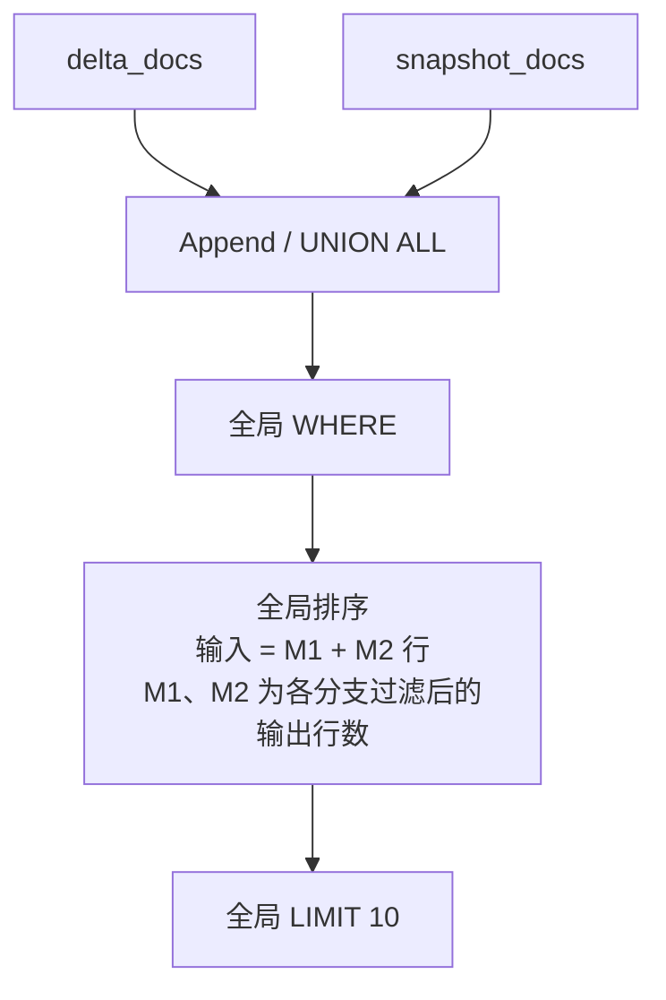

设两个分支过滤后分别输出 `M1`、`M2` 行，则全局排序需处理 `M1 + M2` 行。

### 2.3 下推后的目标形态

将相同的 WHERE、ORDER BY 和 LIMIT 放到每个 UNION ALL 叶子：

```sql
SELECT row_id, title, embedding
FROM (
    (
        SELECT row_id, title, embedding
        FROM delta_docs
        WHERE title LIKE 'delta%'
        ORDER BY embedding <-> '[0.1,0.2,0.3,0.4]'::vector
        LIMIT 10
    )

    UNION ALL

    (
        SELECT s.row_id, s.title, s.embedding
        FROM snapshot_docs s
        WHERE NOT EXISTS (
            SELECT 1
            FROM delete_docs d
            WHERE d.row_id = s.row_id
        )
          AND title LIKE 'delta%'
        ORDER BY embedding <-> '[0.1,0.2,0.3,0.4]'::vector
        LIMIT 10
    )
) u
WHERE title LIKE 'delta%'   -- 当前首版仍保留，作为语义保护
ORDER BY embedding <-> '[0.1,0.2,0.3,0.4]'::vector
LIMIT 10;
```

数据流变成：

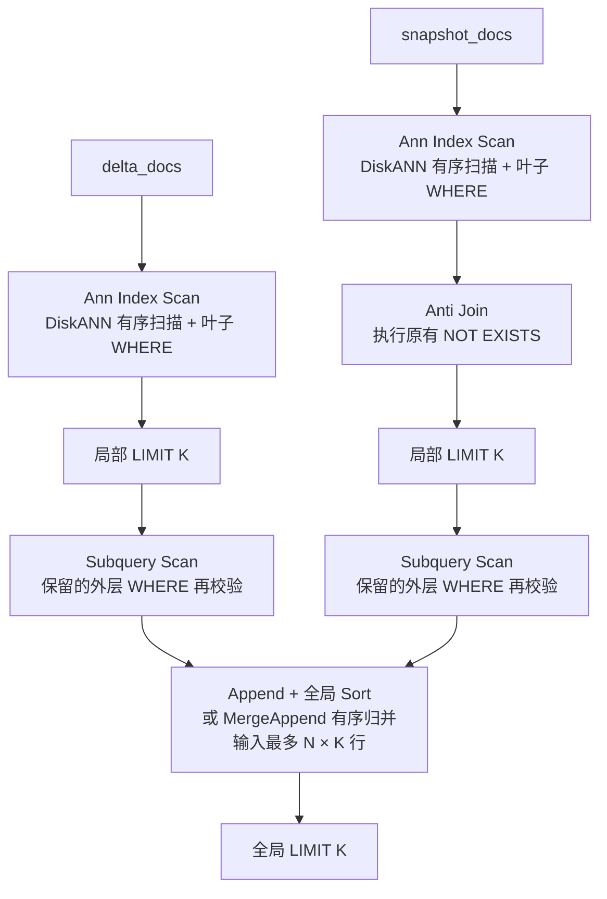

假设有 `N` 个分支，每个分支最多输出 `K` 行，全局阶段最多处理 `N × K` 行，而不是所有分支的总行数 `ΣMi`。

### 2.4 为什么逻辑上成立

在全部排序键构成确定全序、各分支采用相同排序规则，并且使用普通 `LIMIT K`（不含 `WITH TIES`）的前提下，令：

```text
TopK(X) = 输入 X 按相同规则排序后的前 K 行
U       = A1 UNION ALL A2 ... UNION ALL An
```

则：

```text
TopK(U)
= TopK(TopK(A1) UNION ALL TopK(A2) ... UNION ALL TopK(An))
```

证明：

- 如果某行在所属分支中的名次大于 K，该分支至少已有 K 行排在它之前；
- 这些行进入 UNION ALL 后仍排在该行之前，因此该行的全局名次也大于 K；
- 反过来说，所有可能进入全局前 K 的行，一定包含在其所属分支的局部前 K 中。

如果只按向量距离排序，距离相同的行没有确定的先后顺序。需要精确保证返回相同的具体行时，应增加唯一键作为次级排序键；否则只能保证结果符合 SQL 对并列行的非确定性语义。

WHERE 也必须先下推：

```text
TopK(过滤后的数据)
```

不能错误地执行成：

```text
过滤(TopK(未过滤的数据))
```

否则最近的 K 行如果都被 WHERE 淘汰，就不会继续从第 K+1 行以后补足结果。

> `FETCH ... WITH TIES` 不满足“每个分支只取固定 K 行”这一简单边界。边界值出现大量并列时，局部可能需要取超过 K 行。因此 WITH TIES 必须拒绝下推，当前代码在这一点上存在缺陷，见第 15 章。

---

## 3. 阅读代码前必须理解的六个对象

初学者最容易把 SQL 文本、Query 树、Path 和 Plan 混在一起。先建立下面的层次：

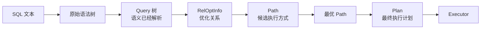

本特性的主要工作发生在 **Query 树阶段**。它不直接创建 DiskANN Plan，而是给每个叶子 Query 增加 WHERE、ORDER BY 和 LIMIT，后续仍交给原生优化器生成 Path、比较代价并创建 Plan。

### 3.1 Query：一层 SELECT 的完整内部表示

`Query` 定义在：

```text
src/include/nodes/parsenodes_common.h
```

本特性最关心的字段：

| 字段 | 对应 SQL | 用途 |
|---|---|---|
| `commandType` | `SELECT` | 只接受查询 |
| `rtable` | FROM 中涉及的表、子查询、连接 | 保存所有 RTE |
| `jointree` | FROM + WHERE | `jointree->quals` 就是本层 WHERE |
| `targetList` | SELECT 输出及内部工作列 | 元素类型是 `TargetEntry` |
| `sortClause` | ORDER BY | 元素类型是 `SortGroupClause` |
| `limitCount` | LIMIT K | 返回行数表达式 |
| `limitOffset` | OFFSET N | 当前设计不支持 |
| `limitIsPercent` | FETCH PERCENT | 当前设计必须拒绝 |
| `limitWithTies` | FETCH WITH TIES | 当前设计必须拒绝 |
| `setOperations` | UNION/INTERSECT/EXCEPT | UNION ALL 树 |
| `hasAggs` | 是否含聚合 | 安全性判断 |
| `hasWindowFuncs` | 是否含窗口函数 | 安全性判断 |
| `hasTargetSRFs` | SELECT 列是否含集合返回函数 | 当前代码漏检项 |
| `hasSubLinks` | 是否含子链接 | 外层当前拒绝 |

下面采用“主图 + 局部图”表示这些字段。所有图描述的都是 Query 树组织关系，不是执行器运行顺序。

#### 3.1.1 主图：Query 的直接成员

主图只展示字段是否直接位于 `Query` 结构体中，不展开子节点：

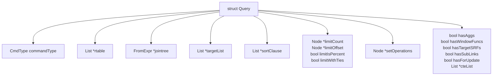

因此，WHERE、ORDER BY 等信息不是 SQL 字符串，而是从 `Query` 的直接字段继续进入不同类型的子节点：

```text
Query
├── 直接保存：commandType、LIMIT字段、语义标志
└── 指向子节点：rtable、jointree、targetList、sortClause、setOperations
```

#### 3.1.2 局部图一：`Query.rtable` 与 `Query.jointree`

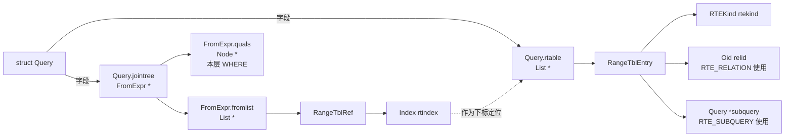

读图要点：

- `rtable` 是 `Query` 的 `List *` 字段，列表元素是 `RangeTblEntry`；
- `jointree` 是 `Query` 的 `FromExpr *` 字段；
- WHERE 的准确位置是 `Query.jointree->quals`；
- `jointree->fromlist` 中的 `RangeTblRef.rtindex` 用来定位 `Query.rtable` 中的 RTE；
- RTE 是表时使用 `relid`，是子查询时使用 `subquery`。

多表 JOIN 主要体现在 `Query.jointree` 的 `JoinExpr` 树中。例如：

```sql
SELECT ...
FROM t1
JOIN t2
  ON t1.id = t2.id
JOIN t3
  ON t2.id = t3.id
WHERE t1.status = 'active';
```

首先看 `Query.jointree` 中的连接层次：

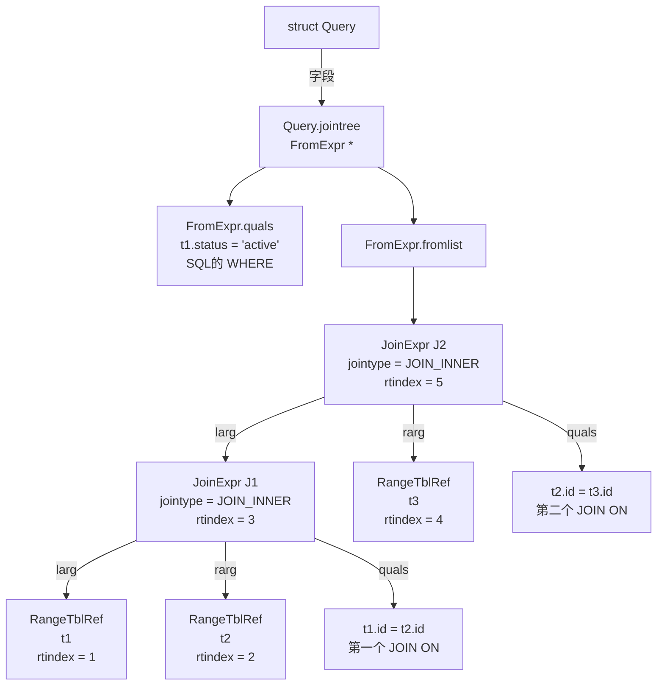

再看 join tree 节点如何关联 `Query.rtable`：

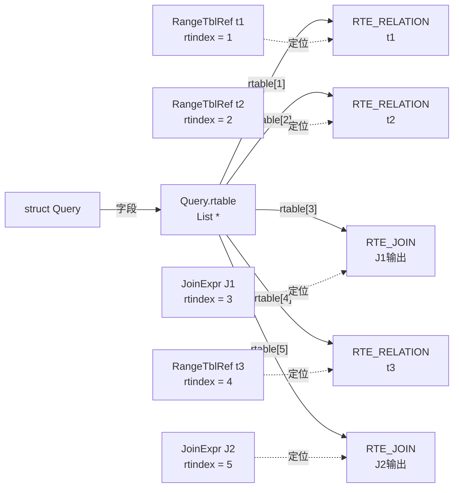

对于本例这棵左结合 JOIN 树，解析器按照“先递归处理左子树，再处理右子树，最后登记当前 JOIN 输出”的顺序追加 RTE，因此编号为：

```text
rtindex = 1 → t1
rtindex = 2 → t2
rtindex = 3 → J1：t1 INNER JOIN t2
rtindex = 4 → t3
rtindex = 5 → J2：J1 INNER JOIN t3
```

这些取值只对应本例的 SQL 结构；表顺序、JOIN括号或子查询结构变化后，具体 `rtindex` 也会变化。解析阶段创建的 `JoinExpr` 通常拥有对应的 `RTE_JOIN`，优化器内部后来生成的某些 `JoinExpr` 则允许 `rtindex = 0`。

图中有两类条件，位置不能混淆：

```text
JOIN ... ON 条件 → 对应 JoinExpr.quals
整个查询的 WHERE → 顶层 FromExpr.quals，即 Query.jointree->quals
```

本例的两个连接均为 `INNER JOIN`。ON 与 WHERE 分别保存在不同字段中，不应在结构图中混淆。`rtable` 负责登记表与 JOIN 输出，真正的连接层次和左右关系由 `jointree` 中嵌套的 `JoinExpr.larg/rarg` 表达。

需要区分“Query结构能够表示”与“当前特性允许下推”：

- openGauss 的 `Query.jointree` 可以表示上述多表 JOIN；
- 当前 `diskann_topk_outer_query_is_safe()` 要求外层只有一个 UNION 子查询来源，因此外层多表 JOIN 会回退；
- UNION 叶子内部仍可能出现 JOIN，例如 snapshot 分支的 `NOT EXISTS` 在后续规划中可能表现为 Anti Join。

#### 3.1.3 局部图二：`Query.targetList` 与 `Query.sortClause`

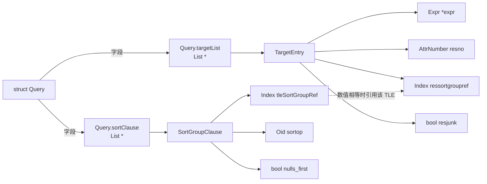

ORDER BY 查找实际表达式的路径：

```text
Query.sortClause
→ SortGroupClause.tleSortGroupRef
↔ TargetEntry.ressortgroupref
→ TargetEntry.expr
```

因此，把外层 `ORDER BY` 下推到某个叶子 `Query` 时，需要完成三件事：

1. 将距离表达式中的 `Var` 改写为该叶子自己的 RTE/列编号；
2. 在叶子的 `targetList` 中找到或新建承载该表达式的 `TargetEntry`；
3. 让叶子 `SortGroupClause.tleSortGroupRef` 与该 TLE 的
   `TargetEntry.ressortgroupref` 保存同一个非零编号。

这两个字段不是两个独立编号，而是通过相同的 `sortgroupref` 把
`sortClause` 与排序 TLE 关联起来。若只复制距离表达式而没有建立这层关联，
优化器便无法从 `sortClause` 找到叶子中实际用于排序的表达式。

`TargetEntry.resjunk` 决定该 TLE 是否返回给用户：

```text
resjunk = false → SELECT 可见输出
resjunk = true  → 内部工作列，例如未出现在 SELECT 中的距离排序表达式
```

#### 3.1.4 局部图三：LIMIT/FETCH 字段直接位于 Query

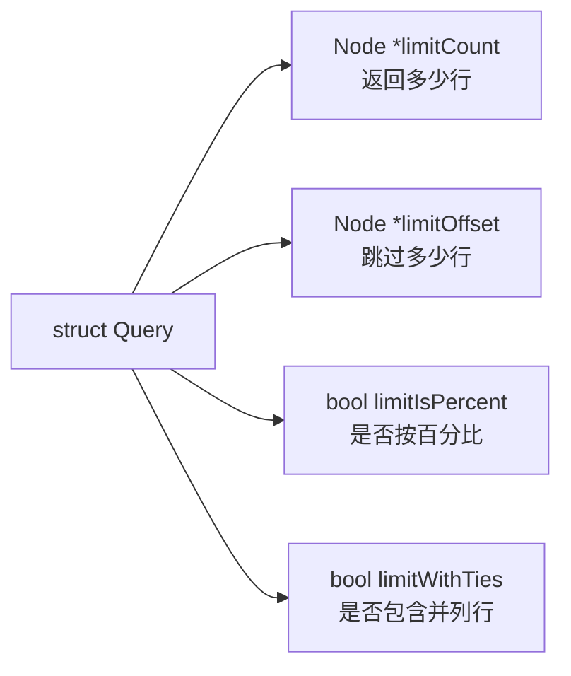

当前设计只允许普通的：

```sql
LIMIT K
```

因此必须满足：

```text
limitCount 非空
limitOffset 为空
limitIsPercent = false
limitWithTies = false
```

#### 3.1.5 局部图四：`Query.setOperations` 的子节点

以下面带外层向量 Top-K 的三叶子查询为例：

```sql
SELECT row_id, title, embedding
FROM (
    SELECT row_id, title, embedding
    FROM delta_docs

    UNION ALL

    SELECT s.row_id, s.title, s.embedding
    FROM snapshot_docs s
    WHERE NOT EXISTS (
        SELECT 1
        FROM delete_docs d
        WHERE d.row_id = s.row_id
    )

    UNION ALL

    SELECT row_id, title, embedding
    FROM archive_docs
) u
ORDER BY embedding <-> '[0.1,0.2,0.3,0.4]'::vector ASC
LIMIT 10;
```

这段 SQL 解析后包含两个 Query 层级：

```text
外层 Top-K Query
├── rtable[1]：RTE_SUBQUERY → 内层 Union Query
├── jointree：RangeTblRef(rtindex = 1)
├── sortClause：embedding <-> 查询向量，ASC
└── limitCount：10

内层 Union Query
├── rtable[1]：RTE_SUBQUERY → delta 叶子 Query
├── rtable[2]：RTE_SUBQUERY → snapshot 叶子 Query
├── rtable[3]：RTE_SUBQUERY → archive 叶子 Query
└── setOperations：(叶子1 UNION ALL 叶子2) UNION ALL 叶子3
```

两层 Query 的关系如下。外层的 `rtindex = 1` 只用于定位整个 UNION 子查询：

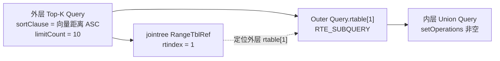

由于 `UNION` 在语法中是左结合的，内层三个分支之间没有额外括号，因此解析成
`(叶子1 UNION ALL 叶子2) UNION ALL 叶子3`。`setOperations` 树和三个
`RangeTblRef.rtindex` 的具体取值如下：

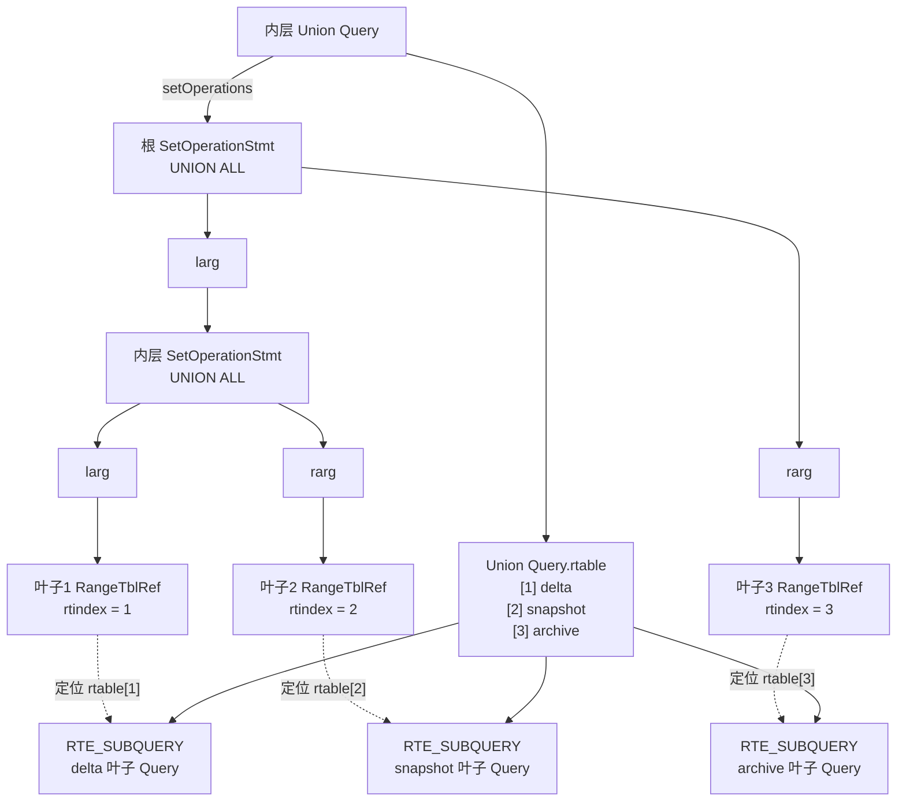

对应关系可以直接写成：

```text
setOperations.larg                 → 内层 SetOperationStmt

setOperations.larg.larg.rtindex = 1
    → Union Query.rtable[1]
    → 第一个 RTE_SUBQUERY
    → delta 叶子 Query

setOperations.larg.rarg.rtindex = 2
    → Union Query.rtable[2]
    → 第二个 RTE_SUBQUERY
    → snapshot 叶子 Query

setOperations.rarg.rtindex = 3
    → Union Query.rtable[3]
    → 第三个 RTE_SUBQUERY
    → archive 叶子 Query
```

外层 `RangeTblRef.rtindex = 1` 与内层叶子1的
`RangeTblRef.rtindex = 1` 数值虽然相同，但分属两个 Query，含义完全不同：

```text
外层 rtindex = 1 → 外层 rtable[1] → 整个 Union Query
内层 rtindex = 1 → 内层 rtable[1] → delta 叶子 Query
```

同理，内层的 `1`、`2`、`3` 只在当前 `Union Query` 层级内有效。每个叶子又是
独立的 `Query`，拥有自己的 `rtable` 和自己的 `rtindex` 编号。

`collect_setop_leaves()` 正是沿着这棵树递归：

```text
SetOperationStmt → 继续遍历左右孩子
RangeTblRef       → 到 rtable 中取得叶子 RTE_SUBQUERY
```

#### 3.1.6 局部图五：Query 语义字段如何参与下推安全检查

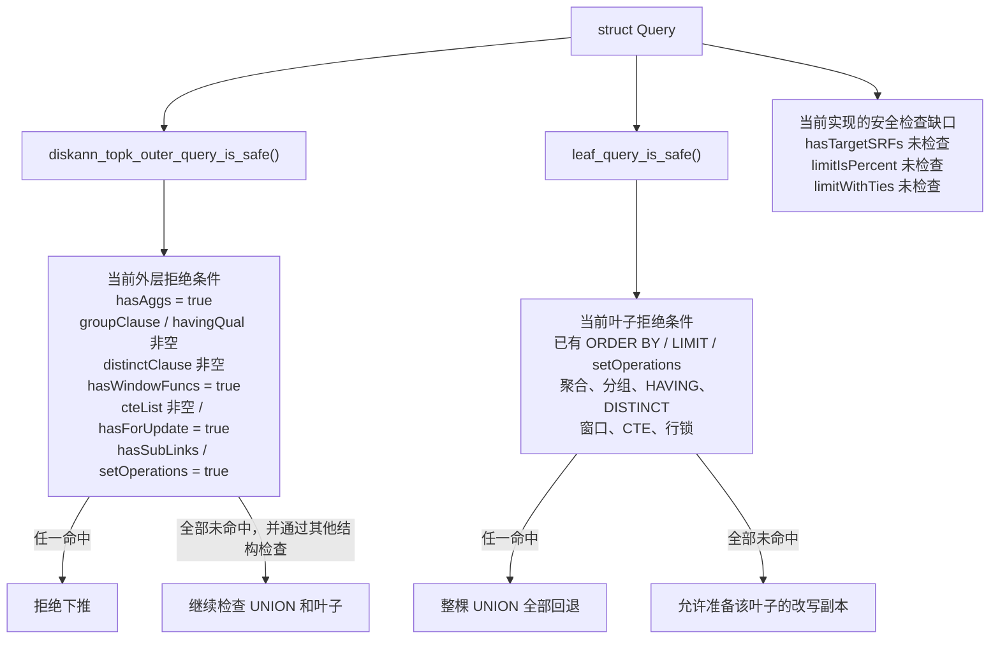

这里并不存在一种名为“安全字段”的特殊节点。`hasAggs`、`hasWindowFuncs` 等是
`Query` 对自身 SQL 语义的摘要；安全检查函数读取这些字段，判断当前改写能否
证明等价。

还要区分外层和叶子：

- 外层 `hasSubLinks = true` 时当前代码直接拒绝；
- 叶子不能笼统拒绝 `hasSubLinks`，因为本特性需要允许 snapshot 叶子原有的
  `NOT EXISTS`；
- 图中“安全检查缺口”表示设计要求拒绝、但当前实现尚未检查的字段，不能误读为
  已具备保护。

从特性代码角度看，最关键的访问关系是：

```text
WHERE      → Query.jointree->quals
ORDER BY   → Query.sortClause → SortGroupClause.tleSortGroupRef
             ↔ TargetEntry.ressortgroupref → TargetEntry.expr
FROM 对象  → Query.jointree->fromlist → RangeTblRef.rtindex → Query.rtable
LIMIT      → Query.limitCount
UNION ALL  → Query.setOperations + Query.rtable 中的叶子 RTE_SUBQUERY
```

非常重要的一点：

```text
一个 Query 只表示一个查询层级。
```

外层 SELECT、UNION ALL 本身、每个 UNION 叶子，都有各自独立的 Query。

### 3.2 RTE：FROM 里“某一个来源”的登记项

RTE 是 `RangeTblEntry` 的简称。

例如：

```sql
SELECT *
FROM docs_union;
```

在视图展开之后，外层 Query 的 `rtable` 中可能有一个：

```text
RTE_SUBQUERY
└── subquery 指向 UNION ALL Query
```

常见 RTE 类型：

| `rtekind` | 含义 |
|---|---|
| `RTE_RELATION` | 普通表 |
| `RTE_SUBQUERY` | FROM 中的子查询或展开后的视图 |
| `RTE_JOIN` | JOIN 的结果 |
| `RTE_FUNCTION` | FROM 中的函数 |
| `RTE_CTE` | WITH 查询 |

RTE 在 `Query->rtable` 中从 1 开始编号。这个编号叫 RTI（Range Table Index）。

```text
rtable 第 1 项 → RTI = 1
rtable 第 2 项 → RTI = 2
```

RTI 只是当前 Query 内部的数组位置，不是表 OID。

### 3.3 Var：表达式中“引用哪一层、哪张表、哪一列”

一条列引用在 Query 树中通常是 `Var`：

```text
Var.varno       = 引用当前 Query 的第几个 RTE
Var.varattno    = 引用该 RTE 输出的第几列
Var.varlevelsup = 向外跨了多少个查询层级
```

例如外层：

```sql
WHERE u.title LIKE 'delta%'
```

如果 `u` 是外层 rtable 的第 1 项，而 `title` 是 `u` 的第 2 个输出列，则近似表示为：

```text
Var
├── varno       = 1
├── varattno    = 2
└── varlevelsup = 0
```

`varlevelsup`：

| 值 | 含义 |
|---|---|
| `0` | 引用当前 Query 层 |
| `1` | 引用直接外层 Query |
| `2` | 再向外一层 |

为什么不能把外层表达式直接复制到叶子？

因为同一个 `varno=1, varattno=2` 在不同 Query 中含义可能不同。复制 SQL 文字看似正确，但内部 Var 可能指向错误的 RTE。必须依据叶子输出列重新映射。

### 3.4 TLE：Target List Entry

TLE 是 **Target List Entry** 的简称，对应结构体 `TargetEntry`。

例如：

```sql
SELECT row_id, title, embedding
FROM docs
ORDER BY embedding <-> '[0.1,0.2,0.3,0.4]'::vector;
```

内部 targetList 可能是：

```text
TLE 1: row_id                               resjunk = false
TLE 2: title                                resjunk = false
TLE 3: embedding                            resjunk = false
TLE 4: embedding <-> '[0.1,0.2,0.3,0.4]'    resjunk = true
```

`TLE 3` 是用户要求返回的普通 `embedding` 列。`TLE 4` 才是排序 TLE，其
`expr` 是一个距离运算 `OpExpr`，该表达式内部再次引用 `embedding`。两个 TLE
虽然都涉及 `embedding`，但用途不同：

```text
TLE 3.expr = Var(embedding)                         → 返回原始向量
TLE 4.expr = OpExpr(Var(embedding) <-> Const(vector)) → 计算距离并排序
```

`TLE 4` 只为排序服务，不返回给用户，所以 `resjunk = true`。

关键字段：

| 字段 | 含义 |
|---|---|
| `expr` | 真正的表达式 |
| `resno` | 在 targetList 中的输出位置 |
| `ressortgroupref` | ORDER BY/GROUP BY 与该 TLE 的关联标签 |
| `resjunk` | 是否只是内部工作列 |

### 3.5 SortGroupClause：ORDER BY 如何找到排序 TLE

`Query->sortClause` 不直接保存完整排序表达式，而是保存 `SortGroupClause`：

```text
SortGroupClause.tleSortGroupRef
              │
              ▼
TargetEntry.ressortgroupref
              │
              ▼
TargetEntry.expr
```

源码通过：

```cpp
TargetEntry *tle =
    get_sortgroupclause_tle(sortClause, query->targetList);
```

找到真正的排序表达式。

将 ORDER BY 下推到叶子时，不仅要复制表达式，还必须：

1. 把表达式中的外层 Var 映射为叶子表达式；
2. 在叶子 targetList 中找到或新增对应 TLE；
3. 为叶子 TLE 分配 `ressortgroupref`；
4. 复制 `SortGroupClause`；
5. 将复制后的 `tleSortGroupRef` 改为叶子 TLE 的标签。

遗漏第 3～5 步，后续优化器就无法知道 ORDER BY 指向哪个表达式。

“找到或新增”由下面这段代码决定：

```cpp
TargetEntry *leafTle =
    tlist_member((Node *)mappedExpr, leafCopy->targetList);

if (leafTle == NULL) {
    leafTle = makeTargetEntry(mappedExpr, newResno, NULL, true);
    leafCopy->targetList = lappend(leafCopy->targetList, leafTle);
}
```

`tlist_member()` 比较的是映射后表达式与已有 `TargetEntry.expr` 的结构，而不是
只比较它们是否引用了同一列。以下面的排序为例：

```sql
SELECT row_id, title, embedding
FROM docs_union
ORDER BY embedding <-> '[0.1,0.2,0.3,0.4]'::vector ASC,
         row_id ASC
LIMIT 10;
```

改写前，某个叶子的 `targetList` 为：

```text
TLE 1: row_id      resjunk = false
TLE 2: title       resjunk = false
TLE 3: embedding   resjunk = false
```

两个排序项分别处理：

```text
排序项1：embedding <-> query_vector
→ 叶子只有 Var(embedding)，没有完整的距离 OpExpr
→ tlist_member() 找不到
→ 新增 TLE 4，resjunk = true

排序项2：row_id
→ 与已有 TLE 1.expr = Var(row_id) 结构相同
→ tlist_member() 找到并复用 TLE 1
→ 不新增 TLE
```

因此，下推完成后的叶子 `targetList` 是：

```text
TLE 1: row_id                          resjunk = false  ← 次级排序复用
TLE 2: title                           resjunk = false
TLE 3: embedding                       resjunk = false
TLE 4: embedding <-> query_vector      resjunk = true   ← 距离排序新增
```

如果叶子原本就有一个 `TargetEntry.expr` 与映射后的完整距离表达式结构相同，
距离排序也会直接复用它。仅仅存在普通的 `embedding` TLE，不算找到距离 TLE。

> 这个双排序键 SQL 只用于说明 TLE 的“新增与复用”。当前 DiskANN 索引未必能
> 同时提供“向量距离 + row_id”的完整顺序，后续物理计划仍可能选择
> `Seq Scan + Sort`，不能据此推导一定生成 `Ann Index Scan`。

### 3.6 PathKey、EquivalenceClass 和 EquivalenceMember

这三个对象属于 Path 阶段：

| 对象 | 保存的主要内容 | 作用 |
|---|---|---|
| `PathKey` | `pk_eclass`、排序opfamily、升降序策略、NULL位置 | 描述一个排序键；`Path.pathkeys` 列表共同描述整条 Path 的输出顺序 |
| `EquivalenceClass`，EC | 一组在当前查询层被认为等价的表达式 | 让优化器用同一套排序/连接语义识别不同写法的等价表达式 |
| `EquivalenceMember`，EM | `em_expr`、表达式涉及的关系集合等 | 表示 EC 中一个具体表达式成员 |

三者的引用关系是：

```text
Path.pathkeys
└── PathKey
    ├── 排序方向、opfamily、NULL位置
    └── pk_eclass → EquivalenceClass
                     ├── EquivalenceMember → 表达式1
                     └── EquivalenceMember → 表达式2
```

例如：

```sql
SELECT *
FROM a JOIN b ON a.id = b.id
ORDER BY a.id;
```

优化器可以建立一个 EC，其中包含两个 EM：

```text
EC(id等价类)
├── EM 1：a.id
└── EM 2：b.id
```

因此优化器知道 `a.id` 和 `b.id` 在该连接条件下等价，不必只按 SQL 中出现的
文字形式识别排序键。

对当前向量 Top-K：

```sql
ORDER BY embedding <-> query_vector ASC
```

距离表达式会成为相应 EC 中的一个 EM，查询要求的排序被表示为 PathKey。优化器
随后比较候选路径：

```text
DiskANN Path.pathkeys 与查询 PathKey 匹配 → 可以利用索引顺序，避免额外 Sort
Path.pathkeys 不匹配                         → 需要增加 Sort
```

不要混淆：

```text
排序 TLE：Query 树中 ORDER BY 表达式的载体
PathKey：Path 阶段对“输出顺序”的描述
EC/EM：PathKey 用来表达等价排序表达式的基础设施
```

`preptopk.cpp` 只改写 Query，不应该手工创建或修补 EC/EM。Query 改写完成后，后续原生优化流程会基于叶子的 `sortClause` 建立 PathKey 和 EC。

---

## 4. 一条示例 SQL 在 Query 树中的形状

本节使用的 `docs_union` 不是普通基表，而是下面这个两叶子的视图：

```sql
CREATE VIEW docs_union AS
SELECT d.row_id, d.title, d.embedding
FROM delta_docs d

UNION ALL

SELECT s.row_id, s.title, s.embedding
FROM snapshot_docs s
WHERE NOT EXISTS (
    SELECT 1
    FROM delete_docs x
    WHERE x.row_id = s.row_id
);
```

用户执行的 Top-K SQL 是：

```sql
SELECT row_id, title, embedding
FROM docs_union
WHERE title LIKE 'delta%'
ORDER BY embedding <-> '[0.1,0.2,0.3,0.4]'::vector
LIMIT 10;
```

经过解析、规则重写并展开 `docs_union` 视图后，整体包含：

```text
外层 Top-K Query
└── docs_union 对应的 Union Query
    ├── Delta Leaf Query
    └── Snapshot Leaf Query（内部保留 NOT EXISTS）
```

外层 Query 可简化理解为：

```text
Outer Query
├── rtable[1] = RTE_SUBQUERY (docs_union)
│   └── subquery = Union Query
├── jointree
│   ├── fromlist = [RangeTblRef(rtindex=1)]
│   └── quals = Var(1,2) LIKE 'delta%'
├── targetList
│   ├── Var(1,1)  -- row_id
│   ├── Var(1,2)  -- title
│   ├── Var(1,3)  -- embedding
│   └── OpExpr(Var(1,3) <-> query_vector) [resjunk排序TLE]
├── sortClause
│   └── tleSortGroupRef → 排序TLE
└── limitCount = 10
```

Union Query：

```text
Union Query
├── rtable[1] = RTE_SUBQUERY → Delta Leaf Query
├── rtable[2] = RTE_SUBQUERY → Snapshot Leaf Query
└── setOperations
    └── SetOperationStmt(UNION ALL)
        ├── larg = RangeTblRef(1)
        └── rarg = RangeTblRef(2)
```

Delta Leaf Query：

```text
Delta Leaf Query
├── rtable[1] = RTE_RELATION(delta_docs)
├── targetList
│   ├── Var(1,row_id)
│   ├── Var(1,title)
│   └── Var(1,embedding)
└── jointree->quals = NULL
```

Snapshot Leaf Query：

```text
Snapshot Leaf Query
├── rtable[1] = RTE_RELATION(snapshot_docs)
├── targetList
│   ├── s.row_id
│   ├── s.title
│   └── s.embedding
└── jointree->quals = NOT EXISTS SubLink
    └── SubLink.subselect = Delete Subquery
        └── rtable[1] = RTE_RELATION(delete_docs)
```

映射外层 `title` 时：

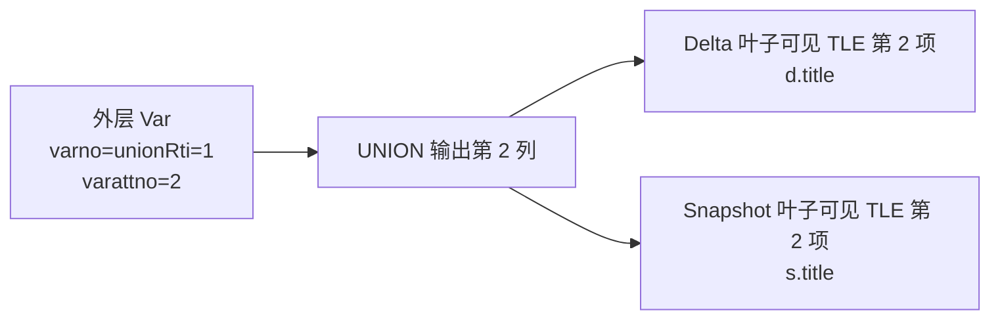

映射不是依赖列名，而是依赖 UNION 输出位置，并额外验证类型、typmod 和 collation。

---

## 5. 全链路调用关系

### 5.1 从 planner 入口到 Query 改写

关键调用链：

```text
planner()
└── standard_planner()
    └── subquery_planner()
        ├── pull_up_sublinks()
        ├── reduce_orderby()
        ├── preprocess_rownum()
        ├── preprocess_union_all_diskann_topk()   ← 本特性入口
        ├── pull_up_subqueries()
        └── flatten_simple_union_all()
```

入口位于：

```text
src/gausskernel/optimizer/plan/planner.cpp:1705
```

当前调用：

```cpp
preprocess_union_all_diskann_topk(root);
```

为什么放在 `pull_up_subqueries()` 之前？

- 此时外层的 UNION ALL 仍然是一个 `RTE_SUBQUERY`；
- `setOperations` 和叶子 Query 层次仍然清晰；
- 可以准确找到 UNION ALL 树和每个叶子；
- 如果先拉平，Query 层次和 Var/RTE 关系会变化，改写难度明显增加。

仍以第4节的 `docs_union` 为例。执行本特性时，`pull_up_subqueries()` 尚未运行，
结构可以简化画成：

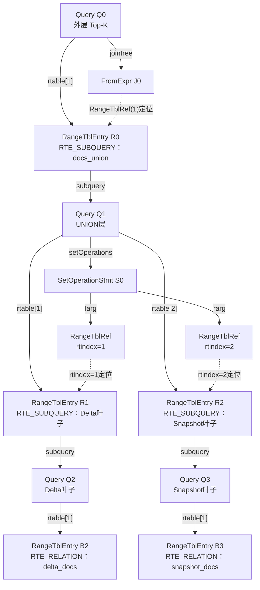

上图统一采用以下规则：

- `Query Q0`～`Query Q3` 方块只表示一个 `Query` 结构体对象；
- `RangeTblEntry`、`FromExpr` 和 `SetOperationStmt` 单独画成节点；
- 实线上的 `rtable[1]`、`jointree`、`setOperations`、`subquery` 是实际字段；
- 虚线表示 `RangeTblRef.rtindex` 按编号定位同层 `Query.rtable`，不是C指针字段。

四个 `Query` 在这个阶段都具有同一套 `Query` 字段，只是字段值不同。下面
严格采用“一格一个字段”，不在同一方格中合并两个Query字段。

外层Query Q0：

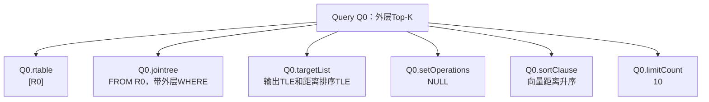

UNION层Query Q1：

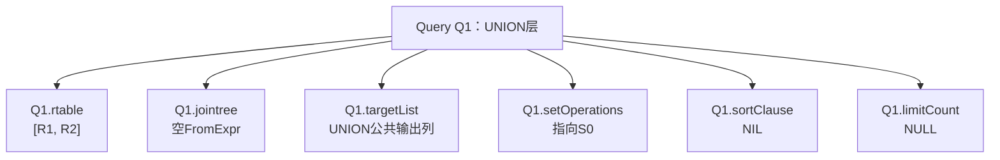

Delta叶子Query Q2：

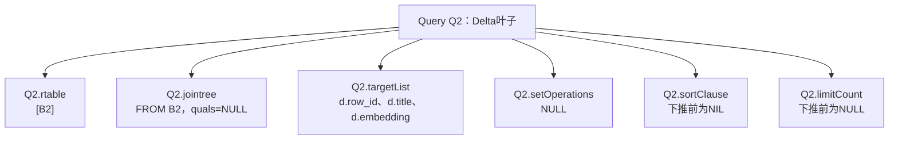

Snapshot叶子Query Q3：

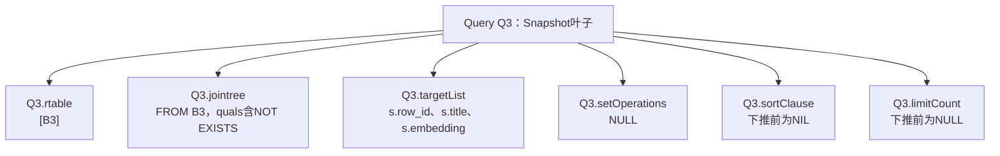

`SetOperationStmt` 本身不保存叶子 `RangeTblEntry`。它的 `larg/rarg` 保存
`RangeTblRef`，再由其中的 `rtindex` 到同一层 `Union Query.rtable` 定位
对应的 `RTE_SUBQUERY`。

注意，图中的多个 `Var(1,...)` 并不引用同一个 RTE：

```text
外层 Var(1,3) → Outer Query.rtable[1] → 整个 docs_union 的 embedding 输出
Delta Var(1,3) → Delta Leaf Query.rtable[1] → delta_docs.embedding
Snapshot Var(1,3) → Snapshot Leaf Query.rtable[1] → snapshot_docs.embedding
```

因为它们属于不同 Query 层级，所以可以各自在本层使用 `varno = 1`。本特性此时
沿着以下关系逐层映射：

```text
Outer RangeTblRef
→ Outer Query.rtable
→ docs_union RTE_SUBQUERY
→ Union Query
→ Query.setOperations中的RangeTblRef
→ Union Query.rtable
→ 叶子RTE_SUBQUERY
→ 叶子Query
```

如果先由 `pull_up_simple_union_all()` 拉平，它会分阶段修改这些结构。对于
尚未下推Top-K的本例，叶子刚复制到父层时，Delta和Snapshot的RT编号分别是2和3；
递归拉平Delta后，Delta对应的 `child_relid` 会由2改为新基表RTE编号4；所有叶子
处理结束后，父RTE才设置 `inh=true`。同一次函数调用中的状态变化是：

| 执行步骤 | Delta对应的`child_relid` | 父RTE的`inh` | 原因 |
|---|---:|---|---|
| A：叶子RTE刚复制到父Query | 2 | `false` | 此时child仍是复制过来的Delta子查询RTE |
| B：Delta继续拉平到基表 | 4 | `false` | `fix_append_rel_relids()`已经把child从RTE 2改为基表RTE 4 |
| C：全部叶子处理完毕 | 4 | `true` | `pull_up_simple_union_all()`最后才把父RTE标记为AppendRel父项 |

所以，在这个“尚未做Top-K下推、Delta可以继续拉平”的执行分支中，函数不会产生
下面这种状态：

```text
Delta child_relid = 2
父RTE inh = true
```

这里的两个值分别取自步骤A和步骤C，但步骤C中的Delta `child_relid`已经是4。
需要注意：如果叶子已经被本特性加入 `ORDER BY + LIMIT`，Delta将不能继续拉平，
那么最终出现“`child_relid=2`且父RTE `inh=true`”反而是正确状态；这是后文说明的
另一个执行分支。

第一步，复制 Union Query 的叶子RTE并追加到父 Query：

```text
拉平前 Outer Query.rtable
└── [1] docs_union RTE_SUBQUERY

Union Query.rtable（独立编号）
├── [1] Delta叶子RTE_SUBQUERY
└── [2] Snapshot叶子RTE_SUBQUERY

复制后 Outer Query.rtable
├── [1] 原docs_union RTE_SUBQUERY
├── [2] 复制的Delta叶子RTE_SUBQUERY
└── [3] 复制的Snapshot叶子RTE_SUBQUERY
```

编号计算为：

```cpp
/* pull_up_simple_union_all() */
rtoffset = list_length(root->parse->rtable);  // 本例为1
root->parse->rtable =
    list_concat(root->parse->rtable, copiedLeafRtable);

/* pull_up_union_leaf_queries() */
childRTindex = childRToffset + leafRangeTblRef->rtindex;
appinfo->child_relid = childRTindex;
```

其中，`pull_up_simple_union_all()` 取得父层已有RTE数量并把叶子RTE列表追加到
父层；随后它把 `rtoffset` 作为 `childRToffset` 传给
`pull_up_union_leaf_queries()`。后者针对每个叶子计算新的父层RT编号，并写入
`AppendRelInfo.child_relid`。

所以两个叶子的初始父层编号是 `2` 和 `3`。child并不固定从2开始；如果父层
原来已有 `N` 个RTE，第一个复制叶子的编号就是 `N + 1`。

第二步，`pull_up_union_leaf_queries()` 为每个叶子先创建 `AppendRelInfo`，随后
立即调用 `pull_up_subqueries_recurse()`，继续尝试拉平该叶子：

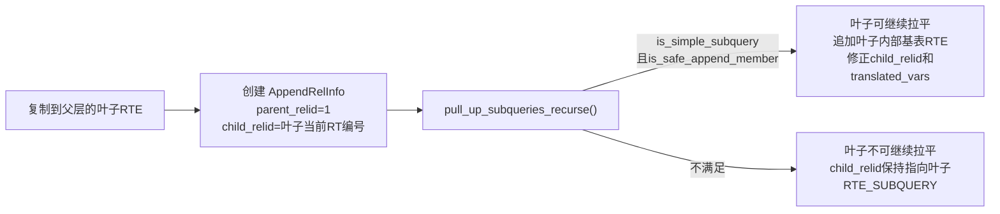

对“尚未做Top-K下推”的本例：

- Delta叶子没有 WHERE、ORDER BY、LIMIT，只有一个基表，可以继续拉平；
- Snapshot叶子含 `NOT EXISTS`，其 `jointree->quals` 非空，
  `is_safe_append_member()` 返回false，因此保留为子查询RTE。

Delta继续拉平时，父层当时已有3个RTE，其内部 `delta_docs` 基表RTE被追加为
`rtable[4]`。随后 `fix_append_rel_relids()` 将Delta对应的
`AppendRelInfo.child_relid` 从2改为4，并同步改写 `translated_vars`。

第三步，所有叶子处理完后，函数才执行：

```cpp
rte->inh = true;   // rte是Outer Query.rtable[1]中的原docs_union RTE
```

因此，对于“原生拉平先于本特性”的本例，函数返回时的简化结构是：

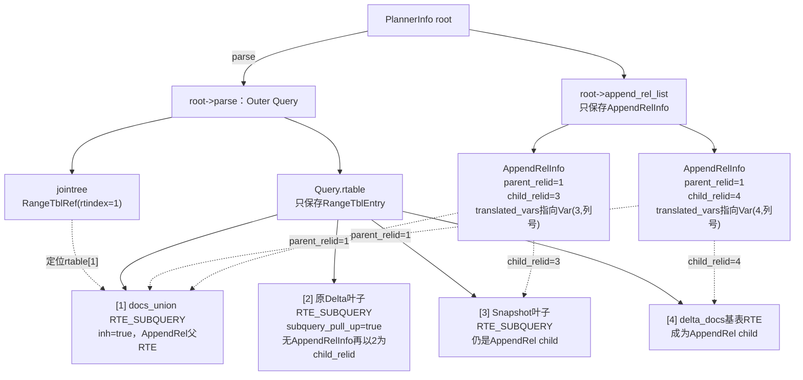

这里必须区分：

```text
Query.rtable
└── 保存RangeTblEntry，不保存AppendRelInfo

PlannerInfo.append_rel_list
└── 保存AppendRelInfo，通过parent_relid/child_relid引用rtable编号
```

这里的 `AppendRel` 是“append relation”的简称，表示一个逻辑父关系由多个
子关系的结果拼接得到；它不是一个名为 `AppendRel` 的C结构体。这个概念由多种
数据结构共同表达：

```text
父RangeTblEntry
└── inh=true：说明该RTE需要按AppendRel父项展开

PlannerInfo.append_rel_list
├── AppendRelInfo(parent=1, child=2, translated_vars=...)
└── AppendRelInfo(parent=1, child=3, translated_vars=...)

PlannerInfo.simple_rel_array
├── [1] 父RelOptInfo：RELOPT_BASEREL
├── [2] 子RelOptInfo：RELOPT_OTHER_MEMBER_REL
└── [3] 子RelOptInfo：RELOPT_OTHER_MEMBER_REL

Path/Plan阶段
└── AppendPath或MergeAppendPath → Append或MergeAppend
```

子项使用 `RELOPT_OTHER_MEMBER_REL`，是因为它不是主Join Tree中独立出现的基表，
而是优化器为了规划AppendRel父项的各个访问分支额外建立的 `RelOptInfo`。

`RangeTblEntry` 中没有 `is_appendrel_child` 之类的成员标志。
`subquery_pull_up=true` 只说明这个子查询RTE已经被拉平，不能单独用来判断它
是不是AppendRel child。真正的判断依据是当前规划阶段是否存在
`AppendRelInfo.child_relid == rtindex`：

```text
拉平Delta之前：
AppendRelInfo(parent_relid=1, child_relid=2)
→ rtable[2] 是AppendRel child

拉平Delta之后：
AppendRelInfo(parent_relid=1, child_relid=4)
→ rtable[4] 是AppendRel child
→ rtable[2] 不再是AppendRel child
```

在 `append_rel_array` 建立以后，也可以用
`root->append_rel_array[rtindex] != NULL` 判断；对应的 `RelOptInfo` 建立以后，
AppendRel子项的 `reloptkind` 为 `RELOPT_OTHER_MEMBER_REL`。这三种判断都属于
优化器状态，不是RTE自身携带的成员标志。

外层 `Var(1,3)` 仍引用 `Query.rtable[1]` 中docs_union父RTE的第3列。优化器
为不同AppendRel子项生成表达式时，分别使用该子项自己的 `translated_vars`：

```text
生成Delta子项表达式：    Var(1,3) → Var(4,3)
生成Snapshot子项表达式： Var(1,3) → Var(3,3)
```

`translated_vars` 是“AppendRel父项输出列到某个子项实际表达式”的映射表。
列表位置对应父项列号：

```text
translated_vars第1项 → 子项中实现父项第1列row_id的表达式
translated_vars第2项 → 子项中实现父项第2列title的表达式
translated_vars第3项 → 子项中实现父项第3列embedding的表达式
```

本例拉平后的映射可以简化为：

```text
Delta对应的AppendRelInfo
parent Var(1,1) → 第1项 → Var(4,1)  // delta_docs.row_id
parent Var(1,2) → 第2项 → Var(4,2)  // delta_docs.title
parent Var(1,3) → 第3项 → Var(4,3)  // delta_docs.embedding

Snapshot对应的AppendRelInfo
parent Var(1,1) → 第1项 → Var(3,1)
parent Var(1,2) → 第2项 → Var(3,2)
parent Var(1,3) → 第3项 → Var(3,3)
```

优化器为某个AppendRel子项生成表达式时，`adjust_appendrel_attrs()` 根据父
`Var.varattno` 取 `translated_vars[varattno - 1]`，用该子项的表达式替换父Var。
因此父项上的目标列、过滤条件和排序表达式都能改写为当前子项实际使用的列。

`translated_vars` 不是执行器传输数据的缓冲区，也不是另一份targetList；它是
优化器中的列/表达式转换元数据。对于UNION ALL，列表元素还可以是任意表达式，
不一定只是简单Var。

还要注意另一个分支：按照当前正确调用顺序，本特性先给叶子增加
`ORDER BY + LIMIT`，之后才运行 `pull_up_simple_union_all()`。此时两个叶子都
不满足 `is_simple_subquery()`，不会继续拉到基表层；对应
`AppendRelInfo.child_relid` 会保持为2和3。这与上图所描述的“原生拉平先于本
特性”是两种不同的处理顺序，不能使用同一份结构表示。

这就是为什么本特性选择在子查询拉平前完成Query改写：拉平后需要同时处理
AppendRel父子关系、RT编号偏移、`translated_vars`及叶子是否被继续拉平等多种
状态。

### 5.2 Query 改写后的原生 Path 生成

叶子 Query 被加入 ORDER BY + LIMIT 后，后续仍走原生优化器：

```text
subquery_planner(每个叶子)
└── query_planner()
    └── make_one_rel()
        └── set_base_rel_pathlists()
            └── set_rel_pathlist()
                └── create_index_paths()
                    └── build_index_paths()
                        ├── match_pathkeys_to_index()
                        └── create_index_path()
                            └── cost_index()
                                └── diskanncostestimate()
```

关键点：

- 叶子 `sortClause` 使优化器形成 `query_pathkeys`；
- `build_index_paths()` 发现 DiskANN `amcanorderbyop`；
- `match_pathkeys_to_index()` 将向量距离排序与 DiskANN 索引匹配；
- `create_index_path()` 创建 `IndexPath`；
- 因为 `IndexOptInfo->isAnnIndex=true`，`pathtype` 被设置为 `T_AnnIndexScan`；
- `cost_index()` 调用 DiskANN AM 的 `diskanncostestimate()`；
- Path 进入 `add_path()`，与 SeqScan、Sort 等候选比较；
- 最便宜且满足顺序的 Path 被选择。

### 5.3 从最优 Path 到 Plan

关键调用链：

```text
create_plan()
└── create_plan_recurse()
    └── create_scan_plan()
        └── create_indexscan_plan()
            └── make_annindexscan()
```

`create_scan_plan()` 根据：

```cpp
best_path->pathtype == T_AnnIndexScan
```

调用 `create_indexscan_plan()`，最终构造 `AnnIndexScan` Plan。

因此本特性各层职责非常清晰：

| 层次 | 负责内容 |
|---|---|
| `preptopk.cpp` | 逻辑改写：给叶子 Query 增加 WHERE、ORDER BY、LIMIT |
| `indxpath.cpp` | 识别 DiskANN 能否提供所需排序，创建候选 IndexPath |
| `costsize.cpp` + DiskANN AM | 计算候选路径代价 |
| `pathnode.cpp` | 构建 `T_AnnIndexScan` Path |
| `createplan.cpp` | 将最优 Path 转成 `AnnIndexScan` Plan |
| Executor | 执行计划，不属于本特性逻辑改写范围 |

---

## 6. 代码文件全景

### 6.1 本特性直接修改的文件

| 文件 | 改动 | 初学者阅读重点 |
|---|---|---|
| `src/gausskernel/optimizer/prep/preptopk.cpp` | 新增 887 行 | 核心 Query 改写 |
| `src/gausskernel/optimizer/plan/planner.cpp` | 增加调用入口 | 改写发生的时机 |
| `src/gausskernel/optimizer/plan/createplan.cpp` | 按ORDER BY表达式返回类型查找opfamily排序算子，修复child EC member为空导致的崩溃 | Query 改写如何安全落到 Plan |
| `src/common/backend/utils/misc/guc/guc_sql.cpp` | 注册 GUC | 功能开关 |
| `src/include/knl/knl_guc/knl_session_attr_sql.h` | 保存会话级 GUC 值 | `u_sess` 字段 |
| `src/include/optimizer/prep.h` | 声明入口函数 | 模块对外接口 |
| `src/gausskernel/optimizer/prep/Makefile` | 增加 `preptopk.o` | 编译集成 |
| `test_complete_where_pushdown.sql` | 测试材料 | 基本功能测试 |
| `openGauss_UNION_ALL分支过滤与DiskANN_TopK协同下推设计.md` | 设计文档 | 设计约束和测试矩阵 |

### 6.2 建议阅读顺序

不要直接从 `preptopk.cpp` 第 1 行顺序读到最后。最快路径是：

1. 先读 `planner.cpp` 的调用位置；
2. 再读 `preprocess_union_all_diskann_topk()` 主流程；
3. 阅读第 3、4 章，理解 Query/RTE/Var/TLE；
4. 阅读 `prepare_leaf_diskann_topk()`，看叶子到底被写入了什么；
5. 阅读 WHERE/ORDER BY 映射函数；
6. 阅读安全检查函数；
7. 最后看 `createplan.cpp` 的空指针修复和原生 Path/Plan 链路。

---

## 7. GUC、声明和编译集成

### 7.1 会话字段

文件：

```text
src/include/knl/knl_guc/knl_session_attr_sql.h
```

新增：

```cpp
bool enable_union_all_diskann_topk_pushdown;
```

它位于会话级 SQL 属性中，因此不同会话可以有不同设置。

### 7.2 GUC 注册

文件：

```text
src/common/backend/utils/misc/guc/guc_sql.cpp
```

核心配置：

```cpp
{"enable_union_all_diskann_topk_pushdown",
 PGC_USERSET,
 NODE_ALL,
 QUERY_TUNING_METHOD,
 ...},
&u_sess->attr.attr_sql.enable_union_all_diskann_topk_pushdown,
false,
...
```

含义：

| 项 | 含义 |
|---|---|
| `PGC_USERSET` | 普通用户可在会话中设置 |
| `NODE_ALL` | 所有节点适用 |
| `QUERY_TUNING_METHOD` | 查询调优类参数 |
| 默认 `false` | 默认不改变原有规划行为 |

使用方法：

```sql
SET enable_union_all_diskann_topk_pushdown = on;
```

### 7.3 对外函数声明

文件：

```text
src/include/optimizer/prep.h
```

新增：

```cpp
extern void preprocess_union_all_diskann_topk(PlannerInfo *root);
```

只有主入口需要对其他编译单元可见，其余辅助函数全部为 `static`，只在 `preptopk.cpp` 内使用。

### 7.4 Makefile

文件：

```text
src/gausskernel/optimizer/prep/Makefile
```

新增：

```make
preptopk.o
```

没有这一项，即使源码存在，也不会被链接进 gaussdb。

---

## 8. `preptopk.cpp` 主流程逐行解读

核心入口：

```cpp
void preprocess_union_all_diskann_topk(PlannerInfo *root)
```

### 8.1 主流程总图

```mermaid
flowchart TD
    A["进入 preprocess_union_all_diskann_topk()"] --> G{"GUC 开启？"}
    G -- 否 --> R1["直接返回，不改 Query"]
    G -- 是 --> O{"使用 root->parse<br/>检查外层 Query 结构是否安全"}
    O -- 否 --> R2["直接返回"]
    O -- 是 --> U["取得唯一 UNION 子查询 RTE<br/>unionRte + unionRti"]
    U --> B{"security_barrier？"}
    B -- 是 --> R3["直接返回"]
    B -- 否 --> C{"收集纯 UNION ALL 叶子"}
    C -- 返回false --> R4["安全回退：直接返回"]
    C -- 成功 --> W{"外层 WHERE 可映射到所有叶子？"}
    W -- 否 --> R5["直接返回"]
    W -- 是 --> CP["复制所有叶子 Query"]
    CP --> P["遍历prepared列表<br/>对每个副本调用prepare_leaf_diskann_topk()"]
    P --> OK{"全部成功？"}
    OK -- 否 --> R6["丢弃副本，原 Query 不变"]
    OK -- 是 --> COMMIT["统一替换 ownerRte->subquery"]
```

源码中的实际语句顺序是：

```cpp
Query *outer = root->parse;  // 只复制指针，没有读取Query字段

if (!u_sess->attr.attr_sql.enable_union_all_diskann_topk_pushdown)
    return;
```

两句之间没有数据依赖。GUC来自会话属性
`u_sess->attr.attr_sql`，不需要使用 `outer` 或 `root->parse`。主流程图不再把
局部指针赋值画成独立算法步骤，而是从真正控制后续行为的GUC快速返回开始。

### 8.2 保存当前层 Query 指针

```cpp
Query *outer = root->parse;
```

`PlannerInfo` 是当前查询层的优化器上下文，`root->parse` 就是当前层 Query。
这里的赋值只是给同一个 `Query` 对象增加一个便于使用的局部别名：

```text
outer ─────┐
           ├──> 同一个Query对象
root->parse┘
```

它没有复制Query，也不是GUC检查的前置条件。真正读取
`outer->commandType`、`outer->rtable`、`outer->sortClause` 等字段，发生在GUC
开启后的 `diskann_topk_outer_query_is_safe(outer)` 中。

### 8.3 GUC 快速返回

```cpp
if (!u_sess->attr.attr_sql.enable_union_all_diskann_topk_pushdown)
    return;
```

默认关闭时，除了多一次布尔判断，不改变 Query、Path 或 Plan。

### 8.4 外层结构检查

```cpp
if (!diskann_topk_outer_query_is_safe(outer))
    return;
```

这一步只读取外层 `Query` 自身的字段，判断SQL是否属于本特性的候选形状：

```text
commandType必须是SELECT
不能包含聚合、GROUP BY、HAVING、DISTINCT、Window、CTE、行锁或SubLink
外层rtable和fromlist都只能有一个来源
必须具有ORDER BY
必须具有受支持的正数LIMIT，且不能有OFFSET
至少存在一个可识别的DiskANN向量距离排序键
```

此时还没有取得 `unionRti`、`unionRte`和叶子Query，因此不会检查外层WHERE的
列能否在所有UNION叶子中找到类型兼容的对应表达式。该检查在收集叶子之后由
`check_outer_qual_pushdown_safe()`完成。

### 8.5 找到 UNION RTE

```cpp
unionRte = get_single_union_subquery_rte(outer, &unionRti);
```

两个返回信息：

```text
unionRti：UNION 子查询在 outer->rtable 中的编号
unionRte：该编号对应的 RangeTblEntry 指针
```

为什么两个都要？

- 表达式中的 `Var.varno` 用数字 `unionRti` 判断引用对象；
- 访问 UNION 的 `subquery`、安全屏障等元数据需要 `unionRte`。

### 8.6 拒绝安全屏障视图

```cpp
if (unionRte == NULL || unionRte->security_barrier)
    return;
```

安全屏障视图对谓词执行顺序有安全语义要求，不能随意把外层 WHERE 放到屏障内部。

### 8.7 收集所有叶子

```cpp
if (!collect_pure_union_all_leaves(unionRte->subquery, &leaves))
    return;
```

这里的“失败”是函数返回 `false`，表示当前集合运算树不属于本特性的目标形状；
调用者直接放弃改写，SQL仍按原有优化流程继续，不会向用户报错。

入口函数只做一项检查：

```cpp
if (query->setOperations == NULL)
    return false;

return collect_setop_leaves(
    query->setOperations,
    query->rtable,
    leaves);
```

真正的递归判断在 `collect_setop_leaves()`：

```text
node == NULL
→ 返回false

node是SetOperationStmt
├── op必须是SETOP_UNION
├── all必须为true
├── 递归larg，返回false则整体返回false
└── 递归rarg，返回false则整体返回false

node是RangeTblRef
├── 用rtindex从同层rtable取得RTE
├── RTE必须是RTE_SUBQUERY
├── RTE.subquery必须非NULL
└── 满足后把该RTE加入leaves

既不是SetOperationStmt，也不是RangeTblRef
→ 违反setOperations树的结构约定
→ 防御性返回false
```

因此它拒绝：

- `UNION` 去重；
- `INTERSECT`；
- `EXCEPT`；
- 上述集合操作与 `UNION ALL` 混合组成的树；
- 某个叶子 `RangeTblRef` 指向的RTE不是 `RTE_SUBQUERY`，或者
  `RTE_SUBQUERY.subquery` 为 `NULL`。

这里不能简称为“叶子不是子查询”。集合操作树中的叶子节点本身是
`RangeTblRef`，真正的叶子Query位于：

```text
RangeTblRef.rtindex
→ 同层Query.rtable[rtindex]
→ RangeTblEntry（必须为RTE_SUBQUERY）
→ RangeTblEntry.subquery（真正的叶子Query）
```

`UNION`去重、`INTERSECT`和`EXCEPT`不是“其他nodeTag”：它们仍然使用
`SetOperationStmt`，只是其中的 `op`或`all`字段不满足
`op == SETOP_UNION && all == true`，因此在另一个条件中被拒绝。

例如：

```text
A UNION ALL B UNION ALL C
→ 收集成功，leaves=[A, B, C]

A UNION B
→ all=false，返回false

(A UNION ALL B) EXCEPT C
→ op=SETOP_EXCEPT，返回false
```

这个函数不检查叶子Query内部是否已有 `ORDER BY/LIMIT`，也不检查聚合、
`DISTINCT`、Window等复杂结构。这些条件在复制叶子后由
`leaf_query_is_safe()`继续判断。即使递归到右分支时才返回false，此前临时加入
`leaves` 的左分支也不会被提交，因为此时尚未修改任何原叶子Query。

### 8.8 完整检查外层 WHERE

```cpp
check_outer_qual_pushdown_safe(
    outer, unionRti, unionRte, leaves);
```

之所以在收集叶子之后检查，是因为必须验证外层 WHERE 引用的每一列，在所有叶子中都有类型兼容的对应输出。

### 8.9 两阶段提交

当前代码分三步：

```text
阶段 1：复制所有叶子
阶段 2：只修改副本，逐个验证和准备
阶段 3：全部成功后统一替换原叶子
```

主流程图中的“遍历prepared列表”对应以下真实代码：

```cpp
foreach (lc, prepared) {
    DiskAnnTopKPreparedLeaf *item =
        (DiskAnnTopKPreparedLeaf *)lfirst(lc);

    if (!prepare_leaf_diskann_topk(
            outer,
            unionRti,
            unionRte,
            unionRte->subquery,
            item->rewrittenQuery,
            outerQual))
        return;
}
```

其中 `item->rewrittenQuery` 是叶子Query的副本。一次
`prepare_leaf_diskann_topk()` 的内部步骤是：

```mermaid
flowchart TD
    A["一个叶子Query副本"] --> S{"leaf_query_is_safe()？"}
    S -- 否 --> F["返回false"]
    S -- 是 --> W{"外层WHERE存在？"}
    W -- 是 --> WM["把外层WHERE映射到该叶子"]
    WM --> WA["与叶子原有quals使用AND合并"]
    W -- 否 --> O
    WA --> O["逐项映射外层ORDER BY表达式"]
    O --> T["在叶子targetList中复用或新增排序TLE"]
    T --> SC["构造叶子sortClause"]
    SC --> L["复制外层limitCount<br/>清空limitOffset等不支持语义"]
    L --> OK["返回true"]
```

所以“逐个准备副本”表示：

```text
依次验证并改写每个叶子副本
≠ 修改原叶子Query
≠ 生成或执行一个Plan节点
```

这里的“提交”不是数据库事务提交，而是一次优化器内存中的原子式 Query 改写。

如果第三个叶子失败：

```text
部分提交：前两个叶子完成改写，第三个叶子保持不变
当前策略：不提交任何改写，所有原叶子保持不变
```

只要成功分支下推的排序规则和 `LIMIT K` 与外层完全一致，并保留外层的全局
`ORDER BY + LIMIT`，只改写部分分支也不会丢失全局 Top-K；未改写的分支只是
输出更多候选行。当前实现采用全有或全无的提交策略，主要是为了简化失败回退，
并避免一棵查询树中出现两种不同的分支改写状态。

---

## 9. 临时结构 `DiskAnnTopKPreparedLeaf`

定义：

```cpp
typedef struct DiskAnnTopKPreparedLeaf {
    RangeTblEntry *ownerRte;
    Query *rewrittenQuery;
} DiskAnnTopKPreparedLeaf;
```

字段含义：

| 字段 | 含义 |
|---|---|
| `ownerRte` | 指向 `UNION Query.rtable` 中某个叶子 `RTE_SUBQUERY` |
| `rewrittenQuery` | `copyObject()` 得到并完成改写的叶子副本 |

`ownerRte` 的具体位置如下。图中以第一个叶子为例：

```text
外层 Query
└── rtable[1]：unionRte（RTE_SUBQUERY）
    └── subquery
        └── UNION Query
            ├── setOperations
            │   └── SetOperationStmt（UNION ALL）
            │       ├── ... → RangeTblRef(rtindex=1)
            │       ├── ... → RangeTblRef(rtindex=2)
            │       └── ... → RangeTblRef(rtindex=3)
            │
            └── rtable
                ├── [1] RangeTblEntry（RTE_SUBQUERY） ← ownerRte
                │       └── subquery → 原叶子 Query 1
                ├── [2] RangeTblEntry（RTE_SUBQUERY）
                │       └── subquery → 原叶子 Query 2
                └── [3] RangeTblEntry（RTE_SUBQUERY）
                        └── subquery → 原叶子 Query 3

DiskAnnTopKPreparedLeaf
├── ownerRte ───────────────→ UNION Query.rtable[1]
└── rewrittenQuery ─────────→ 原叶子 Query 1 的改写副本
```

因此，`ownerRte` 不是外层的 `unionRte`，也不是 `RangeTblRef`。它是被
`RangeTblRef.rtindex` 引用的叶子 `RangeTblEntry`。提交时通过它找到原叶子
位置，并将 `subquery` 替换为改写副本：

最终提交：

```cpp
item->ownerRte->subquery = item->rewrittenQuery;
```

为什么不需要 NodeTag、序列化和 `copyObject()` 支持？

因为这个结构：

- 只在 `preprocess_union_all_diskann_topk()` 调用期间存在；
- 不会写入 Query、Path 或 Plan；
- 不会交给 Executor；
- 只是临时保存两个指针。

内存通过 `palloc()` 分配在当前优化器内存上下文中，规划结束后统一释放，不需要逐项 `pfree()`。

---

## 10. 外层安全检查 `diskann_topk_outer_query_is_safe`

函数位置：

```text
preptopk.cpp:162
```

### 10.1 当前检查项

当前代码要求：

```text
commandType == CMD_SELECT
无聚合
无 GROUP BY / HAVING
无 DISTINCT
无窗口函数
无 CTE
无 FOR UPDATE
无外层 SubLink
外层本身不是集合操作
只有一个 rtable 项
FROM 只有一个来源
存在 ORDER BY
存在合法 LIMIT
无 OFFSET
至少一个排序键是 DiskANN 向量距离操作符
```

### 10.2 为什么聚合、DISTINCT、窗口函数不能直接支持

局部 LIMIT 相对于这些算子的执行位置非常敏感。

例如：

```sql
SELECT category, count(*)
FROM union_view
GROUP BY category
ORDER BY embedding <-> q
LIMIT 10;
```

在分支聚合前取 10 行与全局聚合后取 10 行显然不等价。

首版采用“只证明简单安全场景，其他全部回退”的策略。

### 10.3 LIMIT 的当前识别

当前接受：

- 正整数 `Const`；
- 外部参数 `Param`；
- 单参数 `FuncExpr` 包裹整数常量。

目的是兼容普通：

```sql
LIMIT 3
```

在 openGauss Query 树中可能被表示为整数到 `int8` 的隐式转换。

但当前 `FuncExpr` 判断过宽，例如：

```sql
LIMIT abs(3::bigint)
```

也可能被当作“转换函数”接受。正式修复应使用隐式转换剥离逻辑，而不是接受任意一元非易变函数。见第 15 章。

### 10.4 DiskANN 排序键识别

对每个 `SortGroupClause`：

```cpp
TargetEntry *tle =
    get_sortgroupclause_tle(sc, query->targetList);
```

再检查：

```cpp
is_diskann_vector_order_expr((Expr *)tle->expr, NULL)
```

只要至少一个排序键属于 DiskANN 向量距离操作符，当前函数就认为满足这一条件。

---

## 11. DiskANN 操作符识别 `is_diskann_vector_order_expr`

函数位置：

```text
preptopk.cpp:304
```

该函数不是通过操作符名字是否等于 `<->` 判断，而是查询系统 Catalog。

### 11.1 第一步：剥离 RelabelType

```cpp
while (expr && IsA(expr, RelabelType))
    expr = ((RelabelType *)expr)->arg;
```

`RelabelType` 表示底层值不变，仅调整表达式的类型信息。去掉这一层包装后，
才能看到内部的 `OpExpr`。

### 11.2 第二步：必须是二元 OpExpr

```cpp
if (!IsA(expr, OpExpr))
    return false;

if (list_length(op->args) != 2)
    return false;
```

向量距离预期形态：

```text
左向量  距离操作符  右向量
```

### 11.3 第三步：结果必须是 float8

```cpp
if (resType != FLOAT8OID)
    return false;
```

距离值用于排序，当前 DiskANN 操作符返回 `float8`。

### 11.4 第四步：核对 pg_operator

```cpp
SearchSysCache1(OPEROID, op->opno)
```

取得 `pg_operator` 元组，验证表达式参数类型与 Catalog 中登记的左右参数类型一致。

### 11.5 第五步：通过 pg_amop 和 pg_opfamily 证明属于 DiskANN

这一阶段的输入是 `OpExpr.opno`，也就是当前距离操作符在 `pg_operator`
中的OID。第11.4节已经检查过 `pg_operator`，这里不再重复查询它，而是检查
该操作符是否被某个 DiskANN 操作符族登记为“排序操作符”。

```text
OpExpr.opno
    │
    │ SearchSysCacheList1(AMOPOPID, opno)
    │ 按 pg_amop.amopopr 查找
    ▼
pg_amop 中登记该操作符的所有记录
    │
    └── 逐条检查 aform
        ├── aform->amoppurpose == AMOP_ORDER？
        │       否：检查下一条 pg_amop 记录
        │       是
        │
        └── 取得 aform->amopfamily
                │
                │ SearchSysCache1(OPFAMILYOID, amopfamily)
                ▼
            对应的 pg_opfamily
                │
                └── opfform->opfmethod == DISKANN_AM_OID？
                        否：检查下一条 pg_amop 记录
                        是：确认该操作符可用于 DiskANN 排序
```

两个 Catalog 的分工是：

```text
pg_amop.amopopr       = 当前 OpExpr.opno
pg_amop.amoppurpose   = 该操作符在族内用于搜索还是排序
pg_amop.amopfamily    = 该记录所属操作符族的OID

pg_opfamily.oid       = pg_amop.amopfamily
pg_opfamily.opfmethod = 该操作符族属于哪个索引AM
```

因此，只有同一条 `pg_amop` 记录同时满足以下关系才返回成功：

```cpp
aform->amoppurpose == AMOP_ORDER
&& opfform->opfmethod == DISKANN_AM_OID
```

`AMOPOPID` 和 `OPFAMILYOID` 是系统缓存的查找标识，不是新的系统表：

```text
AMOPOPID    ：使用操作符OID查找 pg_amop
OPFAMILYOID ：使用操作符族OID查找 pg_opfamily
```

这样做比比较操作符名称可靠：

- 操作符可能存在 schema；
- 不同 opfamily 可以登记不同距离语义；
- Index AM 能力由 Catalog 关系证明；
- 后续扩展操作符时不必硬编码名字。

### 11.6 当前实现细节

注释写的是“vector × vector → float8”，但代码没有直接比较 `VECTOROID`；它主要依赖：

1. `pg_operator` 参数类型一致；
2. 操作符登记在 DiskANN opfamily；
3. 用途为 `AMOP_ORDER`。

在 Catalog 正确的前提下足以识别现有操作符，但显式类型检查仍可提升代码可读性和防御性。

---

## 12. UNION ALL 树识别与叶子收集

### 12.1 `get_single_union_subquery_rte`

函数位置：

```text
preptopk.cpp:376
```

当前逻辑：

```text
outer->rtable 长度必须为 1
第 1 项必须是 RTE_SUBQUERY
rte->subquery 必须非空
subquery->setOperations 必须非空
unionRti = 1
```

返回：

```text
RangeTblEntry *unionRte
```

函数名中的 `single` 表示“外层 FROM 只有一个有效 UNION 子查询来源”，不是说 UNION 只有一个分支。

### 12.2 `collect_pure_union_all_leaves`

函数位置：

```text
preptopk.cpp:401
```

它只是检查入口 Query 确实有 `setOperations`，然后交给递归函数。

### 12.3 `collect_setop_leaves`

函数位置：

```text
preptopk.cpp:411
```

集合操作树不是普通二叉表达式，而是：

```text
内部节点：SetOperationStmt
叶子节点：RangeTblRef
```

递归规则：

```text
遇到 SetOperationStmt：
    必须是 UNION ALL
    递归 larg
    递归 rarg

遇到 RangeTblRef：
    用 rtindex 从 Union Query 的 rtable 取 RTE
    RTE 必须是 RTE_SUBQUERY
    RTE.subquery 必须非NULL
    加入 leaves

其他节点：
    既不是SetOperationStmt也不是RangeTblRef，返回失败
```

三分支示意：

```mermaid
flowchart TD
    U1["UNION ALL"] --> L1["Leaf 1 RTE"]
    U1 --> U2["UNION ALL"]
    U2 --> L2["Leaf 2 RTE"]
    U2 --> L3["Leaf 3 RTE"]
```

不论 UNION ALL 如何加括号嵌套，最终都能递归收集到三个叶子。

---

## 13. 表达式映射：整个特性最关键的代码

### 13.1 为什么必须映射，不能简单 copyObject

外层排序：

```text
Var(varno=1, varattno=3) <-> query_vector
```

其含义是“UNION 输出的第 3 列”。

Delta 叶子需要变成：

```text
delta_docs.embedding <-> query_vector
```

Snapshot 叶子需要变成：

```text
snapshot_docs.embedding <-> query_vector
```

两者的内部 `Var.varno`、表达式层次都可能不同。

### 13.2 构造叶子输出映射表 `build_visible_output_map_tlist`

函数位置：

```text
preptopk.cpp:531
```

它遍历叶子 targetList：

```cpp
if (tle->resjunk)
    continue;
```

只取用户可见输出，然后把 `resno` 重新规范为：

```text
1, 2, 3, ... N
```

为什么排除 `resjunk`？

UNION 列编号只对应可见输出。叶子可能已有内部排序列、CTID 等 resjunk 项，它们不能参与 UNION 输出位置映射。

### 13.3 类型检查 `validate_union_leaf_output_types`

函数位置：

```text
preptopk.cpp:556
```

对于外层表达式引用的每个 UNION 输出列：

1. 按 `varattno` 找到 UNION 输出 TLE；
2. 按同一位置找到叶子输出 TLE；
3. 比较：

```text
exprType
exprTypmod
exprCollation
```

任何一项不一致都回退。

这是保守策略。例如把 text 列替换成另一个 collation 的 text 列，表达式语义可能变化，不能只看 OID 类型相同。

### 13.4 核心替换函数 `ReplaceVarsFromTargetList`

调用形态：

```cpp
ReplaceVarsFromTargetList(
    outerExpr,
    unionRti,
    0,
    unionRte,
    leafMapTlist,
    REPLACEVARS_REPORT_ERROR,
    0,
    NULL);
```

可以把它理解成：

```text
在 outerExpr 中查找：
    varno == unionRti
    varlevelsup == 0

对于 Var(varattno=N)：
    用 leafMapTlist 的第 N 个输出表达式替换
```

例子：

```text
外层表达式：
    Var(unionRti, 2) LIKE 'delta%'

Delta leafMapTlist 第 2 项：
    Var(deltaRti, titleAttno)

替换后：
    Var(deltaRti, titleAttno) LIKE 'delta%'
```

`REPLACEVARS_REPORT_ERROR` 表示找不到对应列时报告错误。不过本特性在调用前已经做列号和类型检查，目标是让这里不发生异常。

### 13.5 `varlevelsup` 安全检查

映射前：

```cpp
contain_vars_of_level_or_above(expr, 1)
```

如果表达式含 `varlevelsup >= 1` 的引用，则拒绝。

原因：

- 这类表达式引用外层查询；
- 下推一层后，查询层级关系改变；
- 简单替换可能让相关引用指向错误层级；
- 首版不承担相关表达式重绑定的复杂性。

### 13.6 映射后检查 `leaf_local_expr_is_valid`

函数位置：

```text
preptopk.cpp:592
```

检查：

1. 不含 volatile 函数；
2. 不含 SubLink；
3. 所有 Var 的 `varlevelsup == 0`；
4. 所有 `varno` 都落在叶子 `rtable` 合法范围内；
5. 对应 RTE 可以取到。

这一步是在证明：

```text
映射结果只引用叶子自己的对象，
不会在后续规划时越界或错误关联其他查询层。
```

---

## 14. WHERE 下推代码解读

### 14.1 完整安全检查 `check_outer_qual_pushdown_safe`

函数位置：

```text
preptopk.cpp:746
```

调用前已经收集全部叶子，因此该函数会检查每个叶子的列类型能否接收外层
`WHERE`。但当前实现没有在本函数中检查 `varlevelsup >= 1` 的 Var，这项检查
要到后续真正映射时才执行。

检查顺序：

```mermaid
flowchart TD
    subgraph C["14.1 check_outer_qual_pushdown_safe()"]
    Q["取得完整的外层 WHERE 表达式<br/>outer->jointree->quals"] --> N{"WHERE 为空？"}
    N -- 是 --> OK["允许：无内容需要下推"]
    N -- 否 --> S{"有 SubLink？"}
    S -- 是 --> NO["拒绝"]
    S -- 否 --> V{"有 volatile 函数？"}
    V -- 是 --> NO
    V -- 否 --> A{"有 SRF/Agg/Window？"}
    A -- 是 --> NO
    A -- 否 --> VAR["遍历整个外层 WHERE 表达式<br/>只收集 varlevelsup=0 的 Var"]
    VAR --> OWN{"每个 Var 是否都满足<br/>varno=unionRti 且 varattno&gt;0？"}
    OWN -- 否 --> NO
    OWN -- 是 --> ALL["逐叶子验证 type/typmod/collation"]
    ALL --> PASS["本函数检查通过"]
    VAR -.-> MISS["当前检查缺口：<br/>varlevelsup≥1 的 Var 不进入 vars，<br/>本函数没有拒绝"]
    end

    subgraph M["14.2 后续 map_outer_qual_to_leaf()"]
    PASS --> LEVEL{"存在 varlevelsup≥1 的 Var？"}
    LEVEL -- 是 --> LATE["映射失败，整次改写回退"]
    LEVEL -- 否 --> MAP["继续执行 Var 映射"]
    end
```

这里收集的不是外层 `targetList`、`ORDER BY` 或叶子已有的 `WHERE`，而只是
`outer->jointree->quals` 这棵完整的外层 `WHERE` 表达式树。例如：

```sql
SELECT *
FROM union_view u
WHERE u.title LIKE 'delta%'
  AND u.id > 100;
```

对应关系可以简化为：

```text
outer->jointree->quals
└── AND
    ├── LIKE
    │   └── Var(varno=unionRti, varattno=title列号, varlevelsup=0)
    └── >
        └── Var(varno=unionRti, varattno=id列号, varlevelsup=0)
```

`level-0` 表示 `Var.varlevelsup=0`，即该列引用属于当前这个外层 Query；
它不是“第0列”，也不是表达式树的第0层。`varlevelsup=1` 才表示引用直接
外一层 Query 的列。

这里需要区分“收集”和“拒绝”：

```cpp
List *vars = pull_vars_of_level((Node *)outerQual, 0);
```

这行代码只把 `varlevelsup=0` 的 Var 放入 `vars`，不会把
`varlevelsup>=1` 的 Var放入列表，也不会因为发现它们而返回失败。因此，
`check_outer_qual_pushdown_safe()` 当前只能检查收集到的 level-0 Var。

非零层级 Var 会在后续 `map_outer_qual_to_leaf()` 中被拒绝：

```cpp
if (contain_vars_of_level_or_above((Node *)outerQual, 1))
    return NULL;
```

所以当前代码不会提交错误改写，但失败发生得较晚。更完整的实现应在
`check_outer_qual_pushdown_safe()` 收集 level-0 Var之前增加同样的检查：

```cpp
if (contain_vars_of_level_or_above(outerQual, 1))
    return false;
```

“引用 `unionRti` 的普通列”也不表示这些 Var 必须引用不同列。它要求每个
Var 都同时满足：

```text
varno == unionRti  ：列来自外层 FROM 中的 UNION 子查询
varattno > 0       ：引用该子查询的普通输出列，而非整行或系统属性
```

同一列出现多次可以通过，引用 `id`、`title` 等多个不同输出列也可以通过；
只要其中一个 Var 来自其他 RTE，或者 `varattno <= 0`，检查就会失败。

为什么 volatile 函数不能重复下推？

例如：

```sql
WHERE random() < 0.5
```

保留外层 WHERE 再把它复制到每个叶子，会使 `random()` 多执行一次，结果分布和行集合都会改变。

### 14.2 真正映射 `map_outer_qual_to_leaf`

函数位置：

```text
preptopk.cpp:811
```

它与 ORDER BY 映射使用同一套核心机制：

```text
拒绝 SubLink/外层 Var
→ 检查所有 Var 属于 UNION RTE
→ 建立叶子可见输出映射
→ 检查输出类型
→ ReplaceVarsFromTargetList
→ 验证映射结果只引用叶子本地对象
```

### 14.3 与叶子原有 WHERE 合并 `append_outer_qual_to_leaf`

函数位置：

```text
preptopk.cpp:870
```

核心代码：

```cpp
leafCopy->jointree->quals =
    make_and_qual(
        leafCopy->jointree->quals,
        mappedQual);
```

三种情况：

| 叶子原 WHERE | 映射后外层 WHERE | 结果 |
|---|---|---|
| 空 | `P` | `P` |
| `Q` | `P` | `Q AND P` |
| jointree 为空 | `P` | 创建 FromExpr，再设置 `P` |

快照分支的典型结果：

```sql
WHERE NOT EXISTS (delete...)
  AND title LIKE 'delta%'
```

不能覆盖原 WHERE：

```cpp
leafCopy->jointree->quals = mappedQual;  // 错误
```

否则会把快照删除语义丢掉，让已删除数据重新进入检索结果。

### 14.4 为什么当前还保留外层 WHERE

代码没有清空：

```cpp
outer->jointree->quals
```

因此过滤执行两次：

```text
叶子：减少进入局部 Top-K 的数据
外层：对最终 N×K 个候选再次做语义保护
```

重复检查最多作用于每个分支返回的 K 行，通常额外开销较小。

在完全证明表达式等价、处理好易变性和错误抛出顺序之前，不建议删除外层 WHERE。

---

## 15. ORDER BY 与 LIMIT 下推代码解读

核心函数：

```cpp
prepare_leaf_diskann_topk(...)
```

函数位置：

```text
preptopk.cpp:650
```

### 15.1 固定执行顺序

函数内部顺序必须是：

```text
检查叶子安全
→ 映射并合并外层 WHERE
→ 映射 ORDER BY
→ 设置叶子 LIMIT
```

从关系语义上说：

```text
先过滤，再取过滤结果中的 Top-K
```

### 15.2 叶子安全检查 `leaf_query_is_safe`

当前拒绝叶子已有：

- ORDER BY；
- LIMIT/OFFSET；
- setOperations；
- 聚合、分组、HAVING；
- DISTINCT；
- 窗口函数；
- CTE；
- 行锁。

为什么叶子已有 LIMIT 时不叠加？

```sql
(SELECT ... LIMIT 100)
UNION ALL
...
ORDER BY distance
LIMIT 10;
```

叶子原来的 LIMIT 100 可能没有相同排序语义，简单覆盖成 LIMIT 10 或再套 LIMIT 10 都需要额外证明。

### 15.3 ORDER BY 映射 `map_sort_expr_to_leaf`

函数位置：

```text
preptopk.cpp:474
```

对外层每个排序项：

1. 通过 `get_sortgroupclause_tle()` 找到外层排序 TLE；
2. 把外层排序表达式映射到当前叶子；
3. 在叶子 targetList 中查找结构相同的表达式；
4. 找不到则新增 `resjunk` TLE；
5. 为叶子 TLE 分配 `ressortgroupref`；
6. 复制外层 `SortGroupClause`；
7. 将副本的 `tleSortGroupRef` 改为叶子标签；
8. 将修改后的 `SortGroupClause` 追加到临时列表 `mappedSortClause`；
9. 全部排序项处理完成后，把该列表赋给 `leafCopy->sortClause`。

```text
外层的一个 SortGroupClause
→ 复制为 leafSc
→ leafSc.tleSortGroupRef 指向当前叶子的排序TLE
→ lappend(mappedSortClause, leafSc)

所有排序项处理完成
→ leafCopy->sortClause = mappedSortClause
```

因此，这一步追加的是描述排序规则的 `SortGroupClause`，不是再次追加排序
表达式。排序表达式已经在第3、4步找到或加入 `leafCopy->targetList`。

### 15.4 为什么用 `tlist_member`

```cpp
TargetEntry *leafTle =
    tlist_member(mappedExpr, leafCopy->targetList);
```

如果用户本来就在 SELECT 列中输出距离：

```sql
SELECT embedding <-> q AS distance
...
ORDER BY embedding <-> q
```

叶子 targetList 可能已经有相同表达式。直接复用可避免重复计算和重复 TLE。

找不到时：

```cpp
makeTargetEntry(
    mappedExpr,
    list_length(targetList) + 1,
    NULL,
    true);   // resjunk
```

### 15.5 连接 TLE 与 SortGroupClause

```cpp
if (leafTle->ressortgroupref == 0)
    leafTle->ressortgroupref =
        assignSortGroupRef(leafTle, leafCopy->targetList);
```

再复制排序规则：

```cpp
SortGroupClause *leafSc =
    copyObject(outerSc);

leafSc->tleSortGroupRef =
    leafTle->ressortgroupref;
```

这一段解决的是：

```text
表达式已经放进 targetList，
但 sortClause 必须通过正确标签找到它。
```

### 15.6 设置 LIMIT

当前代码：

```cpp
leafCopy->sortClause = mappedSortClause;
leafCopy->limitCount = copyObject(outer->limitCount);
leafCopy->limitOffset = NULL;
leafCopy->limitIsPercent = false;
leafCopy->limitWithTies = false;
```

普通 `LIMIT K` 下，复制原始 `limitCount` 是正确方向：

- 常量 K 保持一致；
- 参数化 LIMIT 使用相同外部参数；
- 保留表达式的原类型和转换结构。

但是不能在没有拒绝 PERCENT/WITH TIES 的情况下直接把标志改为 false，这会改变语义。当前代码存在该问题。

---

## 16. 两阶段提交为什么是正确性机制，不只是代码风格

假设三个分支：

```text
Leaf A：映射成功
Leaf B：映射成功
Leaf C：类型不匹配，映射失败
```

如果直接修改原 Query：

```text
A 有 LIMIT 10
B 有 LIMIT 10
C 无 LIMIT
```

这不是简单的“优化不完整”，而可能改变查询候选集合和最终结果。

当前流程：

```cpp
copyObject(leafRte->subquery)
```

先复制全部叶子；`prepare_leaf_diskann_topk()` 只处理副本。任何副本失败，主函数立即返回，原叶子完全未改。

全部成功后：

```cpp
commit_prepared_leaves(prepared);
```

统一替换：

```cpp
ownerRte->subquery = rewrittenQuery;
```

可总结为：

```text
校验和构造阶段允许失败；
一旦开始修改原 Query，就必须保证所有叶子都已成功。
```

---

## 17. Query 改写如何触发 DiskANN Ann Index Scan

`preptopk.cpp` 没有调用：

```cpp
make_annindexscan()
```

也没有手工创建 `IndexPath`。真正过程如下。

### 17.1 叶子 sortClause 形成 query_pathkeys

叶子重新进入 `subquery_planner()` 后，原生 planner 根据：

```text
leaf->sortClause
```

构造：

```text
root->sort_pathkeys / root->query_pathkeys
```

### 17.2 `build_index_paths()` 尝试用索引满足排序

文件：

```text
src/gausskernel/optimizer/path/indxpath.cpp
```

DiskANN 属于：

```text
amcanorderbyop = true
```

因此执行：

```cpp
match_pathkeys_to_index(
    index,
    root->query_pathkeys,
    &orderbyclauses,
    &orderbyclausecols);
```

匹配成功后：

```text
orderbyclauses  = 可以交给索引的向量距离表达式
useful_pathkeys = 查询要求的排序
```

### 17.3 `create_index_path()` 标记 ANN Path

文件：

```text
src/gausskernel/optimizer/util/pathnode.cpp
```

核心代码：

```cpp
bool isAnnIndex = index->isAnnIndex;

pathnode->path.pathtype =
    isAnnIndex ? T_AnnIndexScan
               : (indexonly ? T_IndexOnlyScan : T_IndexScan);
```

随后：

```cpp
cost_index(pathnode, root, loop_count);
```

### 17.4 DiskANN AM 代价回调

DiskANN 在 `pg_am` 中注册：

```text
amcostestimate = diskanncostestimate
```

`cost_index()` 经由标准 Index AM 接口调用它。

当前 DiskANN 代价实现位于：

```text
src/gausskernel/storage/access/datavec/diskann.cpp
```

如果没有 `indexorderbys`：

```cpp
*indexStartupCost = DBL_MAX;
*indexTotalCost = DBL_MAX;
```

即 DiskANN 不用于无排序查询。

当前代码按：

```cpp
costs.numIndexTuples = path->indexinfo->tuples;
```

估算索引元组数量，尚未充分按叶子 LIMIT K 建立 DiskANN 特有的 K-aware 成本模型。这是当前功能能生成计划但代价模型仍需完善的地方。

### 17.5 Path 选择

每个叶子可能同时存在：

```text
SeqScan + Sort
DiskANN AnnIndexScan
其他索引 Path
```

优化器通过 `add_path()` 保留非劣候选，再通过 `set_cheapest()` 和上层有序需求选择最优路径。

GUC 打开并不等于强制使用 DiskANN。是否使用仍取决于：

- 索引是否存在；
- opfamily 是否匹配；
- 排序方向和表达式是否匹配；
- 路径代价；
- 其他 GUC，例如 `enable_seqscan`；
- 统计信息和表规模。

---

## 18. `createplan.cpp` ORDER BY排序算子查找及空指针修复

### 18.1 崩溃调用栈

历史问题出现在：

```text
create_merge_append_plan()
└── create_plan_recurse()
    └── create_scan_plan()
        └── create_indexscan_plan()
```

原代码尝试：

```cpp
EquivalenceMember *em =
    find_ec_member_for_expr(
        pathkey->pk_eclass,
        expr,
        NULL);

em->em_datatype;  // em 可能为 NULL
```

### 18.2 为什么 UNION ALL 子关系下可能找不到 EM

UNION ALL 叶子会形成 child relation 对应的 EC member。

这些 member 可能带有非空：

```text
em_relids
```

而原调用传入：

```text
relids = NULL
```

`find_ec_member_for_expr()` 会跳过不满足 relids 条件的 child member，最终返回 NULL。

所以根因不是：

```text
WHERE/ORDER BY 映射代码忘记创建 EC
```

而是：

```text
Plan 生成阶段用不合适的 relids 条件查 child EC member，
并且没有检查返回值。
```

### 18.3 修复方法

当前代码直接从实际 ORDER BY 表达式取得类型：

```cpp
Oid exprtype = exprType((Node *)expr);
```

再通过 PathKey 的 opfamily 和 strategy 查排序操作符：

```cpp
sortop = get_opfamily_member(
    pathkey->pk_opfamily,
    exprtype,
    exprtype,
    pathkey->pk_strategy);
```

并检查：

```cpp
if (!OidIsValid(sortop))
    ereport(ERROR, ...);
```

为什么这样更直接？

当前目的只是取得 ORDER BY 表达式的数据类型，用于在 opfamily 中查排序操作符。真实表达式已经在 `indexorderbys` 中，不需要绕到 EC member 再取一次类型。

以向量L2距离为例：

```text
indexorderby表达式：embedding <-> query_vector
表达式返回类型：    float8
PathKey opfamily：  float_ops
排序策略：          ASC
查找结果：          float8的小于排序算子
```

这里需要区分两个算子：

```text
<->          ：计算两个vector之间的距离
float8的<算子：比较两个距离值，供ORDER BY重检/排序使用
```

所以这项修复不是改变 `<->` 的输入类型或返回类型，而是改正
`indexorderbyops` 中“距离结果应使用哪个排序算子”的查找方式。

### 18.4 修复影响范围

该修改位于通用 `create_indexscan_plan()`，不是只在 GUC 开启时生效。

因此它可能影响所有满足以下条件的索引 AM：

```text
best_path->path.pathkeys 非空
且 indexorderbys 非空
```

虽然实现方向与较新 PostgreSQL 的处理方式一致，仍应对普通 B-tree、GiST KNN、HNSW、IVFFlat、DiskANN 等路径做回归验证。

另外，当前 `AnnIndexScan` Plan 本身不保存 `indexorderbyops` 数组，但通用代码在分支判断前仍会构造该数组，所以历史空指针仍会先触发，修复是必要的。

---

## 19. 当前真实执行计划如何阅读

测试 SQL：

```sql
SET search_path = topk_test, public;
SET enable_seqscan = off;
SET enable_union_all_diskann_topk_pushdown = on;

EXPLAIN (VERBOSE, COSTS OFF)
SELECT row_id, title, embedding
FROM docs_union
WHERE title LIKE 'delta%'
ORDER BY embedding <-> '[0.1,0.2,0.3,0.4]'::vector
LIMIT 3;
```

当前环境实际计划的核心形态：

```text
Limit
└── Sort
    └── Append
        ├── Subquery Scan
        │   ├── 外层保留的 Filter: title LIKE 'delta%'
        │   └── Limit
        │       └── Ann Index Scan using delta_docs_embedding_diskann
        │           ├── Order By: embedding <-> query_vector
        │           └── Filter: title LIKE 'delta%'
        │
        └── Subquery Scan
            ├── 外层保留的 Filter: title LIKE 'delta%'
            └── Limit
                └── Nested Loop Anti Join
                    ├── Ann Index Scan using snapshot_docs_embedding_diskann
                    │   ├── Order By: embedding <-> query_vector
                    │   └── Filter: title LIKE 'delta%'
                    └── Index Only Scan on delete_docs
```

逐层解释：

| 节点 | 来源 |
|---|---|
| 最外层 `Limit` | 原始 SQL 的全局 LIMIT |
| 最外层 `Sort` | 原始 SQL 的全局 ORDER BY |
| `Append` | UNION ALL |
| 每个分支的 `Limit` | 本特性写入叶子 Query 的局部 LIMIT |
| `Ann Index Scan` | 原生 Path 阶段用 DiskANN 满足叶子 ORDER BY |
| Ann Scan 下的 Filter | 下推到叶子的外层 WHERE |
| Subquery Scan Filter | 当前保留的外层 WHERE |
| Anti Join | snapshot 分支原始 NOT EXISTS 语义 |

为什么计划可能是 `Sort + Append`，不是 `MergeAppend`？

- 本特性的首要收益是把每个分支输出限制到 K；
- 如果上层能够证明所有分支 PathKey 一致，可以用 MergeAppend；
- 如果 child EC/PathKey 映射不能形成可用的全局有序归并候选，则保留 `Append + global Sort`；
- 即使仍有全局 Sort，其输入已经从 `ΣMi` 降到最多 `N×K`。

不能为了强行得到 MergeAppend 手工伪造 EC member 或留下不完整 PathKey；映射失败时应保留安全的全局 Sort。

---

## 20. 所有函数职责速查

| 函数 | 输入 | 输出/副作用 | 一句话理解 |
|---|---|---|---|
| `preprocess_union_all_diskann_topk` | `PlannerInfo` | 成功时统一替换叶子 Query | 总调度入口 |
| `diskann_topk_outer_query_is_safe` | 外层 Query | bool | 外层 SQL 形状是否属于目标场景 |
| `is_diskann_vector_order_expr` | 排序 Expr | bool/opfamily | 排序操作符是否登记在 DiskANN opfamily |
| `get_single_union_subquery_rte` | 外层 Query | unionRte/unionRti | 找到外层唯一 UNION 子查询 |
| `collect_pure_union_all_leaves` | UNION Query | leaves | 收集入口 |
| `collect_setop_leaves` | setop 节点 | leaves | 递归遍历纯 UNION ALL 树 |
| `leaf_query_is_safe` | 叶子 Query | bool | 叶子是否能加 ORDER BY/LIMIT |
| `map_sort_expr_to_leaf` | 外层排序 Expr + 叶子 | 叶子 Expr | 把 UNION 输出列引用替换成叶子表达式 |
| `build_visible_output_map_tlist` | 叶子 Query | 临时 TLE 列表 | 建立按 UNION 列位置编号的映射表 |
| `validate_union_leaf_output_types` | UNION 输出/叶子输出/Vars | bool | 检查 type/typmod/collation |
| `leaf_local_expr_is_valid` | 叶子 + 映射后 Expr | bool | 防止映射结果引用错误层级/RTE |
| `make_prepared_leaf` | ownerRte + Query 副本 | 临时对象 | 保存两阶段提交信息 |
| `prepare_leaf_diskann_topk` | 外层信息 + 叶子副本 | 修改副本 | WHERE、ORDER BY、LIMIT 全部写入一个叶子 |
| `commit_prepared_leaves` | prepared 列表 | 修改原 UNION Query | 全部成功后统一提交 |
| `check_outer_qual_pushdown_safe` | 外层 WHERE + 所有叶子 | bool | 证明 WHERE 能映射到全部叶子 |
| `map_outer_qual_to_leaf` | 外层 WHERE + 一个叶子 | 叶子 Expr | 实际执行 WHERE Var/TLE 映射 |
| `append_outer_qual_to_leaf` | 叶子副本 + mappedQual | 修改副本 | 与叶子原 WHERE 按 AND 合并 |

---

## 21. 当前实现的拒绝与回退机制

当前代码没有报错给用户，而是：

```text
不满足条件 → return → 保留原 Query → 走原生计划
```

这是优化器可选改写的正确失败方式。不能因为优化不适用就让合法 SQL 执行失败。

### 21.1 明确会回退的场景

| 场景 | 原因 |
|---|---|
| GUC 关闭 | 功能未启用 |
| 非 SELECT | 不属于目标语义 |
| 外层聚合/GROUP BY/HAVING | 算子次序不等价 |
| DISTINCT/Window/CTE/行锁 | 首版没有证明安全 |
| 外层 SubLink | 相关层级和执行次数复杂 |
| FROM 不止一个来源 | 不是单一 UNION 输入 |
| 不是纯 UNION ALL | 去重/交并差语义不同 |
| 无 ORDER BY | DiskANN Top-K 条件不成立 |
| 无 LIMIT 或含 OFFSET | 不是目标 Top-K 形态 |
| 无 DiskANN 排序操作符 | 不属于本特性 |
| security barrier | 禁止跨安全屏障下推 |
| 外层 WHERE 含 volatile/SRF/Agg/Window/SubLink | 重复执行或层级变化可能改变语义 |
| WHERE/ORDER BY 引用其他 RTE | 无法逐叶子映射 |
| UNION 与叶子输出类型不一致 | 替换后可能改变语义 |
| 叶子已有 ORDER BY/LIMIT/setop 等 | 简单叠加不能证明等价 |
| 任一叶子准备失败 | 必须全体回退 |

### 21.2 可观测性

当前代码使用 `DEBUG1`：

```text
GUC disabled
starting...
outer query unsafe
successfully pushed...
```

但尚未为每种失败建立结构化拒绝原因。生产级调试建议增加：

```text
OUTER_QUERY_UNSAFE
OUTER_QUAL_UNSAFE
QUAL_VAR_MAPPING_FAILED
QUAL_TYPE_MISMATCH
SORT_EXPR_MAPPING_FAILED
UNSUPPORTED_LIMIT
UNSUPPORTED_SETOP
LEAF_UNSAFE
```

这样才能快速区分“GUC 开启但功能没生效”的真实原因。

---

## 22. 当前代码已知问题：阅读和二次开发必须注意

这一章描述的是当前提交 `6df94c2ccb77` 的真实代码边界。

### 22.1 排序方向检查目前没有生效

当前代码：

```cpp
if (!sc->nulls_first && SORTBY_ASC == 0) {
    /* ... */
}
```

这段没有在不满足条件时返回 false，也没有真正根据 `sortop` 判断升降序。

后果：

- `DESC` 可能进入改写；
- `NULLS FIRST` 可能进入改写；
- 多排序键方向混合可能进入改写。

正确方向：

```text
通过 get_ordering_op_properties(sortop, ..., &strategy)
确认 strategy == BTLessStrategyNumber
并要求 nulls_first == false
```

DiskANN 只支持本需求定义的升序距离检索时，任何不满足项都应整体回退。

### 22.2 `WITH TIES` 未拒绝，且被强制改成 false

外层检查只判断：

```cpp
limitCount != NULL
limitOffset == NULL
```

没有检查：

```text
query->limitWithTies
```

叶子却写死：

```cpp
leafCopy->limitWithTies = false;
```

这会改变并列边界语义。必须在外层安全检查中直接拒绝 WITH TIES。

### 22.3 FETCH PERCENT 未拒绝

类似地，未检查：

```text
query->limitIsPercent
```

叶子却强制设置为 false。百分比不是固定 K，不能按当前规则下推。

### 22.4 外层目标列表 SRF 漏检

`Query` 有：

```text
hasTargetSRFs
```

当前外层检查未判断它。

例如目标列表中有 `generate_series()` 时，下推可能改变集合返回函数与 LIMIT 的执行关系和输出行数。

### 22.5 叶子 SRF 和叶子易变表达式漏检

`leaf_query_is_safe()` 注释声称拒绝 SRF，但代码没有检查：

```text
leaf->hasTargetSRFs
```

也没有深度检查叶子 targetList/quals 中的 volatile 表达式。

如果叶子有 `nextval()` 等有副作用表达式，增加局部 LIMIT 会改变调用次数。

### 22.6 LIMIT FuncExpr 判断过宽

当前为了兼容 `int4 → int8` 转换，接受“一个整数 Const 参数的 FuncExpr”。

它没有证明该函数真的是安全的隐式类型转换。

建议：

1. 对验证副本使用 `strip_implicit_coercions()`；
2. 只接受 `int2/int4/int8` 正整数 Const 或合法外部 Param；
3. 写入叶子时仍复制原始 `outer->limitCount`，不要重造表达式。

### 22.7 `rtable` 长度等于 1 的限制过强

当前通过：

```cpp
list_length(outer->rtable) == 1
```

判断外层只有一个来源。

但 `rtable` 可能保留并非当前 `jointree->fromlist` 有效来源的条目。更稳妥的语义是：

```text
jointree->fromlist 中只有一个有效来源，
该来源最终指向一个 UNION RTE。
```

### 22.8 DiskANN 成本模型尚未按 K 完善

`cost_index()` 的 ANN LIMIT 特殊处理当前只针对 HNSW：

```cpp
if (isAnnIndex && index->relam == HNSW_AM_OID)
```

DiskANN 的 `diskanncostestimate_internal()` 仍使用全部索引元组数：

```cpp
costs.numIndexTuples = path->indexinfo->tuples;
```

因此：

- Query 改写可以让叶子出现 LIMIT；
- Path 也能生成 Ann Index Scan；
- 但 DiskANN 代价未充分体现 K、过滤选择率、搜索参数和召回率；
- 计划选择未必在所有数据规模下合理。

### 22.9 测试尚未完整接入回归框架

仓库根目录有 SQL 测试材料，但当前提交未看到标准回归目录中的：

```text
sql/...
expected/...
schedule...
```

因此“手工测试通过”不等于“持续集成会自动防止回归”。

### 22.10 一些参数当前未实际使用

例如：

```text
prepare_leaf_diskann_topk() 的 unionQuery
部分映射函数的 outer
```

当前函数体没有使用。后续应：

- 若设计确实需要，补上用途；
- 若不需要，删除参数，降低理解成本；
- 不要保留让读者误以为存在额外语义的信息。

---

## 23. 最容易写错的五个地方

### 23.1 把外层 Var 原样复制到叶子

错误：

```cpp
leafExpr = copyObject(outerExpr);
```

风险：

```text
varno 仍指向外层 UNION RTE，
到了叶子 Query 中可能引用错误表或越界。
```

必须按输出位置使用 `ReplaceVarsFromTargetList()`。

### 23.2 只改排序 TLE，不同步 SortGroupClause

错误结果：

```text
叶子 targetList 中已有距离表达式，
但 sortClause 的 tleSortGroupRef 找不到它。
```

必须同时维护：

```text
TargetEntry.ressortgroupref
SortGroupClause.tleSortGroupRef
```

### 23.3 WHERE 放在局部 LIMIT 之上

错误计划：

```text
Filter
└── Limit
    └── Ann Index Scan
```

如果 Filter 只在 Limit 上方而叶子扫描内部没有相同过滤，就可能先取近邻再过滤，返回不足 K 行或错误候选。

正确核心顺序：

```text
Limit
└── Ann Index Scan / 其他有序路径
    └── Filter 在取满局部 K 之前生效
```

保留在 Subquery Scan 上方的外层 Filter 只是二次保护，不能代替叶子内部过滤。

### 23.4 覆盖叶子已有 quals

错误：

```cpp
leaf->jointree->quals = mappedOuterQual;
```

正确：

```cpp
leaf->jointree->quals =
    make_and_qual(oldQual, mappedOuterQual);
```

否则 snapshot 的 `NOT EXISTS delete` 会丢失。

### 23.5 手工创建 EC/EM 修复 Plan 阶段崩溃

`preptopk.cpp` 的职责是构造自洽 Query。

若后续 `create_indexscan_plan()` 找不到 child EC member，应先检查：

- 查找时传入的 relids 是否正确；
- 当前目的是否真的需要 EC member；
- 能否直接从实际表达式取得类型。

不能在 Query 预处理阶段手工拼 EC/EM 来掩盖后续接口使用错误。

---

## 24. 调试方法

### 24.1 首先确认功能开关

```sql
SHOW enable_union_all_diskann_topk_pushdown;
SET enable_union_all_diskann_topk_pushdown = on;
```

### 24.2 对比开关前后计划

```sql
SET enable_union_all_diskann_topk_pushdown = off;
EXPLAIN (VERBOSE, COSTS OFF) ...;

SET enable_union_all_diskann_topk_pushdown = on;
EXPLAIN (VERBOSE, COSTS OFF) ...;
```

关键观察：

```text
每个 UNION 分支是否新增 Limit
叶子是否使用 Ann Index Scan
叶子 Ann Index Scan 是否带 Order By
外层 WHERE 是否进入每个叶子
叶子原有 NOT EXISTS 是否仍在
外层全局 Limit 是否仍在
```

### 24.3 用 DEBUG1 判断在哪一步回退

设置适当日志级别后，查看：

```text
preprocess_union_all_diskann_topk: starting...
preprocess_union_all_diskann_topk: outer query unsafe
preprocess_union_all_diskann_topk: successfully pushed...
```

当前日志粒度有限。如果只看到 starting、没有 success，需要在安全检查和叶子准备函数中断点定位。

### 24.4 推荐 GDB 断点

```gdb
break preprocess_union_all_diskann_topk
break diskann_topk_outer_query_is_safe
break check_outer_qual_pushdown_safe
break prepare_leaf_diskann_topk
break map_outer_qual_to_leaf
break map_sort_expr_to_leaf
break create_index_path
break cost_index
break diskanncostestimate
break create_indexscan_plan
```

推荐观察：

```gdb
p unionRti
p unionRte->rtekind
p list_length(leaves)
p outer->jointree->quals
p leafCopy->jointree->quals
p list_length(leafCopy->sortClause)
p leafCopy->limitCount
p best_path->isAnnIndex
p best_path->indexorderbys
p best_path->path.pathkeys
```

### 24.5 打印 Query 树时重点看什么

不要试图一次读完整 Node dump。只跟踪：

```text
外层 rtable 数量和 RTE 类型
unionRti
外层 WHERE 中 Var(varno,varattno,varlevelsup)
外层排序 TLE 的 expr 和 ressortgroupref
每个叶子 visible targetList 的输出位置
映射后 Var 的 varno/varattno/varlevelsup
叶子 sortClause 与 TLE 标签是否一致
叶子 limitCount
```

---

## 25. 测试设计：不能只看“计划里有 Limit”

### 25.1 基本功能

```text
两分支 UNION ALL
三分支嵌套 UNION ALL
无外层 WHERE
有外层 WHERE
<-> 距离操作符
<+> 距离操作符（若已登记到 DiskANN opfamily）
LIMIT 常量
LIMIT 外部参数
```

### 25.2 WHERE 正确性

必须覆盖：

```text
AND
OR
IS NULL
LIKE
不同叶子中同一输出列对应不同 varno
叶子原有 NOT EXISTS
最近多行都不满足 WHERE
```

“最近多行都不满足 WHERE”尤其重要，它能发现“先 LIMIT 后过滤”的错误。

### 25.3 等价性验证

不要只目测结果。用开关前后结果做双向差集：

```sql
-- 关闭优化的结果
CREATE TEMP TABLE result_off AS
SELECT ...
ORDER BY ...
LIMIT K;

-- 开启优化的结果
CREATE TEMP TABLE result_on AS
SELECT ...
ORDER BY ...
LIMIT K;

(SELECT * FROM result_off EXCEPT ALL SELECT * FROM result_on)
UNION ALL
(SELECT * FROM result_on  EXCEPT ALL SELECT * FROM result_off);
```

期望返回 0 行。

如果排序键可能相同，应增加稳定的次级排序键，否则两个语义等价计划可能合法地返回不同并列行。

### 25.4 必须回退的负向用例

```text
DESC
NULLS FIRST
OFFSET
FETCH PERCENT
FETCH WITH TIES
外层 JOIN
聚合/GROUP BY/HAVING
DISTINCT
窗口函数
CTE
FOR UPDATE
外层 SubLink
volatile 函数
目标列表 SRF
叶子已有 LIMIT/ORDER BY
UNION 去重
INTERSECT/EXCEPT
security barrier view
```

负向测试的判断标准：

```text
SQL 仍能正常执行；
结果与 GUC 关闭时一致；
叶子中没有本特性新增的局部 Limit。
```

### 25.5 索引回归

由于 `createplan.cpp` 修改是通用逻辑，至少验证：

```text
B-tree 正向/反向扫描
GiST KNN
HNSW
IVFFlat
DiskANN
Index Scan
Index Only Scan
普通不带 ORDER BY 的索引扫描
```

### 25.6 性能验证

应记录：

```text
分支数 N
每分支行数 Mi
LIMIT K
WHERE 选择率
规划时间
执行时间
全局 Sort 实际输入行数
每个 Ann Index Scan 实际输出/过滤行数
缓冲区和 I/O
```

目标不是只证明计划形状发生变化，而是证明：

```text
全局阶段的候选规模从 ΣMi 收敛到约 N×K。
```

---

## 26. 小白修改代码时的推荐步骤

假设要增加一个新的安全条件或支持一种 WHERE 表达式，按以下顺序：

1. 先写一条 GUC 关闭时的基准 SQL；
2. 写清楚逻辑等价条件；
3. 在“外层安全检查”中只做判断，不修改 Query；
4. 在映射函数中处理 Var/RTE/层级；
5. 在映射后做本地表达式验证；
6. 只修改叶子副本；
7. 任一叶子失败就整体回退；
8. 保留外层 WHERE 和全局 LIMIT；
9. 用 `EXCEPT ALL` 验证开关前后结果；
10. 再检查 Path 和 Plan 是否达到性能目标；
11. 最后补负向回退测试和普通索引回归。

判断一个修改是否安全时，依次问：

```text
它会改变表达式执行次数吗？
它会改变 volatile/SRF/SubLink 的执行位置吗？
它会让 Var 指向不同 RTE 或查询层级吗？
它会让过滤发生在 LIMIT 之后吗？
它会覆盖叶子原有语义吗？
它会只成功修改一部分叶子吗？
它会改变 WITH TIES/PERCENT/OFFSET 语义吗？
```

任何一个问题回答不清楚，都应先回退，而不是强行生成下推计划。

---

## 27. 一句话理解每一层

```text
SQL 层：
    用户想从一个 UNION ALL 逻辑表中找向量最近的 K 行。

Query 改写层：
    证明安全后，把 WHERE、ORDER BY、LIMIT 复制并正确映射到每个叶子。

Path 层：
    原生优化器发现每个叶子的 DiskANN 索引可以提供向量距离顺序。

代价层：
    比较 DiskANN AnnIndexScan 与其他扫描/排序方案。

Plan 层：
    将最优 IndexPath 变成 AnnIndexScan，并在叶子上保留 Limit。

全局层：
    合并每个分支最多 K 个候选，再取全局 K。
```

---

## 28. 术语表

| 术语 | 全称/含义 |
|---|---|
| TLE | Target List Entry，目标列表项 |
| RTE | Range Table Entry，范围表项 |
| RTI | Range Table Index，RTE 在当前 Query rtable 中的编号 |
| Var | 列引用表达式节点 |
| `varno` | Var 引用的 RTI |
| `varattno` | Var 引用的输出列编号 |
| `varlevelsup` | Var 向外跨越的查询层数 |
| qual | qualification，过滤条件 |
| `jointree->quals` | 当前 Query 层的 WHERE |
| `resjunk` | 只供内部计算、不返回用户的 TLE |
| `ressortgroupref` | TLE 与排序/分组条款之间的关联标签 |
| EC | EquivalenceClass，等价类 |
| EM | EquivalenceMember，等价类成员 |
| PathKey | Path 输出顺序描述 |
| Path | 候选执行方式，尚不是最终计划 |
| Plan | 选定 Path 转换得到的执行计划节点 |
| AM | Access Method，索引访问方法 |
| `amcanorderbyop` | 索引 AM 能否按操作符距离提供顺序 |
| Top-K | 按排序键取最靠前的 K 行 |
| 两阶段提交 | 先修改全部副本，全部成功后再统一替换原 Query |

---

## 29. 源码导航

- [`preptopk.cpp`](../../../../src/gausskernel/optimizer/prep/preptopk.cpp)：核心 Query 改写。
- [`planner.cpp`](../../../../src/gausskernel/optimizer/plan/planner.cpp)：`subquery_planner()` 中的调用入口。
- [`createplan.cpp`](../../../../src/gausskernel/optimizer/plan/createplan.cpp)：最优索引 Path 到 Plan，以及 EC 空指针修复。
- [`indxpath.cpp`](../../../../src/gausskernel/optimizer/path/indxpath.cpp)：索引 Path 生成和 ORDER BY 匹配。
- [`pathnode.cpp`](../../../../src/gausskernel/optimizer/util/pathnode.cpp)：`create_index_path()`。
- [`costsize.cpp`](../../../../src/gausskernel/optimizer/path/costsize.cpp)：`cost_index()`。
- [`diskann.cpp`](../../../../src/gausskernel/storage/access/datavec/diskann.cpp)：DiskANN AM 代价回调。
- [`parsenodes_common.h`](../../../../src/include/nodes/parsenodes_common.h)：`Query`。
- [`parsenodes.h`](../../../../src/include/nodes/parsenodes.h)：`RangeTblEntry`、`SortGroupClause`、`SetOperationStmt`。
- [`primnodes.h`](../../../../src/include/nodes/primnodes.h)：`TargetEntry`、`Var` 等表达式节点。
- [`rewriteManip.cpp`](../../../../src/gausskernel/optimizer/rewrite/rewriteManip.cpp)：`ReplaceVarsFromTargetList()`。
- [`guc_sql.cpp`](../../../../src/common/backend/utils/misc/guc/guc_sql.cpp)：GUC 注册。
- [`prep.h`](../../../../src/include/optimizer/prep.h)：预处理模块入口声明。
- [`test_complete_where_pushdown.sql`](../../../../test_complete_where_pushdown.sql)：当前测试材料。
- [`openGauss_UNION_ALL分支过滤与DiskANN_TopK协同下推设计.md`](./openGauss_UNION_ALL分支过滤与DiskANN_TopK协同下推设计.md)：完整设计约束。

---

## 30. 最终总结

该特性的核心并不是“给 UNION ALL 下面强行塞几个 Limit 节点”，而是：

```text
在子查询拉平之前，
识别满足条件的 UNION ALL 向量 Top-K Query，
证明外层 WHERE 和排序表达式能安全映射到全部叶子，
通过 Var/RTE/TLE 的正确重绑定构造完整叶子 Query，
全部叶子成功后一次性提交，
再让 openGauss 原生索引 Path、AM 代价和 Plan 生成机制
自动选择 DiskANN Ann Index Scan。
```

实现正确性的四条主线：

1. **关系语义正确**：WHERE 必须在局部 Top-K 之前，外层全局 Top-K 必须保留。
2. **表达式引用正确**：外层 Var 必须按 UNION 输出位置映射到每个叶子，`varno/varattno/varlevelsup` 不能错。
3. **排序元数据正确**：排序 TLE、`ressortgroupref`、`SortGroupClause` 必须成套构造。
4. **改写原子性正确**：任何叶子失败都整体回退，不能留下部分下推。

当前代码已经打通了主要 Query→Path→Plan 链路，但排序方向、WITH TIES、FETCH PERCENT、SRF、叶子易变表达式、LIMIT 转换识别、DiskANN K-aware 成本和自动回归测试仍需完善。后续开发应先修正这些边界，再扩大支持范围。
