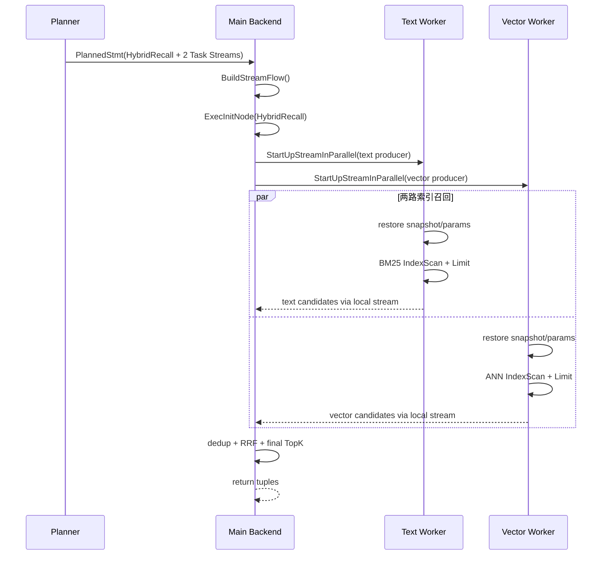

# openGauss 文本与向量两路并行召回算子详细设计与实施文档

> 文档状态：可实施设计 v1.1（尚未表示功能已实现）  
> 编写日期：2026-08-21  
> 核对源码：`/home/qiumc/data/code/cpp/openGauss-server`  
> 核对基线：`d98de98c8016ee99ac14079597ee7d76284904dd`  
> 目标读者：openGauss Planner、Executor、Stream/SMP、DataVec、OGAI 与测试开发人员  
> 关联文档：`openGauss_AnchorGuard混合TopK设计.md`  
> 优化器范围：仅接入 openGauss 原生 Planner，不包含其他优化器框架的适配

## 0. 文档定位

本文解决一个边界明确的问题：

```text
同一条查询中：

BM25 文本 Top-K ─────┐
                     ├─ 按 doc_id 去重 ─ RRF 融合 ─ 最终 Top-K
ANN 向量 Top-K ──────┘

要求 BM25 与 ANN 两条召回支路在 openGauss 内核中真实并发执行。
```

“真实并发”不是指：

- 为索引构建设置 `parallel_workers`；
- 仅把 `query_dop` 设置为 2；
- 把两个查询写进 `UNION ALL`；
- 在一个 backend 中先执行 BM25、再执行 ANN；
- 两条支路都出现在同一棵 EXPLAIN 树中，但运行时仍顺序拉取。

本文定义的真实并发是：

> 主查询线程在 `ExecutorStart` 阶段启动两个独立的数据库执行 worker；文本 worker
> 完整运行 BM25 Top-K 子计划，向量 worker 完整运行 ANN Top-K 子计划。两个 worker
> 使用同一条语句的事务快照，通过本地内存 Stream 把有界候选返回给父
> `HybridRecall` 算子，由父算子执行去重、RRF 和最终 Top-K。

本文包括：

1. 已存在能力与拟新增能力的事实边界；
2. SQL/OGAI 入口、逻辑语义和物理计划；
3. Planner、Plan、Executor、Stream、快照、错误与资源治理设计；
4. openGauss 原生 Planner、Plan、Executor 与 OGAI 接入设计；
5. 文件级修改清单和伪代码；
6. 可逐项执行的原子任务、提交拆分、构建和测试命令；
7. 正确性、真实性能、回滚和生产验收标准。

本文不是现成补丁。伪代码表达目标结构和调用关系；正式编码前必须再次核对目标分支
函数签名、编译宏和调用点。

---

## 1. 一句话方案与交付边界

### 1.1 一句话方案

在计划中加入一个阻塞型 `HybridRecall` 父算子，并在 BM25 与 ANN 两个子计划上分别
放置一个强制保留的 `producerDop=1 / consumerDop=1` 本地 Task Stream：

```text
HybridRecall
├─ Local Task Stream #text     → 一个 StreamProducer worker
│  └─ Limit(text_candidates)
│     └─ BM25 IndexScan
└─ Local Task Stream #vector   → 一个 StreamProducer worker
   └─ Limit(vector_candidates)
      └─ AnnIndexScan(HNSW/IVFFlat/DiskANN)
```

两个索引扫描自身保持串行；并行发生在两条不同支路之间。这是“任务并行”，不是把
一个索引的数据切成多份的“数据并行”。

### 1.2 V1 必须交付

- 单机/主备主节点上的只读 `SELECT`；
- 同一普通行存表上的文本列与向量列；
- BM25 与一个 ANN 索引各自返回有界候选；
- 两个 worker 真实时间重叠；
- 两路共享同一语句快照；
- 按稳定文档主键去重；
- RRF 融合和最终 Top-K；
- 两路公共过滤条件一致下推，并在父节点保留防御性 recheck；
- worker 不足时按配置串行降级或明确报错；
- 查询取消、statement timeout、任一支路 ERROR 能终止另一支路；
- `EXPLAIN (ANALYZE, VERBOSE)` 能证明是否并行、各路耗时和候选数；
- debug/cassert、release 和关键 memcheck 回归；
- 开关关闭后完全回到旧计划和旧执行路径。

### 1.3 V1 明确不做

- 不把 HNSW、IVFFlat、DiskANN 或 BM25 改造成单索引并行扫描；
- 不实现图片解码、Embedding 模型推理或 Rerank 模型服务；
- 不承诺任意 Join/子查询/窗口函数上方都能自动注入 HybridRecall；
- 不支持 DML、`SELECT FOR UPDATE`、游标反向扫描和 mark/restore；
- 不在 V1 宣称分布式全局 RRF 已完成；
- 不在 V1 支持无限候选或全表融合；
- 不直接修改通用 Append 的执行语义；
- 不把 `ogai.hybrid_search()` 当前 SQL 实现描述为已经并行。
- 不接入或维护其他优化器框架的算子、规则及计划序列化协议。

### 1.4 V1 推荐限制

```text
final_top_k                 1..100
text_candidates             final_top_k..1000
vector_candidates           final_top_k..1000
text_candidates + vector_candidates <= 2000
branch worker               固定 2 个
每个 branch 的内部 DOP      1
融合                       RRF
支持方向                    BM25 DESC、向量距离 ASC
```

上限是资源保护默认值，不是算法理论上限；修改上限前必须压测 Stream 缓冲、候选内存和
并发查询资源。

---

## 2. 当前源码事实与拟新增内容

### 2.1 已确认存在的能力

| 能力 | 当前源码事实 | 直接复用方式 |
|---|---|---|
| Stream worker | `StreamProducer` 可执行 Stream 左子树的计划副本 | 每条召回支路一个 producer |
| 线程池接入 | `ApplyStreamThread()` 从 Stream 线程池取 worker，非线程池模式启动 `STREAM_WORKER` | 不自行 `pthread_create` |
| 事务上下文 | `StreamTxnContext` 保存事务相关状态 | 两路继承主查询事务环境 |
| 快照 | `StartupStreamThread()` 取得 `estate->es_snapshot`，producer 复制并恢复 | 两路使用同一语句快照 |
| 参数 | producer 复制或引用 `ParamListInfo` | 支持 query text/vector 参数 |
| 本地内存交换 | Local Stream 使用 `StreamSharedContext` 和内存 tuple/batch 通道 | 候选不走网络 |
| 错误汇聚 | `StreamNodeGroup` 保存 producer 错误并同步退出 | 一路错误可传播到主线程 |
| BM25 | 当前 DataVec 源码包含 BM25 AM 和 Top-K 扫描能力 | 文本候选支路 |
| ANN | 当前源码包含 HNSW、IVFFlat、DiskANN 和 `AnnIndexScan` | 向量候选支路 |

关键源码入口：

- `src/gausskernel/process/stream/execStream.cpp`
  - `BuildStreamFlow()`；
  - `StartupStreamThread()`；
  - `StartUpStreamInParallel()`；
- `src/gausskernel/process/stream/streamProducer.cpp`
  - `StreamProducer::init()`；
  - `StreamProducer::setUpStreamTxnEnvironment()`；
- `src/gausskernel/process/stream/streamMain.cpp`
  - `ApplyStreamThread()`；
  - `execute_stream_plan()`；
- `src/gausskernel/cbb/communication/libcomm_utils/libcomm_memory.cpp`
  - 本地 Stream 的发送和接收；
- `src/gausskernel/runtime/executor/nodeAnnIndexscan.cpp`
  - ANN 执行器；
- `src/gausskernel/storage/access/datavec/bm25scan.cpp`
  - BM25 扫描实现。

### 2.2 当前明确不存在的能力

下列名称和行为均为本文拟新增，当前源码中不能假定存在：

```text
HybridRecall / HybridRecallState
HybridRecallPath
Local Task Stream
Stream::is_task_parallel
enable_hybrid_recall
hybrid_recall_parallel_mode
ogai.hybrid_rrf_marker(...)
```

### 2.3 现有行为为何不能直接满足需求

#### 普通 Append 是顺序拉取

`ExecAppend()` 使用 `as_whichplan` 逐个执行子计划。一个子计划返回 EOF 后才切换到下一个，
所以把两路写成 `UNION ALL` 并不自动获得 sibling concurrency。

#### 当前 ANN AM 不声明并行索引扫描

当前 HNSW、IVFFlat、DiskANN 的 `amcanparallel` 均为 `false`。因此 `query_dop=2` 不能
把单个 ANN IndexScan 安全拆给两个 worker。

#### SMP 文档中的 Append 支持不等于兄弟子计划并发

SMP 能让计划片段以不同 DOP 执行，但“某个 Append 节点处在 SMP 计划中”和“Append
同时调度所有子计划”是两件事。本功能必须建立两个显式 producer 任务边界。

#### 现有 1:1 Local Stream 会被优化掉

当前代码认为 `producerDop=1 && consumerDop=1` 的 Local Stream 无价值，会在创建或
清理计划时删除。对单条支路这个判断合理；但两个独立 1:1 Stream 能形成两支路任务并行，
因此本功能必须增加不可删除的 task-parallel 标记。

#### 当前 `ogai.hybrid_search()` 不是并行调度器

当前工作区的 `ogai.hybrid_search()` 构造包含 `vector_scores`、`bm25_scores`、
`FULL OUTER JOIN` 和最终 `LIMIT` 的动态 SQL。它没有显式创建两个 producer worker，
也不能仅凭 CTE 名称推断两支路并行。V1 应保留旧函数兼容性，新增明确的内核入口。

### 2.4 V1 已选定的设计决策

| ID | 决策 | 原因 |
|---|---|---|
| D-001 | 使用专用 `HybridRecall`，不修改通用 Append | 去重、融合、Top-K 和错误语义不同 |
| D-002 | 两个 1:1 Local Task Stream，每支路一个 worker | 实现 sibling task concurrency，不要求 AM 并行扫描 |
| D-003 | worker 由现有 Stream 线程池创建 | 复用 session、事务、快照、取消和 WLM |
| D-004 | V1 使用 RRF | BM25 分数和向量距离量纲不同 |
| D-005 | query embedding 在进入两分支前只生成一次 | 避免两个 worker 重复调用模型服务 |
| D-006 | V1 要求同一基表和稳定非空主键 | 简化去重、快照和 payload 一致性 |
| D-007 | V1 父节点阻塞式构建候选后输出 | RRF 需要两路完整 rank |
| D-008 | 任一分支 ERROR 导致整条语句 ERROR | 不静默改变混合召回语义 |
| D-009 | 只接入 openGauss 原生 Planner | 复用现有 Path → Plan → Executor 链路，控制实现和维护边界 |
| D-010 | 分布式全局融合不进入 V1 | local rank 不能直接当 global rank |

这些决策若在实现中改变，必须先更新本文的计划形态、验收用例和回退策略，不能只改代码。

---

## 3. 用户语义与 SQL 入口

### 3.1 推荐对外入口

对用户继续提供 OGAI 风格函数，不新增 SQL 关键字：

```sql
SELECT *
FROM ogai.hybrid_search_v2(
    p_task_name         => 'docs_task',
    p_query             => 'openGauss 并行向量检索',
    p_return_cols       => 'id,title,content',
    p_limit             => 10,
    p_where_clause      => 'tenant_id = 42',
    p_options           => '{
        "strategy": "parallel_rrf",
        "text_candidates": 100,
        "vector_candidates": 100,
        "rrf_k": 60,
        "weights": [0.5, 0.5],
        "on_worker_shortage": "serial"
    }'::jsonb
);
```

函数负责：

1. 从 `ogai.vectorize_tasks` 解析源表、主键、文本列、向量列和模型；
2. 生成一次 query embedding；
3. 生成带内部 marker 的关系型 SQL；
4. 若内核能力关闭或查询不满足约束，按明确策略调用旧串行 Hybrid；
5. 返回与旧接口兼容的 JSONB 或定义清晰的 record 类型。

Embedding 必须在主查询构造阶段只计算一次，并作为 `Const`/`Param` 传给向量支路；禁止
在两个 branch targetlist 中分别保留 `ogai_embedding(query, ...)`，否则可能产生两次
外部模型调用、不同结果和不可控延迟。

### 3.2 内核识别形态

推荐使用普通 SQL 表达式 marker，而不是新增 grammar：

```sql
SELECT id, title, content,
       ogai.hybrid_rrf_marker(
           id,
           content,
           embedding,
           $1::text,
           $2::vector,
           '{"text_candidates":100,
             "vector_candidates":100,
             "rrf_k":60,
             "weights":[0.5,0.5]}'::jsonb
       ) AS hybrid_score
FROM public.documents
WHERE tenant_id = 42
ORDER BY hybrid_score DESC
LIMIT 10;
```

该 marker 只用于 Planner 识别。正常执行计划中不应逐行调用 marker。若 marker 漏过
规划器进入表达式执行，C 实现必须报可诊断错误，不能静默返回错误分数：

```text
ERROR: ogai.hybrid_rrf_marker must be executed by HybridRecall plan
```

OGAI wrapper 在 `on_unsupported=legacy` 时不直接执行 marker，而是改走旧串行实现。

### 3.3 Planner 识别条件

V1 仅在全部满足时构造 HybridRecall 候选：

1. 单一目标普通表；
2. 顶层有限 `LIMIT K`，常量或可执行期求值的 Param；
3. 第一排序键是 `hybrid_rrf_marker(...) DESC`；
4. marker 的主键、文本列和向量列来自同一 RangeTblEntry；
5. 存在可用 BM25 索引和可用 ANN 索引；
6. 距离操作符与 ANN opclass 匹配；
7. 文本排序方向是 BM25 score DESC；
8. 查询没有行锁、DML、volatile 公共过滤表达式和不支持的相关子计划；
9. `K` 和候选上限通过资源校验；
10. 用户有表、列及函数权限。

不满足时的行为必须由 GUC/option 决定：

| 模式 | 行为 |
|---|---|
| `fallback` | 不生成 marker SQL，走旧 `ogai.hybrid_search()` |
| `serial` | 生成同语义的内核串行 HybridRecall，不启动 producer |
| `error` | 报出具体不支持原因，用于测试和审计 |

### 3.4 结果语义

每条候选至少包含：

```text
doc_id
source_mask          TEXT=1, VECTOR=2, BOTH=3
text_rank            未命中为 0
vector_rank          未命中为 0
text_raw_score       诊断字段
vector_raw_distance  诊断字段
hybrid_score         RRF 分数
payload              用户返回列或回表所需标识
```

RRF 定义：

```text
hybrid_score(doc) =
    text_weight   / (rrf_k + text_rank(doc))    [若文本路命中]
  + vector_weight / (rrf_k + vector_rank(doc)) [若向量路命中]
```

排序必须定义完整的确定性 tie-break：

```text
hybrid_score DESC,
source_mask DESC,
best_branch_rank ASC,
doc_id ASC
```

若主键类型不具备统一比较语义，可在内部使用主键类型的 B-tree comparator；不能通过
Datum 字节序或指针值排序。

---

## 4. 逻辑与物理计划

### 4.1 概念逻辑表达式

```text
LogicalLimit(K)
  └─ LogicalOrderBy(HybridRRF DESC)
      └─ LogicalHybridRecall(
           id      = documents.id,
           text    = documents.content,
           vector  = documents.embedding,
           query_text,
           query_vector,
           filter  = tenant_id = 42)
```

在 PostgreSQL 风格优化器中，可以不显式增加 Logical Node，而在识别 marker 后直接
生成特殊 Path。本项目不新增独立的逻辑查询节点，优化入口是原生 Planner 中受严格条件
约束的 `HybridRecallPath` 枚举。

### 4.2 推荐物理计划

```text
Limit  (final K=10，可在父 HybridRecall 内吸收)
  -> Hybrid Recall
       Strategy: Parallel RRF
       Candidate K: text=100, vector=100
       RRF k: 60
       Branch Workers: planned=2, actual=2
       Common Filter: tenant_id = 42
       -> Local Task Stream  branch=text, dop: 1/1
            -> Limit 100
                 -> BM25 Index Scan using documents_content_bm25
                      Order By: content <&> $query_text DESC
                      Filter: tenant_id = 42
       -> Local Task Stream  branch=vector, dop: 1/1
            -> Limit 100
                 -> Ann Index Scan using documents_embedding_hnsw
                      Order By: embedding <=> $query_vector
                      Filter: tenant_id = 42
```

每条支路都必须在 Stream 下方包含分支级 `Limit`。只在父节点最终 `LIMIT 10` 是不够的，
否则 worker 可能产生全表候选，破坏内存边界和 Top-K 索引路径。

### 4.3 串行回退计划

```text
Hybrid Recall
  Execution: Serial fallback
  -> Limit(text_candidates) -> BM25 Index Scan
  -> Limit(vector_candidates) -> Ann Index Scan
```

串行与并行计划必须共享同一个融合实现，保证差异只在调度方式，不在结果语义。

### 4.4 为什么不用通用 Append

`HybridRecall` 与 Append 的语义不同：

- Append 只是拼接行；HybridRecall 按主键去重；
- Append 可以流式返回；RRF 必须知道两路 rank 后才能稳定返回最终第一行；
- HybridRecall 有分支候选预算、权重和 final Top-K；
- HybridRecall 需要展示两路独立 instrumentation；
- HybridRecall 要在任一分支失败时应用专门的降级策略。

因此 V1 应新增专用父算子，不应先修改所有 Append 的执行语义。

---

## 5. 并行执行机制

### 5.1 线程模型

```text
Backend / Top Consumer
    HybridRecallState
    ├─ StreamState(text)
    └─ StreamState(vector)

Stream worker 0
    copied PlannedStmt
    Limit -> BM25 IndexScan

Stream worker 1
    copied PlannedStmt
    Limit -> AnnIndexScan
```

主线程和两个 worker 不共享可变 `PlanState`、`EState`、TupleSlot 或普通 MemoryContext。
共享范围仅限现有 Stream 的同步对象、只读/复制后的事务快照语义以及显式保护的统计字段。

### 5.2 启动时序



### 5.3 任务并行 Stream

每条支路创建一个现有 `Stream` 节点，建议配置：

```cpp
stream->type = STREAM_REDISTRIBUTE;
stream->smpDesc.distriType = LOCAL_ROUNDROBIN;
stream->smpDesc.producerDop = 1;
stream->smpDesc.consumerDop = 1;
stream->is_task_parallel = true;       /* 拟新增 */
stream->task_group_id = hybrid_id;     /* 可选，便于观测 */
stream->task_branch_id = branch_id;    /* TEXT / VECTOR */
```

选择 `LOCAL_ROUNDROBIN` 是因为 1 producer → 1 consumer 不需要 hash key，也不需要广播。
若目标分支实际对 `STREAM_REDISTRIBUTE + LOCAL_ROUNDROBIN` 有额外约束，应复用当前生成
Local Gather 的 helper，而不是只手填部分字段。

### 5.4 必须阻止 1:1 Stream 被删除

至少修改两类位置：

```cpp
/* create_stream_plan 类入口 */
if (consumerDop == 1 && producerDop == 1 && !stream->is_task_parallel)
    return subplan;

/* remove_local_plan */
if (is_local && consumerDop == 1 && producerDop == 1 &&
    !stream->is_task_parallel)
    remove_stream();
```

还必须全文检索所有基于 `1/1`、`dop <= 1` 或“local stream useless”做删除/折叠的逻辑，
逐一判断是否需要尊重该标志。

建议审计：

```bash
rg -n "consumerDop.*1|producerDop.*1|dop <= 1|remove_local_plan|LOCAL_ROUNDROBIN" \
  src/gausskernel/optimizer src/gausskernel/process/stream src/include
```

### 5.5 父节点如何消费两路

V1 使用“worker 同时启动、父节点有界顺序 drain”：

1. 两个 worker 在 `ExecutorStart` 中均已启动；
2. 父节点先 drain 文本 Stream 到本地候选表；
3. 同时向量 worker 已执行索引搜索并向自己的 Stream 缓冲写结果；
4. 文本 EOF 后父节点 drain 向量 Stream；
5. 执行融合。

候选上限很小时，这种方式实现简单且索引搜索已真实重叠。必须通过时间线测试验证，
不能仅凭线程数量宣称并行。

若候选规模扩大导致未被读取的一路频繁堵塞，Phase 3 再增加非阻塞多路消费：

```text
ExecStreamTryNext(text)
ExecStreamTryNext(vector)
若均 EMPTY：等待任一路 producer 的共享 latch/condition
```

不能在无 wait-any 机制时用高频 sleep 轮询。

### 5.6 为什么不直接创建 pthread

直接线程需要重新实现：

- `u_sess`、`t_thrd` 和数据库用户上下文；
- TransactionState、Snapshot、CommandId；
- ResourceOwner、MemoryContext；
- ERROR/longjmp 的跨线程传播；
- 锁、查询取消、statement timeout；
- WLM 和线程池配额；
- EXPLAIN instrumentation；
- 主备读取 LSN 和事务清理。

现有 Stream worker 已覆盖这些问题。除非经过设计评审决定抽象新的通用 TaskExecutor，
V1 禁止在 `nodeHybridRecall.cpp` 中调用 `pthread_create` 或 `std::thread`。

---

## 6. Plan、Path 与执行状态设计

### 6.1 `HybridRecallPath`

建议在内核中增加独立 Path：

```cpp
typedef enum HybridFusionKind {
    HYBRID_FUSION_RRF = 0
} HybridFusionKind;

typedef struct HybridRecallPath {
    Path path;

    Path* text_path;
    Path* vector_path;

    Index relid;
    AttrNumber id_attno;
    AttrNumber text_attno;
    AttrNumber vector_attno;

    Expr* query_text;
    Expr* query_vector;
    List* common_quals;

    int64 final_topk_est;
    int64 text_candidates_est;
    int64 vector_candidates_est;

    HybridFusionKind fusion;
    double rrf_k;
    double text_weight;
    double vector_weight;

    bool parallel_branches;
} HybridRecallPath;
```

说明：

- `Path` 不会像 Plan 那样跨线程执行，但仍要遵守 Path 生命周期；
- 参数化 `LIMIT` 不能只保存在 `*_est`，Plan 中还需保存 Expr；
- 公共过滤必须保留原表达式用于最终 recheck；
- `text_path` 与 `vector_path` 必须是同一快照语义下的只读路径；
- V1 不接受一个分支依赖另一个分支输出的参数化 Path。

### 6.2 `HybridRecall` Plan

建议使用原生 Plan，两个分支放入标准 `lefttree/righttree`，使现有默认 plan walker 和
`InitStreamFlow()` 默认分支能够遍历到两个 Stream：

```cpp
typedef struct HybridRecall {
    Plan plan;

    AttrNumber id_resno;
    AttrNumber text_score_resno;
    AttrNumber vector_distance_resno;

    Expr* final_topk;
    Expr* text_candidates;
    Expr* vector_candidates;

    HybridFusionKind fusion;
    double rrf_k;
    double text_weight;
    double vector_weight;

    bool parallel_branches;
    bool require_parallel;
    List* recheck_quals;
} HybridRecall;
```

约定：

```text
plan.lefttree   = text Task Stream 或文本串行子计划
plan.righttree  = vector Task Stream 或向量串行子计划
```

使用 `lefttree/righttree` 比把两个子计划藏在 private 指针中更安全，因为现有：

- plan walker；
- setrefs；
- explain；
- stream flow walker；
- plan node id 分配；
- 子计划结束与 rescan；

更容易按普通二叉 Plan 处理。仍需逐项增加 NodeTag case，不能假定默认 walker 自动正确处理
本节点的额外 Expr/List 字段。

### 6.3 `HybridRecallState`

```cpp
typedef enum HybridRecallPhase {
    HYBRID_PHASE_BUILD = 0,
    HYBRID_PHASE_OUTPUT,
    HYBRID_PHASE_DONE
} HybridRecallPhase;

typedef struct HybridCandidate {
    Datum id;
    bool id_isnull;
    uint8 source_mask;
    uint32 text_rank;
    uint32 vector_rank;
    double text_score;
    double vector_distance;
    double hybrid_score;
    MinimalTuple tuple;
} HybridCandidate;

typedef struct HybridRecallState {
    PlanState ps;

    PlanState* text_state;
    PlanState* vector_state;

    HybridRecallPhase phase;
    MemoryContext candidate_cxt;
    HTAB* by_doc_id;
    binaryheap* final_heap;       /* src/include/lib/binaryheap.h */
    HybridCandidate** output;
    uint32 output_count;
    uint32 output_pos;

    uint64 text_rows;
    uint64 vector_rows;
    uint64 dedup_rows;
    uint64 final_rows;

    instr_time text_first_tuple;
    instr_time text_end;
    instr_time vector_first_tuple;
    instr_time vector_end;
    instr_time fusion_time;

    bool actual_parallel;
    bool serial_fallback;
} HybridRecallState;
```

生产代码不能直接假设 `Datum` 可按字节复制：

- by-value 类型可直接保存；
- by-reference 主键必须在 `candidate_cxt` 中执行 `datumCopy()`；
- 哈希和比较必须调用类型缓存中的 hash/equality/B-tree comparator；
- `MinimalTuple` 必须复制到父节点拥有的 MemoryContext；
- 不得保存 worker TupleSlot、Buffer 页面地址或临时 detoast 指针。

### 6.4 Node 基础设施闭环

新增原生 Plan/State 至少要覆盖：

- `NodeTag`；
- `plannodes.h`；
- `execnodes.h`；
- `copyfuncs`；
- `equalfuncs`；
- `outfuncs`；
- `readfuncs`；
- expression/plan walker；
- `ExecInitNode`；
- `ExecProcNode`；
- `ExecEndNode`；
- `ExecReScan`；
- `EXPLAIN`；
- `setrefs`；
- plan node id、instrumentation 和内存估算 walker；
- single-node 与 `ENABLE_MULTIPLE_NODES` 编译分支。

必须通过 nodeToString/stringToNode 或仓库已有等价 round-trip 测试证明额外字段没有丢失。

---

## 7. Planner 详细设计

### 7.1 识别 marker

建议在基表 Path 枚举完成后，通过核心逻辑或受控 hook 调用：

```text
set_rel_pathlist()
  └─ 当前 rel 普通路径已经生成
      └─ TryAddHybridRecallPath(root, rel, rte)
```

`TryAddHybridRecallPath()` 必须：

1. 从顶层 `sortClause` 找到第一排序表达式；
2. 展开 `TargetEntry`，确认是目标 marker OID；
3. 校验列 Var 的 `varno/varattno/varlevelsup`；
4. 校验 LIMIT、排序方向和 NULLS 行为；
5. 解析 options 常量；Generic Plan 中对 Param 使用保守默认；
6. 在 `rel->indexlist` 中选择 BM25 和 ANN IndexOptInfo；
7. 构造两个分支 Path；
8. 构造串行和并行两个 HybridRecallPath 候选；
9. 通过 `add_path()` 参与代价竞争；
10. 若 require 模式下无法构造，记录精确 not-supported reason 并报错。

### 7.2 文本支路 Path

目标形态：

```text
Limit(text_candidates)
  -> BM25 IndexPath
       indexorderbys = content <&> query_text
       direction = backward/score-desc 对应的 AM 约定
       indexquals/common quals = 可安全下推部分
       qpquals = 其余过滤和 recheck
```

不能把 BM25 score 当成通用数值表达式后做全表 Sort。必须确认生成的 Path 使用 BM25 AM
的有序 Top-K 扫描；用 `EXPLAIN ANALYZE` 验证扫描候选数。

### 7.3 向量支路 Path

目标形态：

```text
Limit(vector_candidates)
  -> IndexPath
       indexorderbys = embedding <=> query_vector
       indexorderdir = Forward
       selected ANN index = HNSW / IVFFlat / DiskANN
```

`createplan.cpp` 当前会根据 ANN 索引路径生成 `AnnIndexScan`。实现者必须复用当前路径到
`AnnIndexScan` 的转换，不要平行复制一份容易漂移的 ANN Plan 构造器。

### 7.4 公共过滤条件

过滤分三类：

| 类型 | 文本支路 | 向量支路 | 父节点 |
|---|---:|---:|---:|
| 两路都能安全下推 | 下推 | 下推 | 保留 recheck |
| 仅文本 AM 可下推 | 下推 | 普通 qpqual/回表 | 保留 recheck |
| 仅 ANN 可 in-filter | 普通 qpqual/回表 | 下推 | 保留 recheck |
| volatile/subplan | V1 不支持并行 | V1 不支持并行 | 串行或报错 |

两条支路必须使用语义相同的租户、权限、时间范围和状态过滤。不能因为一条路径不支持
索引内过滤就把条件直接丢掉；最差也要在候选回表后 recheck。

### 7.5 分支级 Limit

常量 Limit 可直接生成 `Limit` Plan；参数 Limit 要在执行期求值，并验证：

```text
candidate_k >= final_k
candidate_k <= guc_max_candidates_per_branch
candidate_k_text + candidate_k_vector <= guc_max_candidates_total
```

参数化执行和 rescan 时必须重新求值，不能把第一次执行结果永久写回 Plan。

### 7.6 Path 属性

并行 HybridRecallPath 对上层交付：

```text
rows          = min(final_top_k, estimated_union_candidates)
dop           = 1              # 父输出仍是一条流
parallel_safe = 所有表达式和两分支都安全
pathkeys      = hybrid_score DESC + tie-break
distribution  = 子表当前单机 distribution
```

“内部启动两个 branch worker”不等于父 Path 的输出 DOP=2。父节点最终输出仍由主线程
串行产生。

### 7.7 marker 必须在 Plan 中被消除

RRF 依赖“某文档在两路候选中的 rank”，不能由普通逐行 SQL 函数独立计算。因此
`ogai.hybrid_rrf_marker()` 不能像普通 immutable 函数一样留在最终 targetlist 中执行。

Planner 在选择 HybridRecallPath 后必须：

1. 从普通表达式 targetlist 中移除或替换 marker `FuncExpr`；
2. 让 `HybridRecall` 结果 tuple 显式产生 `hybrid_score`；
3. 保持原 `sortgroupref`，使上层 ORDER BY/LIMIT 引用结果列；
4. 对用户显式选择的 `hybrid_score` 返回父节点计算值；
5. 用 plan walker 测试确认最终 Plan 中没有可执行 marker FuncExpr。

因为 row-wise fallback 无法保证与 RRF 相同的语义，包含 marker 的 Query Block 只能选择：

```text
Serial HybridRecall
Parallel HybridRecall
规划失败并由 OGAI 外层 wrapper 改走 legacy SQL
```

不能同时保留一个会逐行执行 marker 的普通 SeqScan/Sort Path 参加成本竞争。`auto` 的
竞争范围是“串行 HybridRecall 与并行 HybridRecall”，不是“正确 HybridRecall 与语义
不同的普通表达式计划”。

### 7.8 Stream 计数与计划标识

生成两个 Task Stream 后，必须让 `PlannedStmt` 的 Stream 元数据与实际计划一致：

- 两个 Stream 拥有不同且非零的 `plan_node_id`；
- `num_streams` 或目标分支等价计数能触发 `BuildStreamFlow()`；
- 两个 StreamKey 的 query id、plan node id、cursor level 组合不冲突；
- instrumentation 数组为父节点和两个分支预留位置；
- copy/serialize 后 task group/branch 标识不丢失。

具体计数由目标分支现有 plan-node-id/stream walker 生成时，应复用该 walker，不能在局部
代码中只写 `num_streams += 2` 后忽略嵌套计划、子计划和重新编号。

---

## 8. Executor 详细设计

### 8.1 初始化

`ExecInitHybridRecall()`：

```cpp
HybridRecallState* ExecInitHybridRecall(HybridRecall* plan,
                                        EState* estate,
                                        int eflags)
{
    RejectUnsupportedExecutorFlags(eflags);
    ValidateRuntimeOptions(plan, estate);

    state = makeNode(HybridRecallState);
    state->ps.plan = (Plan*)plan;
    state->ps.state = estate;
    state->ps.ExecProcNode = ExecHybridRecall;

    state->text_state = ExecInitNode(plan->plan.lefttree, estate, eflags);
    state->vector_state = ExecInitNode(plan->plan.righttree, estate, eflags);

    state->candidate_cxt = AllocSetContextCreate(...);
    state->by_doc_id = BuildCandidateHash(...);
    InitResultSlotAndProjection(...);
    state->phase = HYBRID_PHASE_BUILD;
    return state;
}
```

Stream producer 真正启动发生在整个计划初始化完成后的 `StartUpStreamInParallel()`，
不能在 `ExecInitHybridRecall()` 里重复启动。

### 8.2 首次执行：收集文本候选

```cpp
static void DrainTextBranch(HybridRecallState* state)
{
    uint32 rank = 0;
    for (;;) {
        TupleTableSlot* slot = ExecProcNode(state->text_state);
        if (TupIsNull(slot))
            break;

        rank++;
        ValidateBranchCardinality(rank, state->text_limit);
        UpsertTextCandidate(state, slot, rank);
        ResetExprContext(state->ps.ps_ExprContext);
    }
}
```

支路输出 schema 必须固定，例如：

```text
doc_id, text_score, vector_distance(NULL), payload/TID
```

父节点不应通过列名字符串猜字段位置；Plan 中保存 resno，初始化时验证类型。

### 8.3 收集向量候选

```cpp
static void DrainVectorBranch(HybridRecallState* state)
{
    uint32 rank = 0;
    for (;;) {
        TupleTableSlot* slot = ExecProcNode(state->vector_state);
        if (TupIsNull(slot))
            break;

        rank++;
        ValidateBranchCardinality(rank, state->vector_limit);
        UpsertVectorCandidate(state, slot, rank);
        ResetExprContext(state->ps.ps_ExprContext);
    }
}
```

### 8.4 去重

以业务稳定主键为首选；若使用 CTID：

- 同一语句快照内可用于临时候选关联；
- 不能跨语句、跨 VACUUM 或持久化；
- 分布式场景必须加入 DN 标识；
- HOT/update 可见性必须以回表结果为准。

因此 OGAI 任务必须要求一个非空稳定主键。V1 若主键为 NULL 或不支持 hash/equality，
应在规划期拒绝，而不是退化为指针比较。

### 8.4.1 V1 payload 策略

V1 两个支路使用相容 targetlist，至少输出：

```text
doc_id
branch raw score/distance
最终 SELECT 需要的 payload 列
```

候选第一次进入哈希表时，把 payload 复制成父节点拥有的 `MinimalTuple`；另一支路命中
相同 doc_id 时只补 rank/score。因为 V1 要求同一基表和同一语句快照，两路对应的可见
业务行应一致；debug 构建可校验关键列一致。

这种方案实现简单，但宽 payload 会增加 Stream 传输。后续优化可以让支路只发送
`doc_id/TID + score`，融合完成后仅对最终 K 条回表取 payload。后者必须重新设计 TID
生命周期、RLS/recheck 和 final heap fetch，不作为 V1 前置条件。

### 8.5 RRF 和最终 Top-K

所有候选收集完后：

```cpp
candidate->hybrid_score = 0.0;
if (candidate->text_rank != 0)
    candidate->hybrid_score += text_weight /
        (rrf_k + candidate->text_rank);
if (candidate->vector_rank != 0)
    candidate->hybrid_score += vector_weight /
        (rrf_k + candidate->vector_rank);
```

使用容量为 `final_top_k` 的最小堆：

```text
遍历 N <= text_candidates + vector_candidates 个候选
时间复杂度 O(N log K)
额外堆内存 O(K)
```

最终输出数组按完整 tie-break 排序。浮点比较需要统一处理 NaN：非法分数直接报错或
按最低相关性处理，策略必须固定并测试。

### 8.6 输出

第一次 `ExecHybridRecall()` 完成 BUILD 后切换到 OUTPUT；后续每次调用返回一条：

```cpp
if (state->phase == HYBRID_PHASE_OUTPUT &&
    state->output_pos < state->output_count) {
    return StoreHybridResult(state,
        state->output[state->output_pos++]);
}

state->phase = HYBRID_PHASE_DONE;
return ExecClearTuple(state->ps.ps_ResultTupleSlot);
```

### 8.7 End、EarlyFree 和取消

`ExecEndHybridRecall()` 必须：

1. 对尚未结束的两支路发出停止信号；
2. 等待 producer 进入安全退出点；
3. `ExecEndNode(text_state/vector_state)`；
4. 释放 hash、MinimalTuple、heap 和 candidate context；
5. 不二次释放由 StreamNodeGroup 拥有的共享上下文；
6. 保留第一条 producer ERROR 并向主线程传播；
7. 清理 instrumentation。

主线程上层 Limit 若提前停止，必须确保未消费完的另一路不会永远阻塞在本地 Stream
发送端。应复用 StreamNodeGroup 的 stop/cancel 协议，而不是只把本地指针置空。

### 8.8 Rescan

V1 推荐策略：

```text
无参数且不会 rescan：支持
普通 ExecReScan：重新启动两支路或使用串行路径，开发完成后开放
相关子查询/参数化 NestLoop 内侧：V1 规划期拒绝并行 HybridRecall
```

如果实现 rescan，必须：

- 重新计算 Param query text/vector 与 candidate limits；
- 清空 candidate context 和所有 rank；
- 不能复用上一轮 producer EOF 状态；
- 给每轮分配 generation id，丢弃迟到的旧消息；
- 测试 100 次不同参数执行无串值、无 worker 泄漏。

---

## 9. 快照、锁、权限与一致性

### 9.1 同一语句快照

主线程在启动 Stream worker 时保存 `estate->es_snapshot`；每个 producer 复制并恢复。
本功能必须走该现有流程，禁止自行调用 `GetTransactionSnapshot()` 为两个分支分别取新快照。

验收场景：

1. 会话 A 开始 HybridRecall 并在测试 barrier 暂停两个 worker；
2. 会话 B 插入/更新/删除候选并提交；
3. 释放 barrier；
4. 两路都只能看到会话 A 语句快照允许的数据；
5. 不允许文本路看到新版本而向量路看到旧版本。

### 9.2 权限和 RLS

- Planner marker 不能绕过普通表权限；
- 两分支必须包含同样的 RLS/security quals；
- OGAI wrapper 动态表名必须使用 `regclass`/`quote_ident`，不能直接拼接用户字符串；
- `p_where_clause TEXT` 是旧接口遗留风险，新接口推荐结构化 filter 参数；
- 若仍接受文本 where clause，必须限制调用者或安全解析，不能作为任意 SQL 片段透传。

### 9.3 锁

V1 只读 worker 不获取额外行锁。关系锁应按正常 Planner/Executor 生命周期持有到语句结束。
若任一分支需要 `FOR UPDATE/SHARE`，拒绝并行计划。

---

## 10. 错误处理、降级与资源治理

### 10.1 错误矩阵

| 场景 | 默认行为 | 可选行为 |
|---|---|---|
| BM25 索引不存在 | 规划期走 legacy/serial | require 模式报错 |
| ANN 索引不存在 | 规划期走 legacy/serial | require 模式报错 |
| worker 池不足 | 串行 HybridRecall | `error` |
| 文本 worker ERROR | 取消向量 worker，整条语句 ERROR | V1 不返回单路结果 |
| 向量 worker ERROR | 取消文本 worker，整条语句 ERROR | V1 不返回单路结果 |
| statement timeout | 取消两路并退出 | 无 |
| 用户 cancel | 取消两路并退出 | 无 |
| candidate 超过硬上限 | ERROR，终止两路 | 无 |
| query vector 维度错误 | 执行前/ANN 分支 ERROR | 无 |
| RRF 参数非法 | 规划期或执行前 ERROR | 无 |

V1 不建议在一条支路运行失败后静默返回另一条支路结果，因为这会改变查询语义且难以审计。
如果未来加入 partial-result 模式，必须在结果和 EXPLAIN 中显式标记 degraded。

### 10.2 worker 配额

建议增加会话级 GUC：

```text
enable_hybrid_recall                  on
hybrid_recall_parallel_mode          auto   # off/auto/force
hybrid_recall_on_worker_shortage      serial # serial/error
hybrid_recall_max_candidates_branch   1000
hybrid_recall_max_candidates_total    2000
hybrid_recall_rrf_k                   60
hybrid_recall_stream_startup_cost     待标定
```

`force` 只表示优先生成并选择并行候选，不能绕过正确性约束和资源硬上限。

### 10.3 并发预算

一条并行 HybridRecall 消耗：

```text
1 个主 backend
2 个 Stream producer worker
2 个索引扫描资源
2 个支路 Stream 缓冲
1 个父节点候选哈希表
```

高并发下可能比串行更慢。`auto` 模式应考虑：

- 当前活动查询数；
- Stream worker 配额；
- CPU 利用率；
- ANN/BM25 是否争用同一存储设备；
- 候选大小和 tuple width；
- 两支路预计耗时是否足以覆盖启动开销。

---

## 11. 代价模型

### 11.1 符号

```text
Ct_start, Ct_run     文本支路启动/运行成本
Cv_start, Cv_run     向量支路启动/运行成本
Cs                   两个 Stream worker 启动和本地传输成本
Cf                   去重、RRF、Top-K 成本
Rt, Rv               两路候选行数
W                    候选 tuple width
Pw                   worker 紧张惩罚
Pi                   I/O 竞争惩罚
```

### 11.2 串行成本

```text
Cserial = Ct_start + Ct_run + Cv_start + Cv_run + Cf
```

### 11.3 并行延迟成本

```text
Cparallel_latency =
    Cs + max(Ct_start + Ct_run, Cv_start + Cv_run) + Cf + Pw + Pi
```

### 11.4 资源成本

只比较延迟会在高并发下过度选择并行计划，因此另记录：

```text
Cparallel_resource =
    Ct_run + Cv_run + stream_bytes(Rt + Rv, W) + candidate_memory
```

V1 可以把资源成本折成惩罚加入 total cost；后续可接入 WLM admission。

### 11.5 初始选择规则

在统计未标定前使用保守规则：

```text
if min(estimated_text_ms, estimated_vector_ms) < stream_startup_threshold:
    prefer serial
else if available_stream_workers < 2:
    serial/error
else:
    compare Cserial and Cparallel_latency
```

不能硬编码“Hybrid 一律并行”。一条 0.2 ms BM25 和一条 0.4 ms ANN 查询，启动两个
worker 很可能更慢。

### 11.6 成本标定数据

每个数据规模至少测：

```text
BM25-only: startup、first tuple、total、posting visited
ANN-only: startup、first tuple、total、visited vectors/pages
Serial Hybrid: 两路顺序总耗时
Parallel Hybrid: branch overlap、stream wait、fusion
```

分别覆盖缓存热/冷、HNSW/DiskANN、不同 candidate K 和过滤选择率。

---

## 12. EXPLAIN 与真实性证明

### 12.1 EXPLAIN 目标输出

```text
Hybrid Recall
  Strategy: Parallel RRF
  Final Top-K: 10
  Text Candidates: 100
  Vector Candidates: 100
  RRF k: 60
  Weights: text=0.5 vector=0.5
  Planned Branch Workers: 2
  Actual Branch Workers: 2
  Parallel Fallback: false
  Candidate Rows: text=100 vector=100 deduplicated=147
  Timing: text=7.4 ms vector=11.8 ms fusion=0.3 ms
  Branch Overlap: 7.0 ms
  -> Local Task Stream (branch=text, dop: 1/1)
       -> Limit
            -> BM25 Index Scan ...
  -> Local Task Stream (branch=vector, dop: 1/1)
       -> Limit
            -> Ann Index Scan ...
```

### 12.2 并行真实性指标

必须记录单调时钟时间戳：

```text
text_start, text_end
vector_start, vector_end

overlap = max(0,
    min(text_end, vector_end) - max(text_start, vector_start))
```

验收不能只看两个 worker PID/TID；必须满足：

```text
actual_workers == 2
overlap > 0
```

稳定压测建议要求：

```text
overlap / min(text_duration, vector_duration) >= 0.50
```

极短查询容易受调度噪声影响，不作为并行真实性主样本。

### 12.3 测试 barrier

建议仅在 `USE_ASSERT_CHECKING` 或测试 hook 下提供：

```text
hybrid_recall_test_barrier = off/text/vector/both
hybrid_recall_test_delay_ms = 0
```

测试可以让两 worker 在开始索引扫描后等待同一个 barrier，再同时释放，确定性证明它们
已经被同时启动。测试 GUC 不得进入 release 生产行为。

---

## 13. 文件级修改清单

以下是预计主要文件，不代表完整调用点。正式实现时必须用 `rg` 重新生成事实清单。

### 13.1 openGauss Node/Executor

| 文件 | 预计修改 |
|---|---|
| `src/include/nodes/nodes.h` | 新增 Path/Plan/State NodeTag |
| `src/include/nodes/relation.h` | `HybridRecallPath` |
| `src/include/nodes/plannodes.h` | `HybridRecall`；Stream task 标记 |
| `src/include/nodes/execnodes.h` | `HybridRecallState` |
| `src/include/executor/node/nodeHybridRecall.h` | 生命周期函数声明 |
| `src/gausskernel/runtime/executor/nodeHybridRecall.cpp` | 收集、去重、RRF、Top-K、End/ReScan |
| `src/gausskernel/runtime/executor/execProcnode.cpp` | Init/End dispatch |
| `src/gausskernel/runtime/executor/execAmi.cpp` | ReScan/mark capability |
| Executor 构建文件 | 编译新源文件 |

### 13.2 Node copy/read/out/equal/walker

| 文件族 | 修改 |
|---|---|
| `src/common/backend/nodes/copyfuncs.cpp` | 深拷贝 Plan 字段 |
| `src/common/backend/nodes/equalfuncs.cpp` | 比较字段 |
| `src/common/backend/nodes/outfuncs.cpp` | 序列化字段 |
| `src/common/backend/nodes/readfuncs.cpp` | 反序列化字段 |
| `src/gausskernel/optimizer/plan/setrefs.cpp` | 设置两子树及额外 Expr 引用 |
| plan/expression walker 文件 | 遍历 extra Expr/List |

具体文件名以目标分支 `rg -n 'T_AnnIndexScan|T_Append' src/common src/gausskernel src/include`
结果为准。

### 13.3 Planner/Cost/Explain

| 文件 | 修改 |
|---|---|
| `src/gausskernel/optimizer/path/allpaths.cpp` | 调用 Hybrid Path 枚举或 hook |
| `src/gausskernel/optimizer/util/pathnode.cpp` | Path 构造 helper |
| `src/gausskernel/optimizer/path/costsize.cpp` | 串行/并行成本 |
| `src/gausskernel/optimizer/plan/createplan.cpp` | Path → Plan、两支路 Task Stream |
| `src/gausskernel/optimizer/plan/streamplan_utils.cpp` | 不删除 task 1:1 Stream |
| `src/gausskernel/process/stream/execStream.cpp` | task stream 观测/必要校验 |
| `src/gausskernel/optimizer/commands/explain.cpp` | Hybrid/branch 字段 |

### 13.4 GUC/OGAI

| 文件 | 修改 |
|---|---|
| `src/common/backend/utils/misc/guc/guc_sql.cpp` | GUC 注册（若采用内核 GUC） |
| `src/include/knl/knl_guc/knl_session_attr_sql.h` | session 字段 |
| `contrib/ogai/ogai--*.sql` | `hybrid_search_v2`、marker、升级脚本 |
| `src/gausskernel/storage/access/datavec/ogai_sql/ogai_functions.sql` | 若项目保留 SQL 镜像，同步生成 |
| `contrib/ogai/*.cpp` | wrapper、options 校验和 legacy fallback |

两份 OGAI SQL 若都存在，必须确定单一生成源，不能人工维护两份长期漂移的定义。

## 14. 实施任务与阶段闸门

### 14.1 固定开发循环

每个原子任务都必须执行：

```text
确认事实和调用点
    ↓
先加失败测试或结构断言
    ↓
做最小代码修改
    ↓
编译受影响目录
    ↓
运行目标回归
    ↓
运行旧 BM25/ANN 回归
    ↓
git diff --check + 调用点复核
    ↓
独立 commit（不 push）
```

禁止一次性同时修改 Node、Planner、Stream、Executor 后才第一次编译。

### 14.2 S0：基线固化

| ID | 操作 | 完成判据 |
|---|---|---|
| S0-1 | 记录 commit、编译器、binarylibs、架构、构建命令 | `BASELINE.md` 完整 |
| S0-2 | debug/cassert 全量编译 | 成功，日志归档 |
| S0-3 | 跑 BM25-only、HNSW-only、DiskANN-only | 全过 |
| S0-4 | 记录串行 OGAI Hybrid EXPLAIN/结果/耗时 | 基线可重复 |
| S0-5 | 生成确定性测试数据与 golden result | 固定 seed，重复一致 |

闸门 G0：现有单路检索和串行 Hybrid 基线没有失败，才允许修改共享 Node/Stream。

### 14.3 P0：Node 和串行 HybridRecall

| ID | 操作 | 主要验证 |
|---|---|---|
| P0-1 | 增加 NodeTag、Path、Plan、State 空结构 | single/multiple-node 编译 |
| P0-2 | copy/equal/out/read/walker 闭环 | round-trip 测试 |
| P0-3 | Exec dispatch 与空生命周期 | EXPLAIN 空计划不崩溃 |
| P0-4 | 串行收集两路候选 | 与两个单路 SQL 候选一致 |
| P0-5 | doc_id 去重和 RRF | golden result 一致 |
| P0-6 | Top-K heap、tie-break、NULL/NaN | 边界测试 |
| P0-7 | End、EarlyFree、无参数 ReScan | memcheck 无泄漏/UAF |

闸门 G1：串行 HybridRecall 结果完全正确，才能加入并行；不要用并行掩盖基础融合错误。

### 14.4 P1：Task Stream 并行

| ID | 操作 | 主要验证 |
|---|---|---|
| P1-1 | 为 Stream 增加 `is_task_parallel` | copy/out/read/equal 闭环 |
| P1-2 | 保留 1:1 Local Task Stream | EXPLAIN 中两节点存在 |
| P1-3 | 构造两个 branch Stream | `num_streams` 和 plan ids 正确 |
| P1-4 | 两 producer 启动并共享快照 | barrier + MVCC 测试 |
| P1-5 | 父节点有界 drain | 两路无死锁，候选上限生效 |
| P1-6 | ERROR/cancel/timeout 联动 | 无遗留 worker |
| P1-7 | worker shortage 串行降级 | 结果与串行一致 |
| P1-8 | instrumentation 和 overlap | EXPLAIN 可证明并行 |

闸门 G2：真实 overlap、同快照、取消无泄漏三项全部通过。

### 14.5 P2：Planner 与成本

| ID | 操作 | 主要验证 |
|---|---|---|
| P2-1 | marker 解析与白名单 | 非法形态不误匹配 |
| P2-2 | BM25 branch Path | 真实 BM25 IndexScan + branch Limit |
| P2-3 | ANN branch Path | HNSW/DiskANN AnnIndexScan + branch Limit |
| P2-4 | 公共 filter 下推/recheck | 结果无漏行/越权 |
| P2-5 | 串行/并行 Path 同时入候选 | GUC/hint 可分别强制 |
| P2-6 | 初始成本模型 | 不对极短查询盲目并行 |
| P2-7 | prepared/custom/generic plan | 参数不同结果正确 |

闸门 G3：自动选择、强制串行、强制并行三种模式均可测且语义一致。

### 14.6 P3：OGAI 接口和生产化

| ID | 操作 | 主要验证 |
|---|---|---|
| P3-1 | `hybrid_search_v2` 与 options | API/权限/注入测试 |
| P3-2 | legacy fallback | 开关关闭完全兼容 |
| P3-3 | GUC 和资源硬上限 | 超限可诊断 |
| P3-4 | EXPLAIN/日志/WLM | 字段可观测且无敏感 query 泄露 |
| P3-5 | debug/release/memcheck | 全部通过 |
| P3-6 | 主备查询、故障切换后重试 | 语义明确（已验证，见 P3-6 evidence） |
| P3-7 | 性能矩阵 | 达到第 18 节门槛 |

闸门 G4：具备默认关闭、可灰度、可回退、可观测的生产候选版本。

## 15. 推荐提交拆分

```text
1. test(hybrid): add deterministic BM25/ANN/RRF baseline
2. feat(nodes): add HybridRecall plan and state serialization
3. feat(executor): add serial HybridRecall RRF executor
4. test(executor): cover dedup, tie-break, end and rescan
5. feat(stream): preserve task-parallel 1:1 local streams
6. feat(executor): run HybridRecall branches in two stream workers
7. test(stream): prove overlap, snapshot and cancellation
8. feat(planner): build BM25 and ANN HybridRecall branches
9. cost(planner): compare serial and parallel hybrid paths
10. feat(explain): expose branch workers, timing and overlap
11. feat(ogai): add hybrid_search_v2 and legacy fallback
12. test(hybrid): add prepared, RLS, resource and fault cases
13. docs(hybrid): add deployment, tuning and rollback guide
```

提交原则：

- 每个 commit 单独可编译；
- 测试提交可先于功能提交，体现失败到通过；
- 不混入格式化、生成物或其他用户改动；
- commit body 写明修改前/后调用链、编译配置和测试；
- 可以本地 commit，但未经用户明确授权不得 push。

---

## 16. 构建与运行操作

### 16.1 基线记录

当前工作区已有与本功能无关的修改和生成物。实现者必须保护它们，优先创建独立分支或
worktree，不得使用 `git reset --hard`、`git clean -fdx` 或覆盖用户文件。

执行前记录：

```bash
cd /home/qiumc/data/code/cpp/openGauss-server
git rev-parse HEAD
git status --short
uname -m
g++ --version
```

### 16.2 推荐脚本：编译、安装和重启

当前工作区推荐使用下列脚本完成开发环境的一键编译、安装和实例重启：

```text
/home/qiumc/data/code/cpp/deliverables/multimodal_optimizer/opengauss_build_install_restart.sh
```

脚本必须由普通用户执行，支持三种模式：

| 模式 | 实际行为 | 适用场景 |
|---|---|---|
| `incremental` | 增量 `make`，随后安全停库、`make install`、启动和检查 | 普通 C/C++ 源码修改后的日常开发 |
| `full` | `make clean`、重新 `configure`、全量 `make`，随后安装、重启和检查 | 配置、公共头文件或构建依赖变化 |
| `restart` | 不编译、不安装，只安全停库并重新启动和检查 | 仅需重启实例或验证启动流程 |

常用命令：

```bash
# 日常增量编译、安装和重启
/home/qiumc/data/code/cpp/deliverables/multimodal_optimizer/opengauss_build_install_restart.sh incremental

# 重新 configure，并执行全量 debug/cassert 编译、安装和重启
JOBS=8 /home/qiumc/data/code/cpp/deliverables/multimodal_optimizer/opengauss_build_install_restart.sh full

# 只重启当前安装对应的测试实例
/home/qiumc/data/code/cpp/deliverables/multimodal_optimizer/opengauss_build_install_restart.sh restart
```

脚本默认使用：

```text
CODE_BASE  = /home/qiumc/data/code/cpp/openGauss-server
BINARYLIBS = /home/qiumc/data/code/cpp/binarylibs
GAUSSHOME  = /home/qiumc/data/code/cpp/openGauss-server/mppdb_temp_install
PGDATA     = /home/qiumc/data/code/cpp/openGauss-server/topk_test_data
PGPORT     = 55440
JOBS       = 4
DB_USER    = 当前操作系统用户
LOG_DIR    = /home/qiumc/data/code/cpp/openGauss-server/build_logs
```

需要切换到独立测试实例时，应在同一条命令中显式覆盖目标，避免误停其他实例：

```bash
PGDATA=/home/qiumc/data/opengauss/data/hybrid_recall_dev \
PGPORT=15433 \
DB_USER="$USER" \
/home/qiumc/data/code/cpp/deliverables/multimodal_optimizer/opengauss_build_install_restart.sh incremental
```

执行前必须确认：

- `CODE_BASE` 是准备编译的源码树，`GAUSSHOME` 是允许覆盖的测试安装目录；
- `PGDATA` 已经初始化且存在 `PG_VERSION`；脚本不会初始化、删除或重建数据目录；
- `PGPORT` 未被其他实例占用，`DB_USER` 能连接 `postgres` 数据库；
- `BINARYLIBS/buildtools/gcc10.3` 完整可用；
- `full` 模式当前采用 debug、cassert、thread-safety 配置；release 和 memcheck 仍需按下文
  的标准构建命令单独验证。

脚本会将完整输出写入 `${LOG_DIR}/<mode>_<timestamp>.log`。SQL 连通性检查失败时，如果
`gs_ctl status` 已成功，脚本只给出认证相关警告；此时不能把本次运行记录为完整通过，
必须检查 `DB_USER`、`pg_hba.conf` 和服务端日志。

### 16.3 手工 debug 构建环境

```bash
export HYBRID_CODE_BASE=/home/qiumc/data/code/cpp/openGauss-server
export HYBRID_BINARYLIBS=/home/qiumc/data/code/cpp/binarylibs
export HYBRID_GAUSSHOME="$HYBRID_CODE_BASE/mppdb_temp_install"
export HYBRID_GCC_PATH="$HYBRID_BINARYLIBS/buildtools/gcc10.3"

export PATH="$HYBRID_GAUSSHOME/bin:$HYBRID_GCC_PATH/gcc/bin:$PATH"
export LD_LIBRARY_PATH="$HYBRID_GAUSSHOME/lib:$HYBRID_GCC_PATH/gcc/lib64:$HYBRID_GCC_PATH/isl/lib:$HYBRID_GCC_PATH/mpc/lib:$HYBRID_GCC_PATH/mpfr/lib:$HYBRID_GCC_PATH/gmp/lib:${LD_LIBRARY_PATH:-}"
```

首次配置或共享 Node/CMake 配置变化后：

```bash
cd "$HYBRID_CODE_BASE"

CC=g++ CFLAGS='-O0' ./configure \
    --gcc-version=10.3.0 \
    --prefix="$HYBRID_GAUSSHOME" \
    --3rd="$HYBRID_BINARYLIBS" \
    --enable-debug \
    --enable-cassert \
    --enable-thread-safety \
    --without-readline \
    --without-zlib \
    --without-libxml \
    --enable-mot \
    --enable-bbox \
    --enable-htap
```

编译和安装：

```bash
cd "$HYBRID_CODE_BASE"
make -j4
make install -j1
```

标准仓库若具备完整 build 脚本，也必须验证：

```bash
sh build.sh -m debug -3rd "$HYBRID_BINARYLIBS"
sh build.sh -m release -3rd "$HYBRID_BINARYLIBS"
sh build.sh -m memcheck -3rd "$HYBRID_BINARYLIBS"
```

当前分支是否可直接使用 `build.sh` 以实际执行结果为准，不能只因文档存在就假定脚本完整。

### 16.4 手工初始化独立测试实例

使用独立数据目录，不覆盖已有实例：

```bash
export HYBRID_PGDATA=/home/qiumc/data/opengauss/data/hybrid_recall_dev
export HYBRID_PGPORT=15433

mkdir -p "$HYBRID_PGDATA"
chmod 700 "$HYBRID_PGDATA"

gs_initdb \
    -D "$HYBRID_PGDATA" \
    --nodename=hybrid_recall_dev \
    -E UTF-8 \
    --no-locale \
    -U "$USER" \
    -W

gs_guc set -D "$HYBRID_PGDATA" \
    -c "port = $HYBRID_PGPORT" \
    -c "listen_addresses = 'localhost'"

gs_ctl start -D "$HYBRID_PGDATA" -Z single_node \
    -l "$HYBRID_PGDATA/server.log"
```

`-W` 会交互输入密码，不要把密码写进文档、命令历史或测试脚本。

### 16.5 基本冒烟

```bash
gsql -X -d postgres -p "$HYBRID_PGPORT" -U "$USER" \
    -c "SELECT version();"

gsql -X -d postgres -p "$HYBRID_PGPORT" -U "$USER" \
    -c "SHOW enable_hybrid_recall;"
```

安装 OGAI 后：

```bash
make -C contrib/ogai -j
make -C contrib/ogai install

gsql -X -d postgres -p "$HYBRID_PGPORT" -U "$USER" \
    -c "CREATE EXTENSION IF NOT EXISTS ogai;"
```

安装会修改目标 `$GAUSSHOME`，执行前必须确认它确实是测试实例安装目录。

### 16.6 定向回归

建议新增：

```text
src/test/regress/sql/hybrid_recall.sql
src/test/regress/expected/hybrid_recall.out
src/test/regress/sql/hybrid_recall_parallel.sql
src/test/regress/expected/hybrid_recall_parallel.out
src/test/regress/sql/hybrid_recall_mvcc.sql
src/test/regress/expected/hybrid_recall_mvcc.out
```

加入相应 schedule 后，在已有 build tree 中运行目标测试。仓库 `pg_regress` 参数随分支可能
变化，优先复用当前项目已经成功执行的 fastcheck/installcheck 命令。至少运行：

```text
hybrid_recall
hybrid_recall_parallel
diskann_vector
hnsw_*_vector
BM25 现有查询/构建回归
OGAI 现有回归
```

不能只更新 expected 使测试变绿；必须先查看 `regression.diffs` 和服务端日志解释每一处差异。

### 16.7 静态审计

每次共享 Node 修改后：

```bash
git diff --check

rg -n "HybridRecall|T_HybridRecall|is_task_parallel" \
  src/common src/gausskernel src/include contrib/ogai

rg -n "T_AnnIndexScan|T_Append|T_Stream" \
  src/common/backend/nodes \
  src/gausskernel/optimizer \
  src/gausskernel/runtime/executor \
  src/include

rg -n "consumerDop.*1|producerDop.*1|remove_local_plan|dop <= 1" \
  src/gausskernel/optimizer src/gausskernel/process/stream
```

这些结果不是要求为零，而是逐条分类：已处理、无需处理、受编译宏保护、后续任务。

---

## 17. 测试矩阵

### 17.1 功能正确性

| 编号 | 场景 | 断言 |
|---|---|---|
| F01 | 文本和向量命中完全相同 | 去重后每 doc 一条，source=BOTH |
| F02 | 两路完全不重叠 | 并集 RRF 正确 |
| F03 | 部分重叠 | rank/score 手算一致 |
| F04 | 一路零结果 | 另一条路结果正确，非 ERROR |
| F05 | 两路零结果 | 返回 0 行 |
| F06 | 候选数小于 final K | 返回真实数量 |
| F07 | 权重不等 | 排名符合公式 |
| F08 | 大量同分 | tie-break 稳定 |
| F09 | 主键 text/int/uuid | hash/equality/copy 正确 |
| F10 | NULL/NaN/非法参数 | 明确错误或固定行为 |

### 17.2 计划正确性

| 编号 | 场景 | EXPLAIN 断言 |
|---|---|---|
| P01 | force parallel | HybridRecall + 两个 Task Stream |
| P02 | force serial | 无 producer，两个串行 child |
| P03 | auto 极短查询 | 可选择 serial |
| P04 | 无 BM25 索引 | fallback/error 符合配置 |
| P05 | 无 ANN 索引 | fallback/error 符合配置 |
| P06 | 不支持子查询 | 不误生成并行计划 |
| P07 | 公共过滤 | 两支路都保留语义 |
| P08 | 参数 LIMIT | runtime 值生效 |

### 17.3 并行真实性

| 编号 | 场景 | 断言 |
|---|---|---|
| C01 | 两支路 barrier | 两 worker 均到达后才能释放 |
| C02 | 人工每路延迟 200 ms | 总耗时接近 200 ms，不接近 400 ms |
| C03 | EXPLAIN overlap | overlap > 0 |
| C04 | worker shortage | 串行降级，无半启动 worker |
| C05 | 100 次循环 | worker 数不增长 |

人工延迟只用于测试 hook，不能用 SQL `pg_sleep()` 替代真实 worker 内部 barrier 后就宣称
索引扫描并行。

### 17.4 MVCC 与并发

| 编号 | 操作 | 断言 |
|---|---|---|
| M01 | 执行中并发 INSERT COMMIT | 两路快照一致 |
| M02 | 执行中 UPDATE 文本/向量 | 不拼接两个版本 |
| M03 | 执行中 DELETE | 可见性一致 |
| M04 | 长事务 + VACUUM | 无不可见行/UAF |
| M05 | RLS/租户条件 | 无越权候选 |

### 17.5 错误、取消和资源

| 编号 | 场景 | 断言 |
|---|---|---|
| E01 | 文本 worker ERROR | 向量 worker 被取消 |
| E02 | 向量 worker ERROR | 文本 worker 被取消 |
| E03 | statement timeout | 主线程和两 worker 全退出 |
| E04 | 客户端 cancel | 无 hang、无残留锁 |
| E05 | candidate 超限 | 执行前或有界位置 ERROR |
| E06 | OOM/fault injection | 第一错误正确传播 |
| E07 | 上层 LIMIT 提前结束 | producer 不阻塞泄漏 |

### 17.6 兼容回归

- `enable_hybrid_recall=off` 时计划和结果保持旧行为；
- 普通 BM25 查询不出现 Task Stream；
- 普通 ANN 查询不出现 Task Stream；
- 普通 Append/Union All 执行顺序和结果不变；
- 普通 SMP SeqScan/Agg/Join 回归不变；
- OGAI 旧函数签名和升级脚本兼容；
- 主备恢复、升级和降级门控不因新 Plan node 破坏。

### 17.7 主备查询与故障切换重试语义

V1 的正式支持范围是单机和主备架构**当前主节点**上的只读 `SELECT`。当备节点启用
`hot_standby`、扩展与内核版本一致且所需索引已回放时，HybridRecall 只读查询可以在备端
执行；但这不额外承诺备读延迟、索引回放时效或读流量 SLA。

故障切换不提供透明会话迁移，也不提供 SELECT 结果流的 exactly-once 交付：

1. 旧主失联时，当前语句返回连接错误；即使客户端已经收到部分行，也必须丢弃该次全部
   结果，不能与重试结果拼接。
2. 客户端等待路由确认新节点为 read-write primary 后，重新连接、重新设置
   `enable_hybrid_recall`、并行模式和资源 GUC，并重新 prepare/执行完整只读 SELECT。
3. 重试是一个新语句和新 MVCC 快照。如果切换期间有新 WAL 可见，或者 ANN 索引搜索本身
   存在近似性，重试结果允许与旧尝试不同；系统只保证每一次成功语句内部两支路共用同一
   快照，不保证跨重试快照相同。
4. 对 `hybrid_search_v2`，推荐客户端提前提供 `options.query_vector`。否则一次失败和一次
   重试可能重复调用外部 embedding 服务，产生额外时延、费用或限流。
5. 只有无副作用的只读查询可以按本策略自动重试。连接池必须淘汰旧连接，并通过
   `pg_is_in_recovery() = false`、`transaction_read_only = off` 或等价 HA 路由信号确认角色。

P3-6 验收用例：

| 编号 | 场景 | 断言 |
|---|---|---|
| H01 | 主节点两路召回 | 两个 worker、索引支路、结果正确 |
| H02 | hot standby 只读召回 | read-only 快照内结果正确，无写操作 |
| H03 | 语句 active 时主节点立即故障 | 旧连接明确失败；客户端不接受该次结果 |
| H04 | 备节点 failover | 新主为 Normal/read-write |
| H05 | 新连接整句重试 | 成功且无旧 worker/会话残留 |
| H06 | 切换后 EXPLAIN ANALYZE | Parallel RRF、actual workers=2、无 fallback |

2026-08-26 实测覆盖 H01-H06：冻结数据主备均返回 `245,165,25`，旧连接在首行前断开，
新主整句重试及后续 20 次重复执行全部成功；详见
`openGauss-server/docs/hybrid_recall/evidence/P3-6_live.log`。

---

## 18. 性能基准与验收

### 18.1 数据规模

至少三档：

```text
小：10 万文档
中：100 万文档
大：1000 万文档或目标生产规模
```

查询桶：

- 文本快、向量慢；
- 文本慢、向量快；
- 两路接近；
- 高重叠/低重叠；
- 无过滤、低选择率过滤、高选择率过滤；
- 热缓存、冷缓存；
- HNSW 和 DiskANN 分别测试。

### 18.2 对照组

```text
BM25-only
ANN-only
旧 ogai.hybrid_search
内核 Serial HybridRecall
内核 Parallel HybridRecall
SDK 双连接 parallel=True（外部参考）
```

### 18.3 指标

- P50/P95/P99 latency；
- QPS；
- CPU 时间与墙钟时间；
- Stream worker 等待时间；
- branch overlap；
- buffer read、I/O、缓存命中；
- 内存峰值；
- Recall@K、nDCG@K、MRR；
- 降级比例和 worker shortage 比例。

### 18.4 推荐通过线

在“两路单独耗时都明显高于 worker 启动开销”的目标桶中：

```text
并行 Hybrid P95 <= 串行 Hybrid P95 * 0.75
结果与串行 RRF 100% 一致
overlap ratio >= 0.50
无 worker/MemoryContext/ResourceOwner 泄漏
高并发下实例吞吐下降不超过预设门槛
```

不能要求所有查询并行都更快；`auto` 模式的验收是能避开明显不适合并行的查询。

### 18.5 P3-7a HNSW 10 万行实测（2026-08-26）

本轮按最新需求只覆盖 HNSW 和 10 万行：DiskANN 不再考虑，1000 万行测试取消，100 万行
是否执行留待本轮结果确认。测试使用最终 `-O2` Release 二进制、BM25 56 MB、HNSW
22 MB；机器为 WSL2、i9-12900H 20 逻辑 CPU、7.6 GiB 内存。

性能测试前发现一个真实执行瓶颈：两个 LOCAL GATHER worker 虽然同时启动，父
`HybridRecall` 却先把文本 Stream 读到 EOF，再读取向量 Stream。未被读取的向量
producer 会在有界 tuple buffer 写满后阻塞，导致“计划并行、消费近似串行”。修复方式是
为本地 Stream 提供一次性非阻塞 poll，并让并行 HybridRecall 在同一循环中协调两路；
两路 rank 仍独立，串行路径和其他 Stream 消费者不变。Fusion 耗时也改为从较晚支路的
结束时刻开始计算。

最终计划实测 `Planned/Actual Branch Workers=2/2`、`Parallel Fallback=false`；文本
443.572 ms、向量 820.542 ms、overlap 443.572 ms，overlap ratio=1.00。两路分别使用
BM25 Index Scan 和 HNSW Ann Index Scan，各产生 1000 candidates。

同一 session 完成 5 组 warm-up 和 60 组交替先后顺序的串并配对，查询为 tenant 1%
过滤、两路各 1000 candidates、RRF k=60、权重 0.5/0.5、Top-10：

| 模式 | 次数 | P50 ms | P95 ms | P99 ms |
|---|---:|---:|---:|---:|
| Serial | 60 | 899.084 | 1441.934 | 1641.037 |
| Parallel | 60 | 642.882 | 803.964 | 1057.671 |
| 降幅 | — | 28.50% | 44.24% | 35.55% |

120 次结果集合 100% 一致；60 个配对轮次中并行全部更快。常规查询与文本支路零命中
场景逐行 mismatch 均为 0；statement timeout 后 postmaster 线程恢复为 33，非 idle
测试会话和遗留锁均为 0。P95 满足第 18.4 节推荐通过线。30 组早期校准曾因 WSL 长尾只
得到 5.37% P95 降幅，因此最终使用 60 配对轮次并保留该小样本波动，不选择性隐藏失败
样本；生产部署仍需在目标硬件重新标定。

完整命令、计划和数据见
`openGauss-server/docs/hybrid_recall/evidence/P3-7_hnsw_100k_result.md`。

---

## 19. 回滚与灰度

### 19.1 运行时回滚

```sql
ALTER DATABASE target_db SET enable_hybrid_recall = off;
```

或会话级：

```sql
SET enable_hybrid_recall = off;
```

关闭后：

- Planner 不创建新 HybridRecallPath；
- OGAI v2 根据配置走 legacy；
- 已缓存包含新节点的计划要失效或在执行前安全拒绝；
- 普通 Stream、BM25、ANN 不受影响。

### 19.2 二进制/升级回滚

若新 Plan node 可能进入 plan cache、存储过程缓存或分布式序列化：

- 增加工作版本门槛；
- 混合集群中不生成新节点；
- 降级前清理/失效相关缓存；
- 扩展 SQL 升级脚本提供明确逆操作或保留兼容函数；
- 不持久化包含内部指针或版本不明 private 数据的 Plan。

### 19.3 故障回滚判据

出现任一项立即关闭功能：

- 两路快照不一致；
- 取消后残留 worker 或锁；
- 普通 SMP/Append 行为改变；
- 结果与串行 RRF 不一致且无法解释为 ANN 本身非确定性；
- P99 显著恶化或 worker 池耗尽；
- 主备/升级测试失败。

---

## 20. 风险清单

| 风险 | 后果 | 控制措施 |
|---|---|---|
| 1:1 Stream 被某个后处理再次删除 | 实际退化串行 | 全局 `rg` 审计 + EXPLAIN 断言 |
| 两支路共享可变 EState/Slot | 竞态/UAF | 每 worker 复制 PlannedStmt，禁止共享状态 |
| 只看 worker 数不看 overlap | 假并行 | 单调时钟 + barrier |
| 一路缓冲写满 | 并行重叠降低或 hang | 有界候选；后续 wait-any drain |
| 上层提前结束 | producer 阻塞 | End/EarlyFree 取消协议测试 |
| BM25/ANN 分支未使用索引 Top-K | 全表扫描 | 分支 EXPLAIN + visited rows 门槛 |
| 两路过滤不一致 | 越权/错误结果 | 公共 qual 编译和父层 recheck |
| worker shortage | 高并发抖动 | admission + serial fallback |
| Generic Plan 参数变化 | 上限/索引选择错误 | 执行期校验 + prepared 回归 |
| 浮点同分不稳定 | expected 抖动 | 完整 tie-break |
| 多节点直接复用本地 rank | 全局 RRF 不正确 | V1 单机门控；后续 CN merge 设计 |

---

## 21. 代码量与排期估算

在复用现有 BM25、ANN 和 Stream 的前提下：

| 范围 | 预计有效代码量 |
|---|---:|
| openGauss 正式功能代码 | 2,900～5,000 行 |
| openGauss 测试与文档 | 1,800～3,300 行 |
| 完整总量 | 约 4,700～8,300 行 |

以上估算只覆盖 openGauss 原生 Planner、Plan、Executor、Stream、OGAI、测试和文档；
不包含其他优化器适配。以复用现有 Stream 生命周期和 OGAI 接口为前提，建议将首个完整
可验收版本的目标控制在约 5,000～7,500 行。

建议排期（单名熟悉 openGauss 的内核工程师）：

```text
S0/P0 串行正确性           2～3 周
P1 Stream 并行与生命周期    2～4 周
P2 Planner/Cost             2～3 周
P3 生产化和测试             2～4 周
```

总计约 8～14 人周。多人并行能缩短日历时间，但 Node/Stream/Executor 核心链路需要一名
owner 统一接口，不能把共享结构拆给多人同时无序修改。

---

## 22. 最终验收清单

只有以下全部完成，才能宣称“内核文本+向量两路并行召回已实现”：

### 22.1 代码事实

- [ ] 计划中有专用 HybridRecall；
- [ ] 两个 1:1 Task Stream 不会被删除；
- [ ] 两个 StreamProducer worker 在 ExecutorStart 中启动；
- [ ] 没有在算子中直接创建 pthread/std::thread；
- [ ] 两分支各自有候选 Limit；
- [ ] copy/read/out/equal/walker 完整；
- [ ] single-node 和 multiple-node 配置均能编译。

### 22.2 正确性

- [ ] 串行/并行 RRF golden result 一致；
- [ ] 去重、权重、tie-break 正确；
- [ ] 公共过滤和 RLS 不丢失；
- [ ] prepared 参数和 rescan 策略明确；
- [ ] MVCC 测试证明两路同快照。

### 22.3 并行真实性

- [ ] Actual Branch Workers=2；
- [ ] barrier 证明两个 worker 同时存活；
- [ ] overlap > 0；
- [ ] 人工双路耗时测试接近 max 而不是 sum；
- [ ] worker shortage 能确定性降级。

### 22.4 生命周期和生产安全

- [ ] ERROR/cancel/timeout 不残留 worker；
- [ ] 上层提前停止不 hang；
- [ ] memcheck 无 UAF/泄漏；
- [ ] 开关关闭完全回旧路径；
- [ ] 性能、资源和质量指标达到门槛；
- [ ] 提交已合理拆分且未未经授权 push。

---

## 23. 实施者每日记录模板

```markdown
## YYYY-MM-DD / Task P1-4

### 基线
- commit:
- build mode:
- architecture:
- related dirty files preserved:

### 修改
- files:
- old call path:
- new call path:
- ownership/lifetime changes:

### 验证
- compile command/result:
- target regressions:
- compatibility regressions:
- EXPLAIN evidence:
- worker overlap evidence:
- server log:

### 未完成/风险
- unresolved:
- next task:

### Commit
- hash:
- message:
- pushed: no
```

---

## 24. 源码与官方资料索引

### 24.1 本地源码证据

- `openGauss-server/src/gausskernel/runtime/executor/nodeAppend.cpp`
  - 当前 Append 顺序拉取子计划；
- `openGauss-server/src/gausskernel/process/stream/execStream.cpp`
  - Stream flow、快照保存和 producer 启动；
- `openGauss-server/src/gausskernel/process/stream/streamProducer.cpp`
  - 计划、参数、事务和快照复制；
- `openGauss-server/src/gausskernel/process/stream/streamMain.cpp`
  - Stream worker 获取和 Portal 执行；
- `openGauss-server/src/gausskernel/cbb/communication/libcomm_utils/libcomm_memory.cpp`
  - 本地内存通道；
- `openGauss-server/src/gausskernel/optimizer/plan/createplan.cpp`
  - Stream/Index/AnnIndexScan Plan 构造；
- `openGauss-server/src/gausskernel/optimizer/plan/streamplan_utils.cpp`
  - 1:1 Local Stream 删除；
- `openGauss-server/src/gausskernel/runtime/executor/nodeAnnIndexscan.cpp`
  - ANN 执行器；
- `openGauss-server/src/gausskernel/storage/access/datavec/bm25scan.cpp`
  - BM25 扫描；
- `openGauss-server/src/gausskernel/storage/access/datavec/ogai_sql/ogai_functions.sql`
  - 当前 OGAI Hybrid SQL。

### 24.2 官方能力资料

- [openGauss Python SDK 多模检索](https://docs.opengauss.org/zh/docs/latest/datavec/multimodal_retrieval_python_sdk.html)
  - 官方 SDK 的多路召回、`parallel=True`、RRF/加权/模型重排；
- [openGauss 配置并行查询功能](https://docs.opengauss.org/zh/docs/latest/performance_tuning_guide/configuring_the_parallel_query_function.html)
  - SMP 适用算子和索引扫描限制；
- [openGauss BM25 全文检索索引](https://docs.opengauss.org/zh/docs/latest/datavec/bm25_full_text_search_index.html)
  - BM25 Top-K 和约束；
- [openGauss 向量索引](https://docs.opengauss.org/zh/docs/latest/datavec/vector_index.html)
  - HNSW、IVFFlat、DiskANN 语法和查询参数；
- [openGauss OGAI 使用指南](https://docs.opengauss.org/zh/docs/latest/datavec/ogai_usage_guide.html)
  - 当前 `ogai.hybrid_search()` 接口。

---

## 25. 最终实施建议

推荐顺序只有一条：

```text
先做确定性数据与串行 RRF
    → 再证明两个 Task Stream 能安全并发
    → 再让 openGauss 原生 Planner 自动生成
    → 再接 OGAI API 和生产治理
```

最关键的两个技术判据是：

1. **并行真实性**：两条索引支路在不同 Stream worker 中有可观测的时间重叠；
2. **数据库正确性**：两路共享同一语句快照，任何 ERROR/cancel 都能完整回收整个
   StreamNodeGroup。

如果只完成“EXPLAIN 出现两个子树”或“查询结果能融合”，还不能称为本功能完成。
