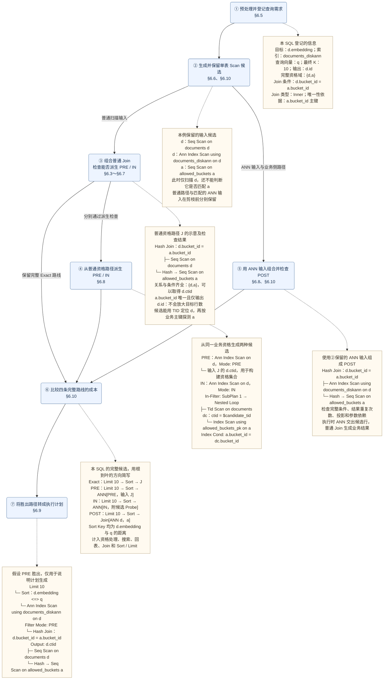
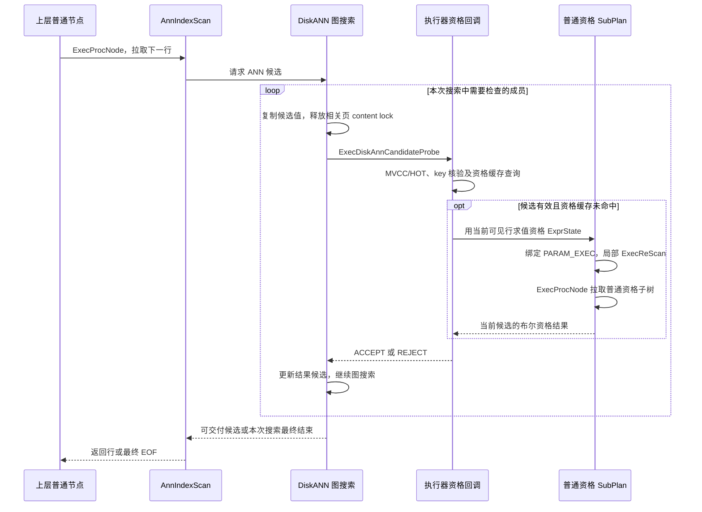

# openGauss 类 Oracle 向标融合详细设计：DiskANN + AStore 原生过滤方案

## 0. 文档合同与开发基线

| 项目 | 本设计的确定值 |
|---|---|
| 交付目标 | 在现有 AStore + DiskANN 上实现 Exact/PRE/IN/POST 选路、业务资格 Join、严格快照语义、有界扩搜与准确排序 |
| 最新决策 | 2026-10-10，PRE/IN 不做运行时精确搜索；第三阶段仅 POST 在同一计划、同一 AnnIndexScan 下切换 AM 的近似/精确入口，不保存两套计划。独立普通 Exact 仍可在规划阶段选中。非唯一 Join、NL 内侧和 Oracle 结果红线继续适用，见 §0.3、§2.8～§2.9 |
| Join 组合设计 | 普通 Scan/Join 提供完整资格；PRE/IN 判断目标行是否合格，需要多次匹配或业务列时由上层普通输出 Join 生成结果；POST 直接通过普通 Join。唯一性只用于证明能否省略输出 Join，不作为路线准入门槛，详见 §6 |
| 源码权威入口 | `/home/qiumc/data/code/cpp/openGauss-server` |
| 本轮核验版本 | 2026-10-11 按用户要求移除 DiskANN INCLUDE/覆盖返回/索引内过滤的 26 个原始提交及后续关闭 INCLUDE 的提交；正式仓分支 `integration/multimodal-stacked` 的新基线为 `ba1e4ad2f9`。原历史保留在备份分支，基线变化及重新验证见执行包“移除覆盖索引与新基线验证记录” |
| 隔离实施工作树 | `/home/qiumc/data/code/cpp/openGauss-vector-filter-p12`，分支 `feature/diskann-vector-filter-p12`，从上述正式仓版本实施前两个阶段；隔离安装、数据与端口见执行包交接 |
| 特性依赖 | 不整体依赖 HybridRecall、DiskANN INCLUDE、UNION ALL Top-K、SQL Bypass 或新优化器框架；E-01 固化所需独立基础修复 |
| 计划约束 | 复用并扩展原生 IndexPath/AnnIndexScan 和普通 Join；§1.2 唯一样例骨架保持，新增 §1.2.2 多匹配计划及 §1.2.3 NL 内侧计划；Oracle 行为红线见 §0.3 |
| 存储边界 | 沿用现有 AStore 表页、DiskANN 索引页、BUILD/INSERT、事务、WAL、VACUUM；搜索代码虽位于 `storage/access/datavec/`，本次修改其查询读路径 |
| 迁移红线 | 迁移到其他 openGauss 同源仓时，先核实目标仓 DiskANN 的真实排序/补批/结束行为及目标表存储类型，再制定迁移方案；不把本仓实现或 AStore 结论直接套到目标仓，见 §0.5 |
| 待定事项 | 第三阶段 F-00 落实结果反馈/结束协议，F-09 证明精确入口完整域覆盖，见 §9.4～§9.5；PRE 空域行为、Oracle 未覆盖形态及成本工作量估计的未闭合项集中列于 §20.4。无备用计划，未指定 Sort 为控制器 |
| 当前状态 | 前两个阶段代码已移到不包含覆盖索引的基线上；新 Release 和新 catalog 的 1439 项功能及原生 8 项复验通过，原阶段门和性能不继承；质量矩阵、执行时序门及新基线性能仍待重新验收 |
| Oracle 证据 | 既有多匹配、NL 内侧及时序证据见 §2.4～§2.6；POST 同算子近似转穷尽见 §2.8；52 条 PRE/IN 无穷尽切换及两条 GDB 对照见 §2.9。本轮仅据已有实测刷新设计，未再次启动数据库 |
| 原始输入 | [Oracle 向标融合调研与 openGauss 类 Oracle 方案（2 页 PPTX）](../Oracle向标融合调研与openGauss类Oracle方案_2页汇报.pptx) |
| 文档路径 | 按工作区“更新已有文档保留原路径”的规则继续使用当前文件名；标题、正文、SQL、任务和验收均以 AStore 为准 |
| 实施入口 | [执行包 README](执行包/README.md) 与 [模型交接入口](执行包/MODEL_HANDOFF_PROMPT.md)；任务、阶段门和证据按本设计派生，包初始化不代表功能已实现 |

### 0.1 交付范围

**2026-10-11 基线红线：** 本特性的开发分支、特性前对照分支和实际测试二进制均不得基于 DiskANN INCLUDE/覆盖返回/索引内过滤那组提交。移除其 DDL、v2 格式、覆盖返回分支、payload 过滤器及专属测试；不以仅关闭 INCLUDE DDL 代替移除实现。保留后续独立的 HybridRecall、UNION 和距离复用特性，并处理它们对已删除字段的引用。旧数据目录与旧二进制保留作历史资产，新的验收库必须由移除覆盖索引后的安装创建，避免继承 `diskanncanreturn` 等旧 catalog。源码基线变化后，已有阶段门和性能报告必须明确区分历史记录与新基线实测。

1. 在已有普通 AStore 表和普通 DiskANN 索引上生成 Exact/PRE/IN/POST 完整方案；不要求重建索引才能启用新过滤。
2. PRE 消费普通 B-tree Index Scan、Bitmap Heap Scan、Seq Scan 或合法资格 Join 的完整结果，在 AnnIndexScan 内建立查询私有资格集合。
3. IN 在图搜索活动期间逐候选同步执行资格检查；Join 样例使用候选 Tid Scan、Nested Loop 和业务键 Index Scan。
4. POST 按普通父节点拉取模型向关系过滤/Join 输出候选，最终由普通 Sort/Limit 排序截取。
5. 正确处理 AStore MVCC、HOT 根 TID 与可见 TID、重复向量多 TID、原始向量距离、参数重扫及资源释放；第二阶段支持一对多和多对多 Join，保留每一次业务匹配产生的结果，即使只投影目标表列也不隐式去重。
6. **第三阶段（质量优化阶段）交付：三种模式有界补搜；PRE/IN 不做精确搜索，仅 POST 在同一计划内切换 AM 精确入口。** 例如 `LIMIT 10`，候选经过完整输出 Join 只有 3 行时，在候选数和搜索轮数上限内继续找；同一扫描周期内相同目标 TID 只交付一次，但该目标匹配的所有业务行都保留。搜索结束仍只有 3 行时，PRE/IN 返回这 3 行，不切精确搜索；POST 默认保持原 AnnIndexScan、Join、Sort 和 Limit，切换当前 AM 扫描为完整成员枚举，沿用同一快照补充尚未交付的目标，由原输出树形成完整结果。最终合格行至少 10 行则取前 10，只有 7 行则返回 7。POST 显式 `diskann_filter_fallback=error` 时按 §9.3 报错，该策略不用于 PRE/IN。已找到 K 行仍须完成最低搜索量。两种 AM 入口、去重及结果反馈见 §9.2～§9.5。
7. 让优化器比较各过滤路线的预计执行开销，提供配置开关，并把选定的过滤模式、查询向量和所需子计划完整传给执行器；通过 EXPLAIN 展示实际采用的路线和运行统计。仅允许选择当前阶段已实现并验证的能力，自动选路和强制指定都不能启用尚未完成的功能。
8. 验证并发 INSERT/UPDATE/DELETE、回滚、长快照及现有 VACUUM 下的新读路径正确性，并做同质量性能比较。

实施分为三个阶段：

| 交付阶段 | 要完成的功能 | 过滤后不足 K 行时 |
|---|---|---|
| 第一阶段：基础功能 | 单表 Exact/PRE/IN/POST 基础路径，AStore 快照、HOT、过滤、排序、基本去重和资源管理 | 按本次既定搜索配置完成 ANN 后，返回实际找到的合格行，允许少于 K |
| 第二阶段：Join 融合 | 接入资格与输出 Join，验收原三个骨架及多匹配、业务投影、NL 内侧重扫和 Oracle 行为红线 | 按完整连接结果计数；不要求根据 Join 后数量继续补搜或自动执行 Exact |
| 第三阶段：质量优化 | 三模式候选/轮数上限、最低搜索量、补搜、跨轮去重与结果反馈；仅 POST 实现同快照精确兜底 | PRE/IN 返回实际合格行，允许少于 K；POST 默认在有界搜索不足时切换同一 AM 的精确入口，显式 error 策略报错 |

第一、第二阶段三种模式均可在既定搜索结束后返回不足 K 行；第三阶段 PRE/IN 在有界搜索结束后仍允许少返回。少返回不证明完整资格域只有这些行。各阶段均须保留资格、MVCC、距离排序及 SQL 重复次数；“基本去重”仅删除同一扫描周期内重复发现的向量候选，不删除 Join 合法重复，扫描尚有本次配置内候选时不能伪造结束。基本去重、内存上限、取消和清理从第一阶段完成。普通 Exact 从第一阶段可由规划器或显式 exact 模式选择；运行中自动切换 Exact 仅属于第三阶段 POST。

**“PRE/IN 不做精确搜索”的边界：** 不对完整资格域或完整索引向量域启动穷尽 Top-K，不从 PRE spool 回放为 Exact，也不保留或切换备用 Exact 计划。已经找到的 ANN 候选仍须使用原始向量计算 SQL 距离，并由普通 Sort/Limit 排序；这种候选重排不属于完整域精确搜索。规划时选中独立普通 Exact 路线也不属于 PRE/IN 运行时回退。

三个阶段各自验收；第三阶段尚未完成不阻塞前两阶段，但不得将阶段性交付宣称为完整特性。第二阶段覆盖 Semi、可安全转换的 Anti、业务键唯一或非唯一的 Inner Join，以及目标表位于保留侧的 Outer Join；一对多、多对多和安全业务列投影不能再因缺少唯一性证明而被排除。仍可能产生没有真实目标 TID 的结果的 Outer Join 保留普通 Exact。§1.2 原三个样例保持骨架；扩展形态按 §1.2.2～§1.2.3 和 §6 实现，并验收 §0.3 的 Oracle 行为红线。

本次不实现另一种表存储适配、新索引页格式、持久 TID 目录、独立索引版本链、新事务/WAL 协议、图页在线回收、目录分桶或维护调度器。原文围绕这些结构提出的任务、工程量及空间稳态承诺在本版撤销，不再作为过滤项目的前置条件。混合读写和更新老化仍要测量，但继承现有 DiskANN 的维护与空间边界，见 §11、§18。

首版范围为单机、普通行执行器、持久化非分区 AStore 表、无 INCLUDE 的单向量 key DiskANN，L2/COSINE；不新增 HNSW、并行、分布式、Index-Only、PQ、mmap 支持。已有其他配置是否允许使用旧路径，由原能力判断决定，本项目不扩大其支持声明。

上述范围是当前正式仓的实施基线。后续迁移到使用 UStore 或其他表存储的同源仓，按 §0.5 先核验并制定针对目标存储的方案；不能因本文以 AStore 为基线而直接认定目标仓无法迁移，也不能把本次补充解释为已完成 UStore 适配。

### 0.2 阅读顺序与评审问题

架构评审先读 §1～§4 和 §10～§11；Planner 开发读 §5～§6、§12、§14；执行与 AM 开发读 §7～§11、§13～§15；测试与发布读 §16～§20。

评审重点：三个计划是否真实执行；PRE 是否收齐资格后搜索；IN 是否逐候选同步 Probe；资格与输出 Join、HOT 身份、NL 参数及扫描周期是否正确；回调是否在释放索引页锁后执行。第三阶段再验证三模式补搜、PRE/IN 不调用精确入口，以及 POST 同计划 AM 切换与完整域覆盖。F-00/F-09 须交付真实协议，不能用 EXPLAIN 外观替代。

### 0.3 实施开发红线与变更确认

**用户已明确要求：§1.2 的三个计划作为实施开发红线。开发中遇到不可回避的问题，确实必须修改时，必须先取得用户明确确认，才能实施变更。** 此约束适用于后续开发者和编码代理，不因代码实现困难、性能压力、排期或 force 模式而自动豁免。

红线覆盖三个样例的节点骨架、向量索引可见性、Join 与 ANN 的前中后关系、资格检查时点和普通 Sort/Limit 的职责。不得自行增加过滤包装节点、隐藏新的执行节点、调换 Join 与 ANN 的位置，或只保留 EXPLAIN 外观而改变实际执行语义。带输出 Join 路线尚未决定的控制位置也不能被默认为 Sort 已获授权承担的职责。

确需变更时，先暂停受影响的实现，提交：当前红线与不可回避的冲突；源码或最小实验证据；已尝试的保留原计划办法及失败原因；替代计划和语义、性能、生命周期、验收影响。**取得用户针对该变更的明确确认后，先更新本文件及验收基线，再实施。** 未确认前可以继续不依赖该变更的工作，不能先改代码、改期望计划或放宽数量合同再补确认。

三份样例的表名、索引名和参数名可按测试对象替换；本文已列明的 PRE 底层 B-tree/Bitmap/Seq 访问选择不改变红线骨架。针对 §1.2 的三份 Join 样例，验收必须复现对应结构。其他受支持 SQL 的合法关系计划仍受 §6.4 约束，不构成擅自替换这三个基准样例的理由。

2026-10-09 用户已明确将第六条移到第三阶段。2026-10-10 又明确“PRE 和 IN 不做精确搜索，POST 做精确搜索，放到第三阶段完成”，并明确“POST 只是一个计划的两种 AM 接口形式，不存两个计划”。本版据此撤销 PRE/IN 的运行时精确搜索及所有模式的备用 Exact Path/Plan，只为 POST 增加同一 AM 扫描内的精确入口。这个已授权调整无需重复确认；三个主计划骨架、独立普通 Exact 规划路线和 Oracle 最终结果红线保持。

**2026-10-10 用户明确要求解除唯一性限制，并明确“这个行为要务必和 Oracle 保持一致，这是红线”。** 用户进一步明确“行为和最终查询结果也要和 Oracle 保持一致”，并要求优先参考公开官方设计。授权范围包括为多匹配构造普通输出 Join、保留业务投影及配套参数/计数处理；原唯一业务侧样例继续适用省略输出 Join 的优化，不必为新增的多匹配形态重复申请确认。以下行为是第二阶段必过的实施红线：

1. 一条向量目标行匹配多条业务行时，完整保留每一次匹配；只投影 d.id 等目标列也不得隐式 DISTINCT、按 d.ctid 去重或只输出第一次匹配。
2. PRE 完整构建目标资格后搜索，IN 在搜索内同步判断资格；多匹配结果由真实普通输出 Join 形成。上层输出 Join 的存在不把 PRE/IN 改称 POST。
3. ANN 访问可处于 Nested Loop 内侧；允许一次返回多条行。同一目标 TID 在不同外侧行触发的扫描中可以再次输出，不能由跨重扫缓存或全查询去重吞掉。
4. 原始 Join 后 Top-K 的最终 LIMIT 计数对象是完整连接结果行，含 SQL 合法重复；不能改成 K 个不同目标 ID，也不能通过插入内层 Top-K 改变原 SQL。用户显式要求每个外侧行 Top-K 时，按其相关子查询边界分别执行。
5. Inner 的多匹配、Semi/Anti 的存在/不存在、Outer 的全部匹配或补 NULL，以及 ON/WHERE 位置均遵循原 SQL；距离在完整输出结果上排序截取。
6. 以 §2.6 的 Oracle 实际 SQL、计划及重复次数建立 §17.5 的 O01～O06 验收。未通过不得宣称已支持，不能仅修改 EXPLAIN 或 expected 掩盖偏离；确有不可回避的行为偏离，先提交证据和替代方案并取得用户明确确认。

**最终查询结果同样是红线，不能将其缩减为“关系语义大致相同”或“Recall 达标”。** 对同一数据、等价 SQL、参数、距离定义和一致的数据版本，必须对照 Oracle 实际输出，核验列值、NULL、重复次数、返回数量及 SQL 规定的排序；可确定的结果逐行一致。验收保存原始输出及差异，不能只比较去重后的 ID 集合。官方来源、结果判据和证据边界见 §2.6～§2.7、§17.5。

Oracle 官方同时说明 ANN 使用启发式搜索，结果可能与 Exact 不同；这意味着当前 DiskANN 设计尚不能仅凭结构推导出“任意输入均与 Oracle HNSW 返回相同 ID”。这不是本项目自行设定的豁免：跨引擎结果差异须阻断对应兼容验收，查明原因，修复后重测；无法消除时提交实际差异及方案，由用户确认后才能改变红线。SQL 未规定的并列次序按 §17.5 核验，不通过偷偷增加排序键改变待测查询。第三阶段 POST 的 AM 精确兜底属于本项目质量设计，也必须单独核验其对 Oracle 最终结果的影响，不能声称“更精确”就自动等价。

### 0.4 Oracle 已验证行为的实施与验收约束

**本节把“核心行为规则与 Oracle 实测一致”落实到代码职责和必过用例。写入设计只表示实施要求已经明确，不表示 openGauss 已实现或两端已通过对照。** Oracle 证据限定于 §2.4～§2.6 记录的版本、SQL 和实际计划；不得把本项目选用的 TID 集合、缓存键或字段设计标成 Oracle 内部算法。

| 编号 | Oracle 已验证的行为及证据 | 实现必须做到 | 必过用例 / 实现章节 |
|---|---|---|---|
| OB01 | 非唯一业务键允许生成向量 Join；目标列与业务列投影均成功，§2.6 的 `NLS_DONLY_*`、`NLS_BOTH_*` | 不以业务侧唯一作为准入条件；需要多匹配或业务列时构造真实普通输出 Join；唯一性只用于证明能否省略它 | O01、O02、PL07；§6.4、§6.9、§14 |
| OB02 | 只投影 d 的列仍保留 4/2 次匹配；`NLS_DONLY_*` 的最终 ID 为 31626×4、33286×2、48626×4 | 候选去重只在当前扫描周期、输出 Join 之前执行；Join 输出不按目标 ID/TID 去重。资格关系的重复行不再乘到输出上，不把一对四变成一对一或一对十六 | O02、O04；§4.1、§7.4、§8.3、§13.2 |
| OB03 | ANN 可为 NL 内侧且每次多行；`NLS_*` 的 HNSW Starts=6；独立内层 Top-3 的 `VIEW_INNER_*` 则通过重放得到 12 行 | 每次真实 ReScan 建立新扫描周期；相同外侧键的不同行各保留其结果。合法物化重放须重置读取位置并重放完整结果，不强制每次重新搜索 | O03、J07；§6.9、§13.2 |
| OB04 | 全局 Join 后 Top-10 与相关 `APPLY_INNER_*` 的每外侧行 Top-3 各自成立，§2.6 | 最终 K 计连接结果行；保留用户原查询块和显式内层 LIMIT；不插入隐式内层 LIMIT、不改成 K 个不同目标、不以 K 替代候选预算 | O06；§1.2.3、§6.9、§15.2 |
| OB05 | PRE 先收齐过滤身份，再开始图搜索，§2.4 的函数时序证据 | 普通资格源完整结束并 Seal 后才搜索；集合不完整时不能输出部分查询结果 | PL02、B01～B03；§7.1～§7.3 |
| OB06 | IN 在搜索活动期间同步检查候选，§2.5 的函数时序证据 | 候选驱动局部 Probe，其结果参与本次搜索的资格判断；不能先结束整次 ANN 再调用 Probe 来冒充 IN | PL03、I01、I02；§8 |
| OB07 | POST 实测在向量候选之上保留普通关系过滤/Join，再排序限行，§2.6 的 POST 用例 | 普通输出 Join 拉取 ANN 候选；保持业务条件与投影；最终普通 Sort/Limit 处理连接结果 | PL04、O01～O03、O06；§9、§13 |

实施时，每项 OB 必须有“相关改动符号 → 实际计划与运行证据 → 自动比较结论”的对应记录，J-07 汇总到 §17.5。所有条目初始状态为“待实现 / 待 openGauss 对照”；仅有设计、EXPLAIN 文本或 Oracle 单端成功均不得改为“通过”。证据缺失或结果不一致就不能完成对应任务、打开该能力或宣称兼容；强制指定模式同样不能绕过。原能力未完成时按 §0.1 处理，不能把回退 Exact 当成指定 ANN 模式已经通过。

Semi/Anti/Outer 全组合、参数化候选范围变化、跨快照缓存，以及第三阶段三模式补搜及仅 POST 的 AM 精确切换与 Oracle 的等价性尚未由上述实测全部覆盖；它们仍有设计与 SQL 正确性要求，但不得借用 OB01～OB07 的结论冒充已验证。最终近邻 ID、列值和重复次数的一致性继续受 §0.3、§17.5 约束，行为验收通过不能替代最终结果验收。

### 0.5 迁移红线说明

**本特性迁移到其他 openGauss 同源代码仓时，必须先确认目标仓事实，再制定迁移方案，之后才实施对应改动。** 本文的源码函数、内部排序/补批、AStore HOT 回表和“不新增存储维护机制”等结论，均限定于 §0 记录的正式仓版本及工作树状态；仓库同源、函数同名或索引同叫 DiskANN，都不能作为行为相同的证明。

这里的“确认”要求源码核验及必要的最小实测证据，不以推测代替。迁移沿用 §0.3 的三个计划、Oracle 行为与结果红线，以及 PRE/IN 不做精确搜索、POST 第三阶段同计划双 AM 入口的合同；目标仓实现差异须在这些约束下制定适配方案。

#### 0.5.1 DiskANN 扫描行为红线：先核实，再决定如何接入

“现有 DiskANN 扫描自带内部排序和补批逻辑”是**当前已核验仓库的事实，不是所有 openGauss 同源仓的共同前提**。迁移前必须分别确认：

- 候选由 AM 还是执行器组织，是否存在内部排序；排序覆盖单批还是完整扫描周期，使用何种距离，是否保证跨批有序。
- 是否支持补批或续搜，由谁触发，停止条件使用候选数、扫描内合格数还是其他信息；批结束与最终 EOF 如何区分，是否存在内部 K 截断。
- 普通 Filter 的实际执行位置、LIMIT 如何传给扫描、参数重扫如何重置状态，以及回调位置的页锁和资源生命周期。

完成上述确认后，迁移方案须逐项写明哪些现有机制可以复用、哪些需适配、哪些能力缺失及如何补齐。目标仓没有 `AnnIndexOrderedNext`、`diskann_advance_ordered_batch` 或采用不同实现时，不能照搬 §13.4 的函数改法，也不能为了套用本仓接线而先移植整套旧排序/补批逻辑。目标仓已有这些行为时，同样要核实其语义，防止重复排序、重复资格判断、提前截断或错误 EOF。三种目标计划中的普通 Sort 和各阶段补搜边界继续保持。

#### 0.5.2 表存储红线：按实际存储类型制定方案

迁移前必须确认目标查询实际访问的表存储类型及所走 TableAM/索引接口，不能只看数据库默认值或把所有同源仓都视为 AStore。对 AStore、UStore 或目标仓其他实现，至少核验以下事项：

| 核验项 | 迁移方案必须回答的问题 |
|---|---|
| DiskANN 与表存储的基础配合 | 目标存储下是否已有建索引、查询、插入、更新、删除和维护支持？缺失的是基础能力还是新过滤接线？ |
| 候选与行身份 | 索引保存什么行标识，怎样定位同一快照下的可见版本；更新、删除及标识复用后怎样防止旧候选对应到错误行？ |
| PRE 与 IN 的定位 | PRE 资格源输出的身份如何对应索引成员；IN 的普通 Tid Scan/对应原生访问能否按候选身份取得正确版本，输入和返回语义是什么？ |
| 可见性与资源 | 使用哪些快照、版本回查、锁和 pin 接口；若目标实现依赖 Undo 等机制，其读取与保留条件如何满足？取消和重扫如何释放资源？ |
| 维护与完整枚举 | 现有 DML、回滚和回收是否保持成员可见性；第三阶段 POST 精确入口如何覆盖该存储下全部合法成员？ |

**不得把 AStore 的 HOT 根 TID、`heap_get_root_tuples`、`heap_hot_search` 或 `heap_fetch` 调用原样视为 UStore 的实现方案，也不得仅替换名称就宣布适配完成。** 即使目标仓仍使用 AStore，也须重新验证这些接口及索引维护行为。资格身份、可见版本、key 核验和去重方案应基于目标存储的实际机制制定，并保持同一语句快照与 SQL 结果合同。

本文“不需要新增存储修改”的论证不能直接外推到目标仓；也不能仅因目标是 UStore 就预设必须重构存储。先核实已有能力，再区分查询读路径适配、基础缺陷修复和确需新增的存储能力。确需改变持久格式、DML/WAL/回收协议或计划骨架时，提交必要性证据和具体方案，按 §0.3、§3.2 取得用户确认后实施，不能借迁移名义越过原红线。

#### 0.5.3 迁移前置顺序与交付记录

1. **固定目标基线。** 记录仓库路径、分支/提交、dirty 状态、实际运行二进制、目标表存储类型及 DiskANN 配置。
2. **确认两类事实。** 按 §0.5.1～§0.5.2 保存源码符号、最小 SQL、实际计划和必要的调用/候选/重扫证据；每项标记已确认、能力缺失或待确认。关键事实未确认时，先继续核验，不以本仓结论填空或开始依赖该假设的迁移实施。
3. **据此制定迁移方案。** 列出可复用部分、目标仓差异、执行器/AM/存储适配位置、阶段依赖及验证方法；涉及现有红线变更时按原确认流程处理。函数改法和工作量必须来自目标仓事实。
4. **实施并在目标仓验收。** 重跑普通 DiskANN 基线，再按适用存储验证三种计划、候选资格、快照、更新删除、参数重扫、资源清理和 Oracle 对照；第三阶段另验反馈与完整枚举。源仓测试通过不能替代目标仓验证。

迁移记录至少包含“目标版本/存储 → 已确认行为及证据 → 与本仓差异 → 适配方案 → 目标仓验收结果”。该记录是目标仓 E-01 和迁移检查 M01/M02 的必备材料；本节建立的是后续迁移约束，不表示已对任何其他仓库完成核验。

## 1. 设计结论

### 1.1 计划设计原则

**PRE、IN、POST 统一复用并扩展原生 AnnIndexScan，最终由普通 Sort 和 Limit 完成排序与截取；存储继续使用已有 AStore + DiskANN。**

1. 不新增 VectorFilterScan、VectorFilterBuild、Candidate Scan 或 Custom Scan 包装节点；不另造可执行过滤 Path/Plan 类型。规划辅助函数、扫描内状态和普通子计划可以扩展。
2. PRE 的普通资格关系子计划位于 AnnIndexScan 下方；逐行收取目标 TID，内部构建集合，Seal 后开始图搜索；不建立用于 Exact 回放的 TID spool。
3. IN 的资格 SubPlan 由搜索中的候选驱动，同步返回资格后再继续；扫描全部完成后的 Filter 不能代替这个时点。
4. POST 的普通 Join 位于 AnnIndexScan 上方，候选按火山模型向上交付；批边界不充当子计划 EOF。
5. 三种模式均保留真实的普通 Sort。跨轮候选不承诺全局有序，不声明虚假的 pathkeys；基于快照可见行原向量计算 SQL 距离。
6. 最终 K 与候选/图搜索量分开，不把 LIMIT 10 直接作为 Join 下方的候选截断条件。前两阶段按既定搜索配置生成候选，允许最终少于 K；第三阶段再增加基于合格数量的补搜及最低搜索量检查。
7. 资格状态、HOT 身份转换结果、候选、回调与预算只活在当前查询；不写入索引页，不因过滤修改图边或存储事务机制。
8. 第三阶段带输出 Join 路线的补搜控制位置按 §9.4 待定，不作为前两阶段基础路线的启用门槛。各阶段已有的原生节点字段、遍历、初始化、重扫、清理和 EXPLAIN 都须真实接通；红线变更遵守 §0.3。
9. PRE/IN 的资格集合或布尔 Probe 只决定目标候选是否合格。存在多匹配或需读取业务列时，在 AnnIndexScan 上方保留真实普通输出 Join，恢复全部结果行；只有证明每目标最多一行且输出仅依赖目标表时才能省略它。POST 本来就由普通 Join 产生完整结果。
10. 候选去重局限于一次扫描执行周期；SQL 结果不按目标 TID 去重。ANN 作为 NL 内侧每次真实 ReScan 都开始新的交付周期，同一业务键的不同外侧行也不能共享“已输出”标记。带输出 Join 的三种模式在第三阶段统一受 §9.4 的结果数量协调约束。

### 1.2 三个目标计划与数据流（实施开发红线）

以下是待实现的目标计划，不是当前基线的实测输出。三个样例使用同一业务资格：`d.bucket_id = a.bucket_id`，`allowed_buckets.bucket_id` 唯一且建有 `allowed_buckets_pk`，只投影 documents 的列，按向量距离返回 Top-10。资格 Join 属第二阶段范围。`query_vector`、`$candidate_tid` 为示意参数，`Filter Mode`、`In-Filter` 等是拟新增的观测属性。

这三个 Inner Join 样例的节点骨架保持红线。如何从普通 Scan/Join 候选派生这些路径、如何判断能否组合，以及 Semi/Outer 的语义差异，统一按 §6；不得把 Semi/Outer 改写成会改变结果的 Inner Join 来套用样例。

**PRE：Join 先提供完整资格名单，ANN 再搜索。**

```text
Limit 10
  -> Sort
       Sort Key: d.embedding <=> query_vector
       -> Ann Index Scan using documents_diskann on documents d
            Filter Mode: PRE
            Query Vector: query_vector
            -> Hash Join
                 Hash Cond: d.bucket_id = a.bucket_id
                 Output: d.ctid
                 -> Seq Scan on documents d
                 -> Hash
                      -> Seq Scan on allowed_buckets a
```

AnnIndexScan 按行执行器接口拉取 Hash Join 的 TID 输出，在内部收齐精确集合，然后把只读集合交给 DiskANN。集合之外的图节点仍可用于导航。最终合格候选向上交给 Sort，见 §7。

**IN：ANN 搜索过程中，把当前候选交给资格子计划检查。**

```text
Limit 10
  -> Sort
       Sort Key: d.embedding <=> query_vector
       -> Ann Index Scan using documents_diskann on documents d
            Filter Mode: IN
            Query Vector: query_vector
            In-Filter: (SubPlan 1)
            SubPlan 1
              -> Nested Loop
                   -> Tid Scan on documents dc
                        TID Cond: dc.ctid = $candidate_tid
                   -> Index Scan using allowed_buckets_pk on allowed_buckets a
                        Index Cond: a.bucket_id = dc.bucket_id
```

AnnIndexScan 先按同一快照解析 HOT 链，绑定候选的可见行 TID；资格子计划用 Tid Scan 定位该行，再以当前行的 bucket_id 探测业务索引。回调在本候选资格明确后返回图搜索。SubPlan 是按需调用的资格计划，不是先算出一张完整候选表；图内部批量距离计算与逐候选资格检查可以并存，见 §8。

**POST：ANN 先向普通关系计划提供候选，Join 再过滤。**

```text
Limit 10
  -> Sort
       Sort Key: d.embedding <=> query_vector
       -> Hash Join
            Hash Cond: d.bucket_id = a.bucket_id
            -> Ann Index Scan using documents_diskann on documents d
                 Query Vector: query_vector
            -> Hash
                 -> Seq Scan on allowed_buckets a
```

父节点发起取数，候选行按 `AnnIndexScan → Hash Join → Sort` 的方向交付；Sort 收齐本次候选经过 Join 后的合格输入并排序，Limit 最多取 10 行。第二阶段即可验收这一 Join 计划，允许既定搜索结束后少于 10 行；第三阶段完成 §9.4 后，再增加不足 K 时的反馈、补搜与精确查询兜底。

三图描述正常 ANN 主计划，第二阶段须全部交付。第三阶段仅 POST 可在同一 AnnIndexScan 下切换 AM 近似/精确入口，须分别记录搜索次数与完整域处理量；PRE/IN 始终保持 ANN。三模式均不挂接备用普通 Exact 计划，主计划节点和 Join 位置保持原样。

### 1.2.1 普通 Scan 的三种目标计划（无 Join）

下面用一个只有目标表过滤条件的查询说明基础 Scan 路径；`documents_bucket` 只是示例，优化器可以根据代价选择 B-tree、Bitmap 或 Seq Scan。三种路径仍复用原生 `Ann Index Scan`，不新增 `VectorFilterScan`、`VectorFilterBuild` 或 `Custom Scan` 节点。

```sql
SELECT d.id
FROM documents d
WHERE d.bucket_id BETWEEN 100 AND 200
ORDER BY d.embedding <=> query_vector
LIMIT 10;
```

**PRE：普通资格 Scan 先输出目标 TID，ANN 再搜索。**

```text
Limit 10
  -> Sort
       Sort Key: d.embedding <=> query_vector
       -> Ann Index Scan using documents_diskann on documents d
            Filter Mode: PRE
            Query Vector: query_vector
            -> Index Scan using documents_bucket on documents q
                 Index Cond: q.bucket_id BETWEEN 100 AND 200
                 Output: q.ctid
```

这里的下层 Scan 是资格子计划，`q.ctid` 是供 `Ann Index Scan` 使用的内部输出，不是用户查询输出。`Ann Index Scan` 按行消费该子计划，收齐并封存查询私有资格集合后才开始 DiskANN 搜索；它不要求先建立用户表或持久化中间表。

**IN：ANN 搜索中的每个候选都通过参数化资格 Scan 检查。**

```text
Limit 10
  -> Sort
       Sort Key: d.embedding <=> query_vector
       -> Ann Index Scan using documents_diskann on documents d
            Filter Mode: IN
            Query Vector: query_vector
            In-Filter: SubPlan 1
            SubPlan 1
              -> Tid Scan on documents q
                   TID Cond: q.ctid = $candidate_tid
                   Filter: q.bucket_id BETWEEN 100 AND 200
```

`SubPlan 1` 由当前 ANN 候选驱动：先绑定 `$candidate_tid`，再定位并检查这一行，资格结果返回后才继续处理该候选。它不是在向量搜索开始前一次性生成完整资格集合；图内部的批量距离计算不改变逐候选资格判断的时点。

**POST：ANN 先产生候选，再由普通 Filter 过滤。**

```text
Limit 10
  -> Sort
       Sort Key: d.embedding <=> query_vector
       -> Ann Index Scan using documents_diskann on documents d
            Filter Mode: POST
            Query Vector: query_vector
            Filter: d.bucket_id BETWEEN 100 AND 200
```

父节点按火山模型从 `Ann Index Scan` 拉取候选，现有扫描节点的普通残余 `Filter` 属性对候选执行资格条件，然后交给 `Sort` 和 `Limit`。这是普通后置过滤，不得因此新增过滤包装节点；若某种计划展示形式把残余条件单独打印，仍必须保持同一 `Ann Index Scan → Filter → Sort` 的执行语义。

普通 Scan 与 Join 的关系是：单表资格 Scan 可以直接形成 PRE/IN；带 Join 时，先按普通 Scan/Join 流程形成完整资格关系，再按 §6 派生资格路径。两者都必须保留同一快照、TID 身份和最终普通 `Sort/Limit` 语义。

### 1.2.2 非唯一业务键：三种完整目标计划

使用 §5.1 的 `allowed_bucket_members a`：主键为 `(acl_group,bucket_id)`，`bucket_id` 可重复，其普通 B-tree 为 `allowed_bucket_members_bucket`。同一 SQL 如下；删去 `a.acl_group` 后仍必须保留重复 d.id。

```sql
SELECT d.id, a.acl_group
FROM documents d
JOIN allowed_bucket_members a ON d.bucket_id = a.bucket_id
WHERE d.tenant_id = 7 AND a.bucket_id IN (626, 286)
ORDER BY d.embedding <=> query_vector
LIMIT 10;
```

PRE：下层 Join 只提供资格，上层 Join 按原 SQL 生成全部匹配。

```text
Limit 10
  -> Sort
       Sort Key: d.embedding <=> query_vector
       -> Hash Join
            Hash Cond: d.bucket_id = a.bucket_id
            -> Ann Index Scan using documents_diskann on documents d
                 Filter Mode: PRE
                 -> Hash Join
                      Output: dq.ctid
                      Hash Cond: dq.bucket_id = aq.bucket_id
                      -> Seq Scan on documents dq
                           Filter: tenant_id = 7
                      -> Hash
                           -> Seq Scan on allowed_bucket_members aq
                                Filter: bucket_id IN (626, 286)
            -> Hash
                 -> Seq Scan on allowed_bucket_members a
                      Filter: bucket_id IN (626, 286)
```

IN：内部 Probe 检查“此目标行是否至少产生一条合格结果”，上层 Join 枚举其全部业务匹配。

```text
Limit 10
  -> Sort
       Sort Key: d.embedding <=> query_vector
       -> Hash Join
            Hash Cond: d.bucket_id = a.bucket_id
            -> Ann Index Scan using documents_diskann on documents d
                 Filter Mode: IN
                 In-Filter: SubPlan 1
                 SubPlan 1
                   -> Nested Loop
                        -> Tid Scan on documents dc
                             TID Cond: dc.ctid = $candidate_tid
                             Filter: dc.tenant_id = 7
                        -> Index Scan using allowed_bucket_members_bucket on allowed_bucket_members aq
                             Index Cond: aq.bucket_id = dc.bucket_id
                             Filter: aq.bucket_id IN (626, 286)
            -> Hash
                 -> Seq Scan on allowed_bucket_members a
                      Filter: bucket_id IN (626, 286)
```

POST：候选直接进入原 SQL 的 Join，之后排序并截取结果行。

```text
Limit 10
  -> Sort
       Sort Key: d.embedding <=> query_vector
       -> Hash Join
            Hash Cond: d.bucket_id = a.bucket_id
            -> Ann Index Scan using documents_diskann on documents d
                 Filter Mode: POST
                 Filter: d.tenant_id = 7
            -> Hash
                 -> Seq Scan on allowed_bucket_members a
                      Filter: bucket_id IN (626, 286)
```

`dq/aq/dc` 表示内部资格访问，与输出访问使用独立状态但对应同一数据和语句快照；不是用户 SQL 新增逻辑表。PRE 集合与 IN 布尔值可以合并同一目标的重复资格，**上层输出 Join 不得去重**。例如一个候选 d 与 4 条 a 匹配，就交给 Sort 4 行。资格访问和输出访问虽然可能读同一业务表两次，但只有输出树决定结果重复次数，不形成 4×4 行。这里“输出 Join”是本项目的职责名称；Oracle 官方 Join-back 的定义还包括搜索后回基表取投影列，不能把两个术语简单等同。

### 1.2.3 ANN 作为 Nested Loop 内侧：允许每次返回多行

沿用 §1.2.2 的 SQL，若采用业务表驱动的 PRE 路线，可形成以下完整目标计划；具体选择由成本决定：

```text
Limit 10
  -> Sort
       Sort Key: d.embedding <=> query_vector
       -> Nested Loop
            Join Filter: d.bucket_id = a.bucket_id
            -> Seq Scan on allowed_bucket_members a
                 Filter: a.bucket_id IN (626, 286)
            -> Ann Index Scan using documents_diskann on documents d
                 Filter Mode: PRE
                 -> Hash Join
                      Output: dq.ctid
                      Hash Cond: dq.bucket_id = aq.bucket_id
                      -> Seq Scan on documents dq
                           Filter: dq.tenant_id = 7
                      -> Hash
                           -> Seq Scan on allowed_bucket_members aq
                                Filter: aq.bucket_id IN (626, 286)
```

这是完整资格后搜索、输出阶段再次连接的形态，与 §2.6 的 Oracle 直接反例对应；不要求内侧唯一。每个外侧行能接收多条 ANN 行，普通 Join Filter 负责匹配。IN 换成 §1.2.2 的完整候选 Probe；POST 使用普通候选访问及原条件。三个模式都不在内侧擅自插入 `Limit 10`。

参数化变体可以绑定外侧业务键，但必须保持同一查询块最终 Top-K 的语义，记录真实 `required_outer`；完整资格域与参数范围见 §6.9。真实 ReScan 清理本次“已输出”状态，外侧两个相同 bucket 的不同行仍各有全部匹配。原生 Materialize 等合法重放可复用完整内侧结果，但不能只复用第一次的游标终点。

用户显式写“每个业务行取 Top-3”的相关子查询时，内层 Sort/Limit 属于用户查询块，需分别执行；Oracle 的 APPLY 证据见 §2.6。它不能作为上面全局 Top-10 的替代实现，也不要求为本项目引入新的 SQL 语法。

### 1.3 语义与执行合同

| 路线 | 资格判断时点 | 固定成本 | 每候选主要成本 |
|---|---|---|---|
| Exact | 完整关系过滤后精排 | 普通资格关系源 | 原始距离、Sort/Top-N |
| PRE | 图搜索前构建资格集合；搜索中查集合 | 完整 Join/Scan、HOT 根 TID 归一、精确资格集合 | 成员查集合、AStore MVCC/HOT 回表、必要 key 重检；不切 Exact |
| IN | 图搜索中同步判断当前成员 | 参数化资格计划初始化 | AStore 可见 TID 解析、Tid Scan、业务键 Probe |
| POST | 候选交付到上层普通关系计划后 | 普通 Join/Hash/Sort、第三阶段控制协调 | AStore 回表、候选去重与完整关系输出 |

所有路线使用同一语句快照。PRE/IN 的资格拒绝只影响结果队列，不剥夺节点的导航用途。同一向量节点的多个 TID 可以有不同业务资格，必须逐成员判断。PRE/IN 始终交付 ANN 候选，必要时经过完整输出 Join，任何阶段都不切 Exact。第三阶段各模式按 §9.4 协调结果反馈与补搜；仅 POST 可在用户首行前切换 AM 精确入口，由同一个 Sort 完成最终排序。结果数量按 §0.1 的模式和阶段要求验收。

不修改持久格式不代表零源码改动：新增能力位于优化器、执行器和 DiskANN 搜索读路径。现有数据页、索引文件、写维护与 WAL 继续复用，见 §3、§10～§11。

## 2. Oracle 证据及其对设计的约束

### 2.1 本次实际环境

Oracle 容器 `oracle26ai`，实例 FREE，版本 `23.26.2.0.0`，PDB `FREEPDB1`。验证复用了 `HNSW_REL_TEST.HJBM_DOCUMENTS` 及权限表，没有创建或更新业务对象。基表实际 `COUNT(*)=50,000`，`bucket_id BETWEEN 100 AND 200` 实际合格 5,050 行。关系 Bitmap、主键及向量索引状态均为 VALID。

核验 SQL 与完整输出：

- [前、中、精确与权限 Join 核验 SQL](验证/Oracle只读核验_20260908/前中精确与权限Join核验.sql)
- [前、中、精确与权限 Join 实际计划](验证/Oracle只读核验_20260908/前中精确与权限Join实际计划.log)
- [候选级 Bitmap 重扫核验 SQL](验证/Oracle只读核验_20260908/候选级Bitmap重扫核验.sql)
- [候选级 Bitmap 重扫实际计划](验证/Oracle只读核验_20260908/候选级Bitmap重扫实际计划.log)

本次均为单次形态核验，不构成性能对标。SQL*Plus 包装脚本不能单靠退出码证明 SQL 成功；本次同时检查输出中的 SQL 错误、实际节点和返回行。业务账号读取 `DISPLAY_CURSOR(NULL,...)` 曾缺少 `V$SESSION` 权限，最终使用 SYS 会话切换 PDB 和 current_schema 完成采集，没有追加 GRANT。

### 2.2 当前复核结果

| 形态 | 实际统计 | 对 openGauss 的要求 |
|---|---|---|
| PRE | ANN Starts=1；Bitmap Conversion Starts=1，A-Rows=5,050；内部映射扫描 Starts=1，A-Rows=50,000；返回 10 | 关系源可流式交付；资格集合完整构建后才开始图搜索，函数级实测见 §2.4 |
| 原生 IN | ANN Starts=1；候选 View 与按 ROWID 访问均 Starts=3,359，合格 339；返回 10 | 可做候选定位 Probe，成本按候选总数计，不仅按返回 K 计 |
| 强制 Bitmap IN | ANN Starts=1；候选 View、Bitmap Conversion、Bitmap Index Scan 均 Starts=3,359，累计约 16M 行转换 | 只检查 ANN Loops=1 不够；禁止每候选完整重跑关系集合 |
| Exact | 合格 5,050 行进入关系过滤后的距离 Top-K；返回 10 | 独立规划成本竞争者和正确性对照；不作为 ANN 计划的运行时备用分支 |
| 权限 Join PRE | 资格构建侧 Hash Join 产生 10,000 行；ANN Starts=1；计划另有输出阶段 Join-back | 区分资格 Build 与输出 Join-back；集合中只能保留目标表身份 |

同一过滤查询的 PRE、IN、Exact 和 Bitmap IN 本次均返回相同的有序 ID：

```text
19109, 48125, 1165, 34153, 24155,
36105, 16110, 26196, 44144, 15160
```

这只证明该查询样本上的结果一致，不能推导任意查询 Recall@10=100%。本次 Bitmap IN 的 QB_NAME 因名称过长在 Hint Report 中标为 Unused；两个决定执行形态的访问 Hint 均生效，实际节点足以确认重扫现象。

PPT 的百万行选择率数据和 224 倍单次差距保留为历史背景，本文不把它们换算为 DiskANN 的预期收益或生产 SLA。设计验收以本产品、同一数据、同一快照质量参考和同一机器上的实测为准。

### 2.3 从 Oracle 借鉴的范围

公开文档支持 PRE/IN 与 Join-back 是不同决策维度；PRE 可先获得过滤后的行身份并与内部映射关联，IN 可按向量候选定位基表行。[Oracle 优化器计划文档](https://docs.oracle.com/en/database/oracle/oracle-database/26/vecse/optimizer-plans-hnsw-vector-indexes.html)

公开 Hint 文档也表明，指定过滤类型是在候选变换中选一种；未指定时可比较有效类型。Hint 的出现不代替实际计划验证。[Oracle 向量索引 Hint](https://docs.oracle.com/en/database/oracle/oracle-database/26/vecse/vector-index-hints.html)

本设计定义查询私有 ExactTidSet 和 DiskANN 资格回调，复用 AStore MVCC/HOT 读取；不从 Oracle 计划树推断其未公开算法。Oracle 的包含列能力不作为本项目依赖。[Oracle 包含列说明](https://docs.oracle.com/en/database/oracle/oracle-database/26/vecse/included-columns-hnsw-indexes.html)

本项目只借鉴资格构建、候选 Probe 和关系执行的边界；Oracle 内部身份映射不构成本项目新增持久目录的依据。openGauss 的现有图节点已经保存行 TID，查询私有身份处理见 §10。

### 2.4 2026-10-08 关键补充：VIEW 流式交付，HNSW 收齐过滤集合后搜索

**[实测，限定当前版本与查询]** 在 Oracle 26ai Free `23.26.2.0.0` 上复用 `HNSW_REL_TEST.HJBM_DOCUMENTS` 的 50,000 行数据及 `HJBM_DOCS_HNSW` 索引，查询条件为 `bucket_id BETWEEN 100 AND 200`，使用 `PRE_FILTER_WITH_JOIN_BACK`、Top-10、target accuracy 90。两轮专用查询会话的函数级跟踪确认：**VIEW 逐行向 HNSW 算子交付数据；HNSW 算子在内部收齐 5,050 个合格 VID、建好 Roaring 位图后，才开始图搜索。**

第二轮实际计划的相关子树如下；`VW_HPJ` 后缀是本次生成的名称，不是固定接口：

```text
VECTOR INDEX HNSW SCAN PRE-FILTER       Starts=1  A-Rows=10
  VIEW VW_HPJ_0ADE3497                 Starts=1  A-Rows=5,050
    HASH JOIN OUTER                   Starts=1  A-Rows=5,050
      BITMAP CONVERSION TO ROWIDS     Starts=1  A-Rows=5,050
        BITMAP INDEX RANGE SCAN
      TABLE ACCESS FULL ...HNSW_ROWID_VID_MAP
                                      Starts=1  A-Rows=50,000
```

#### 2.4.1 VIEW 的职责与流式交付边界

`VW_HPJ` 是优化器生成的内部视图行源，投影为 `VERTEX_ID` 和 `ROWID`。同日先行字典核验使用同形计划中的 `VW_HPJ_7D814FC8`，对象、视图、物化视图及段字典均无对应记录。它下面的 `HNSW_ROWID_VID_MAP` 则是持久辅助物理表，用于 ROWID 与 VID 的身份关联。`A-Rows=5,050` 表示 VIEW 累计交付了多少行，本身不表示 VIEW 缓存了一张 5,050 行的中间表。

调用栈与事件顺序显示以下过程，省略通用行源分派等中间层：

```text
qervixFetch：HNSW 算子开始执行，初始化过滤结构并消费下层行源
  Hash Join 输出一行
    → qervwRowProcedure：VIEW 行回调
    → qervixRowP：HNSW 行处理回调
    → kdivs_hnsw_filter_set_membership
    → roaring_bitmap_add：将该行 VID 加入过滤位图
  上述接收、加入过程共 5,050 次
  → kdvhnswKNNSearch：此时才开始近邻搜索
    → kdvhnswKNNIndexSearch：执行图索引搜索
    → roaring_bitmap_contains：搜索中查询前面装好的同一个位图
```

这里可以用**火山模型的上下游行源关系**理解执行组织；Oracle 官方将其描述为迭代式行源执行。[Oracle SQL Processing](https://docs.oracle.com/en/database/oracle/oracle-database/26/tgsql/sql-processing.html) 但本次直接证明的是“逐行回调交付”，没有证明底层 API 严格采用“一次 `next()` 只返回一行”，也没有排除批量取数后逐行处理。

**流式交付和搜索前完整构建集合同时成立。** HNSW 算子进入执行早于图搜索；它先消费下层输入并建立资格集合，收齐后才搜索。VIEW 下方的 Hash Join 仍有自身的哈希构建工作区，不能把这一交付边界概括为整棵子树没有阻塞或缓存。本次也没有证明 ROWID 或其他列与 VID 位图采用相同的缓存方式。

#### 2.4.2 完整装载先于搜索的直接证据

仅靠 `Starts`、`A-Rows` 或计划缩进不能证明完整装载的时点。此次 SQL Trace 只提供聚合行源统计，SQL Monitor 首末输出时间落在同一秒；因此补充对本次专用 Oracle 后端的函数断点观测，读取调用栈、参数、事件序号与过滤对象指针。

| 观测点 | 本次调用次数 | 含义 |
|---|---:|---|
| `qervixRowP` | 5,050 | 通过行回调接收下层输出 |
| `kdivs_hnsw_filter_set_membership` / `roaring_bitmap_add` | 各 5,050 | 将全部合格 VID 装入同一个 Roaring 位图 |
| `kdvhnswKNNSearch` / `kdvhnswKNNIndexSearch` | 各 1 | 位图装载完成后开始本次图搜索 |
| `kdivs_hnsw_filter_check_membershippf` / `roaring_bitmap_contains` | 各 3,359 | 搜索期间检查同一个位图；该数字不是唯一节点数或距离计算次数 |

第二轮最后一次 `roaring_bitmap_add` 的事件序号为 **15,153**，进入 `kdvhnswKNNSearch` 为 **15,154**，第一次 `roaring_bitmap_contains` 为 **15,157**。搜索开始后没有更多 add，也未观察到 remove；装载、搜索入口及 contains 指向同一个位图对象。两轮捕获的 5,050 个 VID 都与独立 SQL 关联查询得到的合格 VID 集合完全一致，第二轮实际 Roaring add 参数也通过相同核对，最终返回 10 行。

该结论只覆盖上述版本、索引、过滤条件与执行形态，不能推广为所有 PRE 计划都固定使用 Roaring。未合格节点是否参与图导航不在本次证明范围内。断点会增加耗时，跟踪数据不用于性能结论；观测未对业务表或索引执行 DML/DDL，调试器正常 detach，Oracle 已恢复核验前的停止状态。

原始证据与复现入口：

- [VIEW 投影、字典及实际计划核验](验证/VW_HPJ实测_20261008_113128/实际计划与字典核验.log)
- [第二轮函数调用日志与调用栈](验证/VW_HPJ执行时序核验_20261008_141644/Roaring动态复核/函数跟踪_GDB.log)、[完整事件及位图对象记录](验证/VW_HPJ执行时序核验_20261008_141644/Roaring动态复核/函数调用顺序.json)、[实际查询及执行计划](验证/VW_HPJ执行时序核验_20261008_141644/Roaring动态复核/函数跟踪_查询会话.log)
- [两轮自动核验汇总](验证/VW_HPJ执行时序核验_20261008_141644/核验汇总.json)、[独立 SQL 合格 VID 核验](验证/VW_HPJ执行时序核验_20261008_141644/SQL合格VID.sql)
- [函数观测脚本](验证/VW_HPJ执行时序核验_20261008_141644/函数调用观测.py)、[专用查询会话编排](验证/VW_HPJ执行时序核验_20261008_141644/运行函数调用观测.py)
- [Oracle 内部映射与前过滤专题文档](../Oracle_HNSW_ROWID_VID_MAP内部映射表索引与前过滤详细设计.md) §8.4～§8.5：完整调查记录。

#### 2.4.3 对本设计的具体约束

本设计将 PRE 的集合构建放在 `AnnIndexScan` 内部：普通关系子计划逐行提供可见 TID，扫描节点将其归一为根 TID 并构建 `ExactTidSet`；输入结束并 `Seal` 后，才交给 DiskANN 开始图搜索。不增加独立集合构建节点，也不建立 Exact 回放 spool；空集合、小集合和资源超限按 §7.3 处理。

这是本项目的执行器职责划分，不要求照搬 Oracle 的内部回调或 Roaring 表示。Oracle 本例的集合键是 VID；本项目仍按 §7.2 使用精确 TID 域和块号/offset 集合，并按 §7.4 处理 AStore MVCC 与 HOT 身份。Oracle 实测支持“先完成资格集合，再搜索”的时序依据，不能替代本项目的 MVCC、导航或回退正确性证明。

#### 2.4.4 与拿到过滤结果后直接精排的区别及收益条件

本节“直接精排”指对**全部合格行**计算向量距离并选出精确 Top-K，不是只对 ANN 已召回的候选重新排序。**HNSW 前过滤的最大潜在收益，是通过图搜索减少向量读取和距离计算；代价是近邻结果属于近似搜索。** 它仍需先消费完整的资格名单。

以本次 5,050 个合格行、返回 Top-10 为例：

| 比较项 | 过滤后直接精排 | HNSW 前过滤 |
|---|---|---|
| 过滤结果之后的工作 | 读取全部 5,050 个合格向量，逐个计算距离，再选 Top-10 | 将 5,050 个 VID 建为资格位图，沿图寻找近邻并检查结果资格 |
| 距离计算范围 | 覆盖全部合格向量 | 由图搜索路径和预算决定，有机会少于穷举；不是只算最终 10 个，也不保证一定少于 5,050 次 |
| 结果质量 | 在相同快照和距离指标下得到精确 Top-10 | 近似 Top-10；候选重排不能补回未召回的近邻 |
| 主要额外工作 | Top-K 收集；可边取行边维护有界堆，无需完整排序或缓存全部行 | 身份映射、资格位图、图遍历和成员检查；本次 Join-back 计划最后再取结果行 |

上述区别对应 Oracle 的[精确相似搜索](https://docs.oracle.com/en/database/oracle/oracle-database/26/vecse/perform-exact-similarity-search.html)、[近似索引搜索](https://docs.oracle.com/en/database/oracle/oracle-database/26/vecse/perform-approximate-similarity-search-using-vector-indexes.html)及[HNSW 前过滤与 Join-back](https://docs.oracle.com/en/database/oracle/oracle-database/26/vecse/optimizer-plans-hnsw-vector-indexes.html)说明。

本例 VIEW 只投影 ROWID、VID，尚未读取并计算所有合格向量的距离。因此，得到完整名单之后仍有向量计算工作；当合格集较大、向量维度较高，而且满足目标召回率的图搜索工作量足够小时，HNSW 才可能在这个阶段获得明显收益。这是成本判断，不能据此预先承诺加速比例。

**过滤后剩余行很少时，直接精排可能更快，并且结果精确。** 图遍历、位图构建和随机访问的成本可能超过省下的向量计算。需要区分两种比较：复用同一个 VIEW 后接不同搜索方式，只比较后半程；比较完整执行计划时，Exact 通常还可以省去 HNSW 专用的 ROWID→VID 映射关联和资格位图，直接从关系过滤结果计算距离。不能强制 Exact 承担这些 ANN 专用成本后再得出性能结论。

**当前 5,050 行样本只证明了构建与搜索的先后顺序，尚未证明 HNSW 比直接精排快。** 3,359 次是资格位图查询次数，不是距离计算次数，也不能与 5,050 相除估算收益。性能结论须在同一数据、查询、快照及质量口径下测量。本项目按 §12 在规划阶段比较 PRE 与独立普通 Exact 的完整成本；预计合格集合很小时可直接选 Exact，但一旦选定 PRE，执行阶段不因集合小而切换为 Exact。

### 2.5 2026-10-08：中过滤逐候选同步调用 VIEW 的实测

**[实测，限定当前版本与两个查询]** 在同一 Oracle 26ai Free `23.26.2.0.0`、`HJBM_DOCS_HNSW`、Top-10、target accuracy 90 的环境中，对单表过滤和业务权限 Join 分别做完整函数级跟踪。确认：**HNSW 在图搜索内部，将需要检查的候选 ROWID 逐个交给 VIEW；等待本候选的资格检查返回后，再检查下一个候选。** 内部存在批量距离计算，逐候选同步调用和批量算距离同时成立。

#### 2.5.1 与前过滤的区别

| 比较项 | PRE：`VW_HPJ` | IN：`VW_HIJ` |
|---|---|---|
| VIEW 的任务 | 向 HNSW 提供完整的合格 ROWID/VID 名单 | 接收当前候选 ROWID，回表并执行谓词或业务 Join |
| 资格判断时点 | 搜索前收齐名单；搜索中查已建位图 | 搜索中逐候选调用关系子计划，取得资格结果 |
| 本次执行次数 | VIEW Starts=1，累计输出 5,050 行 | 单表 Starts=3,359；业务 Join Starts=1,766 |
| HNSW 搜索 | 名单装载完毕后开始图搜索 | 搜索与资格检查交错进行 |

IN 不预先枚举所有合格文档；业务权限表若预建并复用，也只是准备判断资格所需的数据。是否真正复用，需要检查业务表本身的运行统计，不能只由 VIEW 名称或 Hash Join 节点推断。

#### 2.5.2 同步调用与内部批处理的直接证据

业务 Join 条件为 `a.bucket_id=d.bucket_id AND a.acl_group=4`，使用 `IN_FILTER_WITH_JOIN_BACK`、`leading(d a) use_hash(a) full(a)` Hint；实际 SQL_ID=`1xfjwkana17kd`，plan hash=`2106624704`。相关计划为：

```text
VECTOR INDEX HNSW SCAN IN-FILTER        Starts=1      A-Rows=10
  VIEW VW_HIJ_F1A424A6                 Starts=1,766  A-Rows=346
    HASH JOIN                         Starts=1,766  A-Rows=346
      TABLE ACCESS BY USER ROWID      Starts=1,766  A-Rows=1,766
      TABLE ACCESS FULL ALLOWED_BUCKETS
                                      Starts=1,766  A-Rows=353K
```

调用栈显示 `kdvhnswSearchLayer / kdvhnswSearchVisitNbrs → kdivs_hnsw_filter_check_membershipif → qervixInFilteringCbk → qervwStart / qervwFetch → Hash Join / ROWID 取行`。这些调用都位于尚未返回的 `kdvhnswKNNSearch` 内部。每次成员检查对应一次 VIEW Start、一次 Fetch，回调返回 0 或 1，成员检查返回同一资格值；下一次成员检查在前一次返回后才开始。

| 完整实测查询 | 资格检查次数 | 通过 / 拒绝 | 每候选 VIEW Start / Fetch | HNSW 搜索次数 / 最终输出 |
|---|---:|---:|---:|---:|
| 单表 `bucket_id BETWEEN 100 AND 200` | 3,359 | 339 / 3,020 | 各 1 次 | 1 次 / 10 行 |
| 业务权限 Join | 1,766 | 346 / 1,420 | 各 1 次 | 1 次 / 10 行 |

同时记录到一个具体邻居批次：事件 143～144 是 `kdvhnswdDistBatch` 以数量 **26** 进入并返回；145～380 是该批邻居处理，其中触发 26 次逐个同步资格检查。候选 2 在事件 146～154 完成检查，155 才开始候选 3。首次与末次资格检查之间还穿插了 1,115 次批量距离计算入口调用，`kdvhnswKNNSearch` 到事件 21,265 才返回。

因此，准确的执行理解是“搜索过程中处理邻居批次，对需要检查的候选逐个同步调用 VIEW，再继续搜索”。不能解释为先完成整次向量搜索、拿到完整候选名单后统一过滤；也不能把“逐候选交给 VIEW”扩大为每发现一个向量就立即过滤且完全没有内部批次。26 只是一次观测值，不是固定批量大小；检查次数及批量入口次数均不等于唯一节点数或距离计算总数。

#### 2.5.3 业务 Join 重扫及对本设计的约束

本次带 Hint 的业务 Join 计划，VIEW 内的权限表 `HJBM_ALLOWED_BUCKETS` 实际 **Starts=1,766、累计 A-Rows=353K**，Hash Join 也 Starts=1,766，说明这条路径确实重复执行了关系访问。HNSW 上方另有用于输出关联的权限表扫描 Starts=1；这是不同节点，不能用它认定候选资格检查复用了业务表。重复扫描也不等于每次都从磁盘物理读取，且不推广为所有 IN 计划的固定行为。

本设计借鉴候选驱动、同步取得资格结果的执行边界，由 AnnIndexScan 在图搜索中调用生成的参数化资格子计划，见 §1.2、§8.2；DiskANN 内部批量计算距离不改变逐候选资格 Probe 的要求。当前 IN 红线样例采用候选 Tid Scan 加业务键 Index Probe，禁止把权限表全扫描或完整 Bitmap Build 放入每候选回调，详见 §6.4。该约束用于避免本次观测到的重复关系访问，不要求照搬 Oracle 回调接口；AStore MVCC/HOT、导航队列与结果队列的语义仍按本项目合同实现。

实测未验证未合格节点的导航规则，断点耗时不作为性能数据。完整记录与复现见[中过滤调用时序实测结论](验证/VW_HIJ执行时序核验_20261008_150530/中过滤调用时序实测结论.md)、[两查询自动核验汇总](验证/VW_HIJ执行时序核验_20261008_150530/核验汇总.json)、[业务 Join 实际 SQL 与计划](验证/VW_HIJ执行时序核验_20261008_150530/业务Join复核/函数跟踪_查询会话.log)、[完整事件及候选检查记录](验证/VW_HIJ执行时序核验_20261008_150530/业务Join复核/函数调用顺序.json)。两成功样本均完整观察到算子关闭，回调与实际计划统计一致；失败尝试单独保留且未计入核验结果。

### 2.6 2026-10-10：业务键不必唯一，ANN 可位于 NL 内侧

本节依据已经完成的 Oracle 26ai Free **23.26.2.0.0** 实测，不是根据估算行数猜测。原始 SQL、计划、Hint Report、逐行输出和取消记录见 [唯一性限制与 NL 内侧实测报告](验证/Oracle局部过滤与Join组合核验_20261009_164902/唯一性与NestedLoop内侧核验_20261010_083420/唯一性限制与NL内侧实测报告.md)。本次设计刷新不重复启动数据库。

业务表主键是 `(ACL_GROUP,BUCKET_ID)`：bucket 626 有 4 条业务记录，bucket 286 有 2 条。使用同查询块 `d JOIN a`、`d.tenant_id=7`、`a.bucket_id IN (626,286)`，按 d.embedding 的 cosine 距离全局取 Top-10。没有用户内层 Top-K，只输出 d 的列也得到下面结果：

```text
31626, 31626, 31626, 31626,
33286, 33286,
48626, 48626, 48626, 48626
```

| 实测形态 | 可直接观察的证据 | 本设计约束 |
|---|---|---|
| 同查询块，a 驱动，HNSW 在 Nested Loop 内侧 | PRE/IN/POST 的 HNSW 均 Starts=6、累计 A-Rows=60；内侧回表及连接过滤累计 30 行；最终 10 行 | 内侧不限一行；同一 d 与不同 a 的匹配不去重；不能把 E-Rows=1 当作唯一性 |
| 同一 SQL，Exact 对照 | 与上述三种只投影 d 的 ANN 查询得到相同 10 行及重复次数 | 固定用例必须保留实际结果基线，不能只检查 EXPLAIN |
| 普通输出 Hash Join | 该组 HNSW 10 行、输出 Join 18 行、最终 Top-10 | 资格和最终输出次数分开，输出 Join 可以放大候选行数 |
| 相关 APPLY，用户每个外侧行 Top-3 | 6 次 HNSW 启动累计 18 行，每个外侧行 3 行 | 参数化扫描和全局 Top-K 分别验收 |
| 独立内层 Top-3 视图 | HNSW Starts=1、视图 Starts=4、输出 12 行 | 上层重放次数不等于 ANN 搜索次数 |

直接反例的 PRE / IN / POST SQL_ID 分别为 `4djj15yraja7z`、`2aj4gkk5fuana`、`6xtm2ysfhgj6n`。PRE/IN 使用公开 Hint；本二进制接受的 `POST_FILTER_WITH_JOIN_BACK` 未出现在所查官方 Hint 清单中，只作版本实测证据。24 条 ANN 测试中 21 条完成，另 3 条大驱动集查询主动取消，不计作成功或“不支持”的证据；Exact 对照另有 1 条完成。

**结论：原“业务侧必须唯一”是本项目旧转换方案的限制，现已解除，不能再作为 Oracle 限制引用。** 实测证明这些具体形态成功，不表示 Oracle 对所有 SQL 都选择同样的 Join 顺序或搜索参数。

### 2.7 Oracle 公开官方设计依据与结果保证

#### 2.7.1 找到的官方资料及可采用的结论

截至本次检索，找到官方技术架构图、优化器执行路线说明和 SQL 语义文档；尚未找到公开到“任意多表向量 Join 的重复行恢复算法、内部缓存键及重扫状态机”的完整源码级设计。以下按证据层次引用，不把我们的实现方案冒充 Oracle 内部代码。

| 官方资料 | 公开说明 | 本设计如何参考 |
|---|---|---|
| [AI Vector Search Technical Architecture](https://docs.oracle.com/en/database/oracle/oracle-database/26/vsiad/aivs_genarch.html) | 向量数据与业务关系数据通过原生 SQL 一起查询 | 复用关系执行器；该总览没有给出多匹配内部算法 |
| [Optimizer Plans for HNSW Vector Indexes](https://docs.oracle.com/en/database/oracle/oracle-database/26/vecse/optimizer-plans-hnsw-vector-indexes.html) | PRE 先过滤，IN 在遍历候选时过滤；搜索前处理投影为 no-join-back，搜索后取列为 join-back；示例在上层排序限行 | 分离资格判断与结果生成；不把其辅助 ROWID/VID 表的唯一索引解释为业务键唯一 |
| [SQL Tuning Guide — Joins](https://docs.oracle.com/en/database/oracle/oracle-database/26/tgsql/joins.html) | NL 对每条外侧行读取内侧全部匹配；Semi 与 Outer 各有独立语义 | 输出使用相应原生 Join，允许多行和外侧重复键，不手工只取首匹配 |
| [SQL Language Reference — SELECT](https://docs.oracle.com/en/database/oracle/oracle-database/26/sqlrf/SELECT.html) | SELECT 默认 ALL、保留重复；最终限行与 ORDER BY 配合；APPLY 可引用左侧列 | 保留投影后的重复、NULL 和最终 K；保持用户查询块和相关 Top-K 边界 |
| [Vector Index Hints](https://docs.oracle.com/en/database/oracle/oracle-database/26/vecse/vector-index-hints.html) | 公开 PRE/IN 等转换 Hint；实际选路仍需检查计划 | 测试固定 SQL、Hint 与实际模式，不用 Hint 文本替代执行证据 |
| [Restrictions for Oracle AI Vector Search](https://docs.oracle.com/en/database/oracle/oracle-database/26/rnrdm/vector-search-restrictions.html) | 约束 VECTOR 列作为连接条件/唯一约束等向量本身的用法；未规定业务标量 Join 键必须唯一 | 不把 VECTOR 列限制误读成 `bucket_id` 等业务列的一对一限制；业务 Join 仍按普通 SQL 结果语义执行 |
| [Database Concepts — Artificial Intelligence](https://docs.oracle.com/en/database/oracle/oracle-database/26/cncpt/artificial-intelligence-oracle-database.html) | 启发式 ANN 可能返回不同于 Exact 的近邻，也可能少于 K | 不能从同样的过滤计划推导邻居 ID 必然相同；必须做最终结果对照，不以 Recall 代替一致性验收 |

#### 2.7.2 如何保证：官方规则、实测机制和本项目落实

可观察到的 Oracle 保证链条是：**向量访问得到候选 → 普通关系执行保留匹配及投影 → 排序与最终限行**。对于 PRE/IN，资格判断发生在候选形成之前或之中；上层仍可有回表和业务 Join。官方文档说明各职责，§2.6 的多匹配实测直接显示输出 Join 在 HNSW 上方，并保留最终重复行。由此得到本项目的设计推论：资格可以按目标身份合并，结果必须按原 SQL 重新通过输出关系生成。这是依据公开说明和实测作出的实现选择，不是对 Oracle 未公开缓存结构的断言。

本项目按下列约束落实：

1. PRE 保存目标 TID 的精确资格集合；IN 对目标执行完整资格的存在性检查。它们都不能冒充完整 Join 输出。
2. 非唯一 Inner、需要业务列及需要补 NULL 的 Outer 保留原生输出 Join；一条目标候选只进入一次输出树，由该树产生全部匹配。唯一性只用于安全省略该树。
3. 输出 Join、资格访问、回表共用同一语句快照；业务列来自真实匹配行，不能复制首次 Probe 的列值伪造后续匹配。
4. 每次 NL 内侧实际 ReScan 重新建立交付状态；同一外侧参数值出现两次，也必须有两次结果。合法物化重放必须完整重置读游标。
5. 最终 Sort/Limit 消费完整结果行；候选去重位于输出 Join 之前。补搜及 POST 切换 AM 精确入口时保留本周期已交付集合，精确入口补充未交付目标，原 Join 继续生成全部业务匹配，原 Sort 统一排序。不得重复交付目标或拼接两份已截断的 Top-K；PRE/IN 不切精确入口。
6. §17.5 同时验行为、结果及证据；官方未公开的细节采用我们的可证明实现，并以 Oracle 输出验收。

#### 2.7.3 一致性红线与尚未证明的事项

目前已有证据证明 Oracle 的多匹配行为及固定查询输出；openGauss 的新融合路径仍待实现，不能写成“两端已通过一致性”。第二阶段必须重现 §2.6 的固定输出，以及非唯一业务键、目标列投影、业务列投影、NL 内侧与全局/相关 Top-K 的成组结果。

ANN 引擎不同导致的候选差异、浮点距离临界差异、第三阶段 POST 切换 AM 精确入口带来的结果差异均须记录并定位，不能预先从红线剔除。若只能做到相同关系语义而不能做到用户要求的最终结果一致，必须明确报告未通过及影响范围，提出可验证方案；取得用户明确确认前，不降低验收要求，不宣称完全兼容。确定性 Exact 对照和固定候选实验用于定位，不能替代端到端 Oracle 对照。

### 2.8 2026-10-10：运行时从近似搜索转为 HNSW 索引内精确搜索

**[实测，限定本机版本与查询] Oracle 26ai Free `23.26.2.0.0` 的后过滤可在同一个 HNSW 算子内先进行近似搜索，再转为穷尽精确搜索。本次没有观察到启动另一棵普通 Scan／Join／Sort 备用计划。** 本项目据用户最新指示采用同一计划下两种 AM 入口的结构；Oracle 的私有函数并非 openGauss 的 AM ABI，不能把这种类比写成接口逐一对应。

复用 `HJBM_DOCUMENTS` 的 50,000 行与 `HJBM_DOCS_HNSW`，以离查询向量最远的 20 行构造资格条件，请求 Top-10。后过滤的非跟踪执行统计为近似搜索 **5 次**、穷尽搜索 **1 次**；`EFSEARCH=1` 与 `TARGET ACCURACY 90` 均复现。两轮专用后端函数观测均捕获以下顺序：

```text
同一个 qervixFetch
  → kdvhnswKNNSearch → kdvhnswKNNIndexSearch，返回（重复 5 轮）
  → kdvhnswKNNSearch → kdvhnswKNNExhaustiveSearch，返回（第 6 轮）
  → 后续取数，最终关闭同一个 HNSW 算子
```

实际计划仍是 `SORT ORDER BY STOPKEY → TABLE ACCESS BY INDEX ROWID → VECTOR INDEX HNSW SCAN POST-FILTER → VIEW → TABLE ACCESS BY USER ROWID`，HNSW `Starts=1, A-Rows=10`，未显示普通 Exact 备用分支。Oracle 官方把 `VECTOR NEIGHBOR GRAPH HNSW search executed exhaustive` 定义为 HNSW 索引内精确搜索次数；本次统计和函数顺序互相印证。[Oracle AI Vector Search Dictionary Statistics](https://docs.oracle.com/en/database/oracle/oracle-database/26/vecse/oracle-ai-vector-search-dictionary-statistics.html)

返回的 10 行与相同条件的 `FETCH EXACT` 对照具有相同多重集合；两个距离完全相同的行排列次序不同，原始差异与距离位表示已保留。PRE／IN 对照各执行 1 次近似搜索、0 次穷尽搜索，故不得把后过滤的切换规则直接推广到全部模式。公开的 `POST_FILTER_WITHOUT_JOIN_BACK` 被本机该索引拒绝；本次使用本机实际接受、但不在当前官方公开枚举中的 `POST_FILTER_WITH_JOIN_BACK`，不将这个 Hint 当成跨版本稳定接口。

**对设计的约束：** 用户确定第三阶段仅 POST 在同一计划内切换 AM 近似/精确入口，PRE/IN 不做精确搜索；撤销预存另一棵普通 Exact 关系计划的旧方案，见 §9.2～§9.5。F-00/F-09 分别完成执行协调与完整枚举，触发行为和最终结果继续对照 Oracle。本次没有重建 Oracle 的完整触发阈值、任意 Join 或并发 DML 机制，不能把本项目的具体去重与续流协议标成 Oracle 已公开实现。三个主计划骨架继续保持。

完整 SQL、实际计划、搜索计数、两轮调用栈、IN 对照及复现脚本见 [Oracle 运行时精确搜索切换实测报告](验证/Oracle运行时Exact回退核验_20261010_100228/Oracle运行时精确搜索切换实测报告.md)。本轮未修改业务数据与索引，Oracle 恢复测试前的停止状态。

### 2.9 2026-10-10：PRE/IN 无穷尽切换实测与本项目决策

Oracle 26ai Free `23.26.2.0.0` 的新增测试包含 **52 条 PRE/IN、10 条普通 Exact、1 条 POST 对照**。PRE/IN 覆盖合格 0/1/5/20/50 行、K=10/20/30/1000、`TARGET ACCURACY 90/100`、`EFSEARCH 1/50000` 及有/无 Join-back；52 条实际计划均匹配指定模式，计数均为 **1 次 approximate、0 次 exhaustive**。20 行合格却请求 30/1000 行时返回 20 行；两条 K=30 的专用后端 GDB 也确认各调用一次 `kdvhnswKNNIndexSearch`，未调用 `kdvhnswKNNExhaustiveSearch`。同轮 POST 对照仍复现 5 次近似加 1 次穷尽。

困难 PRE/IN 查询的底层距离计算达到 49,999 次，IN 资格 VIEW 可执行 50,000 次；未切精确函数不代表工作量很小。原始结果多重集合均与对应 Exact 对照相同，等距行的次序差异另行保留。详见 [Oracle 前中过滤搜索行为实测报告](验证/Oracle_PRE_IN穷尽搜索核验_20261010_141443/Oracle前中过滤搜索行为实测报告.md)。有限用例不能证明 Oracle 所有 PRE/IN 永远不会精确搜索，也不是所有输入都能补齐 K 的保证。

**用户据此确定本项目实施规则：PRE/IN 不做运行时精确搜索；第三阶段仅 POST 在同一计划、同一个 AnnIndexScan 下使用近似/精确两种 AM 入口，不保存两套计划。** 这是已授权项目决策，不把有限测试扩大成 Oracle 普遍定理。独立普通 Exact 仍参与规划竞争，ANN 候选的原始距离计算和最终排序仍保留。

该轮空域 PRE 的资格 VIEW 输出 0 行，但 Oracle 仍启动一次图搜索；本项目 §7.3 的空域提前结束尚不是已证 Oracle 行为。此差异应在兼容验收中单独记录，不能因本次仅调整精确回退范围而自动豁免。

## 3. 正式仓源码事实与不修改存储的论证

### 3.1 核验对象及已有能力

以下以 §0 移除覆盖索引后的正式仓工作树为准。覆盖索引那组地基修复不再整体存在；后续独立距离复用特性中的延迟删除、VACUUM 和有序候选批仍保留。重扫与 visited 的具体行为必须重新测试，不能引用移除前的源码事实。行号仅便于定位，实施时以函数名核验。迁移到其他同源仓时，本表每项能力均须按 §0.5 重新确认，不能直接用作目标仓事实。

| 能力 | 正式仓证据 | 本次使用方式 |
|---|---|---|
| 普通 AStore DiskANN 扫描 | [nodeAnnIndexscan.cpp](../../openGauss-server/src/gausskernel/runtime/executor/nodeAnnIndexscan.cpp) `AnnIndexNext`，约 268～335 行 | 扩展原生扫描状态及资格接线，保留旧路径行为 |
| 节点到行的关联 | [diskann.h](../../openGauss-server/src/include/access/datavec/diskann.h) `DiskAnnNodePageData`，约 669 行；`heaptids[]` 已在页内 | 查询按成员 TID 处理，不新增持久映射表 |
| 查询私有状态 | 同头文件 `DiskAnnScanOpaqueData`，约 587 行 | 扩展集合、回调、预算及缓存；不落盘 |
| 图搜索及结果生成 | [diskannscan.cpp](../../openGauss-server/src/gausskernel/storage/access/datavec/diskannscan.cpp) `SearchFixedPoint` / `diskannsearch`，约 665/559 行 | 在搜索活动期间加入 PRE/IN 成员资格判断，分离导航与合格结果 |
| AStore MVCC/HOT 回表 | [heapam.cpp](../../openGauss-server/src/gausskernel/storage/access/heap/heapam.cpp) `heap_hot_search_buffer` / `heap_hot_search`，约 2567/2776 行 | 复用既有快照判断及可见 TID 解析，不新增表版本协议 |
| HOT 根映射 | [pruneheap.cpp](../../openGauss-server/src/gausskernel/storage/access/heap/pruneheap.cpp) `heap_get_root_tuples`，约 669 行；[index.cpp](../../openGauss-server/src/common/backend/catalog/index.cpp) 现有 BUILD 同样使用 | PRE 在既有页锁保护下把可见 TID 归一为索引根 TID |
| 普通 Tid Scan | [nodeTidscan.cpp](../../openGauss-server/src/gausskernel/runtime/executor/nodeTidscan.cpp) 约 519 行 `heap_fetch` | 传入已按同快照解析的可见 TID，不能直接假设普通 Tid Scan 会遍历 HOT 链 |
| 向量 key 读取与核对 | `diskannscan.cpp::GetDistance` / `diskann_orderby_vector_matches` | 复用既有向量规范化规则；搜索内回调需要适合其时点的稳定 key 副本，不能假设旧返回游标已定位 |
| 重扫、扩轮和候选批 | `diskannrescan_internal`、`diskannsearch`、`diskann_advance_ordered_batch` | 重扫和逐轮状态在新基线上重新验证；新查询协议自行管理真实 epoch，不依赖已移除的覆盖索引状态和缓存 |
| 延迟删除与 VACUUM | [diskann.cpp](../../openGauss-server/src/gausskernel/storage/access/datavec/diskann.cpp) `DiskAnnIndexUsesDeferredDelete` / `diskannbulkdelete_internal` | 沿用现有 AStore 写维护与死亡 TID 清理；空节点保留导航、不回收图页的边界继续存在 |
| Buffer、锁和 Generic WAL | 既有 DiskANN BUILD/INSERT/cleanup 路径 | 本次不改变持久结构或写入协议 |

正式仓已移除 INCLUDE payload 过滤。本设计的 IN 通过查询私有协议在活动图搜索中同步调用业务子计划；不读取覆盖列 payload，不恢复覆盖索引 DDL 或 v2 格式。

### 3.2 修改层次与明确边界

| 层次 | 本次动作 |
|---|---|
| Planner、原生计划字段与成本 | 修改：枚举完整路线、子计划及参数传递、安全证明和能力门 |
| AnnIndexScan 与资格执行 | 修改：集合构建、候选回调、AStore 读取接线、去重、预算与输出 |
| DiskANN 搜索读路径 | 修改：查询内过滤接口、导航/结果状态、批与轮次、解锁后回调；第三阶段增加仅 POST 使用的完整索引成员枚举与 AM 模式切换 |
| AStore 表页、HOT/MVCC 规则 | 复用，不设计新格式或新版本机制 |
| DiskANN 节点、边、元页磁盘格式 | 复用，不增加持久目录、事务字段或节点代号 |
| BUILD/INSERT、DML、WAL、VACUUM 写维护 | 沿用现有机制；运行正确性回归，不作为过滤新增开发模块 |
| 在线图页回收、长期空间稳态 | 不在本项目交付范围；记录现有边界，不承诺新能力 |

若实现中发现旧路径缺陷，应提供复现并区分基础缺陷修复与过滤功能；不能据此默认恢复整套存储重构。若确需突破本节存储边界，先提交具体必要性、保持现状的失败证据和影响供用户确认；涉及三个计划时还须遵守 §0.3。

### 3.3 不新增持久结构的实现依据

本节论证限定于当前正式仓的 AStore + DiskANN。其他同源仓，尤其采用 UStore 或不同索引维护实现时，是否能仅改查询读路径须按 §0.5.2 重新论证，再确定迁移修改范围。

PRE 的资格 TID、IN 的回调与参数、POST 的候选进度及第三阶段 AM 精确枚举游标都只对当前查询有效，保存在 AnnIndexScanState、DiskAnnScanOpaque 和既有关系节点状态中。PRE 不建立 Exact 回放 spool；候选或 Sort/Hash 溢写使用既有临时文件，不形成用户表或持久索引目录。

持久图节点已有 TID、向量和边。过滤只影响成员进入结果缓冲的资格，不修改导航图；同向量多个 TID 各自判断，无需改成一行一个磁盘节点。HOT 根到可见成员的转换复用现有 heap 接口，不把用户查询的快照可见性缓存到磁盘。

图搜索当前迭代器会持索引页锁。新读路径必须复制所需邻接、TID 和 key，释放相关 content lock 后执行关系回调；只保留有所有权的值，不保存解锁后的页内裸指针。这个变化位于扫描代码，不要求改变写者的页格式、WAL 或发布机制。具体锁、内存和并发边界见 §11。

### 3.4 历史设计的处置

本版正式采用 AStore 方案。旧的另一种表存储 DDL/DML 适配、新页格式、分片目录、独立索引版本、写入并发改造、读者 epoch 回收和维护调度均不再执行；原 26～43/28～47 工程师周估算随之失效。文件名沿用历史路径是为了保留引用，不表示仍有双引擎实施阶段。

Oracle 调研事实和证据文件保留。正式仓本来已有的清理、扫描重置等能力继续复用，不能再使用历史参考树 `38781a47` 的缺陷推导本版工作量。当前论证来自源码；功能和兼容性仍须通过 §17～§18 的实测。

## 4. SQL 语义及支持边界

### 4.1 正确性定义

固定语句快照 S、当前查询块及外侧参数绑定 p，先区分完整结果与目标身份：

```text
R(S,p) = 原 SQL 在最终 Sort/Limit 之前的完整关系结果（多重集，保留每次匹配）
T(S,p) = R 中真实目标 TID 的集合
E(t)   = R 中至少存在一行的目标 TID 为 t
C      = 本次 ANN 调用找到的目标候选集合（仅扫描周期内按目标去重）
R_C    = R 中目标 TID 属于 C 的全部行（保留列值、NULL 及重复次数）
Exact  = Sort/Limit_K(R)
ANN    = Sort/Limit_K(R_C)
```

目标可被补 NULL 的输出没有真实 TID，仍按 §4.2 走普通 Exact；不能用上式删除这类原 SQL 结果。参数化 NL 对每个外侧行在其作用域内执行后组合结果，不能用跨调用的目标集合消除重复。全局 K 只在全局结果上执行；显式相关子查询的内层 K 留在其查询块。

上式描述一次 ANN 调用的候选范围。ANN 位于 NL 内侧时，以外侧行的**每次出现**编号 i（即使两个外侧行的连接键相同也不同号），分别记其原连接结果为 R_i、该次候选为 C_i：

```text
本次匹配结果 B_i = R_i 中目标 TID 属于 C_i 的全部行
全局 Join 后 Top-K = Sort/Limit_K(B_1 ⊎ B_2 ⊎ ...)，⊎ 表示保留重复的合并
用户显式每外侧行 Top-k = 各自执行 Sort/Limit_k(B_i)，再按外层 SQL 组合
```

不得先把所有 C_i 合并成一个目标集合，再与全部外侧行重做 Join；这可能把仅在某次扫描出现的候选错误分配给其他外侧行。合法独立内层物化可以重放相同候选，但仍要产生每次外侧匹配，不能合并外侧行身份。

距离使用可见目标行的原始向量；业务投影使用本次真实匹配。近似性不能改变资格、MVCC、NULL、SQL 重复次数或排序规则。PRE/IN 在所有阶段均允许搜索结束后少于 K 行，不切精确搜索；第三阶段 POST 默认通过同一 AM 的精确入口达到 `min(K, |R|)`，显式 error 策略按 §9.3 执行。这不是 Oracle 最终结果相同的证明，兼容验收仍按 §0.3、§17.5。所有读取沿用 `EState.es_snapshot`，AM 模式切换不更换快照。

### 4.2 首版支持矩阵

| 项目 | 合同 |
|---|---|
| 表 | 单机、普通、持久化、非分区 AStore 行存；一个目标向量列 |
| 向量索引 | 现有普通 DiskANN；单个 `vector(n)` key，无 INCLUDE，不要求新格式或重建 |
| 标量索引 | 现有 B-tree；Bitmap 是普通索引产生位图后经 Bitmap Heap Scan 回表的访问路径 |
| 距离 | L2、COSINE；固定维度与合法有限输入；COSINE 须证明非零向量域 |
| 查询 | 只读 SELECT，单一距离 ASC，正有限常量/参数 LIMIT，OFFSET 为 0 |
| 投影与谓词 | 目标表及第二阶段业务表普通列、安全确定性标量表达式；首版不接返回集合的表达式（SRF）；业务列由输出 Join 提供；比较、NULL、AND/OR/NOT/IN 保留 SQL 三值逻辑 |
| 资格关系 | 单表基础及第二阶段 Semi、受限 Anti、唯一或非唯一业务侧 Inner（含多对多）；Outer 覆盖目标表保留侧的零/一/多匹配；保留原 SQL 输出 Join、重复及 NULL |
| 权限与安全 | 普通表/列权限保留；RLS、安全屏障、volatile 或不可安全移动表达式首版走普通 Exact |
| 隔离 | Read Committed、Repeatable Read；同一执行周期固定语句快照；Serializable 首版走 Exact |
| 并发 DML | 沿用既有 INSERT/UPDATE/DELETE、回滚和 VACUUM；新读路径须通过 HOT/非 HOT、长快照及 TID 复用测试 |
| 执行形态 | 普通行执行器；带新增过滤状态的 AnnIndexScan 禁用 OPFusion、向量化、Stream 和 parallel worker |
| 其他 SQL | 聚合、窗口、DISTINCT、集合操作、行锁、WITH TIES、百分比 LIMIT、非零 OFFSET、仍可能输出无目标 TID 行的 Outer Join 不进入本变换 |

未支持新优化时，auto 保留原有合法计划或普通 Exact；原本非法的 SQL 按原错误处理。force 仅控制已通过能力检查的路线，不能绕过类型、权限或执行门。

新过滤首版不覆盖分区/bucket、压缩表、临时/unlogged、表达式/部分向量索引、PQ/mmap、INCLUDE 和 Index-Only。限制约束的是新过滤路径，不在通用 DDL 中擅自禁止原来合法的其他配置。

COSINE 新路径只在 NOT NULL 且有已验证非零约束，或查询明确排除不进入索引的值时启用；无法证明完整候选域就选 Exact。L2 不要求非零，但仍要处理 NULL 域。不能把索引跳过的 NULL/零向量静默算作业务不合格。

**参数 LIMIT 的合法性与本特性准入分开。** `LIMIT 0` 是合法空结果，`LIMIT NULL` 按现有执行器表示不限行，二者都不是负 LIMIT 的 SQL 错误。常量或 custom plan 已绑定为这些值时，auto 选普通计划；generic plan 无法证明参数满足正有限 K 时，首版同样保留普通计划，不能先缓存 ANN 计划，再因后续合法参数不适用而在执行期换计划或错误报错。显式指定不支持的 ANN 模式可以在能力检查时说明原因，但不能伪造 SQL 参数错误。查询向量的 NULL、零值和维度同样区分普通 SQL/类型语义与新路线准入；资格表达式返回集合会改变结果行数，不能按一目标一行的标量合同处理。

## 5. 外部接口与示例

### 5.1 AStore 表、现有索引和目标 SQL

建表与建索引复用当前 AStore 能力；过滤 GUC 和三个目标计划是本项目待开发项。示例只在隔离测试模式内执行，不覆盖同名现有用户对象。

```sql
CREATE TABLE documents (
    id bigint PRIMARY KEY,
    tenant_id integer NOT NULL,
    bucket_id integer NOT NULL,
    status smallint NOT NULL,
    created_at timestamp NOT NULL,
    embedding vector(8) NOT NULL,
    title text,
    CONSTRAINT documents_embedding_nonzero CHECK (vector_norm(embedding) > 0)
) WITH (storage_type = astore);

CREATE INDEX documents_tenant_time ON documents USING btree (tenant_id, created_at);
CREATE INDEX documents_bucket ON documents USING btree (bucket_id);
CREATE INDEX documents_diskann ON documents USING diskann (embedding vector_cosine_ops);

CREATE TABLE allowed_buckets (
    bucket_id integer NOT NULL,
    CONSTRAINT allowed_buckets_pk PRIMARY KEY (bucket_id)
) WITH (storage_type = astore);

-- 非唯一连接键，用于 §1.2.2～§1.2.3。不能用复合主键证明 bucket_id 唯一。
CREATE TABLE allowed_bucket_members (
    acl_group integer NOT NULL,
    bucket_id integer NOT NULL,
    CONSTRAINT allowed_bucket_members_pk PRIMARY KEY (acl_group, bucket_id)
) WITH (storage_type = astore);
CREATE INDEX allowed_bucket_members_bucket ON allowed_bucket_members USING btree (bucket_id);

-- 以下两个 GUC 待本项目实现；普通 DiskANN DDL 不依赖它们。
SET enable_diskann_filter = on;
SET diskann_filter_mode = 'auto';

-- 单表资格。
SELECT id, title
FROM documents
WHERE tenant_id = 7
  AND created_at >= timestamp '2026-06-01 00:00:00'
ORDER BY embedding <=> '[1,3,5,7,11,13,17,19]'::vector
LIMIT 10;

-- 对应三个红线计划的右侧唯一 Inner Join。
SELECT d.id, d.title
FROM documents d
JOIN allowed_buckets a ON d.bucket_id = a.bucket_id
ORDER BY d.embedding <=> '[1,3,5,7,11,13,17,19]'::vector
LIMIT 10;

-- 第二阶段亦覆盖安全转换后的 EXISTS。
SELECT d.id, d.title
FROM documents d
WHERE EXISTS (SELECT 1 FROM allowed_buckets a WHERE a.bucket_id = d.bucket_id)
ORDER BY d.embedding <=> '[1,3,5,7,11,13,17,19]'::vector
LIMIT 10;
```

约束证明只识别同一列 NOT NULL 及已验证的内建 `vector_norm(Var) > 0` 等固定形式，按函数、类型、操作符 OID 判断，不按 SQL 文本匹配。维度、类型和索引容量沿用现有 DDL 检查；本项目不增加存储类型标志或修改索引 options。

业务 SQL 不需要 marker 或包装函数。强制 PRE/IN/POST 仅用于测试及明确选路请求；§1.2 计划中的 `query_vector` 表示上例常量或运行参数。

### 5.2 新增 GUC 的确定语义

以下均为待实现项，初始默认值在性能验收前校准。第三阶段能力在前两阶段不能设置后静默忽略；PRE/IN 不做精确搜索的范围约束自第一阶段起遵守。

| 参数 | 初始值 | 交付阶段 | 合同 |
|---|---|---|---|
| `enable_diskann_filter` | off | 第一阶段 | 控制新过滤路线，不控制既有 DiskANN DDL、写入或 VACUUM |
| `diskann_filter_mode` | auto | 第一阶段；Join 见第二阶段 | `auto/exact/pre/in/post`；显式模式仍须通过对应能力与语义门；exact 是规划时独立普通路线 |
| `diskann_filter_max_candidates` | 100000 | 第三阶段 | 当前 ANN scan epoch 首次检查的不同候选成员上限；不等于图节点数或 K，不截断 POST 精确枚举 |
| `diskann_filter_max_rounds` | 10 | 第三阶段 | 含首轮的 ANN 总搜索轮数上限，溢出安全扩容 |
| `diskann_filter_work_mem` | 0 | 第一阶段 | KB；0 取 work_mem；统一约束集合、候选、去重、缓存及搜索临时副本；第三阶段计入 POST 精确游标及交付去重状态 |
| `diskann_filter_fallback` | exact | 第三阶段，仅 POST | exact：同一 AM 扫描切精确入口；error：不足且无法履约时首行前报错。PRE/IN 不采用此策略，不做精确切换或数量错误 |

关闭功能时不产生新增过滤计划；与显式 pre/in/post 的组合在执行前明确报未启用。`diskann_filter_mode=exact` 选择不含 ANN 的普通路线，不表示给 ANN 挂接备用计划。GUC 改变须使旧计划失效或在执行前重新核验能力，见 §14.4。

已有 `diskann_probes` 是图搜索初始容量输入，单位为节点。K、图节点预算、成员预算、合格目标数和完整连接结果数分别保存。第一、第二阶段按既定搜索结束；第三阶段增加有界补搜和最低搜索量检查。PRE/IN 结束后返回实际合格行；只有 POST 使用本节的精确/error 策略。

单表 POST 和带输出 Join 的路线按 F-00 接通结果反馈，POST 精确入口按 F-09 通过完整性门。一次查询只执行胜出的计划；不存在 PRE spool 回放、IN 备用源或 POST 第二套普通 Exact 计划。取消、超时、快照、资源或数据损坏错误直接上报，不触发更昂贵的精确枚举。

## 6. Planner：复用原生路径，枚举完整路线

**整体设计：用同一条 SQL 看清每一步产生了什么，再把完整的 Exact／PRE／IN／POST 候选放在一起比较。** 本章沿用原生 Scan → Join 枚举，PRE／IN 从完整普通资格路径派生，POST 用保留的 ANN 扫描候选与普通业务路径组合。

贯穿示例使用 §5 的表和索引：`allowed_buckets.bucket_id` 是主键，d 上有 `documents_diskann`，查询只输出 d 的列。

本例因逐目标至多匹配一行而可省略 PRE/IN 的上层输出 Join。非唯一或需要业务列时，在同一流程中补上真实普通输出 Join，按 §6.9 的另一分支构造；图中的唯一性不是所有路线的准入条件。

```sql
SELECT d.id
FROM documents d
JOIN allowed_buckets a ON d.bucket_id = a.bucket_id
ORDER BY d.embedding <=> '[1,3,5,7,11,13,17,19]'::vector
LIMIT 10;
```

图中 `q` 代表上述查询向量常量；`J` 代表普通 `Join(d,a)` 的完整资格路径。**圆角框是规划器正在做的事，虚线连接的说明框展示这条 SQL 在该步骤的登记信息、检查结果或计划片段。实线表示规划步骤及候选来源，虚线只关联说明。** 所有候选在规划阶段构造，选定后才执行；片段中的 `ANN` 简写为原生 `Ann Index Scan`，完整计划以 §1.2 为准。



沿着这条 SQL 看，最关键的变化有三处：

1. **②到③：从“能访问 d”变成“能判断 d 是否符合全部业务条件”。** d 的 Scan 只覆盖 `{d}`；普通 `Join(d,a)` 才覆盖 `{d,a}`，并落实连接条件。本例到③才有完整 PRE／IN 派生来源。单表查询的普通 Scan 已可覆盖完整资格域。
2. **③到④与②到⑤：同一 SQL 产生不同候选。** PRE 保留普通 J 的 TID 输出作为下层输入；IN 按 J 的业务条件生成候选定位加业务索引探测；POST 将 ANN 输入接入普通 Join。逐模式检查是否支持，IN 缺少高效 Probe 时仍可评估合法 PRE／POST；普通 Exact 始终保留。明确强制不支持的模式时说明原因。
3. **⑥到⑦：按完整查询选择一条路线并落实计划。** 四条路线都包含最终 Sort／Limit，按同一业务语义及当前阶段的质量／数量约定比较，`K=10` 不直接截断 Join 下方的 ANN 候选。若 PRE 胜出，其逻辑路径表示已完成 `{d,a}`，实际索引扫描仍属于 d；计划生成时接通资格子树、列引用和执行生命周期。IN 胜出时还须接通候选参数与 SubPlan，POST 则保留普通 Join 在 ANN 上方。

后续 11 节按以下顺序展开这套设计：

| 小节 | 回答的问题 |
|---|---|
| §6.1～§6.2 | 用什么原生路径承载，整体要完成哪些步骤？ |
| §6.3～§6.4 | 哪些表达式及 Semi／Inner／Outer Join 语义允许组合？ |
| §6.5～§6.8 | 登记什么信息，在何时检查条件，怎样生成各模式候选？ |
| §6.9～§6.10 | 怎样表示已完成的关系、生成计划、保留候选并比较完整成本？ |
| §6.11 | 怎样用一条 SQL 验证上述流程已经真实接通？ |

### 6.1 扩展现有 IndexPath

**保留现有“先生成 Scan 候选，再组合 Join 候选”的流程。在普通资格 Scan/Join 候选形成后，新增派生 PRE/IN 的规则；POST 继续由普通 Join 使用 ANN 作为输入。** 三种路线连同 Exact 在最终方案确定前比较完整成本。PRE 是以资格路径为输入的一种目标表访问方案，不是把目标表与资格 Join 再做一次 SQL Join。

扩展现有 `IndexPath` 和 `AnnIndexScan`，不创建新的执行节点或过滤 Path 类型。规划器可以增加需求描述、候选列表和辅助函数；本章新增的结构及函数名均是待实现设计名，不表示正式仓已经存在对应功能。

```cpp
// 增量字段示意，归属于现有 IndexPath。
AnnFilterMode ann_filter_mode;       // NONE/PRE/IN/POST
uint32 ann_request_id;              // 本查询块内的向量需求编号
Index ann_target_rti;               // 实际扫描的向量表别名对应的 RTI
Relids ann_qualification_relids;     // 判断资格所需的完整关系域，不冒充路径输出域
Path *ann_eligibility_path;          // PRE：完整资格源；IN：参数化 Probe
// 第三阶段仅 POST 可启用 AM 精确入口；不保存备用 Exact Path。
Expr *ann_query_vector;
Expr *ann_limit_expr;                // 最终 K，与候选预算分开
bool ann_output_join_required;      // 多匹配/业务投影/Outer 语义需要保留原 Join
// 输出 Join 的类型、条件及投影保存在真实普通 JoinPath 中，不另造 Join 语义枚举。
double ann_estimated_eligible;
double ann_estimated_candidate_pass;
int64 ann_initial_search_nodes;
int64 ann_max_candidate_members;
int ann_max_rounds;
DiskAnnPostExhaustivePolicy ann_post_exhaustive_policy; // PRE/IN=DISABLED；POST=EXACT/ERROR
```

PRE 的资格路径作为 AnnIndexScan 的普通下层输入；IN 的资格路径是绑定 `$candidate_tid` 的生成 SubPlan；POST 的业务 Join 位于 AnnIndexScan 上方。三个路径均不声明跨轮全局有序，必须保留 §1.2 的普通 Sort 和 Limit。

带 Join 的 PRE/IN 必须区分三个概念：`ann_qualification_relids` 记录资格检查覆盖的关系；`path.parent` 表示该路径实际提供的逻辑输出；`ann_target_rti/indexinfo->rel` 指向真正读取索引的 d。需要输出 Join 时，ANN 候选路径的 parent 仍为 d，完整普通 JoinPath 的 parent 才为 `{d,a}`；只有能够省略输出 Join 时，派生 ANN 路径才直接代表完整关系。不能因检查过 a 的资格就宣称已经生成 a 的全部匹配和投影。候选保存、参数与转换按 §6.9。

上述为三阶段完成后的字段全集。新增成员/轮数上限和 POST 的 AM 精确策略在第三阶段接入；PRE/IN 的精确策略固定 DISABLED，不保存备用 Exact Path。规划阶段的普通 Exact 候选独立参与比较，选定 ANN 后不挂到运行计划中。

计划字段只保存表达式、参数编号、模式、预算和子计划引用，不保存 Snapshot、Relation、Buffer、C++ 容器或候选页指针。`createplan`、copy/out/read、setrefs、walker、参数依赖及计划缓存失效必须同时扩展。

### 6.2 路线生成步骤

1. 完成既有查询预处理、外连接化简、条件归类和无用 Join 删除，登记向量目标、可用索引、查询向量、K、资格关系及条件位置，见 §6.5。
2. 正常生成目标表的 Seq/B-tree/Bitmap 与 ANN 候选。单表查询可在资格扫描候选形成后派生 PRE/IN；带 Join 的查询先保留它们供后续组合。
3. 正常枚举合法 Join。普通 Join 候选形成后，按 §6.7 检查目标关系、完整资格、行数语义、NULL 和参数依赖。
4. 满足 PRE 条件时，保存独立拥有的普通资格路径，以它为输入构造 PRE IndexPath。资格子树不要求已经含有 ANN。
5. 满足 IN 条件时，按相同逻辑 Join 和条件位置生成候选驱动的 Probe 路径；Inner 基准样例形成 Nested Loop/Tid Scan/业务 Index Scan。
6. POST 沿用普通 Join 的输入组合，同时明确保留请求相关的 ANN 输入候选；不能仅依赖普通“最便宜扫描”列表恰好保留 ANN。
7. PRE/IN 需要输出 Join 时，先以 ANN 候选替换原输出树中的目标访问，按原 Join 类型、ON/WHERE 和投影构造完整普通 JoinPath，再与 Exact/POST 比较。计入资格处理、回表、输出 Join、排序和 LIMIT 成本，不能拿只输出 d 的候选与完整 Join 直接竞争。路径保留及剪枝按 §6.10。
8. 将胜出路径转换成 §1.2 的实际计划并接通执行信息。F-00 只约束第三阶段补搜与 POST 的 AM 精确切换，不阻塞第二阶段 Join 组合。

### 6.3 表达式、快照和安全边界

所有移动谓词使用标准 `ExprState`，保留 NULL、NaN、排序规则和三值逻辑。volatile、有外部副作用、RLS/安全屏障或无法证明执行次序的条件走普通 Exact。一次执行周期固定 `es_snapshot`；资格回调不能创建新快照。

`$candidate_tid` 的 `PARAM_EXEC` 编号在规划期按既有参数分配机制产生，连同类型和依赖关系写入计划；执行器仅按当前候选绑定值，不在运行时另分配计划参数编号，也不做字符串替换。候选变化只重扫局部资格子计划，不重建 AnnIndexScan。custom plan 可使用本次已绑定参数估算；generic plan 不得假定未知参数的具体值或选择率，正有限 K 的准入按 §4.2 检查。相关 GUC 变更须使计划失效或在执行前重新检查。

### 6.4 Semi、Inner、Outer 的组合边界

本设计按目标表行身份组织 ANN 候选，但不把目标身份集合当成最终 SQL 结果。能够派生的资格关系必须保证：候选对应真实目标行；完整保留条件、NULL、权限和 Join 类型；需要输出多条业务匹配时由普通输出 Join 恢复完整结果多重集。唯一性只决定是否可以安全省略输出 Join，不是 PRE/IN/POST 的准入条件。不能仅凭估算行数或测试数据恰好没有重复改变路线。

#### 6.4.1 Semi Join 与 Anti Join

目标表位于 Semi Join 输出侧时，业务侧有一个或多个匹配都只接受目标行一次，故不要求业务连接键唯一。PRE 使用完整 Semi Join 的目标 TID；IN 检查是否存在匹配，找到第一个合格匹配后即可结束本候选检查；POST 使用普通 Semi Join。不能把 Semi 改成普通 Inner 后依靠全局 DISTINCT 修正。

Anti/NOT EXISTS 以“不存在满足 ON 条件的匹配”为资格；IN 只有证明本候选没有匹配才通过。保留 SQL 三值逻辑，`NOT IN` 不直接改写为 Anti Join。目标表若在不输出的一侧，不能把其 TID 当作查询输出身份。

#### 6.4.2 Inner Join

Inner Join 无论业务侧是唯一、非唯一还是多对多，只要目标 TID、Join 条件、参数依赖和输出 Join 可以完整表达，就允许评估 PRE/IN/POST。PRE/IN 只把资格阶段压缩为“目标是否至少有一个合格连接结果”；如果一条 d 匹配多条 a，必须在 AnnIndexScan 上方保留普通输出 Join，重新枚举每一条匹配。业务列也通过该输出 Join 取得，不能用资格 Probe 的第一条 a 行填充其余结果。

只有在完整连接条件下证明每个目标行最多产生一条合格结果、全部业务资格条件已在资格路径中执行、输出阶段所需投影和表达式仅依赖目标列时，才允许省略输出 Join。资格路径仍可读取 a 的列执行 ON/WHERE，不能把“不输出业务列”误解成“不允许业务过滤”。唯一性证明使用有效约束/索引及既有推理，并检查连接列、操作符、NULL 和参数范围；它是一个输出 Join 消除优化，不是路线准入条件。若证明失败，仍保留输出 Join 生成多重集。

普通 Inner Join 的全局 `LIMIT K` 作用于 Join 输出行。不能按不同目标 TID 计数，也不能在 AnnIndexScan 内偷偷加入 `LIMIT K`，否则会把一对多结果改成至多 K 个目标。用户明确写在相关子查询中的内层 LIMIT 另按其查询块执行。

#### 6.4.3 Outer Join：先判断保留侧和补 NULL 行

先使用既有 `reduce_outer_joins` 和 `remove_useless_joins` 的结果，再登记请求。若 WHERE 的 NULL 拒绝条件已将 Outer 化简成 Inner，按化简后的 Inner 判断；不能自行假定 ORDER BY 或 LIMIT 会排除补 NULL 行。

| 化简后形态 | 派生规则 |
|---|---|
| `d LEFT JOIN a`，d 是向量目标 | 可以考虑三路线；PRE/IN 必须保留零、一、多匹配、补 NULL 和连接后过滤语义，输出 Join 不得被目标去重替代 |
| 等价的 `a RIGHT JOIN d` | 按目标表 d 位于保留侧判断，遵守原 Join 顺序约束 |
| 目标 d 在可补 NULL 的一侧，例如 `a LEFT JOIN d`，仍可能输出没有 d 的行 | 不派生；这些输出没有真实 d.ctid，ANN 无法生成 |
| 未被化简的 FULL OUTER JOIN | 不派生；可能存在没有目标行身份的输出 |
| 保留目标表且会多次匹配业务行 | 允许派生；以目标 TID 做资格候选，保留普通输出 Outer Join 生成全部匹配和必要的补 NULL 行 |

对允许的目标表保留侧 Outer，PRE 的普通资格子树仍是完整 Outer Join 加相应过滤，输出其合格 d.ctid；IN 的 Tid Scan 驱动带相同 Outer 语义的参数化 Probe；POST 保留普通 Outer Join。**IN 不能只返回“业务索引有没有匹配”：没有匹配时应先产生逻辑上的 NULL 扩展行，再判断连接后的条件。** 外连接的 ON 条件与连接后 WHERE 条件分别保留，不能任意互换位置。

例如 a.bucket_id 为主键：

```sql
SELECT d.id
FROM documents d
LEFT JOIN allowed_buckets a ON d.bucket_id = a.bucket_id
WHERE a.bucket_id >= 100 OR a.bucket_id IS NULL
ORDER BY d.embedding <=> query_vector
LIMIT 10;
```

| 当前 d 的匹配情况 | 资格结果 |
|---|---|
| 匹配到 a.bucket_id=100 | 接受 |
| 匹配到 a.bucket_id=10 | 拒绝：确实有匹配，但 WHERE 为 false |
| 没有匹配 | 接受：补 NULL 后 `a.bucket_id IS NULL` 为 true |

不能先把 `a.bucket_id >= 100` 当作业务索引的过滤条件，再把未命中都当作“无匹配”；这会错误接受本来匹配到 10 的行。IN 基准结构相应使用普通 `Nested Loop Left Join`，保持 ON 和连接后过滤的位置；这是 Outer SQL 的计划，不替换 §1.2 的 Inner 红线样例。

如果唯一业务侧没有参与输出，也没有决定目标行资格的连接后条件，Outer 可能被原优化器删除；删除后按剩余单表或 Join 查询规划即可。若仍保留但完全不筛选目标行，不为此重复生成没有额外资格效果的 PRE/IN；目标表自身过滤仍可按普通规则优化。

#### 6.4.4 不能组合时的处理

不能证明完整资格或行数/NULL 语义时，auto 保留普通关系/Exact 方案；明确指定无法支持的模式则说明具体原因。IN 无法形成候选定位加高效业务 Probe 时，只放弃 IN，仍可评估合法 PRE/POST。禁止每候选全扫业务表或重建完整 Bitmap。

多层 Join 要逐层保留 SpecialJoinInfo 等顺序约束，并对最终目标行语义作证明。某一层 Semi 的存在不能替其他层的 Inner/Outer 消除重复；不能把全部 Join 类型统一降成“存在匹配”。

### 6.5 先登记向量查询需求，Join 才有判断依据

在 `query_planner` 已完成条件归类、无用 Join 删除及参数依赖整理，准备调用 `make_one_rel` 时，新增需求登记辅助函数，例如 `ann_collect_requests(root, joinlist)`。首版每个受支持查询块处理一个向量排序目标，可关联该目标上的多个匹配索引；查询块之外的相关参数必须有明确来源。

登记结果存于 PlannerInfo 的查询期辅助状态，至少包括：

| 信息 | 用途 |
|---|---|
| request_id、目标别名 RTI、向量列、匹配索引和距离算子 | 识别本次向量需求；同一物理表的不同别名不能混用 |
| 查询向量表达式、K 及外部参数依赖 | 确认扫描启动时可求值，K 与候选数分开 |
| 完整资格关系集合 qualification_relids | 识别何时关系已经齐全；按化简后的查询登记 |
| 资格条件及其执行位置 | 保留基表过滤、Join ON、连接后过滤和权限条件，尤其是 Outer 的 NULL 扩展边界 |
| 目标输出列、业务输出列、目标 TID 需求、Join 类型及可选唯一性证明 | 判断资格候选、输出 Join 是否必需，以及最终结果的列值、行数和重复 |

这份记录不是执行节点，也不要求先找到一个 ANN 子路径。登记时补充普通资格候选需要的 d.ctid 和 IN 读取列，作为内部所需列处理，不增加用户 SELECT 输出列。

“完整资格”指普通 Scan/Join 子树能判断目标行是否满足全部业务条件。例如 `d.tenant_id=7`、`a.enabled=true` 和 `d.bucket_id=a.bucket_id` 可以分别位于两侧 Scan 和 Join；不要求都放在一个节点。距离 ORDER BY 和最终 LIMIT 不在资格子树中提前执行。条件关联 a.enabled 的示例仅解释判断原则，实际测试使用对应业务表定义。

### 6.6 与现有优化器的接入时点

正式仓的原流程是 `query_planner → make_one_rel → set_base_rel_pathlists → make_rel_from_joinlist`；标准 Join 搜索通过 `join_search_one_level`、`make_join_rel`、`add_paths_to_joinrel` 生成候选。ANN 目前由 `create_index_path` 生成 `pathtype=T_AnnIndexScan` 的 IndexPath。对应入口见 [planmain.cpp](../../openGauss-server/src/gausskernel/optimizer/plan/planmain.cpp)、[allpaths.cpp](../../openGauss-server/src/gausskernel/optimizer/path/allpaths.cpp)、[joinrels.cpp](../../openGauss-server/src/gausskernel/optimizer/path/joinrels.cpp)、[joinpath.cpp](../../openGauss-server/src/gausskernel/optimizer/path/joinpath.cpp) 和 [pathnode.cpp](../../openGauss-server/src/gausskernel/optimizer/util/pathnode.cpp)。

| 时点 | 新增处理 |
|---|---|
| 调用 make_one_rel 之前 | 登记 §6.5 的请求、资格条件位置及所需目标列 |
| 单表普通 Scan 候选形成时 | 若请求的完整资格域就是本表，尝试 PRE/IN；保留匹配 ANN 候选供 POST 使用 |
| 普通 Join 候选构造时 | 在请求相关候选被普通剪枝丢弃前，检查其资格域并登记可复用的普通资格路径 |
| 一组完整资格 Join 候选已经可用、最终路线尚未选定时 | 调用拟新增 `ann_derive_filter_paths`，从普通路径派生 PRE/IN；同步评估带 ANN 输入的普通 POST Join |
| 顶层选择路径、调用 create_plan 之前 | 在同一查询请求内比较四条完整路线，计入真实 Sort/Limit 开销 |

语义识别必须保留 `join_is_legal` 等已有检查。首版只对完整资格关系域派生 PRE/IN，不对缺少关系的前缀 Join 宣称完成过滤。只输出目标候选的 ANN 路径还须按需接一次完整输出 Join；已经代表完整关系结果的路线不能再加入同一业务关系。第三阶段的补搜与 F-00 不参与上述第二阶段触发判断。

### 6.7 一个 Join 如何判断自己具备派生条件

由辅助函数读取请求与当前 JoinPath 的关系、条件和输出信息，不由执行中的 Hash Join 临时决定。概念接口为 `ann_check_eligibility(root, request, ordinary_path)`，返回 PRE/IN 各自是否允许及失败原因，而非一个无法解释的布尔总开关。

| 检查 | 通过条件 |
|---|---|
| 向量需求 | AStore、索引、距离、查询向量、LIMIT 满足 §4；没有需求就不派生 |
| 目标身份 | 当前路径包含 request.target_rti；可得到真实目标 TID，不把补 NULL 行虚构成目标行 |
| 关系完整 | 首版当前逻辑域等于 qualification_relids；Semi/Anti 的业务侧关系虽不输出也属于判断域 |
| 条件完整 | 所有业务和安全条件已在 Scan、ON 或连接后位置落实；不能仅凭关系集合相等判断通过 |
| 行数与投影 | 能按原 Join 生成完整结果多重集；若省略输出 Join，才额外要求逐目标至多一行且只依赖目标列 |
| 普通完整输入 | PRE 输入未被 ANN、提前 LIMIT、抽样或其他近似步骤截断；Bitmap 经回表重检后才算精确输入 |
| 参数 | PRE 在外侧参数已经绑定后、图搜索之前完成，不依赖未生成的 ANN 候选；IN 在相同外侧绑定上额外接收当前候选；实际 required_outer 完整，无循环依赖 |
| IN 可定位性 | 可构造候选 Tid Scan 及业务键 Probe，完整保留对应 Join 类型和 NULL 处理 |

若资格域是 `{d,a,b}`，`Join(d,a)` 缺 b，`Join(a,b)` 缺向量目标 d，均暂不派生完整 PRE/IN；普通枚举继续，到 `Join(d,a,b)` 再做其余检查。资格路径可以全由普通扫描构成，不要求已有 Ann Scan 子节点。

### 6.8 从同一资格关系派生三种候选

以下描述候选 Path 的构造顺序，实际执行计划仍以 §1.2 为准：

```text
普通扫描候选 → 普通资格 Join 候选 J
                        │
                        ├─ Exact：J 的完整合格行计算距离，再 Sort/Limit
                        ├─ PRE：J 的合格 TID → AnnIndexScan → 必要的普通输出 Join → Sort/Limit
                        └─ IN：J 的逻辑条件 → 候选 Probe + AnnIndexScan → 必要的普通输出 Join → Sort/Limit

匹配的 ANN 扫描候选 + 普通业务关系路径
                        └─ POST：按原 Join 语义组合，再 Sort/Limit
```

PRE 保留 J 的普通资格语义并只请求所需 TID 输出；其宽度和成本按实际投影重新估算，不把普通输出全行的成本直接冒充最终成本。J 先独立完成，AnnIndexScan 再搜索；这是两次物理读取目标表的合法访问策略，不是额外增加一次逻辑 Join。

IN 根据同一逻辑条件和 Join 类型重新生成参数化资格路径，不能把已经选中的完整 Hash Join 原样重复执行。Inner 基准是 `Tid Scan(dc) → Nested Loop → a 的索引探测`；Semi/Anti 按存在/不存在返回；Outer 使用 §6.4.3 的普通外连接 Probe，并在正确位置评价连接后条件。实际候选可见 TID 由 AnnIndexScan 在同快照 HOT 解析后绑定。

POST 将目标表 ANN 路径作为普通 Join 输入，保留完整业务关系路径。Hash Join 不保证保持输入的距离顺序，故仍由普通 Sort/Limit 完成最终结果；基础 POST 不接入 IN 式业务回调。

### 6.9 路径归属、参数和计划生成

**资格判断完成与 SQL 连接结果生成完成是两件事。** 以下分支必须在生成路径时确定，不能留到 Executor 用行数猜测：

| 场景 | ANN 候选的 parent / 输出 | 参加完整路线比较的根路径 |
|---|---|---|
| 单表资格 | d / 目标行 | ANN 路径 |
| Join 可以安全省略输出树 | 完整资格关系 / 仅由目标列表达且逐目标至多一行的完整结果 | 派生 ANN 路径；必须附 §6.4 的消除证明 |
| 非唯一、业务投影或 Outer 等需要输出树 | d / 目标候选行；资格域另存为完整 `{d,a,...}` | 按原 SQL 构造的普通 JoinPath，其 parent 为完整关系 |

共同字段为 `ann_target_rti=d`、`indexinfo->rel=d`、`ann_qualification_relids=完整资格域`，资格路径指向普通 J 或候选 Probe。实际 `AnnIndexScan.scan.scanrelid` 始终为经标准引用修正的 d。输出树的类型、业务列、ON 与连接后条件使用普通 JoinPath/Join Plan 保存；`ann_output_join_required` 只是要求保留输出树的标记，不代替它。

需要输出树时，将普通输出 Join 的 d 访问替换为该请求的 ANN 候选，保留其余关系、连接次序约束、所有条件及最终投影。资格子树和输出树的可变计划/执行状态分别持有，不能共享消费游标或把 Probe 的首条匹配列值当作业务输出。同一候选只作为目标输入一次，普通 Join 枚举全部匹配。资格阶段已经评价的条件仍须保留在输出树的正确位置，以免输出原本不合格的业务匹配。

带完整资格的 ANN 候选只放在本请求的私有候选列表中，不能作为可任意复用的普通 d 基表路径加入全局 pathlist，否则可能被用于另一组 Join 条件。构成完整输出的根路径才进入本请求的路线比较；根路径代表全部关系后禁止再连接同一业务关系。这不禁止资格访问与必要输出访问各读一次业务表。

`IndexPath` 的复用需要真实扩展现有假设。正式仓 `create_indexscan_plan` 从 `path.parent->relid` 取得基表号并断言为基表；`make_annindexscan` 将 lefttree/righttree 初始化为空，见 [createplan.cpp](../../openGauss-server/src/gausskernel/optimizer/plan/createplan.cpp)。省略输出 Join、parent 为完整关系的分支，必须按 `ann_target_rti/indexinfo->rel` 修正基表访问、targetlist 和 scan clauses 的生成；不能把完整 Join 条件直接当作 d 的 baserestrictinfo。保留输出树时由普通 Join 生成业务投影，ANN 仅生成目标输入。两个分支均须接通 RTE/权限、setrefs、参数收集、copy/out/read、遍历和 init/rescan/end。

参数按真实供给者区分，不能把“查询块外部”当成 `required_outer` 的定义：

- 若 `a` 是同一查询块 NL 的外侧且 ANN/资格子计划引用当前 a 的值，ANN 路径必须记录对 a 的真实 `required_outer`，由 NL 的标准参数传递和 ReScan 绑定；即使 a 同时属于完整资格域也不能删除这项依赖。更外层查询块的相关参数按原有参数机制处理。
- 若资格子树独立访问完整 a，且当前 ANN 不引用 NL 外侧值，则不能仅因存在外侧 a 就虚构参数依赖。此形态仍按每个外侧行形成完整匹配；可由真实重扫或合法重放完成。
- IN 的 `$candidate_tid` 由当前 AnnIndexScan 供给，只重扫局部 Probe，不成为父 ANN 对自己的依赖。外侧绑定或查询向量变化必须重置相应资格与候选状态。

完整资格域下搜索与绑定当前外侧行后搜索可能形成不同 ANN 候选集，不能因普通关系代数可交换就认定近似结果相同。两种形态分别记录范围、参数与 Oracle 对照；不得未经验证相互替代。全局 K 仅在原全局 Sort/Limit 生效，候选预算独立；用户显式相关子查询的 K 留在原查询块。

生成计划前校验：需要输出树时根路径确为相应普通 Join，业务列均由真实输入提供；候选 parent、完整根 parent、资格域及参数供给无混淆；每条输出条件均保留；没有新增隐式 LIMIT 或目标 DISTINCT。检查失败应修复路径构造，不能把必需业务关系删掉来“生成成功”。PRE 仍使用真实 lefttree，IN 仍使用真实 SubPlan；此修正不增加执行节点，不改变 §1.2 的三个红线骨架。

### 6.10 候选保留、成本比较和防止循环派生

正式仓 `add_path` 会按成本、排序、参数化等淘汰候选，部分被淘汰 Path 会立即释放；普通 Hash Join 也主要取最便宜的输入路径，而非穷举所有访问方式。仅往原 pathlist 放一个 ANN 路径，不能保证后来还会尝试所需组合。

本项目为当前请求在 PlannerInfo 中维护查询期候选列表，存放匹配 ANN 输入、普通精确资格路径及派生的三种路线，元素仍是原生 Path：

1. 在请求相关的 `add_path_precheck`/`add_path` 淘汰前做类型和用途识别。普通资格源与 ANN 候选不能仅因 ANN 行数少、启动成本低而互相覆盖；普通 Exact 候选始终保留。AUTO 还须把关闭本特性时已有的原生 ANN 路径交回普通 `add_path`，让由它形成的 Scan/Join 路线独立参与完整成本比较，不能只留作新模式的派生模板。派生模板另持有一份 IndexPath 根及可变列表副本，避免原生路径被剪枝释放后悬空；已有 ANN 输入不能用作 PRE/IN 的完整精确资格源。显式 pre/in/post 仍只选择满足相应协议的新路线。
2. 保留资格路径时取得独立所有权：拷贝所需路径节点及可变列表到规划上下文，按只读借用规则共享稳定的 RelOptInfo/表达式。单表普通 Scan 同样须在原生 Hint 赋值后、成本剪枝前保存，不能只在最终 pathlist 寻找资格源；带 ANN Hint 时也不能因原生 ANN 胜出而丢失精确资格扫描。资格源按合法原生 Hint 和成本选择。不能持有稍后会被 add_path 释放的原始 JoinPath 指针，也不能修改已被其他候选共享的输入路径。
3. POST，以及需要保留输出 Join 的 PRE/IN，都显式尝试请求相关的 ANN 输入和合法业务侧路径；复用普通 Hash/NestLoop/Semi/Outer 的构造、参数及成本规则，不假定它恰好进入普通 cheapest 列表。按 §6.9 先形成完整输出根路径，再参与比较。
4. PRE/IN 派生只消费主请求中标记为普通、精确、完整资格的来源。候选 Probe 的内部规划不反向触发该请求的派生；不生成备用 Exact 源。按 request、索引、资格域、条件位置和模式记录来源，禁止再次消费自己的派生结果，避免 `J → PRE(J) → PRE(PRE(J))`。
5. 不同模式、不同资格覆盖、不同参数依赖分别保留有竞争力的候选；同类内部继续做合法的成本和排序剪枝。完整路线加入真实 Sort/Limit 成本后再选，不把“生成了三个候选”理解为会执行三次查询。 前两阶段 AUTO 对固定预算的新路线先检查预计完整输出行数：小于用户 K 时不选该路线，因为当前没有反馈补搜。这里使用输出 Join 的结果行数，保留业务多匹配的倍数，不能替换成不同目标的数量。旧单表 ANN 按原有补批模型计价，独立普通 Exact 继续参与；显式 PRE/IN/POST 不受此自动数量门限制，仍如实报告实际不足 K。该门是规划估计，不保证运行时数量或召回率。

前两阶段比较既定搜索量下的成本，并如实估计合格候选数量；不能用更少返回行或漏掉 Outer 补 NULL 语义伪造低成本。第三阶段再计入三模式补搜、最低搜索量，以及仅 POST 的 AM 精确枚举成本。模式强制请求只能在该模式满足语义条件时选择；普通 Exact 和 ANN 的近似性差异必须按 §4、§18 明确保留。

### 6.11 贯穿示例与第二阶段验收

```sql
SELECT d.id
FROM documents d
JOIN allowed_buckets a ON d.bucket_id = a.bucket_id
ORDER BY d.embedding <=> query_vector
LIMIT 10;
```

在 §5 的表定义下，a.bucket_id 是主键，d 有匹配 DiskANN，最终仅输出 d.id。请求登记目标 d、资格域 `{d,a}`、连接条件和向量参数。没有额外 WHERE 不影响派生，因为 Join 本身就在筛选目标行。

扫描 a 只提供 bucket_id，不能单独作为 PRE 的目标 TID 集合；完整普通 `Join(d,a)` 形成后，按条件和输出语义派生 PRE 和候选 Probe 的 IN。即使 a.bucket_id 非唯一，PRE/IN 也只在资格阶段合并同一 d 的候选，并在上方保留输出 Join；POST 直接用 ANN 候选与 a 的普通路径组合。三条路线加普通 Exact 一起比较；三个唯一样例计划继续引用 §1.2，多匹配和 NL 内侧形态引用 §1.2.2～§1.2.3，避免另写一套不同骨架。

第二阶段必须验证：登记需求、普通候选保留、派生条件、正确的路径归属、三条路线及 Exact 的竞争、计划生成与真实执行。新增 Semi/Outer 样例按 §6.4 验证各自语义；不以第三阶段 F-00 为前置，也不能以三个计划打印出来了替代真实数据流验证。

## 7. PRE：查询私有精确 TID 集合

### 7.1 从完整资格源构建

```text
B-tree Index Scan / Bitmap Heap Scan / Seq Scan / 合法资格 Join
  → 普通 AStore MVCC、必要 recheck 和完整业务资格
  → 目标可见行 ctid
  → AnnIndexScan 内部构建：HOT root TID 集合（不建立 Exact 回放 spool）
  → 全部输入完成，Seal
  → DiskANN 搜索，按索引成员 root TID 查资格
```

资格源使用真实普通关系节点，逐行交付；不是先缓存全部完整行，也不新增 Build 节点。原始 Bitmap 可能 lossy，必须经 Bitmap Heap Scan 展开、可见性及条件重检后才能加入集合。

为保持 §1.2 的 `Output: d.ctid`，资格源继续输出可见行 TID，AnnIndexScan 在内部完成根 TID 归一。读取该数据页时持 pin 和共享 content lock，调用既有 `heap_get_root_tuples` 得到根偏移，拷贝值后释放；不借用已被上层物化后失效的 slot 页指针。相同页可在一次受保护读取中合批转换，不能跨解锁缓存未验证的裸页映射。

输入结束前不运行图搜索。集合收齐后 Seal 并绑定到 DiskANN；空域、小域或资源不足按 §7.3。该时序沿用 §2.4 的 Oracle 观测，不要求相同位图实现，也不新增持久 ROWID↔VID 映射。

#### 7.1.1 执行器如何拉取普通资格子树

PRE 对上层是首行前需要完成构建的扫描，对下层仍逐次调用普通 `ExecProcNode`。AnnIndexScanState 增加查询私有的 `BUILD → SEARCH → DONE` 状态，不增加计划节点：

| 时点/状态 | 动作与退出条件 |
|---|---|
| `ExecInitAnnIndexScan` | 通过 `ExecInitNode(plan.lefttree, estate, eflags)` 初始化并持有真实资格子树；只初始化，不提前取数，特别不能在 NL 外侧参数尚未绑定时构建集合 |
| 首次取数前 | 绑定当前外侧参数、查询向量和 K，完成既有 runtime key 求值/初始化，再建立本周期集合并进入 BUILD；不能在集合 Seal 后因首次 runtime key 初始化又清空它 |
| BUILD | 循环 `ExecProcNode(outerPlanState(node))`，消费一个普通 slot 就提取并复制目标可见 TID、完成 HOT 根归一、加入集合；可在扫描内合批，但不保存借用的整行 slot 或页内指针 |
| 资格子树最终 EOF | 完整输入消费完毕，调用 `ExactTidSetSeal` 并绑定只读集合，转 SEARCH；子树 EOF 不是 PRE 扫描对父节点的 EOF，空集合的行为仍须满足 §7.3 |
| SEARCH | AM 使用已 Seal 集合搜索并交付候选；本周期不再重扫资格源。第三阶段补搜沿用本集合；仅本周期搜索最终结束才转 DONE |
| DONE | 向父节点返回最终空 slot；不可把构建未完成、内部批结束或等待继续搜索表示成最终 EOF |

真实 SQL ReScan 先解除 AM 对旧集合的借用，再销毁旧集合并按标准 `chgParam` 规则重置资格子树：已标记参数变化的子树由下次取数触发重扫，未标记但需重放的子树显式重扫，避免同一周期重复调用。重扫后回到 BUILD，沿用当前 `EState.es_snapshot`，即使外侧参数值相同也不沿用旧交付状态。End 由 AnnIndexScan 关闭其直接拥有的资格子树一次；IN 的全局 SubPlan 另按 §8.3.4 结束，不能混用所有权。取消或构建失败立即按原错误清理，不把不完整集合 Seal 后继续。

源码接入点为 [nodeAnnIndexscan.cpp](../../openGauss-server/src/gausskernel/runtime/executor/nodeAnnIndexscan.cpp) 的初始化、取数、重扫和结束函数，以及 [execAmi.cpp](../../openGauss-server/src/gausskernel/runtime/executor/execAmi.cpp) 的参数变化处理。当前源码尚无本节 PRE 子树状态机；F-04 必须验证“参数已绑定 → 完整资格 EOF → Seal → 首次图搜索”的真实时序。

### 7.2 ExactTidSet 合同

```cpp
struct ExactTidDomain {
    Oid target_relation;
    RelFileNode target_file;
    uint64 scan_epoch;          // 仅本扫描的参数/状态代号
    Snapshot snapshot;         // 借用已注册的语句快照
};
bool ExactTidSetAdd(ExactTidSet *, const ItemPointerData *root_tid);
bool ExactTidSetContains(const ExactTidSet *, const ItemPointerData *root_tid);
void ExactTidSetSeal(ExactTidSet *);
void ExactTidSetDestroy(ExactTidSet *);
```

集合按块号分组，offset 可用排序数组或精确位图；转换不允许退化为“整页都合格”。key 按字段编码，不对含 padding 的结构做裸 memcmp。校验关系域、块号、offset、epoch；只在同一快照和参数下使用。

集合保存索引根 TID，候选回表按同快照解析可见 TID；两种身份不能混用。集合只读借给 AM，所有权在 AnnIndexScan；关闭 AM/解绑引用后再销毁。没有用于 Exact 回放的可见 TID spool。

### 7.3 空域、小集合和资源边界：PRE 不做精确搜索

各阶段都必须完整构建资格集合后才搜索。**空集合的原拟定优化尚未通过 Oracle 行为红线。** 原稿定义直接返回空结果、ANN Starts=0，而 §2.9 的 Oracle 实测在空资格源之后仍启动一次近似搜索。结果都为空不能消除这项执行行为差异。F-04/B02 必须对照该证据闭合处理：保持红线时按 Oracle 已观测时序接入近似搜索；如果仍希望跳过搜索，须按 §0.3 提交具体偏离供用户确认。未闭合前不能把该提前结束标为已批准、已兼容或通过 F-04；两种处理都不得进入精确搜索。

非空集合无论小于、等于或大于 K，都沿用 PRE 图搜索，不按集合大小切换精确搜索。第一、第二阶段按既定搜索配置结束；第三阶段增加有界补搜，结束后返回实际找到的合格结果，允许少于 K。必要的输出 Join 仍须枚举全部业务匹配，不能把资格目标数直接当作最终行数。

不建立可见 TID 的 Exact 回放 spool，不执行 Exact From Build，不因搜索不足、集合小或资源不足改走普通 Exact 或索引内穷尽。若规划阶段预计普通精确路线更便宜，可独立选择 Exact；该选择发生在 PRE 执行之前。

集合必须满足精确成员判断和资源上限。无法在预算内完整建立集合，或不能可靠完成 HOT 根身份归一时，明确报错并完整清理，不能用部分集合继续查询。数据损坏按原错误上报。候选缓冲及普通 Sort/Hash 可按既有规则 spill，但不借 spill 引入 PRE 精确回放。正常 PRE 每 epoch 的 Filter Build Runs≤1，资格源不重复执行。

### 7.4 搜索中的 membership 与可见行核验

搜索取得节点 TID 副本后，逐成员查询根 TID 集合。未命中成员不进入结果，但节点仍可导航。命中者按语句快照调用既有 AStore HOT 回表，验证可见行及必要向量 key；同一目标 TID 在一次 ANN 扫描周期内只进入候选交付一次，但这只防止图路径重复发现，不删除上层输出 Join 的业务匹配。使用原列向量计算 SQL 距离。

集合证明的是该快照下的业务资格，不代替安全回表。root/visible 关系与 key 验证见 §10；页锁和候选副本见 §11。跨执行、跨参数、跨快照不复用集合。资格缓存不能把同节点其他 TID 一并判为合格。

## 8. IN：图搜索内逐候选同步资格检查

### 8.1 AnnIndexScan 与 AM 的运行时接口

以下为待实现的查询接口，不是新节点或持久结构：

```cpp
enum DiskAnnProbeResult {
    DAP_REJECT,
    DAP_ACCEPT
};
DiskAnnProbeResult ExecDiskAnnCandidateProbe(
    void *ann_scan_state, const DiskAnnCandidateRef *candidate);
```

AnnIndexScanState 持有快照、候选 slot、参数、资格 SubPlanState、缓存和候选缓冲。AM 只传递候选值并使用返回结果，不解释业务 SQL。候选定义见 §10.2；回调不接收裸页指针，不在持有索引 content lock 时运行。

#### 8.1.1 执行器调用时序

**IN 在一次 ANN 搜索调用中同步执行资格检查。** 上层仍通过 `ExecProcNode` 拉取 AnnIndexScan；AM 搜索到需要检查的成员时调用 `ExecDiskAnnCandidateProbe`，等待布尔资格结果后继续本次搜索。下图中的 Probe 是同一 AnnIndexScanState 的回调函数，不是新增计划节点；普通资格子树继续使用既有执行接口。



图搜索可以内部批量读页或计算距离，但涉及资格判定的候选须在搜索活动期间完成同步回调，不能先结束整次搜索再依次执行 SubPlan。`ACCEPT` 表示该目标可参与 ANN 结果选择，不表示立即向用户输出；`REJECT` 不自动删除节点的导航资格。单表 IN 也保留 §1.2.1 的真实 `SubPlan → Tid Scan`：普通标量条件由 Tid Scan 的 Filter/ExprState 求值；第二阶段在这份候选定位子树上增加业务 Join。不能把单表 IN 改成绕过 SubPlan 的直接表达式检查，却继续展示原目标计划。

### 8.2 每候选执行顺序

1. 在图搜索循环内部读取并复制所需邻接、节点 key 和成员 TID，释放全部相关索引页 content lock。图内部允许批量读/算距离，但不先完成整次搜索再调用资格子计划。
2. 按当前 epoch 的成员键判定是否已处理，保留节点导航资格。对需要检查的成员，通过现有 AStore HOT 读取按语句快照解析可见行 TID；不可见者拒绝。
3. 核对索引 canonical key 与可见行向量；不同 key 的旧候选不能提前把该可见 TID 标记为“已接受”。
4. 对未命中有效资格缓存的候选，准备当前可见行 slot，由资格表达式的标准 SubPlan 参数传递将**可见 TID**绑定到 `$candidate_tid`，标记 chgParam 并重扫局部资格 SubPlan，具体见 §8.3.2。普通 Tid Scan 按这个 TID 取行；不能把索引根 TID 直接传给只做 heap_fetch 的普通入口。
5. §1.2 的 Inner Join 样例用当前行 bucket_id 驱动业务主键 Index Scan，完整资格为 SQL TRUE 才接受。Semi/Anti 分别检查存在/不存在；允许的 Outer 按 §6.4.3 执行匹配、必要的补 NULL 和连接后条件判断，不能仅以索引命中与否决定资格。单表模式复用同一取数与 ExprState 合同，无业务 Join。
6. 按 `(scan_epoch, visible_tid, canonical_key)` 去重已接受的 ANN 目标候选，复制所需目标投影/原向量或安全回放身份进入候选缓冲。该去重不跨真实 NL ReScan，也不删除输出 Join 的匹配行；清理已无引用的临时资源，子计划仍借用的参数/slot 按 §8.3.4 保留至解除引用。回调返回后图搜索才继续处理后续候选。

可复用安全持有的行副本减少重复回表，但不得隐藏或虚构红线中的真实 Tid Scan 执行。首版允许先解析 HOT 再由 Tid Scan 读取带来的额外成本，必须如实计费；不为省这次读取改变计划骨架。

### 8.3 子计划、缓存与参数合同

ExecInit 只初始化资格计划，不预先枚举完整候选或合格域。每候选只重扫局部 Probe，不重开外层 AnnIndexScan，不改变快照/epoch。回调不得递归调用当前 AnnIndexScan 的 Next；子计划 EOF 只表示本候选检查结束。

资格缓存与成员处理缓存分开：业务判断可按已核验可见 TID 缓存，节点身份/key 失败按成员键记录。两者均绑定当前快照、用户参数和 epoch；同节点不同 TID 不能共享节点级业务资格结论。缓存命中和实际 SubPlan 执行分别统计。

Semi/Anti/Inner/Outer 的 SQL 语义按 §6.4 保留；不把任意用户 SubPlan 直接交进图搜索。Inner 的 Probe 可以在本候选找到第一条合格匹配后返回“资格成立”，但不能把这条匹配当作最终业务输出；上层输出 Join 仍须枚举全部匹配。IN 不允许每候选全扫业务表或重建完整 Bitmap。生成的资格子计划与参数必须经过 copy/out/read、walker、setrefs、init/end/rescan 和 EXPLAIN。

#### 8.3.1 初始化一次，复用现有 SubPlan 生命周期

Planner 将生成的资格 SubPlan 按标准方式登记到语句子计划列表，记录候选参数及真实外侧参数的依赖。`ExecInitAnnIndexScan` 初始化 IN 专用资格 ExprState、候选 slot、Probe ExprContext 和回调状态；按当前执行器的表达式初始化路径建立 `SubPlanState`，并确保注册到父节点的 `subPlan` 列表一次，不能同时手工和经表达式初始化各建一份。

正式仓的 `ExecInitSubPlan` 从 `EState.es_subplanstates` 取得已初始化的资格 PlanState。本设计沿用这份状态，不在 AnnIndexScan 中重复 `ExecInitNode`，也不为每个候选重新打开一套资格计划。普通资格 PlanState 的最终关闭仍由 EState 的既有子计划结束流程负责；AnnIndexScan 只管理自身新增的 slot、表达式上下文、缓存和 AM 借用关系。

初始化不扫描业务资格域。首次实际取数时确定当前 scan epoch 和参数，在 AM 开始图搜索前通过查询私有过滤接口绑定 `ExecDiskAnnCandidateProbe` 及 context。原始语句快照沿用 `EState.es_snapshot`，回调不创建独立 EState 或新快照。子计划中的关系打开、权限及表达式检查继续走普通初始化流程。

资格表达式使用独立的 Probe ExprContext；对外投影继续使用 AnnIndexScan 的正常输出上下文。当前候选、回调重入标记和局部结果单独保存，不能在检查资格时覆盖尚被图搜索或上层投影使用的 slot。第一阶段单表 IN 就初始化真实资格 SubPlan 和 Tid Scan；第二阶段扩展其中的业务 Join，以下生命周期职责两阶段均须满足。

#### 8.3.2 一个候选如何绑定参数、重扫并取得资格

单表和 Join IN 均使用对**当前候选的完整资格子树**求存在性的布尔 SubPlan；单表子树是带原标量过滤的 Tid Scan，Join 子树还保留 §6.4 的 Semi/Anti/Inner/Outer、ON/WHERE 和补 NULL 语义。其目标表输入由真实候选 Tid Scan 定位，输出只供资格判断；不使用可能因业务侧多行而报错的标量 `EXPR_SUBLINK` 取第一条业务记录。

一次未命中资格缓存的检查按以下顺序执行：

1. 回调完成 MVCC/HOT 和 key 核验后，把安全持有的可见行副本放入候选 slot，设置 Probe ExprContext。资格 SubPlan 的 `args` 从这份已核验输入取得可见 TID；Planner 令对应 `parParam` 与 `ann_candidate_tid_param` 一致，保留其他真实相关参数及 `extParam/allParam` 依赖。
2. 经 IN 专用资格 ExprState 调用标准 SubPlan 求值流程。现有 `ExecSubPlan` 的扫描式实现会求值 `args`、写入 `PARAM_EXEC`、标记资格 PlanState 的 `chgParam`，然后调用局部 `ExecReScan` 并通过 `ExecProcNode` 拉取子树；复用这条流程，不直接调用静态内部函数 `ExecScanSubPlan`。
3. 每个候选仅走一次上述参数绑定和局部重扫链路。回调不能先手工 `ExecReScan`，随后又让标准 SubPlan 求值重复重扫；也不能对当前 AnnIndexScan 调用 `ExecReScan` 或再次取其 Next。候选参数不作为触发父 AnnIndexScan 重扫的外侧参数上送。
4. 完整资格表达式的 SQL TRUE 返回 `DAP_ACCEPT`，FALSE/NULL 返回 `DAP_REJECT`。普通节点负责 Join 和三值逻辑，AM 只接收该结果。资格子树无业务匹配时，Anti 或目标保留侧 Outer 仍可能产生合格目标行，不能直接将业务 Index Scan 的 EOF 映射为拒绝。
5. 缓存布尔判断前检查快照、用户参数和 epoch；缓存命中复用资格结论，不调用 SubPlan。需要保留的候选行或向量先复制到其实际使用周期的上下文，再清理已无引用的临时工作区。可见 TID 是需要有效存储的传引用值；子计划提前返回后仍借用的参数和 slot 按 §8.3.4 保留，不能使参数指向已清理的临时对象或复用后的旧 slot。

资格表达式只在搜索回调中执行，不再作为 ANN 输出行的普通 qual 执行第二遍；其参数依赖、计划遍历、权限和成本仍按正常规则登记。存在性子计划可在第一条完整合格结果出现时结束本候选检查；后续候选通过标准重扫重置其游标，不能沿用上一候选的剩余匹配。业务多匹配和投影由原普通输出 Join 处理，不能用 Probe 的首条匹配替代。

#### 8.3.3 EOF、同步回调和状态隔离

| 事件 | 解释及必须保持的状态 |
|---|---|
| 业务侧 Index Scan 返回 EOF | 只是该普通节点没有更多匹配，由资格树中的 Join 按 SQL 语义继续处理 |
| 完整资格 SubPlan 返回布尔结果或结束 | 当前候选的检查完成；图搜索继续，快照、AM scan descriptor、visited、队列和 scan epoch 均保留 |
| 候选被拒绝 | 不进入合格结果缓冲；按图算法保留必要导航，不能把拒绝当作整个扫描结束 |
| AM 内部候选批结束 | 按原搜索协议继续；有后续搜索工作时不能向父节点返回假 EOF |
| 本周期搜索最终结束 | 才由 AnnIndexScan 按真实结果和结束状态向上报告最终 EOF；IN 不进入精确搜索 |

回调与当前图搜索处于同一执行调用链，AM 在资格结果返回前不推进依赖该结果的搜索步骤。图搜索调用 Executor 回调是允许的；回调再次调用当前 AnnIndexScan 的取数入口属于禁止的重入。AnnIndexScanState 记录是否正在执行 Probe，重复进入应作为实现错误报告，不能静默视为不合格；缓存命中、提前拒绝、正常返回及异常退出均须正确复位本次回调的重入标记。

在调用回调前复制候选 key/TID/必要邻接数据并释放相关页 content lock；回调在调用业务子计划前也须释放自身 HOT/key 核验持有的页 content lock。关系级读锁按正常事务生命周期保留。成员缓冲和参数不保存跨解锁的页内裸指针。遵守 §11 的并发规则，不能通过持有索引页锁等待业务扫描来保护旧引用。

#### 8.3.4 重扫、取消和清理的具体归属

| 时点 | 执行器与 AM 的动作 |
|---|---|
| 候选变化 | 只改变当前 Probe 输入，标准 SubPlan 流程局部重扫；不关闭 AM，不重建图搜索或 scan epoch |
| 同 epoch 的有界补搜（第三阶段） | 保留语句快照、有效资格缓存和交付去重；每轮 visited 按原搜索协议处理，不作为真实 SQL ReScan |
| 外侧参数变化导致真实 `ExecReScanAnnIndexScan` | 在非回调活动状态解除 AM 的旧回调/context 借用，清理搜索队列、候选缓存和交付状态；通过既有参数机制使资格子计划旧结果失效，建立新 epoch，下次取数前重新绑定 |
| `ExecEndAnnIndexScan` | 先解除 AM 借用并结束自身扫描，再清理已无借用的 IN 私有 slot、Probe ExprContext 和缓存；候选参数稳定副本按下述 EState 生命周期保留。资格 PlanState 仍由 EState 关闭，不手工调用第二次 `ExecEndNode` |
| Probe 中 ERROR、取消或超时 | 依既有错误/资源释放机制清理；必要的 `PG_TRY/PG_CATCH` 恢复临时 context 和重入标记后原样抛出，不把错误转换成 `DAP_REJECT`，不继续搜索或切 Exact |

资格参数的存储须覆盖本次子计划取数及局部重扫清理。候选 TID 使用该扫描在 `es_query_cxt` 中持有的固定大小副本，参数引用其稳定地址；每次求值前更新内容，不指向栈变量、页面或随即 reset 的 Probe 临时区，也不为每个候选累积一份长期副本。正式仓 `ExecEndPlan` 先结束主树，再结束 `es_subplanstates`，故该参数存储不能随主树中的 AnnIndexScan 私有临时区提前释放；保留到全局子计划结束后由 EState 统一回收。其余传引用参数沿用标准绑定与所有权规则，真实 ReScan 标记旧值失效后再绑定。

回调向 AM 返回资格枚举值；需要保留的候选副本存放在明确归属的查询状态中，不让 AM 持有 SubPlan 的返回 slot。资格 PlanState 和普通输出 JoinState 各自执行，不能共享一份会被局部 ReScan 改写的游标。

必须分别统计回调次数、实际 `probe_calls`、`probe_cache_hits`、接受/拒绝数和真实 AnnIndexScan 扫描周期；缓存命中或可见性/key 提前拒绝时，不能虚增 SubPlan Loops。`probe_calls` 用于 §12 的调用次数校准，不能用最终 K 或上层 Join 输出行数替代。

上述接入依据已核对正式仓：[nodeSubplan.cpp](../../openGauss-server/src/gausskernel/runtime/executor/nodeSubplan.cpp) 的 `ExecInitSubPlan` / `ExecSubPlan` 及内部参数绑定、重扫流程，[execAmi.cpp](../../openGauss-server/src/gausskernel/runtime/executor/execAmi.cpp) 的 `ExecReScan` 参数传播，以及 [execMain.cpp](../../openGauss-server/src/gausskernel/runtime/executor/execMain.cpp) 的子计划统一初始化/结束。本节是本项目待实现的接入设计，不表示上述源码已实现 IN 回调，也不把它声称为 Oracle 私有接口。

### 8.4 导航、结果缓冲及第三阶段补搜：IN 不做精确搜索

导航队列与合格成员缓冲分开。节点不合格或成员不可见，不自动禁止通过该节点导航。预算区分访问节点、检查成员和接受可见行；同向量多个 TID 可能一次带来多条合法结果。

PRE/IN 在所有阶段都使用 ANN 候选源，不保留备用 Exact 计划，不调用索引内精确搜索入口。第一、第二阶段按既定搜索配置完成；第三阶段增加候选数、搜索轮数上限和最低搜索量检查，在预算内继续寻找合格候选。预算用完或合法搜索结束后，返回实际合格结果，允许少于 K，不因数量不足触发 Exact 或 POST 专用的 error 策略。

无需输出 Join 时，AnnIndexScan 可根据自身合格行数调度补搜；需要输出 Join 时，完整连接结果数量由 §9.4 的反馈协议提供。结果进入普通 Sort/Limit，始终保留最终距离排序和业务重复。候选缓冲可按资源限制 spill；它只缓存已发现候选，不执行完整资格域精确搜索。

## 9. POST 基础执行与第三阶段质量优化

### 9.1 批处理接口与职责

DiskANN 提供查询期内部接口，复用现有 `IndexScanDesc` 和扫描状态：

```cpp
void DiskAnnSetFilter(IndexScanDesc, const DiskAnnFilterSpec *);
DiskAnnBatchStatus DiskAnnNextCandidateBatch(
    IndexScanDesc, DiskAnnCandidateBatch *, int max_batch);
void DiskAnnReportAccepted(IndexScanDesc, const DiskAnnProgress *); // 第三阶段：合格数反馈
void DiskAnnClearFilter(IndexScanDesc);
```

这些接口传递查询私有集合、Probe 回调、参数和预算，不改变索引页布局，也不扩展所有 AM 的通用 ABI。候选批是 AM 内部交付单位，对普通父节点透明，不能返回假 EOF。

PRE 绑定 sealed 集合；IN 绑定逐候选 Probe；POST 不绑定业务资格回调，向上层普通 Join 交付 AStore 可见候选。AnnIndexScan 记录搜索状态，Join 负责资格，Sort 负责排序，Limit 负责最终截取。

### 9.2 搜索周期和火山模型交付

第一、第二阶段三种模式按既定搜索配置产生候选，经资格检查和普通 Sort/Limit 返回实际结果。批结束不等于整个扫描结束；本次配置内仍有候选时不能返回 EOF。配置内搜索确已完成时，可以返回不足 K 行，不触发第三阶段的自动补搜或精确搜索。

第三阶段 PRE/IN 的执行流程：

```text
绑定参数/快照，建立 scan epoch
  → PRE 完整资格集合 + Seal，或 IN 初始化候选 Probe
  → 图搜索、资格检查和候选去重
  → 交付候选，经必要的输出 Join 进入普通 Sort
       ↳ 按 §9.4 反馈；预算允许且需要继续搜索：继续 ANN
  → 搜索结束（不切 Exact）
  → 普通 Sort 完成排序 → Limit
```

带输出 Join 时，实际候选可先进入普通 Join/Sort 以获得结果数量；三种模式的反馈按 §9.4 接通。每轮可从同一图入口重新搜索并重置 visited，但候选交付去重保留到当前 epoch 结束。图搜索不声明跨轮全局有序，普通 Sort 仍是必需节点。

第三阶段 POST 保持同一棵计划、同一个 AnnIndexScan 和同一个 AM scan descriptor，仅改变 AM 搜索入口：

```text
Limit → Sort → 普通关系过滤/Join → AnnIndexScan
                                      │ 同一个 AM 扫描
                                      ├─ APPROX：图搜索、按预算补搜
                                      └─ EXACT：需要兜底时完整枚举索引成员
```

精确入口仍通过原 AnnIndexScan 向原关系计划交付目标行。POST 的业务资格仍在原关系过滤/Join 中执行，不移入 PRE 集合或 IN Probe。执行时不重新规划，不预存或启动第二棵普通 Scan/Join/Sort 计划，不改变三个主计划骨架。

### 9.3 第三阶段完成条件：仅 POST 切换 AM 精确搜索

本节只定义第三阶段新增行为。PRE/IN 不做运行时精确搜索；POST 正常搜索满足要求时仍以 ANN 结束，在有界搜索结束或图队列耗尽后，完整合格结果仍不足 K 且未证明完整域结束时，默认切入同一 AM 扫描的精确入口。

| 条件 | PRE/IN | POST |
|---|---|---|
| 最低搜索量已完成，完整合格结果至少 K 行 | 输出 ANN 候选形成的 Top-K | 输出 ANN 候选形成的 Top-K |
| 预算允许且需要继续搜索 | 继续图搜索；带输出 Join 时使用结果反馈 | 继续图搜索，按关系过滤/Join 后行数反馈 |
| 有界搜索结束，结果不足 K | 返回实际合格行；不切 Exact，不证明完整资格域已穷尽 | 默认在同一 scan epoch 切换 AM 精确入口；显式 error 策略则首行前报错 |
| PRE 空资格集合 | 按 §7.3 处理，不启动精确搜索 | 不适用 |
| 图队列耗尽 | 只代表图搜索已结束，不据此宣布完整资格域穷尽 | 未满足数量且未证明完整域结束时，切精确入口枚举完整索引成员域 |
| 精确入口完成 | 禁止进入 | 完整关系结果至少 K 行则取前 K；只有 J<K 行则返回 J 行 |
| 取消、超时、损坏、快照或资源错误 | 原错误上报并清理 | 原错误上报，不把这些错误当作精确搜索的触发器 |

`diskann_filter_fallback=exact/error` 仅控制 POST。PRE/IN 的运行策略固定为 ANN，不能读取该参数后转入精确入口或因正常少返回而报 POST 数量错误。ANN 的候选/轮数上限不充当精确枚举的停止条件；精确入口受查询超时、取消和资源约束，未完整结束时不能把部分枚举标为精确结果。

模式切换不建立新 epoch，不改变参数或语句快照。保留当前扫描中已经交付给上层的目标身份集合；放弃尚未交付的 ANN 队列后，精确入口重新覆盖完整索引成员域，已经交付的目标跳过，其他目标继续走原 AnnIndexScan 和输出树。去重只依据成功回表、key 核验并实际交付的身份，不能使用图 visited 或“曾发现”标记跳过未交付成员。

原 Join/Sort 已接收的行仍参与最终结果，精确入口补充此前未交付的目标；完整枚举保证原候选与新增目标共同覆盖完整域。这不是把两份 Top-K 结果拼接：精确入口不能仅产生未经业务过滤的 K 个目标，最终 K 仍由原 Sort/Limit 在完整关系结果上执行。向用户输出首行前必须完成搜索模式决定及最终排序，不能先发布部分 ANN 结果再补精确结果。

### 9.4 第三阶段结果反馈与同计划 AM 切换（F-00 待定）

POST 红线主计划严格保持 `Limit → Sort → Hash Join → Ann Index Scan`。PRE/IN 的多匹配输出 Join 也继续保留。F-00 的范围是三模式结果反馈与补搜，以及**仅 POST** 的 AM 模式切换和结束协议；不包含备用计划生成或换计划执行。

以 `LIMIT 10` 为例，第三阶段需要做到：

1. AnnIndexScan 交出一批候选，普通输出 Join 形成 3 行结果，将真实结果进度提供给查询内控制状态；不同目标数与完整 Join 行数分开统计。
2. 在预算内继续 ANN 搜索，跨轮不重复交付同一目标；同一目标产生的所有业务匹配均保留。已凑足 10 行仍要完成最低搜索量，不能因一个目标匹配很多行而提前结束搜索。
3. 有界搜索结束仍不足时，PRE/IN 正常返回实际行；POST 默认通过查询私有 AM 控制接口，把当前扫描由 APPROX 切为 EXACT。上层仍执行原 Filter/Join/Sort，不新建普通 Exact 分支。
4. AM 精确入口按 §9.5 完整枚举，AnnIndexScan 做同快照回表和身份核验，按 §9.3 保留交付去重。原输出树生成全部业务匹配，再由原 Sort/Limit 返回结果。
5. 只有本次搜索已最终结束，才向上层报告扫描 EOF。批边界、可继续搜索状态和精确域确已结束必须能区分；不能用普通 NULL slot 同时表达“等反馈继续”和“永久结束”。

**F-00 仍须落实具体接线。** 要明确哪个既有节点记录完整输出行数，如何将进度交给 AnnIndexScan，如何调用 AM 模式切换，以及如何协调 Hash Join 分批/溢写、尚未产出的匹配、Sort 的输入结束和提前释放。普通 Sort 遇到 EOF 不会自动通知索引补搜；尚未输出的 Join 匹配也不能被当作不存在。不能仅因保留了 EXPLAIN 外观就宣布协议已实现。

参数化 NL 每次真实 ReScan 是独立扫描周期；AM 模式切换不是一次 SQL ReScan，不清空当前周期的已交付集合。全局 Top-K 涉及多个外侧调用时，不能把最后一次 ANN 扫描的完整枚举当作整个全局关系已经精确覆盖；F-00 必须给出对应执行作用域的覆盖证明和实际时序。尚未通过该协调门的形态不启用第三阶段补搜/兜底能力，不影响前两阶段已验证行为。

F-06 负责 F-00 协调，F-09 负责 AM 精确入口。接口归属、原生节点字段、取消/重扫/清理须在实施前定案；不预设 Sort 为控制器。确需改变三个计划骨架时按 §0.3 执行，但不得以实现方便恢复“双计划”方案。

### 9.5 POST 的 AM 精确入口与完整性合同（第三阶段）

AM 提供近似与精确两种查询读入口，语义分别为图候选搜索、完整索引成员枚举。精确入口不执行 SQL Join，不在业务过滤之前截取全局 Top-K；各可见目标的原始距离与最终排序仍由同一 AnnIndexScan/普通关系/Sort 链路按既有表达式完成。

```text
同一 DiskANN scan descriptor
  APPROX：现有图搜索 → 候选成员
      │ POST 需要精确兜底时切换
  EXACT：完整成员枚举 → 尚未交付的目标成员
      ↓ 两种入口共用
  AStore MVCC/HOT 回表 → canonical key 核验 → 当前 epoch 交付去重
      ↓
  原普通 Filter/Join → 原始距离与 Sort/Limit
```

实施前必须证明以下条件，缺一项都不能把输出标为精确搜索：

- **域完整。** 枚举必须覆盖索引中所有可能对应当前快照可见目标的成员，不依赖图入口可达性、邻居优先级、beam 或 ANN visited；多个 TID、重复向量、主/从页、溢出节点及仅导航节点逐项处理。不能把“图队列耗尽”当作完整域结束。
- **值完整。** §4.2 的 NULL、零向量、距离操作符和索引覆盖范围证明同样适用；索引本来未覆盖的合法结果不能靠精确入口补出。规划时不能证明完整域的查询，不启用该 POST 能力，可选择独立普通 Exact。
- **快照完整。** 沿用 `EState.es_snapshot` 和 §10 的 HOT/key 规则。并发追加索引页、提交时序、更新旧版本、VACUUM 和 TID 复用必须有覆盖证明；不能未经验证仅截取模式切换时的物理文件长度。已有页结构和读锁可用于实现，但页枚举算法及边界须经 F-09 实测验证。
- **交付完整。** 近似阶段已交付目标只跳过重复交付，不删除其已生成的业务结果；精确阶段必须交付其余符合可见性/key 规则的目标。未交付的近似候选不能因旧去重标记遗漏。重复抑制在输出 Join 之前，业务重复保留。
- **终止真实。** 精确枚举读完完整成员域后才结束，记录独立距离/成员/耗时计数。原始距离重排已有 ANN 候选不能冒充完整精确搜索，搜索模式切换也不能重置统计掩盖此前开销。

本节只新增查询读路径和查询私有状态，不修改 AStore/DiskANN 持久格式、DML、WAL 或 VACUUM 协议。若现有读结构无法满足完整性要求，应按 §0.3、§3.2 提交具体证据和变更方案，不能静默改为第二棵普通 Exact 计划。

## 10. AStore 行身份、快照和候选核验

本章给出当前 AStore 基线的具体实现。迁移时先按 §0.5.2 确认目标存储，再制定等价的身份定位、版本读取和 key 核验方案；本章的 HOT/heap 接口不直接作为 UStore 适配结论。若目标访问方式影响红线计划中的 Tid Scan 等节点，先按 §0.3 处理，不能自动替换节点。

### 10.1 身份模型

DiskANN 页中已经保存向量节点的行 TID。AStore 的普通索引访问可能以 HOT 链根 TID 进入，再在同一快照下找到可见链成员；查询过滤状态不把这种身份关系持久化。

```text
DiskANN node
  ├─ stored vector key
  ├─ vector owner TID
  └─ member TID list
        ↓ 查询期复制
      AStore HOT/MVCC fetch(snapshot)
        ↓
      visible TID + visible row + original vector
```

查询期候选键至少包含索引关系文件、节点块号、存储向量 owner TID 和成员 TID。它是内存对象，不是 NodeRef/generation 等新的磁盘格式。节点块号只在页锁保护下读取和复制，释放锁后不得保留页内裸指针。

### 10.2 候选核验顺序

1. 从 DiskANN 页复制完整向量 key、成员 TID 和必要的邻接信息。
2. 释放索引页 content lock；PRE 可先按 §7.4 用根 TID membership 排除不合格成员，但仍保留节点导航用途。需要继续核验的成员在固定语句快照下通过 AStore 既有 fetch/HOT 路径查找可见行。
3. 将索引 key 与可见行的向量值按当前 opclass 规则核对；不一致的历史候选拒绝，不能直接复用索引距离。
4. 取得可见 TID、目标列和必要投影；仅在当前 ANN epoch 内对同一 `(TID,key)` 候选去重，不把不同业务匹配、不同外侧 ReScan 或同节点其他成员一起去重。
5. PRE 确认集合命中及上述可见性/key 核验均成立；IN 执行参数化资格 Probe；POST 把可见行交给普通关系节点。需要输出 Join 的 PRE/IN 也只交付目标候选，由父 Join 生成业务匹配。
6. 最终 Sort 用可见行原始向量计算 SQL 距离。索引内部距离只能作为搜索优先级，不能替代最终表达式。

AStore HOT 链归一化必须在已有 pin 和锁约束下完成。普通 Tid Scan 的输入是已经解析的可见 TID；不能假设它会自动从索引根 TID 遍历 HOT 链。查找失败只表示当前候选不可见或已被回收，按照路线语义拒绝并继续搜索；页损坏、非法 TID 或关系域不匹配则上报数据错误。

### 10.3 DML、回滚和 VACUUM 的边界

本项目不改 AStore 的 INSERT/UPDATE/DELETE、事务回滚、WAL 或 VACUUM 机制。现有 DiskANN 写入/延迟删除路径继续负责索引维护，过滤代码只读取当前快照并构造查询私有状态。

需要回归验证向量列更新、非向量 HOT 更新、非原地 UPDATE、DELETE、回滚、SAVEPOINT、长快照和 TID 复用。出现基础索引维护缺陷时，按独立缺陷修复；不能把它扩展成新版本链或持久目录的默认理由。

现有 DiskANN bulkdelete 会清理死亡 TID并保留空导航节点；本版记录这一空间边界，不承诺在线图页回收，也不因为过滤新增后台维护任务。

## 11. 读路径锁、并发和现有持久机制

### 11.1 锁和内存所有权

图搜索只在复制页内数据时持有索引页锁。距离计算、AStore 回表、ExprState、业务 Join 和用户函数都在释放 content lock 后执行。候选、邻接、向量和投影放入查询私有 context，不能保存跨解锁的 `Page`、`IndexTuple` 或 `Datum` 指针。

回调调用顺序如下：

```text
锁内读取并复制 node/key/TID
  → 释放当前及邻接页锁
  → AStore 可见性/HOT fetch
  → key 核验与业务资格 Expr/SubPlan
  → 复制结果并返回 Probe 状态
  → 继续 DiskANN 导航
```

同一查询的 PRE 集合、IN 资格缓存和候选去重表均由 AnnIndexScanState 所有；AM 只借用只读视图。`BeginScan`、`Rescan`、`EndScan`、ERROR 和取消路径都要解除借用关系，再释放集合和 context。

### 11.2 并发 DML 和普通索引读写

查询读取沿用现有 buffer pin、share lock、AStore MVCC/HOT 和 DiskANN 读写锁顺序。执行业务子计划前释放所需表页及索引页的 content lock，不把整个图搜索放入写者互斥段；正常关系级读锁仍按数据库既有规则持有，不能为 Probe 擅自释放。普通 DML 仍由现有索引插入和延迟删除维护图结构。

如果候选在回调等待期间被并发更新，回调使用已经绑定的语句快照；回表结果不符合 key 或资格时拒绝该候选，后续搜索可继续扩展。不能重取新快照来“修正”当前语句。

### 11.3 WAL、崩溃和维护边界

过滤路径不产生持久写入，故不新增 WAL 或崩溃恢复状态。已有 DiskANN 页写入、Generic WAL、VACUUM 和延迟删除照原协议工作；过滤查询异常只释放内存和 buffer，不写补偿记录。

本项目不实现图页在线回收、反向边索引、目录分桶、读者 epoch 或维护调度器。空节点保留导航、文件高水位和普通 REINDEX 边界属于现有 DiskANN 行为，性能报告必须单独说明，不能归因于新过滤。

### 11.4 锁和资源阶段门

测试必须覆盖：持锁期间不执行子计划；嵌套 Probe 不死锁；外层取消释放所有 buffer；重扫不持有上一次候选；并发 UPDATE/DELETE 不返回错误版本。失败时保留原始错误，不捕获成“无候选”。

## 12. 成本模型与风险

**实施原则：复用现有优化器的代价体系和成本函数，只对新增的执行工作补充估算。** PRE/IN/POST 沿用原生 Path 的 `startup_cost`、`total_cost` 和行数估计，仍由现有路径比较机制选路；不为三种模式另建独立的成本体系。复用节点也须反映其实际工作量：PRE 新增集合构建，IN 新增候选驱动的资格调用，第三阶段新增补搜和 POST 的 AM 精确枚举。

| 部分 | 直接复用的成本估算 | 本特性需要补充或接通的内容 |
|---|---|---|
| 普通 Scan、Join、Sort、Limit | 原有扫描成本、`initial_cost_*join` / `final_cost_*join`、`cost_sort`、`cost_limit` 等规则 | 向原有估算传入对应路线的输入行数、宽度、参数依赖和重复执行次数；按完整输出路线比较 |
| ANN 索引访问 | `cost_index` 调用现有 `diskanncostestimate`，内部沿用 `genericcostestimate` 及 DiskANN 修正 | 在现有入口中反映过滤模式对应的索引访问量和回表量；继续使用原有 CPU/I/O 成本单位 |
| PRE 的资格子计划 | 普通 Scan/Join 已计算的资格路径成本 | 当前扫描周期完整执行一次资格源；其总成本及集合构建成本计入 ANN 启动成本，搜索期间集合查询按预计次数计入 |
| IN 的资格子计划 | 子树的普通 Tid Scan/Index Scan/Join 成本，以及 `cost_subplan` 的一次性/每次调用拆分和适用的 `cost_rescan` 规则 | 按预计实际执行资格子计划的次数累计；区分一次性初始化、每次参数重扫和缓存命中，详见 §12.2.1 |
| POST 基础计划 | ANN、普通关系过滤/Join、Sort、Limit 的现有组合成本 | 使用 ANN 预计交付的候选行数估计上层工作量；前两阶段不加入精确搜索成本 |
| 第三阶段补搜及 POST 精确入口 | 继续复用 ANN 和普通父路径的成本估算 | 在 ANN 中补计新增搜索/枚举工作；增加的候选使原 Join/Sort 成本相应变化。PRE/IN 不计精确入口，POST 不计第二套计划 |

`cpu_tuple_cost`、`cpu_index_tuple_cost`、`cpu_operator_cost`、`seq_page_cost`、`random_page_cost` 继续使用现有含义。新增集合操作等按操作数量使用这些单位估算；不另设 PRE/IN/POST 专属成本单位，也不通过给整条模式路线任意乘倍数来代替工作量估计。

**下文公式用于核对哪些工作应当计费，不要求新写一套独立计算器。** 普通父路径的成本已经包含子路径成本，不能把整棵树每个节点的 `total_cost` 再相加，也不能在已有计算结果之上把公式中的同一项加第二遍。具体归属见 §12.2.2。

### 12.1 变量

| 符号 | 定义 |
|---|---|
| N | 目标表估计可见行数 |
| s | 不同目标行满足完整业务资格的比例，不是 Join 输出行数比例 |
| p(q) | 查询附近候选通过率，通常不等于 s |
| K | 最终 LIMIT |
| L | 一轮图节点访问量 |
| M | 本周期不同候选成员数 |
| M_admitted | PRE 中通过资格集合 membership 检查的候选成员数 |
| M_qualified | 已通过可见性、身份及相应业务资格检查的候选成员数；距离实际求值次数还须按输出 Join 和复用情况修正 |
| Q_probe | 当前扫描周期内预计实际执行资格 SubPlan 的次数；在到达 Probe 的候选中扣除有效资格缓存命中，不是最终通过行数或 K |
| U | 本周期不同、已核验的目标 TID 数；只用于 ANN 候选资格，不等于最终结果行数 |
| F | 候选进入完整输出 Join 后产生的结果行数，允许 `F > U` |
| F_exact | 普通 Exact 完整关系结果行数，包含业务匹配重复，不用 `N*s` 代替 |
| R | 搜索轮数 |
| P_switch | 第三阶段 POST 从近似入口切换至精确入口的估计概率 |
| B | 查询内部资格集合、交付去重、候选、AM 精确游标和普通工作区实际峰值 |

#### 12.1.1 前两阶段的可实施初值与边界

第一、第二阶段固定使用会话 `diskann_probes`，不根据 K 自动扩搜。以下初值是规划工作量估计，不是结果数量或召回率保证。缺少图访问测量时先采用保守估计；后续用实际计数校准，不能给尚未实现的缓存和补搜优惠。

| 输入／工作量 | 取值与来源 |
|---|---|
| N、N_idx | `RelOptInfo.tuples`、`IndexOptInfo.tuples`，分别为目标表和索引的统计估计；不是实际执行的可见行数。参与运算时钳制到非负有限值，索引成员估计取两者较大值 |
| s | 单表用原生 `clauselist_selectivity`；Join 用目标侧存在性资格的 Semi Join 选择率，不能用输出 Join 的 `rows/N`。缺少统计时沿用原生选择率默认规则；无法建立合法资格估算时不派生该路线 |
| t、V | t 为每个图节点的成员数估计：可用向量列真实 distinct 统计时取 `clamp(N_idx/D, 1, DISKANN_HEAPTIDS)`，否则取成员槽上限 `DISKANN_HEAPTIDS`。`V=ceil(N_idx/t)`；溢出节点仍计入 V。当前源码槽上限为 10，迁移时重新核对 |
| L、M | 缺少可用图拓扑估计时按 `L=V`、`M=N_idx` 保守计费。新基线性能校准读取同一索引至多 32 个均匀分布的节点页，在每个页的共享锁下取得主节点邻接数与成员数，解锁后求平均 g、t_s，取 `M=min(N_idx,(1+diskann_probes*g)*t_s)`，相应节点访问估计为 `M/t_s`。这不是运行时访问上限，不以 K、`K/s` 或业务选择率缩减图工作。索引成员不超过 1024、页/格式不可用、主节点样本不足或无有效边时使用全成员估计；本请求同一索引只采样一次。既有 `genericcostestimate` 使用 M 计索引访问，不再叠加一份图 I/O，也不套用旧 INCLUDE 折扣。采样公式须按真实 Visited Nodes/Candidate Members 校验误差，不能仅因计划更便宜就认定正确 |
| C、U | C 是搜索结果队列向执行器交付的成员上限估计，区别于搜索中检查的 M。当前固定 beam 配置估计 `C=min(M, diskann_probes*t)`；t 始终来自完整索引的 N_idx/distinct 或原槽上限，不能把局部 M 用作完整索引密度。POST 的不同可见目标初估 `U=min(N,C)`，随后由普通标量/Join 过滤；PRE/IN 从搜索中访问到的 M 个成员里保留合格成员，因此初估 `U=min(N,C,M*s)`，不能把队列容量 C 再乘一次 s。p(q) 初值取 s，属于需测量校准的假设 |
| M_admitted、Q_probe | PRE 初值 `M_admitted=M*s`；IN 初值 `Q_probe=M`，不预先扣除可见性失败或资格缓存命中。实际有效缓存完成后才根据同 epoch、同候选身份的实测命中率修正；初始缓存折扣为 0 |
| F、F_exact | 原生输出 Join 的行数估计；用 U 替换 ANN 输入行数重新调用原 Join 成本规则。完整普通路线保留自己的行数；非唯一匹配允许 F 大于 U，均不钳制到 K |

成本落地采用以下归属：PRE 资格源 `total_cost` 加 `N*s*cpu_tuple_cost` 的集合插入估计全部计入启动，membership 按 M 次 `cpu_operator_cost` 计入；IN 的参数化存在性 Probe 每次按 `startup_cost + (total_cost-startup_cost)/max(rows,1)` 估计，正是相关 EXISTS 的原生 `cost_subplan` 规则，按 Q_probe 累计。只有真实独立且可复用的初始化才单列一次性项。PRE/IN 候选核验缓存的查询和写入另按实际次数使用现有 CPU 单位，不能只享受命中折扣而漏记维护。

`cost_index` 的原有回表部分先识别其已经覆盖的 C 次访问，再仅补记 PRE 的 `M_admitted` 或 IN 的 M 超出这部分的访问；HOT/key 核验按新增工作计。IN 子树真实 Tid Scan 是另一次访问，仍保留其自身成本。IN 的标量资格已计入 Probe，POST 标量资格由原生 scan qual 计价，各自只计一次。原 SQL 距离表达式、输出 Join、Sort 和 Limit 由实际所在节点计价，资格表达式不同时挂入普通 qpqual 和 AM 回调。单次 ANN 成本不预乘外层 NL 次数，留给父 NL 估算。

所有乘除在有限 double 域中做饱和计算：无统计用原生估计，不能把未知当成空表；N_idx=0 的估计保留原生最低启动成本，不以统计推断运行时可以跳过搜索。s 钳制到 [0,1]；s=0 不除以 s，PRE 仍遵守空集合后的真实 ANN 启动合同。固定正 probes 受现有 GUC 范围约束。已知 LIMIT 0/NULL 走普通合法 SQL；负值保留原生报错；generic 未知 K 不派生新路线，强制模式给出能力说明。极大 K 不扩大本阶段候选预算；NaN/Inf 的统计或计算中间值回到保守有限估计，不能让路径得到 NaN cost。

基线样本为 `N=N_idx=64`、向量 distinct=64、t=1、probes=128、标量资格预计 9 行，因此 L=64、M=64、C=64、s=9/64、PRE/IN U=9、IN Q_probe=64；普通 Scan 的估算为 `cost=0..2.80 rows=9`。这说明成本按可能检查的成员收费，不能因 LIMIT 10 就按 10 次 Probe。统计并非执行事实，仍由后续工作量计数验收校准。

**PRE/IN 的合格队列与 AUTO 行数门：** `C` 是最多保留多少成员，`M` 是搜索过程中检查多少成员；PRE/IN 在发现成员时检查资格，合格结果可以来自最终导航队列之外。因此本阶段输出行数按 `min(C,M*s)` 估计，POST 的标量过滤输出才按 `C*s` 估计。不能用 `C*s<K` 同时排除三种模式。64 行、9 行合格、probes=2 的实测中，PRE/IN 都返回2行；原估算1行，修复后估算2行，POST保持自己的过滤估算。图探索、IN Probe 和回表仍按各自原工作量计费，不能因为输出行数修正而减少 M；当前原生交付回表费用仍按容量 C 保守计入。该估算既不保证返回K行，也不保证召回率，资格与距离相关或图估算偏差仍需用完整查询集验证。补测与修复证据见[PRE/IN路线优势验证](测试附件/前两阶段最终测试/PRE_IN路线优势验证/)。

**当前修复范围与 Oracle 结果门：** 上述 `min(C,M*s)` 已用于单表及可省略输出 Join 的 PRE/IN 路线。仍需真实输出 Join 的路线暂保留既有 `C*s` 估算：全量应用新行数曾使非唯一 LEFT JOIN 从 Nested Loop 改选 Merge Join，并改变已冻结 Oracle 样例的并列第10行业务匹配，未通过结果红线，失败证据保留。不能以 SQL 对并列顺序未指定为由放宽该验收，也不能宣称这一类 Join 的估算问题已解决。扩大修复范围须先解决该结果兼容问题；如确实必须改变红线行为，按既有约定取得用户确认。

**AUTO 中旧原生 ANN 的计价边界：** 单表查询中，直接位于有序扫描上方的 LIMIT 可以传入旧 `AnnIndexOrderedNext`。旧执行器完成一批后检查合格行数，不足 K 时按现有倍增规则重启图搜索，最后做内部完整排序。开启侧比较成本时，这条旧路线也要用同一份图拓扑样本、原有页面/回表/CPU 单位计价，并累计预计的各批搜索工作；不能对新路线估计局部搜索，却对旧路线始终收取全索引费用。K 与选择率只能决定预计需要几批，不能减少每批图探索估计。旧路线按真实内部完整 Sort 计费，不包含新过滤协议新增的身份/cache 操作。该私有计价记录不生成执行节点，不更改关闭开关时的计划成本或执行行为。向量扫描位于 Join 下面时，LIMIT 未传入旧扫描，仍保持其原有完整搜索成本，不套用单表停批模型。

**POST 的候选队列边界：** 图导航结束后最多保留 beam 个节点组，POST 将其中每个组的可见且 key 核验通过成员全部交付。此阶段不再用新的图距离裁剪或重排组；只复制当前索引 key 与身份并执行快照/key 核验。最终距离和 Top-K 由原输出树中的普通 Sort/Limit 完成，不能把省掉的内部重复排序解释为省掉最终 SQL 距离计算。

#### 12.1.2 外置向量的读取成本

向量列的统计宽度可能只是18字节的TOAST指针，不能据此把读取完整向量视为普通窄列读取。2026-10-12的默认EXTERNAL样例中，普通路径须对约5万条合格行解引用768维向量；原生heap扫描及标量函数成本漏掉了这部分读取，造成AUTO误选暴搜。修复沿用现有页面与元组成本单位，补充以下工作量，不能只提高普通路线成本而漏掉ANN中的同类读取：

- 普通距离求值及新ANN最终投影：按完整输出行数估计，保留Join匹配重复，不按K截断。
- 新ANN的key核验：PRE按预计通过资格集合的成员数，IN按预计检查成员数，POST按预计交付成员数；核验在首条输出前完成，计入启动成本。
- 旧原生单表ANN：按各批真实机制计入距离求值或复用时的heap key核验，保留其内部排序/补批模型，不借用新过滤回调计费。

当前实现仅对**有已知维度、可用宽度统计且声明EXTERNAL**的向量推算外置比例：以完整内联宽度和外置指针宽度解释平均存储宽度；小向量的1字节短头属于内联表示，必须排除误判。每次解引用估计一次TOAST索引叶页定位、所需payload页及chunk元组处理，使用原有`random_page_cost`、`cpu_tuple_cost`。PLAIN不增加此项；EXTENDED/MAIN可能压缩，不能把压缩后的小宽度直接当成外置比例；维度或统计未知时保留原估计。这个模型仍是成本估计，不是实际I/O次数或召回保证；不同存储策略、缓存及迁移目标仍须实测校准。

完整路线比较和启动成本下界必须包含同口径的新增项；胜出路径保留相应成本，交给后续原生Sort/Limit。不开新计划节点、不改变统计值、不修改执行过程或持久格式。修复及三档AUTO实测见[最终测试报告§5.4.2](DiskANN前两阶段最终测试报告.md)。

### 12.2 完整路线成本

```text
C_exact = C_full_relation + C_distance_exact + C_sort(F_exact, K)

C_pre = C_build_source + C_exact_tidset
      + C_graph(L, R) + M*C_membership
      + M_admitted*(C_astore_fetch + C_hot_resolve + C_key_check
                    + C_original_distance)
      + C_output_join(F) + C_sort(F, K) + C_feedback

C_probe_total = C_probe_setup + Q_probe*C_eligibility_probe + C_probe_cache

C_in = C_graph(L, R)
     + M*(C_astore_fetch + C_hot_resolve + C_key_check)
     + C_probe_total
     + M_qualified*C_original_distance + C_output_join(F) + C_sort(F, K)
     + C_feedback

C_post_ann = C_graph(L, R) + C_candidate_batch
           + M*(C_astore_fetch + C_hot_resolve + C_key_check)
           + C_feedback + M_qualified*C_original_distance
           + C_output_join(F) + C_sort(F, K)

C_post_exact_extra = C_full_index_member_enumeration + C_delivery_dedup
                   + C_additional_fetch_and_key_check
                   + C_additional_output_join + C_additional_distance_sort
C_post = C_post_ann + P_switch * C_post_exact_extra
```

`C_exact` 是规划阶段独立普通精确路线的成本，不是 POST 备用计划成本。PRE/IN 不收取 Exact spool、备用源初始化或精确切换成本；POST 第三阶段只计入同一 AM 的完整枚举及原输出树的增量工作。精确枚举可能重新访问近似阶段见过的索引成员，不能把这部分开销假定为零；已交付目标不再次形成业务结果，必要的身份检查成本仍须计入。

`C_post_exact_extra` 表示发生切换这一条件下的预计新增开销，不能用一次完整普通 Exact 计划的总成本直接代替。

普通 `cost_index` 已计的回表成本不能完整重复累加；HOT 解析、key 核对和 Probe 按新增工作量计费。`C_output_join(F)` 包括全部业务访问和匹配生成；只有经证明省略输出 Join 时才为零。NL 内侧按真实预计调用或物化重放次数计费。距离可随目标 slot 复用时按实际求值次数计，否则按完整 Join 行数计；没有实现复用就不能只收取一次距离成本。

IN 的标量资格在真实资格 SubPlan 的 Filter 中执行，已包含于 `C_eligibility_probe`，不再单列一份 `M*C_scalar_qual`。缓存命中而未执行子计划时，也不能再次收取该子计划内的标量判断成本；输出 Join 中确实重新评价的业务条件仍按该节点真实工作计费。

`C_feedback` 仅第三阶段计费；需要输出 Join 的三模式及单表 POST 都须按实际 F-00 接线估算。第一、第二阶段的 POST 不启用精确入口，成本中不含 `P_switch` 项。第三阶段在没有测量依据时不能把精确切换概率写成零，也不能预设精确兜底必然提高速度。资格集合、候选、交付去重和普通 Sort/Hash 的资源分别计账。

#### 12.2.1 IN：复用一次资格检查的成本，接通实际调用次数

以 §1.2 的候选 Tid Scan → 业务键 Index Scan/Nested Loop 资格子计划为例，先由现有函数估计检查一个候选所需的成本，再由 IN 估计会实际调用多少次。**即使最终只接受 10 个目标，如果预计需要实际检查 1,000 个候选，就按 1,000 次资格检查计费。** 这发生在规划阶段，不需要先执行查询取得次数。

`C_probe_total` 的三个组成部分分别是：

- `C_probe_setup`：当前扫描周期真正只发生一次的初始化或可复用准备工作。不能把子计划全部 `startup_cost` 一律当成一次性开销；随候选参数改变而必须重做的启动工作属于每次调用成本。
- `C_eligibility_probe`：一次实际资格检查的平均成本，包含本次必须执行的启动、扫描、连接及表达式求值。复用 `cost_subplan` 的 `startup_cost` / `per_call_cost` 拆分规则，首次执行与后续执行存在差异时，按适用的 `cost_rescan` 规则估计；子树内部 Nested Loop 已计入的重扫不再重复乘一次。
- `C_probe_cache`：资格缓存的查询、写入等新增成本。§8.3 的有效缓存命中不再执行资格子计划，因此不计入 `Q_probe`，但缓存查询仍有成本。尚未实现或不能证明有效的缓存不能预先获得成本折扣。

例如，无资格缓存且每次检查成本相同，预计一次性准备成本为 5，每次实际检查为 2，检查 1,000 次后得到 10 个合格目标，则本部分为 `5 + 1,000 × 2 = 2,005`。数字均为优化器 cost 单位；5 和 2 只是说明计算方式的例子，不是实现常量。若部分候选在可见性/key 核验时已被拒绝，或命中有效资格缓存，没有调用 SubPlan，就应相应减少 `Q_probe`。

每个候选改变 `$candidate_tid` 后是否需要重建子计划内部状态，取决于真实参数依赖。只有执行器确实复用的 Material/Hash 等状态才可采用对应重扫优惠；普通 buffer 命中也不等于整份业务资格结果可复用。存在性资格检查可按实际提前结束语义使用现有估算规则；上层输出 Join 的全部业务匹配仍单独由其原有成本函数计算。

`Q_probe` 只描述一个真实 AnnIndexScan 扫描周期。ANN 若处于外层 Nested Loop 的内侧，外层调用次数由普通 NL 成本规则累计，不能先将 ANN 单次成本乘完外层次数，再交给 NL 重复累计。成员数 M、Probe 调用次数、已核验的不同目标数 U 和输出 Join 行数 F 分别估计，不能都用 LIMIT K 代替。

#### 12.2.2 成本接入位置与避免重复计算

1. **普通子路径先照常计价。** 资格 Scan/Join、参数化 Probe 子树和输出 Join 都复用现有构造及估算函数。§6 派生过滤 IndexPath 时读取这些成本，并在路径参与比较前接入新增工作量；不能等到选出 Plan 后才补记关键成本。
2. **索引与执行层各计自己的工作。** `diskanncostestimate_internal` 负责索引访问的估算；`cost_index` 及过滤 IndexPath 的增量接线负责现有回表、PRE 集合和 IN 资格调用等成本。业务子计划仍由 Planner 计价，不交给 AM 解释。当前正式仓没有接入本设计的 PRE/IN/POST 字段，这里是待实现要求。
3. **保留既有启动/总成本规则。** PRE 必须收齐资格源并 Seal，因此资格源的 `total_cost` 和集合构建开销在首个 ANN 输出前支付，计入 ANN 的 `startup_cost`，并作为总成本的一部分只计一次。IN 的可复用准备和逐候选检查按 §12.2.1 拆分；图搜索在首行前完成的部分沿用 ANN 启动成本规则。普通阻塞 Sort 仍计入消费完整输入的成本，不能因为顶层 `LIMIT 10` 就只算 10 个输入候选。
4. **资格 SubPlan 只收费一次。** 复用现有 `cost_subplan` / `cost_qual_eval` 规则；若生成的资格 SubPlan 已通过表达式成本计入当前路径，就不再叠加其中已计的准备和每次调用成本，仅补缺少的缓存等开销。若它由 AM 回调触发、未经过普通 qual 计价，则在过滤 IndexPath 中显式接入 `C_probe_total`，并使用 `Q_probe`。普通 qual 默认求值次数与真实候选调用次数不一致时，只调整这一项的次数。Path 阶段尚无 Plan 时，复用或抽取相同规则完成估算，Plan 生成后核对一致，不能假设 `cost_subplan` 直接接受 Path。
5. **真实执行两次的工作也不能漏计。** §8.2 允许先由 AnnIndexScan 做 HOT/key 核验，再由真实 Tid Scan 取可见行；实际发生两次访问就按各自成本计入。只有已实现并验证的行副本复用才可扣除重复工作。输出 Join、距离表达式和 Sort 各按实际所在节点及求值次数计价。
6. **完整路线由原有父路径汇总。** 将计价后的 ANN 路径和业务路径交给原有 Join、Sort、Limit 成本规则，比较同一 SQL 输出范围内的完整方案。第三阶段 POST 新增候选带来的 Join/Sort 开销，按扩大输入后的原有估算与基础估算的差额处理；已经通过输入规模计入父路径的增量不得再次相加。`C_post_exact_extra` 不替换成普通 Exact 备用计划成本。

以上入口已在正式仓核对：[costsize.cpp](../../openGauss-server/src/gausskernel/optimizer/path/costsize.cpp) 包含 `cost_index`、`cost_subplan`、`cost_rescan`、Join、Sort、Limit 和表达式成本规则；[pathnode.cpp](../../openGauss-server/src/gausskernel/optimizer/util/pathnode.cpp) 的 `create_index_path` 调用 `cost_index`；[diskann.cpp](../../openGauss-server/src/gausskernel/storage/access/datavec/diskann.cpp) 提供现有 DiskANN AM 成本入口。复用这些入口不表示当前代码已能估计新增的三种过滤路线。

Q-01 验收须保存“现有估算入口 → 新增工作项 → 次数依据 → 最终归属”的对照：普通子计划无重复计费；PRE 完整构建计入启动；IN 按 Probe 调用而非成功行数计费；缓存命中、参数变化及 NL 外层重复分别正确处理；POST 的第三阶段增量只计一次。候选量、通过率和切换概率的具体估计与校准仍按 §12.3 落实，不能因为复用了成本函数就省略工作量估计。

### 12.3 选择与风险

第三阶段初始成员预算可按 `ceil(K / max(p_lower, epsilon)) * safety_factor` 估计并受硬上限约束；p_lower 是保守估计，不是召回保证。前两阶段按既定搜索配置评估路线开销和实际质量。各阶段对选择率缺失、s=0、N=0、参数 LIMIT、NULL/NaN 和极大 K 都要有显式分支。

运行时记录 `visited_nodes / candidate_members / visible_rows / probe_calls / probe_cache_hits / qualified_target_rows / joined_output_rows / rounds / fallback`，供离线校准；`probe_calls` 对照 `Q_probe`，缓存命中单列。`joined_output_rows` 可以大于 `qualified_target_rows`；不能把 Oracle 某次选择率或距离数直接当作 openGauss cost 单位，也不能写死某个过滤率必选 PRE/IN/POST。

### 12.4 写入成本说明

本项目不改变 DML 写路径，不把新的过滤查询成本包装成写入优化。INSERT/UPDATE/DELETE 的现有索引维护成本作为对照记录；混合读写测试只用于确认新读路径没有改变既有 DML 语义和异常率。若后续要优化图页回收或写入吞吐，应另立存储维护设计。

## 13. 执行生命周期和资源所有权

### 13.1 Plan 与 Executor 分工

三种模式都打开真实 AnnIndexScan。PRE 的 `lefttree` 是普通资格源；IN 持有生成资格 SubPlan 及局部参数。需要输出 Join 的 PRE/IN/POST 均由上层普通 JoinState 拉取 ANN 候选、生成真实业务匹配；输出 Join 是父节点，不由子 AnnIndexScanState 拥有或代为枚举。资格子树与输出树各自拥有其执行状态，候选去重不能替代输出树。集合、Probe、HOT 临时结果、候选和预算均是 Executor 状态，Plan 只保存可序列化定义。

普通 Sort/Limit 仍由标准节点管理。第三阶段结果反馈和 POST 的 AM 模式控制归属由 F-00 定案，不预填 SortState 私有控制字段；精确游标由当前 AM 扫描拥有。没有备用 Exact PlanState、第二套输出树、新执行 NodeTag 或持久 reader registry。

### 13.2 生命周期表

| 时点 | 动作 |
|---|---|
| ExecInit | 校验 AStore、DiskANN、快照和模式；初始化 slots、ExprState、预算和实际子计划；PRE 初始化其直接子树，IN 沿用全局 SubPlan 初始化，见 §7.1.1、§8.3.1 |
| 首次 Next | 完成参数、查询向量、K 和 runtime key 绑定后建立 epoch；PRE 按 BUILD→SEARCH 状态消费资格源并 Seal，IN 准备本周期 Probe 输入和缓存 |
| 开始搜索 | 初始化 AM scan；复制参数和查询向量；绑定 PRE 集合或 IN 回调/context，准备查询私有候选状态 |
| 候选处理 | 锁内复制页数据，解锁后 AStore fetch、HOT/key 核验、资格判断，复制结果 |
| 搜索完成或切换 | PRE/IN 始终交付 ANN 候选；第三阶段仅 POST 可在同一 scan descriptor 切换精确入口，保留快照、epoch、已交付集合及原输出树 |
| 向上交付 | 无输出 Join 时交普通 Sort；需要输出 Join 时先交普通 Join，再将完整结果交 Sort/Limit，与过滤模式分开判断 |
| ReScan | 清空 AM 队列、集合、Probe 参数有效标记、缓存和候选，建立新 epoch；同一语句内仍沿用 `EState.es_snapshot`，不取得新快照；新一次语句执行不复用旧查询状态 |
| End/ERROR | 先清除 AM 对集合/回调的借用，再释放 slots、临时文件、contexts 和 scan descriptor |

IN 候选参数变化只重扫局部 SubPlan，不等于外层 AnnIndexScan ReScan。第三阶段新增的补搜必须保留同一快照和当前 ANN epoch 的候选去重；真实 NL 内侧每次 ReScan 都清空本次交付状态，即使外侧参数值相同也不能复用“已输出”标记。前两阶段沿用既有扫描时同样不能重复发现 ANN 候选，但不能删除输出 Join 合法重复。POST 的 AM 精确切换必须在用户收到第一行之前完成；PRE/IN 不存在该切换。

IN 的局部重扫、AM 回调解绑、参数存储和全局 SubPlan 结束归属按 §8.3.2～§8.3.4 执行；AnnIndexScan 不重复初始化或结束 EState 已管理的资格 PlanState。

### 13.3 内存层次与预算

```text
es_query_cxt
  └─ AnnIndexScanState
       ├─ parameterCtx（用户参数、快照引用、epoch）
       ├─ buildCtx（PRE 精确资格集合，无 Exact 回放 spool）
       ├─ scanCtx（当前 epoch 的成员/key/可见 TID 候选去重）
       │    ├─ roundCtx（visited、导航队列、当前候选批）
       │    └─ exactCtx（第三阶段仅 POST；AM 完整枚举游标）
       ├─ probeParamStorage（IN 稳定候选参数副本，由 EState 统一回收）
       ├─ probeCtx（IN slot、ExprState 临时值，不存放跨清理的参数副本）
       └─ candidateCtx（排序前候选，可 spill）
```

`diskann_filter_work_mem` 统一约束集合、去重、候选及复制向量；POST 第三阶段的精确枚举状态同样计账。普通 Sort/Hash 使用自身 work_mem，并计入总峰值。超限不允许丢失交付去重信息或伪造精确域结束。不得无预算复制长正文或保存页内裸指针；C++ 容器在 context 销毁前清理非平凡对象和外部资源。

### 13.4 与现有 ANN 排序、补批及 LIMIT 接线的边界

**本节只描述 §0 所列正式仓版本的接入边界。迁移到其他 openGauss 同源仓，必须先按 §0.5.1 确认目标实现，再制定接线方案；不能假定存在本节同名函数、内部排序或补批逻辑。**

当前正式仓 `nodeAnnIndexscan.cpp::AnnIndexOrderedNext` 已有内部 tuplesort、普通 qual 检查，以及按本地合格数和 `limitCount` 决定是否继续 `diskann_advance_ordered_batch` 的逻辑。这属于该仓现有普通 DiskANN 路径，不能不加区分地作为新三模式的执行主循环：它看不到完整输出 Join 行数，也不能承担 §9.4 尚未完成的反馈协议。

新增模式须在原 AnnIndexScan 的分派中显式接入本设计的集合/回调/候选状态机，保留未启用新模式的旧路径行为。PRE/IN 资格不能再被旧普通 qual 路径重复当作输出资格执行；POST 普通 qual 仍按原计划位置执行。旧内部排序不替代红线中的真实 Sort，旧本地 K 停止条件不替代候选预算，也不能在前两阶段静默启用第三阶段的 Join 反馈补搜。若复用旧批接口，只复用边界清楚的取数和资源机制，继续满足最终 EOF 合同。

现有 `nodeLimit.cpp::pass_down_bound` 遇到 Sort 时只设置 Sort 的 bound，不继续穿透 Sort/Join 向 ANN 传递 K。因此新路线不能依赖这一旧链路给 ANN 的 `limitCount` 自动赋值；K 由计划中的 `ann_limit_expr` 和正常参数依赖在所属查询块的执行作用域内取得，候选预算单独保存。首次 runtime key 求值也必须先于 PRE 构建/IN 绑定，避免初始化式 ReScan 销毁刚建立的状态。F-01/F-02 须验证这三处接线及关闭新模式后的普通 DiskANN 回归。

## 14. 跨层字段、接口和计划版本

### 14.1 AnnIndexScan 增量字段

```cpp
AnnFilterMode ann_filter_mode;         // NONE/PRE/IN/POST
uint32 ann_request_id;                 // 本查询块内的向量需求编号
Index ann_target_rti;                  // 实际扫描的向量表别名对应的 RTI
Expr *ann_query_vector;
Expr *ann_distance_expr;
Expr *ann_limit_expr;
bool ann_output_join_required;
// 业务输出 Join 由真实普通父计划表达，不能只保存一个模式值来替代。
int64 ann_initial_search_nodes;
int64 ann_max_candidate_members;
int ann_max_rounds;
DiskAnnPostExhaustivePolicy ann_post_exhaustive_policy; // PRE/IN=DISABLED；POST=EXACT/ERROR
SubPlan *ann_in_filter;                // IN：生成的资格计划
int ann_candidate_tid_param;           // IN：PARAM_EXEC 编号
// 不保存 ann_exact_source_plan：POST 在当前 AM 扫描中切换入口。
// PRE 的资格源使用现有 plan.lefttree。
```

以上为完整特性字段；第三阶段接入候选/轮数上限和仅 POST 的 AM 精确策略，不新增备用 Exact 计划。PRE/IN 的策略固定 DISABLED。执行期快照、ExactTidSet、Probe context、已交付集合、HOT 临时值、AM 搜索模式与精确枚举游标均不序列化、不写入索引页。

第二阶段 `IndexPath.ann_target_rti` 转换为现有 `Scan.scanrelid`，按标准 RTE/setrefs 规则修正。规划期 `ann_qualification_relids` 与路径输出归属分开，按 §6.9 的三个分支生成计划，不把完整关系 parent 当成表号。Executor 分别通过真实资格子树/Probe 判断目标资格、通过必要的普通父 Join 生成业务投影和全部匹配；两处都保留原 ON/WHERE 位置。资格证明与请求候选列表不作为运行时业务关系的替代物。

### 14.2 执行计划信息传递检查表

| 数据 | 生产者 | 经过 | 消费者 |
|---|---|---|---|
| 模式/预算 | IndexPath/CBO | createplan、copy/out/read、缓存失效 | AnnIndexScan Init、EXPLAIN |
| 资格域 / 候选与完整根 parent / 目标 RTI | 向量请求、原 JoinPath、indexinfo->rel | §6.9 分支、targetlist、setrefs、Scan.scanrelid | 正确打开 d；仅完整根代表全部 SQL 输出 |
| 输出 Join 必需标记、类型、业务列、ON/WHERE | 原 JoinPath、SpecialJoinInfo、消除证明 | 普通输出 JoinPath → Join Plan → JoinState | 全部匹配、真实业务投影和补 NULL；不借用 Probe 首条结果 |
| 资格 Join 类型、ON / 连接后条件位置 | 既有逻辑 Join 和完整资格证明 | PRE 普通子树 / IN 参数化 SubPlan 的生成与遍历 | 判断目标资格，不能替代上层输出树 |
| NL 外侧参数 / IN 候选参数 | 普通 NL / AnnIndexScan 各自供给 | required_outer、NestLoop 参数、PARAM_EXEC、chgParam、ReScan | 外侧参数重置整次扫描；候选参数仅重扫局部 Probe |
| 查询向量/距离/LIMIT | Query | setrefs、参数收集、表达式初始化 | AM 搜索、普通 Sort |
| PRE 资格源 | 普通 Path | lefttree、walker、权限初始化 | AnnIndexScan build |
| IN SubPlan/参数 | Planner | PARAM_EXEC、setrefs、init/rescan/end | 候选 Probe、Tid Scan、业务 Index Scan |
| POST 精确入口策略/能力（第三阶段） | POST IndexPath 的覆盖与能力证明 | createplan、copy/out/read、参数与模式校验；无备用子计划 | 原 AnnIndexScan 的 AM 模式控制；PRE/IN 固定 DISABLED |
| ExactTidSet/Probe | Executor | 只读借用、epoch、EndScan | DiskANN 搜索读路径 |
| 候选 key/TID | DiskANN AM | 锁内复制、解锁、AStore fetch | HOT/key/资格检查 |
| 运行计数 | AM/Executor/普通节点 | instrumentation 汇总 | EXPLAIN ANALYZE |

完整检查 copyfuncs、equalfuncs（适用节点）、outfuncs、readfuncs、setrefs、plan walker、参数依赖及 executor init/end/rescan。复用 NodeTag 也必须完成计划往返和缓存失效验证。

### 14.3 AM 接口边界：同一计划的两种搜索入口

`DiskAnnFilterSpec` 只包含过滤模式、只读集合或候选 Probe、context、epoch 和预算；AM 不解释 SQL Join，也不拥有业务 slot。集合/回调顺序保持 `SetFilter → Scan → ClearFilter → EndScan`。

以下是第三阶段查询接口的设计名，具体函数签名在 F-09 实施时核验：

```cpp
enum DiskAnnSearchMode { DISKANN_SEARCH_APPROX, DISKANN_SEARCH_EXACT };
// 两个入口使用同一 IndexScanDesc 和 DiskAnnScanOpaque。
bool DiskAnnGetNextApprox(IndexScanDesc scan, ScanDirection direction);
bool DiskAnnGetNextExact(IndexScanDesc scan, ScanDirection direction);
void DiskAnnSwitchToExact(IndexScanDesc scan); // 仅 POST；保持 snapshot/epoch
```

现有 AM 取数入口按查询私有 search_mode 分派到上述两种实现；不要求在 `pg_am` 新增两个持久函数字段，不注册第二个索引 AM。PRE/IN 只允许 APPROX，调用 SwitchToExact 必须被校验拒绝；POST 在 F-00 确认需要兜底时切为 EXACT，具体完整性见 §9.5。取数入口只有最终搜索结束才返回 EOF，继续搜索/等待反馈的内部状态另由 F-00 接通。

模式切换不调用 SQL ReScan，不创建第二个 PlanState，不重建输出 Join。切换清理未交付的近似队列，保留已交付目标集合、原快照和统计；真实参数 ReScan 才重置整个扫描周期及精确游标。两种入口共用 AStore HOT/key 核验与候选交付规则，不能把 AM 返回的成员直接当作已经满足业务 Join 的结果。

不改变持久页格式、`pg_am`、`aminsert`、删除分派或既有 DML 协议。若完整枚举需要突破既定存储边界，按 §3.2 先提交证据，不通过挂接普通 Exact 备用计划规避该设计。

### 14.4 计划缓存和开关

`enable_diskann_filter` 或 `diskann_filter_mode` 改变后，prepared statement 必须重新检查模式能力；不能用旧计划绕过开关。关闭过滤只停止新路线选择，普通 Exact 和已有 DiskANN 的正常读写仍可用。新路径尚未通过能力门时，auto 选择普通 Exact。

## 15. EXPLAIN、统计和错误

### 15.1 目标 EXPLAIN 形态

三个原始唯一样例的节点骨架以 §1.2 为准；非唯一业务侧和 NL 内侧扩展以 §1.2.2～§1.2.3 为准。统计附在真实 AnnIndexScan、普通输出 Join 和 Sort 上，不增加包装节点。下例仅展示统计属性，省略的 PRE 资格子树必须在真实 EXPLAIN 中完整显示：

```text
Limit 10
  -> Sort
       Sort Key: d.embedding <=> query_vector
       -> Ann Index Scan using documents_diskann on documents d
            Storage: AStore
            Filter Mode: PRE
            Planned Mode: PRE
            Executed Mode: PRE
            Search Rounds: ...
            Visited Nodes: ...
            Candidate Members: ...
            AStore Fetch Attempts: ...
            HOT Chain Steps: ...
            Visible Rows: ...
            Vector Key Mismatches: ...
            Qualification Probes: ...
            Qualified Target Rows: ...
            Filter Build Runs: 1
            Search Mode: APPROX
            Exact Search Calls: 0
            Exact Switch Policy: disabled
```

IN 显示真实 `In-Filter: (SubPlan 1)` 和 Probe 的 Loops；需要输出 Join 的三模式在真实普通关系节点上报告完整结果行数。`Joined Output Rows` 不能由目标数冒充，也不能将多层 Join 行数相加。第三阶段显示 `Search Mode: APPROX/EXACT`、近似/精确入口调用数、切换原因、精确枚举成员数和当前 epoch 已交付目标数；PRE/IN 的精确调用数必须为 0。POST 切换后 `Filter Mode` 仍是 POST，不把同一计划打印成普通 Exact 计划或增加虚构节点。F-00 挂载点待定，前两阶段未交付字段不打印成已经启用。

### 15.2 计数约束

- `visited_nodes`、`candidate_members`、`visible_rows`、`qualified_target_rows`、`joined_output_rows` 分开统计，不互相冒充；`joined_output_rows` 允许大于 `qualified_target_rows`。
- `AStore Fetch Attempts >= Visible Rows >= Key Matched Rows >= Qualified Target Rows`；输出 Join 的 `joined_output_rows` 另按真实 Join 结果统计，缓存命中另计。
- PRE 每 epoch `Filter Build Runs <= 1`，资格源 Loops 如实输出；空集合的图搜索计数如实记录，§7.3 的 Oracle 差异未闭合前不能把 Starts=0 作为兼容通过条件。
- IN 资格执行次数可大于最终 K，必须显示实际 Probe 次数；不能打印成一次预建全集。
- 最终输出不超过 K，K 计数对象是完整 Join 行。仅 POST 分别累计近似/精确入口的工作量，AM 模式切换不重置扫描 epoch、已交付集合或统计；PRE/IN 精确调用数恒为 0。Sort/Hash spill 按原节点计费。

### 15.3 错误分类

| 情况 | 行为 |
|---|---|
| 模式或 SQL 不支持 | `FEATURE_NOT_SUPPORTED`，说明具体条件 |
| 负 LIMIT、非法向量维度或类型输入 | 沿用原 SQL/类型错误；不把合法的 `LIMIT 0/NULL` 一并列为非法 |
| 合法但不满足新路线条件的 LIMIT/向量参数 | 按 §4.2 在规划阶段选择普通计划，generic plan 不预设未知参数合法；不执行期换计划，不把 NULL 一概报为类型错误 |
| 前两阶段搜索完成但合格行不足 K | 正常返回实际合格行；记录数量，不把少返回解释为资格域已穷尽 |
| 第三阶段 PRE/IN 搜索结束仍不足 K | 正常返回实际合格行，不进入精确入口，不报 POST 的数量错误 |
| 第三阶段 POST 搜索不足且策略为 exact | 原计划内切换同一 AM 的精确入口，按完整域结束，不向用户提前输出 |
| 第三阶段 POST fallback=error | 无法履约时首行前报错，报告预算、K 和已合格行数；PRE/IN 不采用该策略 |
| AStore fetch/HOT/key 不匹配 | 拒绝当前候选并记录原因；数据损坏则原错误 |
| 索引页损坏、非法 TID、关系域不匹配 | `DATA_CORRUPTED` 类错误，不返回部分结果 |
| 子计划、取消、超时或快照错误 | 原错误并完整释放查询状态，不换快照 |
| 第三阶段 F-00 或 POST F-09 未通过 | 不提供对应优化能力；前两阶段已验收路线仍可使用，不能以第二套 Exact 计划代替未完成的 AM 能力 |

## 16. 源文件修改清单与任务依赖

### 16.1 文件地图

以下是本版预期修改范围，均为现有节点或查询期状态扩展；不新增存储格式、目录、后台回收线程或新执行 NodeTag。

| 文件/目录 | 职责 |
|---|---|
| `src/gausskernel/optimizer/plan/planmain.cpp`、`planner.cpp` | 预处理后登记向量需求、目标 TID/列需求，选择包含真实排序代价的完整路线 |
| `src/gausskernel/optimizer/path/allpaths.cpp`、`indxpath.cpp` | 生成普通扫描与匹配 ANN 候选，触发单表派生并保留请求相关输入 |
| `src/gausskernel/optimizer/path/joinrels.cpp`、`joinpath.cpp` | 检查完整资格、原 Join 语义与合法顺序；派生 PRE/IN，构造各模式所需的完整输出 Join |
| `src/gausskernel/optimizer/util/pathnode.cpp`、`src/gausskernel/optimizer/path/costsize.cpp` | 扩展 IndexPath 的目标表/逻辑域处理、剪枝与候选所有权，比较完整成本 |
| `src/include/nodes/relation.h`、`plannodes.h` 及相关 copy/out/read/walker 文件 | PlannerInfo 查询期请求状态、IndexPath 增量字段及原生计划信息传递 |
| `src/gausskernel/optimizer/plan/createplan.cpp`、计划读写/遍历文件 | 传递模式、预算、子计划和 PARAM_EXEC |
| `src/gausskernel/runtime/executor/nodeAnnIndexscan.cpp` | PRE 集合、IN Probe、AStore/HOT、候选交付去重及 POST AM 模式控制、生命周期 |
| `src/gausskernel/runtime/executor/nodeTidscan.cpp` | 复核候选可见 TID 的调用契约；仅在必要时修正读取接线 |
| `src/gausskernel/runtime/executor/execUtils.cpp` | 计划参数、instrumentation 和资源清理接线 |
| `src/gausskernel/storage/access/datavec/diskannscan.cpp` | 查询过滤、候选批、解锁后 Probe、轮次/rescan；第三阶段仅 POST 增加同一 AM 的精确枚举入口 |
| `src/include/access/datavec/diskann.h`、相关 datavec 头文件 | 查询期结构、强类型接口和统计定义；不改变页格式结构 |
| `src/gausskernel/storage/access/heap/heapam.cpp` 及已有 TableAM 调用方 | 只复用/修正 AStore HOT 可见性调用；不设计新表格式 |
| `src/test/regress/sql/`、`expected/` | AStore 计划、资格、HOT、并发、PRE/IN 无精确切换、POST 双 AM 入口及普通 DiskANN 回归 |
| `docs/` | 记录接口、验证和变更，不把历史 INCLUDE 作为本项目依赖 |

不新增 `diskanndirectory.cpp`、`diskannreclaim.cpp`、`diskannwal.cpp`、成员版本页、TID 目录或维护调度器。若编码中发现确实需要这些结构，先按 §0.3 提交证据并暂停越界实现。

### 16.2 阶段依赖

| 交付阶段 | 实施内容 | 前置条件 |
|---|---|---|
| 第一阶段：基础功能 | E-01/E-02、F-01～F-05、F-07 的基础能力、单表 PRE/IN/POST 和成本验收 | 正式仓基线、隔离测试入口；不含 F-06/F-08/F-09，不依赖 F-00 |
| 第二阶段：Join 融合 | J-01～J-07 三个唯一样例及多匹配/业务投影/NL 内侧 Join 计划、请求登记与派生规则、Semi/Inner/Outer、候选保留及完整成本比较；O01～O06 Oracle 行为与最终结果对照 | 第一阶段通过；不依赖补搜和自动 Exact 兜底 |
| 第三阶段：质量优化 | F-08 三模式有界补搜；F-06/F-00 结果反馈与 POST 模式控制；F-09 同一 AM 的 POST 精确入口；PRE/IN 禁止精确搜索 | 第二阶段通过；不保存双计划，任何主计划骨架变更仍须确认 |

任务编号表示工作包，不代表“第几交付阶段”；同一任务可在后续阶段扩展。Q-01 和 V-01/V-02 按三个阶段分别完成；第三阶段的未完成项不作为前两阶段验收失败的理由。

### 16.3 原子任务

| ID | 交付阶段 | 任务 | 完成证据 |
|---|---|---|---|
| E-01 | 第一阶段；每次迁移先重新执行 | 正式仓核验、隔离构建、普通 DiskANN 基线；迁移时先按 §0.5 确认扫描行为和存储类型，再制定适配方案 | HEAD/status、版本、基线 SQL 和本仓存储依赖论证；迁移另附两类事实证据、差异/方案及 M01/M02 记录，不预填目标仓无需存储改动 |
| E-02 | 第一阶段 | 回归 target 与最小 AStore 数据集 | 普通建表/建索引、DML、VACUUM 回归通过 |
| F-01 | 第一阶段，后续随能力扩展 | 把优化器的模式、参数及子计划传给执行器，配置与计划缓存 | 计划往返、参数编号及有效性、§13.4 的 K 接线、Q04、普通 Exact 不受影响 |
| F-02 | 第一阶段 | AM 候选交付、既有轮次、rescan 和错误清理 | 不串状态，页锁不跨 Probe 保留，无假 EOF；§13.4 新旧执行分派和 runtime key 初始化不相互干扰 |
| F-03 | 第一阶段 | AStore 可见 TID/HOT/key 核验 | HOT、非 HOT、同 key/改 key 结果正确 |
| F-04 | 第一阶段 | PRE 完整集合、内存限制和空域处理 | B01～B04；§7.1.1 状态机、完整资格输入每周期一次，lossy 不产生假阳性；§7.3 空域 Oracle 差异闭合 |
| F-05 | 第一阶段，第二阶段增加业务 Join | IN 同步资格 SubPlan（单表也含真实 Tid Scan），落实 §8.1.1、§8.3.1～§8.3.4 | I01～I07；回调时序、初始化一次、标准参数/局部重扫、EOF 和清理归属；无业务表全扫或 ANN 重入 |
| F-07 | 第一阶段，第二阶段增加 Join | 基础 POST 按既定搜索配置交付候选 | 经过关系过滤后排序，允许少于 K，数量和去重正确 |
| J-01 | 第二阶段 | 三个 Join 红线计划 | EXPLAIN 和运行时顺序符合 §1.2；不以 F-00 为前置 |
| J-02 | 第二阶段 | 向量请求登记、完整资格域和条件位置检查 | 别名、部分 Join、缺失条件、目标 TID 和参数依赖均按 §6.5～§6.7 判定 |
| J-03 | 第二阶段 | PRE/IN 派生、POST 输入保留、路径归属和剪枝 | §6.9 三分支通过；资格域、候选 parent、完整根 parent、输出投影及真实 NL 参数分别正确，无悬空 Path 或循环派生 |
| J-04 | 第二阶段 | Semi/Inner/Outer 的资格子树及候选 Probe | 匹配重复、未匹配、补 NULL、ON/WHERE、Join 化简和不支持形态均保留 SQL 语义 |
| J-05 | 第二阶段 | 非唯一业务侧输出 Join | PRE/IN 资格阶段可按目标 TID 合并，输出 Join 保留每条业务匹配、业务列和最终 LIMIT |
| J-06 | 第二阶段 | ANN 作为 Nested Loop 内侧的多行 ReScan | 每次外侧驱动均可返回多行；重复外侧键不共享已输出状态；不插入隐式内层 LIMIT |
| J-07 | 第二阶段 | Oracle 行为与最终结果兼容门 | OB01～OB07 逐项关联源码、运行证据和 O01～O06；按 §17.5 保存两端原始输出与自动比较结果，缺证据或失败均不得完成 |
| F-08 | 第三阶段 | 三模式搜索上限、最低搜索量、补搜和跨轮交付去重；PRE/IN 不做精确搜索 | 搜索有界推进，PRE/IN 不足时返回实际行，精确入口调用为 0 |
| F-06 | 第三阶段 | F-00：单表/Join 结果反馈和仅 POST 的同计划 AM 模式控制 | 各模式补搜接通；POST 切换不建第二套 PlanState、不重复交付，完成 EOF、spill、NL 作用域及取消清理验证 |
| F-09 | 第三阶段 | POST 的 AM 精确入口及完整索引成员枚举 | §9.5 全部合同；与普通 Exact 对照，无遗漏/重复，快照、HOT、DML、断开图和资源边界通过 |
| Q-01 | 各阶段 | 按 §12 复用现有成本函数并接入新增工作量，完成 EXPLAIN 和错误处理 | §12.2.2 的成本归属与次数对照；不重复计价、不虚报未交付能力；第三阶段纳入补搜与 POST 精确入口增量 |
| V-01 | 各阶段 | 对本阶段能力做语义与并发回归 | 快照、回滚、取消、重扫、DML 结果无错误 |
| V-02 | 各阶段 | 性能与资源测量；第三阶段验收质量优化效果 | 报告召回、实际返回行数、时延、内存、临时文件和 DML 回归 |

每个任务记录改动符号、命令、退出码、实际计划、快照和已知限制。不得通过修改 expected 文件掩盖未解释的计划或结果差异。

F-06 承载三模式的输出反馈和仅 POST 的 AM 模式控制，F-08 承载有界 ANN 搜索，新增 F-09 承载 POST 精确枚举。三项均在第三阶段完成，前两阶段不依赖它们；PRE/IN 的禁止精确搜索约束各阶段均须满足。J-05～J-07 继续覆盖多匹配与 Oracle 对照，任务编号不表示执行先后。

### 16.4 工程量边界

本版主要工作集中在 Planner/Executor/DiskANN 查询读路径和资格 Join。原 8～14 工程师周、误差至少 ±40% 的粗估覆盖三个阶段，不作为前两阶段的工期承诺；拆分工期在阶段任务评估后分别给出。F-00 的复杂度影响第三阶段估算，不阻塞前两阶段交付。不包含另一种表存储适配、持久格式、图页回收或新后台维护。

## 17. 正确性测试与阶段门

### 17.1 三层验证

1. 静态层：计划字段、节点骨架、source status、存储边界、无新持久格式。
2. 功能层：AStore 快照、HOT、资格语义、距离、回退、资源清理。
3. 负载层：同质量性能、并发读写回归和资源峰值。

### 17.2 测试矩阵

各阶段验证过滤、快照、排序、去重、并发和资源安全，PRE/IN 均不得调用精确入口。PL02～PL04 的 Join 主计划在第二阶段验收；S01/S02/S04～S06/P01/P02 的新增补搜和 POST AM 精确切换在第三阶段验收。B02/B03 只验证 PRE 的 ANN/集合语义，不再验收 Exact spool。

PL06～PL09、J01～J07 属第二阶段新增检查。资格与行数验证使用完整 Exact 关系结果作为参考，并单独评价 ANN 召回和阶段性少返回；不能把“ANN 未找到某个邻居”和“错误处理 Join 资格或 NULL”混为一类。

M01/M02 专用于向其他同源仓迁移：方案制定前先完成事实核验，实施后再补齐目标仓验收。它们不表示当前 AStore 版本已交付其他表存储支持；其余用例须按目标存储的真实机制适配，不能机械要求 UStore 复现 AStore 的 HOT 实现。

| ID | 场景 | 通过条件 |
|---|---|---|
| M01 | 迁移：DiskANN 扫描行为差异 | §0.5.1 的排序、补批、K/EOF、过滤及重扫事实有目标仓证据；方案基于已确认行为；迁移后无重复资格检查、提前截断或假 EOF，原计划与阶段边界保持 |
| M02 | 迁移：AStore/UStore 等实际表存储 | §0.5.2 的存储类型、基础索引能力、身份/版本回查及维护行为已确认；据此制定并验证适配方案，普通读写、快照、资格和去重正确，不用 AStore 测试替代目标存储测试 |
| D01 | 普通 AStore DiskANN 建索引/重建 | 复用现有格式，普通查询和 DML 回归不退化 |
| D02 | L2/COSINE、NULL、零向量、维度错误 | 路线选择和 SQL 错误正确 |
| D03 | INSERT/UPDATE/DELETE/回滚/SAVEPOINT | 既有 DiskANN 维护语义保持；过滤读取不返回错误版本 |
| D04 | HOT 标量更新 | 根 TID 与可见 TID 正确，资格和距离不串 |
| D05 | 向量 A→B、B→A、非原地 UPDATE | key mismatch 正确拒绝/接受，旧新快照结果正确 |
| D06 | DELETE、长快照、VACUUM、TID 复用 | 不误返回，不把新实体与旧候选串联 |
| PL01 | 三模式原生节点骨架 | 真实 AnnIndexScan + 普通 Sort/Limit，无包装节点 |
| PL02 | PRE 红线计划 | 下层 Hash Join 完整收齐 TID，Seal 后才搜索 |
| PL03 | IN 红线计划 | 搜索期间逐候选同步 SubPlan；Tid Scan 和业务主键 Probe 真实执行 |
| PL04 | POST 红线计划 | 第二阶段即复现 Hash Join 在 AnnIndexScan 上方、Sort 在 Join 上方；第三阶段继续保持该骨架 |
| PL05 | 红线变更审查 | 无用户确认不改变节点骨架、Join 位置和资格时点 |
| PL06 | 向量需求、别名与资格完整性 | `{d,a}` 不匹配 `{d,a,b}`，不同别名不混用；关系齐全但条件缺失或位置错误仍拒绝派生 |
| PL07 | PRE/IN 资格域、候选与完整根归属 | §6.9 三分支均验证；需要输出 Join 时 ANN parent=d、完整根 parent=资格域，业务投影与 NL 参数来源正确，候选不泄漏进普通基表 pathlist |
| PL08 | 候选剪枝、所有权和重入 | 资格路径不悬空，Probe 不循环派生；普通 Exact 与 ANN 独立竞争，选中 ANN 的 Plan 中无备用 Exact Path/Plan |
| PL09 | POST 的 ANN 输入不是普通最便宜扫描 | 仍实际尝试请求相关的合法 POST 候选；不声明 Hash Join 保持距离顺序 |
| B01 | PRE B-tree/Bitmap/Seq 三种资格源 | 资格集合精确，无 lossy 假阳性，源不重复执行 |
| B02 | PRE 空域、<K、=K、>K | 非空域沿用 ANN，任何阶段均不因集合小切精确；空域按 §7.3 闭合 §2.9 的 Oracle 行为差异；仅记录差异或空结果相同不算通过 |
| B03 | PRE 内存边界/取消 | 集合必须完整；超限明确失败并清理，不建 Exact spool、不切精确、不重扫资格源 |
| B04 | PRE 子树拉取、runtime key 与真实 ReScan | 先绑定参数再 BUILD，完整子树 EOF→Seal→SEARCH；子树 EOF 不提前上传；每周期构建一次，重扫保持本语句快照，取消/End 只关闭自有子树一次 |
| I01 | IN 0/1/多候选及拒绝 | 每候选 Probe 次数和结果正确，拒绝仍可导航 |
| I02 | IN 参数变化/局部 ReScan | 不重建外层扫描，不串 epoch、快照或缓存 |
| I03 | 同节点多 TID/重复向量 | 按成员逐个资格，合法行不被节点级缓存吞掉 |
| I04 | IN 初始化与候选参数绑定 | 单表也真实执行 SubPlan/Tid Scan；资格 PlanState 初始化一次；连续不同 TID 和重复外侧参数均正确；每个实际 Probe 只走一次标准局部重扫，无重复初始化/重扫/关闭 |
| I05 | IN 子树 EOF、三值逻辑和多匹配 | 业务索引 EOF、完整资格结果和 ANN EOF 分开；Semi/Anti/Outer 按 §6.4 判断，NULL 不误接受；首条资格匹配不替代输出 Join 的全部匹配 |
| I06 | IN 回调锁、slot 生命周期和异常 | 页 content lock 外执行业务子计划；slot/TID 副本无悬空引用；拒绝仍可导航；重入被检出，取消/ERROR 原样上报，解绑及资源清理完整 |
| I07 | IN 缓存与运行计数 | 回调、实际 Probe、缓存命中、接受/拒绝和扫描周期分别计数；同 epoch 有效缓存可用，真实 ReScan 失效；不得把最终 K 当作 Probe 次数 |
| S00 | 基础搜索结束后少于 K | 前两阶段三模式、第三阶段 PRE/IN 返回实际行；无假 EOF/重复/精确切换，记录结束原因 |
| S01 | 第三阶段补搜、visited、跨轮去重 | 扩搜真实推进，无跨轮重复或先输出后逆序 |
| S02 | 第三阶段候选不足、图耗尽、预算耗尽 | PRE/IN 有界结束并可少返回；仅 POST 按 exact/error 策略切 AM 入口或报错；两类结束条件不混用 |
| S03 | 相邻距离和原始向量重排 | 各模式 Sort 使用原始 SQL 距离；候选重排不标为全域精确搜索 |
| S04 | PRE/IN 的精确入口禁用 | 合格 0/1/5/20/50 行、K=10/20/30/1000 及预算耗尽均验证；精确调用恒为 0，无备用计划，改变 POST 策略也不能放开 |
| S05 | POST 同计划切换 AM | 单一计划/AnnIndexScan/scan descriptor；近似转精确后 snapshot/epoch/已交付集合保持，无第二套计划或重规划 |
| S06 | POST 精确域覆盖 | 断开图、多个成员 TID、主/从/溢出节点、DML/HOT/VACUUM/NULL 域与资源边界逐项验证；完整结果同普通 Exact，不用访问次数冒充覆盖证明 |
| P01 | 第三阶段输出 Join 后不足 K | 三模式反馈补搜；PRE/IN 不切精确，POST 仅切 AM；同一目标只交付一次而全部业务重复保留，最终由原 Sort/Limit 处理 |
| P02 | 输出 Join spill/early-free/NL 参数变化 | 验证反馈与 EOF，不把未输出匹配当不存在；POST 精确覆盖实际执行作用域，模式切换不重置 epoch，真实 ReScan 才重置 |
| Q01 | NULL/三值逻辑/EXISTS/NOT EXISTS | 与普通 Exact 一致，NOT IN 不错误改写 |
| Q02 | 右侧重复/多对多/外连接 | Semi/Anti 保留存在性；Inner/Outer 允许零/一/多匹配，资格候选可按目标 TID 合并，但输出 Join 保留完整多重集、业务列和补 NULL |
| Q03 | RLS、volatile、行锁、prepared SET | 规划阶段选择普通 Exact 或说明不支持；不在 PRE/IN 执行中回退 |
| Q04 | 参数 LIMIT、查询向量与 generic/custom plan | 正 K、0、NULL、负值及不同向量参数按 §4.2 区分；未知 generic 参数不绕过准入，合法 SQL 不误报错；K 在 Sort/Join 下方仍正确接入，SRF/百分比 LIMIT 保留普通计划 |
| J01 | Semi/EXISTS，业务侧多个匹配及零匹配 | 一个目标行至多一次；IN 以完整资格匹配的存在性判断，不要求右侧唯一 |
| J02 | Inner Join 的唯一/非唯一业务侧 | 唯一与非唯一情况都尝试三路线；资格阶段可以目标 TID 去重，最终输出 Join 不得改变 SQL 多重集 |
| J03 | 目标保留侧 Outer：匹配通过、匹配被 WHERE 拒绝、无匹配 | §6.4.3 三种结果分别正确；IN 按外连接产生 NULL 扩展后判断，PRE/POST 同义 |
| J04 | Outer 的 ON 与 WHERE、NULL 拒绝化简、无用 Join 删除 | 条件位置不错误移动；按真实化简结果登记资格域，未被化简时不擅自按 Inner 执行 |
| J05 | 目标位于可补 NULL 侧、FULL OUTER、业务列投影 | 无真实目标 TID 的输出仍保留普通 Exact；目标保留侧 Outer 的零/一/多匹配和业务投影按原输出 Join 执行 |
| J06 | Anti/NOT EXISTS、NULL 和候选无匹配 | 保留反连接条件及三值逻辑，不把 NOT IN 直接当作 NOT EXISTS |
| J07 | ANN-NL 内侧重扫、重复外侧键与物化重放 | 每个外侧行得到其全部匹配；真实 ReScan 清交付状态，重放重置读游标；不把 Probe 局部重扫误当整次 ANN 重扫 |
| R01 | 重扫、ERROR、取消、超时 | buffer、slot、context、候选临时文件、回调及 POST 精确游标全部释放，无跨周期状态 |
| R02 | EXPLAIN/TEXT/JSON 统计 | 真实节点、Loops、Probe、HOT 和回退计数一致 |
| N01 | 持久结构不变检查 | 新过滤测试不产生新增目录、页格式、WAL 或后台进程 |

### 17.3 双会话关键时间线

会话 A 固定 Repeatable Read 快照执行 PRE/IN/POST；会话 B 交替执行向量 UPDATE、标量 HOT UPDATE、DELETE、ROLLBACK 和 VACUUM。A 的资格、可见 TID、key 和最终排序必须保持同一快照语义；B 的既有 DiskANN DML 不能被过滤回调阻塞在索引页锁上。

### 17.4 阶段门

| 交付阶段 | 必须通过 | 不作为本阶段前置条件 |
|---|---|---|
| 第一阶段：基础功能 | 普通 DiskANN 基线、单表三模式、HOT/MVCC、资格与排序、基本去重、S00、资源清理和 DML 回归 | Join 红线样例、补搜、运行时 Exact 兜底、F-00 |
| 第二阶段：Join 融合 | 第一阶段回归、PL01～PL09、J01～J07、O01～O06、S00、S03、P02/R01/R02 基础行为及 Join 并发/质量测量 | S01/S02/P01 的新增优化、F-00 |
| 第三阶段：质量优化 | F-08、F-06/F-00、F-09；S01～S06、P01/P02、资源回归、三个原计划重验及质量对照 | 不豁免计划红线，不接受双计划兜底；PRE/IN 不做精确搜索 |

每个阶段分别记录功能、召回、返回数量、性能和资源。前两阶段通过不表示第三阶段已交付；第三阶段 PRE/IN 仍允许少返回，只有 POST 的 AM 精确兜底承担完整域补足职责。

### 17.5 Oracle 兼容结果门（O01～O06）

以下用例是第二阶段的硬门，必须在相同的静态数据版本、查询向量、距离定义及 SQL 查询块边界下，保存 Oracle 26ai 与 openGauss 的原始输出。**最终结果使用原 SQL 的原 LIMIT 实际执行并比较；不能删除 LIMIT、增加 DISTINCT 或排序键后，把改写查询的输出当成原查询证据。** 排序前的 Join 输出、候选身份及重扫事件可作为同次执行的诊断记录；无法观察的中间数据标记为未观测，不由累计 A-Rows 猜造明细。另跑 Exact 或固定候选实验用于定位，不替代原 ANN 查询验收。

| ID | 行为与当前 Oracle 证据范围 | 必须核验 |
|---|---|---|
| O01 | Inner 非唯一匹配，已有 `MULTI_*`、`NLS_BOTH_*` 成功记录 | 目标列重复次数、真实业务列组合、Join 后排序与 LIMIT；业务键无唯一性证明仍生成指定合法模式 |
| O02 | 目标列投影不隐式去重，已有 `NLS_DONLY_*` | 固定 bucket 626/286 的 4/2 次匹配，最终 31626×4、33286×2、48626×4；不能用去重 ID 集合通过验收 |
| O03 | NL 内侧多行与独立视图重放，已有 `NLS_*`、`VIEW_INNER_*` | 每个外侧行结果完整；真实重扫不串交付状态；合法重放重置游标；区分搜索次数和上层行源 Starts |
| O04 | 多匹配结果有实测；TID 去重位置是本项目实现规则 | 注入同一扫描周期内重复候选仍只交付一次目标；一条目标匹配四条业务行时输出四条，不得一条或十六条；新 NL 周期可再次输出同一目标 |
| O05 | Semi/Anti/Outer 的一般 SQL 语义有官方依据，但本轮多匹配报告未覆盖全部向量转换 | 先补对应 Oracle 成功计划与输出，再对照存在性、反连接、补 NULL、ON/WHERE 和三值逻辑；未取得证据的形态保持待验证，不冒充 OB 已实测结论 |
| O06 | 全局与相关 Top-K 已由 `NLS_*`、`APPLY_INNER_*` 分别验证 | 全局 K 计 Join 行；显式内层 K 按各外侧行执行；不得以其中一种替代另一种。第三阶段另验证 POST 同计划 AM 切换、完整域覆盖和不重复交付，不能标作本轮 Oracle 已证事实 |

Oracle 公开文档支持的规则和本地实测证据分别见 §2.7 与 §2.6。ANN 索引的近似候选若因 HNSW/DiskANN 算法不同而不同，仍必须先按 O01～O06 检查每个实际候选的关系结果；对于用户要求的“最终查询结果与 Oracle 一致”，固定兼容用例的逐行差异直接判失败，不能以 Recall、计划形状或“算法不同”代替。差异报告至少包含 SQL、参数、快照/数据版本、Oracle/openGauss 原始行、重复计数、排序键和执行计划。

#### 17.5.1 固定 Oracle 基线和复现输入

权威基线为 [唯一性与 NL 内侧实测报告](验证/Oracle局部过滤与Join组合核验_20261009_164902/唯一性与NestedLoop内侧核验_20261010_083420/唯一性限制与NL内侧实测报告.md)及同目录的 `.sql/.log`、[结果核验.json](验证/Oracle局部过滤与Join组合核验_20261009_164902/唯一性与NestedLoop内侧核验_20261010_083420/结果核验.json)。21 条完成的 ANN 与 1 条 Exact 分开记录；3 条主动取消的大驱动集用例不是成功证据。

固定数据为 HJBM_DOCUMENTS 50,000 行、HJBM_ALLOWED_BUCKETS 主键 `(ACL_GROUP,BUCKET_ID)`；查询参数为 tenant=7、bucket IN (626,286)、8 维向量 `[1,3,5,7,11,13,17,19]`、COSINE。626 对应四条业务记录，286 对应两条；不能把这份数据重建成 bucket_id 唯一后仍声称验证了非唯一场景。两端使用相同导出数据并记录行数、类型、数据摘要和查询文本；Oracle SCN 与 openGauss 快照编号不同，以同一逻辑数据版本为对照依据。

| 基线组 | 已有 Oracle 观测 | 验收用途 |
|---|---|---|
| `NLS_DONLY_PRE/IN/POST` | HNSW Starts=6、累计 60 行，连接后 30 行，最终 ID 序列为 31626×4、33286×2、48626×4 | 同查询块非唯一 Join、目标列投影、NL 内侧和全局 Top-10 |
| `NLS_BOTH_PRE/IN/POST` | 同时投影真实 ACL_GROUP，保留业务匹配 | 不能复制 Probe 第一条业务记录来伪造其余结果 |
| `MULTI_PRE/IN/POST` | HNSW 10 行、普通输出 Join 18 行、最终 10 行 | 候选数、连接结果数与最终 K 分离 |
| `VIEW_INNER_PRE/IN/POST` | 独立内层 Top-3：HNSW Starts=1，视图 Starts=4，输出 12 行 | 合法重放不必重跑搜索，但须保留四次匹配 |
| `APPLY_INNER_PRE/IN/POST` | 六条外侧行，各自 Top-3，HNSW Starts=6、累计 18 行 | 显式相关 Top-K 的参数、作用域与每次结果 |
| `EXACT_SMALL` | 与三条 `NLS_DONLY_*` 的最终结果一致 | 此固定数据上的附加参照，不推广为所有 ANN 都等于 Exact |

表中搜索次数、候选量是 Oracle 的观测基线，不要求两个不同 ANN 引擎的内部统计机械相等；openGauss 须解释其真实调用与重放，并满足规定的匹配次数、模式、过滤时点及最终结果。Oracle PRE/IN Hint 有公开依据；本版本接受的 `POST_FILTER_WITH_JOIN_BACK` 仅作版本实测记录，不能宣称为通用公开接口。

#### 17.5.2 每项实施的必过步骤

1. **先固定证据。** 保存 OB 编号、SQL、数据版本、参数、Oracle 版本、源码 HEAD/dirty 状态、配置和实际计划；旧日志保持原样，新测试使用新证据目录。新增未覆盖形态先取得 Oracle 证据，不先编写“预期 Oracle 输出”冒充实测。
2. **检查实际路径。** 在 auto 与测试指定模式下验证 §6.9、§14；指定模式必须真实执行相应 ANN，不能悄悄选 Exact 后记作通过。验证非唯一业务键、只投影 d、投影 a、NL 内侧等变化；计划文字相似不等于数据流正确。
3. **检查运行行为。** PRE 记录资格完成/Seal/首次搜索的先后；IN 记录搜索活动中的候选、Probe 调用与返回；多匹配记录候选交付、输出 Join 行数、真实扫描周期与重放。自动断言 OB01～OB07，不只人工看 EXPLAIN。
4. **比较原始结果。** 保留每一行，包括相同投影值的多次出现；比较列值、NULL、数量、重复次数及 SQL 规定的顺序。对未规定内部顺序的等距离组比较结果多重集，不要求业务行在组内固定排列。若 LIMIT 恰好截断并列组而两端成员不同，记录原始差异并定位，不能自行放宽最终结果红线或偷偷增加排序键；未确认解决前不标为通过。浮点容差同样不得临时放宽来消除差异。
5. **检查反例和重扫。** 至少覆盖一目标四匹配、目标列投影仍四行、外侧相同键的不同行、同周期重复候选、不同周期重现同目标、独立内层重放、全局 K 与显式内层 K。业务投影和重复次数按原 SQL 比较，不能通过 DISTINCT 修补。
6. **形成可审核结论。** 每项保存源码符号、运行命令/退出码、两端计划与原始结果、比较器输出和未通过原因。任一必过项失败、取消或缺证据时，该项及依赖它的能力不能标记完成；按 §0.3 处理不可回避的偏离，不能只改 expected 或降低门槛。第三阶段修改候选生成、缓存、重扫或回退后必须重跑受影响的全部 OB 与 O 用例。

#### 17.5.3 行为通过与结果通过分别记账

验收记录至少包含：`OB/O 编号、Oracle 证据路径、实现符号、SQL/数据摘要、实际模式、行为断言、结果差异、通过状态`。行为与最终结果为两个独立必过栏；同候选的 Join 语义实验即使通过，只要端到端近邻 ID 或结果多重集仍有未解决差异，兼容项仍未通过。本文新增的是实施合同，当前状态均为待 openGauss 实现及对照验收。

## 18. 等质量查询和混合读写验收

### 18.1 共同真值

覆盖 50,000、100,000 行，维度 8 和 768，L2/COSINE 分开测试。过滤保留率使用 0、0.1%、1%、10%、50%、100%，并构造独立、正相关、负相关数据；包含重复向量、HOT 密度和长短正文。

```text
R(S,q) = 同一快照下最终 Sort/Limit 之前的完整业务结果多重集
T(S,q) = R 中真实目标 TID 的集合
K_eff = min(K, |R(S,q)|)
ANN_K(S,q) = ANN 输出 Join 后按 SQL 距离取前 K 的结果多重集
Exact_K(S,q) = Exact 输出 Join 后按同一距离取前 K 的结果多重集
ResultBagRecall@K = Σ_x min(count_ANN_K(x), count_Exact_K(x)) / K_eff
```

Exact 与 ANN 必须使用同一快照、同一过滤条件和同一原始距离。结果身份 `x` 使用原查询实际投影的完整值及 NULL 标记，按出现次数比较；不能因为两条业务匹配投影相同就合成一次。业务行主键可作为同次执行的诊断身份，但不擅自加入 SELECT、ORDER BY 或 DISTINCT 改变待测查询。并列距离采用 tie-aware 质量评价；K_eff=0 单列空域正确率。第一、第二阶段记录结果多重集、实际返回行数、目标候选数和不足 K 的比例；第三阶段至少报告 ResultBagRecall@K 0.95 和 0.99 两档及适用范围。ANN 少返回仍以 K_eff 为分母。质量指标不替代 §17.5 的 Oracle 最终结果一致性，也不允许过滤错误、key 错误、错误去重或乱序。

### 18.2 比较组和归因

| 组 | 目的 |
|---|---|
| 普通 Exact | 语义和强过滤选择率基线 |
| 无过滤普通 DiskANN | 分离已有 ANN 基础成本 |
| PRE/IN/POST/AUTO | 相同质量目标下比较路线 |
| AStore 并发读写回归 | 确认过滤读路径不改变既有 DML |
| 新建索引与老化索引 | 观察现有 DiskANN 维护边界，不能归因于新过滤 |

所有正式性能采用 Release/O2、同数据、同快照口径、同机器；Debug 只作功能依据。不能把不同索引格式、不同候选预算、不同缓存状态的最好结果拼成结论。

### 18.3 同期窗口

| 场景 | 读/写比 | 目的 |
|---|---:|---|
| Q_ONLY | 100/0 | 读路线基准 |
| W_ONLY | 0/100 | 既有 DML 回归 |
| RW95 | 95/5 | 读尾延迟 |
| RW80 | 80/20 | 主档混合负载 |
| HOT | RW80，热点更新 | 页锁和回调释放 |
| SNAPSHOT | RW80 + 长 RR 读 | 快照一致性 |

记录 offered/started/completed、P50/P95/P99、错误、Recall、visited、Probe、HOT steps、buffer hit/read、临时文件、内存和 WAL。没有新维护后台，因此不报告“新增维护积压”；只报告既有 DiskANN 空间变化和 DML 是否回归。

### 18.4 性能边界

AUTO 比较当前阶段已实现路线的成本与质量；估计不确定时可在规划阶段优先独立普通 Exact。第三阶段补搜适用于三模式，AM 精确入口仅 POST 可用。分别报告图搜索量、精确枚举量和总耗时，不能把困难 PRE/IN 接近全量的距离计算隐藏为低成本，也不能预设 POST 精确兜底一定更快。三阶段均测量 P95、内存和临时文件，不以关闭 HOT/key 核验换取吞吐。

## 19. 构建、隔离验证和发布

### 19.1 源码和运行状态

正式开发前记录源码、dirty 文件、实际二进制、版本和实例状态：

```bash
W=/home/qiumc/data/code/cpp/openGauss-server
git -C "$W" rev-parse HEAD
git -C "$W" status --short
git -C "$W" worktree list --porcelain
ss -ltnp
podman ps -a --format '{{.Names}} {{.Status}}'
```

设计初始化时未启动数据库或编译源码；用户随后授权实施前两个阶段，已建立 §0 的隔离工作树并进入 E-01 构建和普通 DiskANN 核验。实际进度以执行包任务状态及原始证据为准。正式测试使用隔离数据目录和端口，不能覆盖用户已有 schema 或实例。

迁移到其他同源仓时，先完成 §0.5 的目标基线和行为核验，再制定该仓迁移方案。以下本机源码路径、构建脚本和 AStore 用例不能未经核实直接用于目标仓。

### 19.2 构建规则

沿用工作区统一脚本，不手工另造 configure 参数。E-01 先确定隔离安装、已初始化的数据目录和空闲端口；下例要求显式传入这三个值，避免脚本默认安装并重启用户的 `topk_test_data:55440`：

```bash
BUILD=/home/qiumc/data/code/cpp/deliverables/multimodal_optimizer/opengauss_build_install_restart.sh
: "${ANN_FILTER_INSTALL:?先设置本特性隔离安装目录的绝对路径}"
: "${ANN_FILTER_DATA:?先设置已初始化的隔离数据目录的绝对路径}"
: "${ANN_FILTER_PORT:?先设置经核验空闲的隔离端口}"

# 日常功能验证；工作树只修改 .cpp 时可增量。
CODE_BASE=/home/qiumc/data/code/cpp/openGauss-server \
GAUSSHOME="$ANN_FILTER_INSTALL" \
PGDATA="$ANN_FILTER_DATA" \
PGPORT="$ANN_FILTER_PORT" JOBS=4 bash "$BUILD" incremental

# 首次配置、切换配置或头文件变化时，改用下面这一条，不重复执行上面的 incremental。
CODE_BASE=/home/qiumc/data/code/cpp/openGauss-server \
GAUSSHOME="$ANN_FILTER_INSTALL" \
PGDATA="$ANN_FILTER_DATA" \
PGPORT="$ANN_FILTER_PORT" JOBS=4 bash "$BUILD" full
```

改头文件必须 full；Debug/Release 不交叉增量。性能数据采用工作区规定的 Release/O2 脚本和独立数据目录，Debug 数字不能进入性能结论。脚本要求 `PGDATA/PG_VERSION` 已存在，空目录先按工作区初始化流程处理，不能凭 SQL 连接告警判断构建成功。

### 19.3 测试执行顺序

先运行普通 DiskANN 基线和 E-02。第一阶段验证单表三模式和搜索结束少于 K；第二阶段验证 Join 派生、原计划、多匹配/NL 及 OB/O 对照；第三阶段验证 F-08 补搜、F-06/F-00 反馈与 F-09 POST 精确入口，特别执行 S04～S06 和 P01/P02。必须证明 PRE/IN 无精确调用、POST 同一计划内切换 AM 且覆盖完整域。记录交付阶段、实际计划、结果多重集、快照、GUC、源码 HEAD 和退出码，不能用第二套计划或只改 EXPLAIN 替代。前两阶段不等待 F-00/F-09。

### 19.4 开关、升级和回退

过滤开关默认 off。关闭后普通 Exact 和既有 DiskANN 读写继续工作；关闭新过滤不删除索引、不停止既有 DML 维护。发生问题时先关闭路线选择或用普通 Exact，保留索引和表数据，再按普通 DDL/REINDEX 流程处理。因为本版不引入新持久格式，不需要专门的新旧格式降级转换；仍须按 openGauss 正常二进制/catalog 兼容规则核验。

### 19.5 运维边界

本版不部署新的后台回收或调度器。现有 VACUUM、REINDEX、WAL 和索引统计照普通 DiskANN 运维；候选、AM 精确游标和临时文件按所属扫描/计划的 End、取消或错误路径释放，最迟在本语句结束时清理，不能等到整个会话结束。空间长期增长和图页回收如需优化，应另立设计，不在本特性发布判据中隐含承诺。

## 20. 实施决策与验收交付

### 20.1 已确定的方案

| 决策 | 选定方案 |
|---|---|
| 交付阶段 | 第一阶段基础功能、第二阶段 Join 融合、第三阶段质量优化；第六条在第三阶段交付 |
| 表存储 | AStore；复用现有表页、MVCC、HOT、WAL 和 VACUUM |
| 向量索引 | 现有 DiskANN；不新增页格式、TID 目录、版本链或回收协议 |
| 查询节点 | 扩展现有 IndexPath、AnnIndexScan、AnnIndexScanState，保留普通 Sort/Limit |
| Join 派生 | 先登记向量需求，普通 Scan/Join 候选具备完整资格后派生 PRE/IN；POST 组合保留的 ANN 输入；同域比较完整成本 |
| Join 类型 | Semi、受限 Anti、唯一或非唯一 Inner（含一对多/多对多）以及目标保留侧 Outer；不混淆资格目标 TID、输出 Join、ON/WHERE、补 NULL 和实际目标 TID |
| PRE | 下层完整资格源，AnnIndexScan 内精确资格集合，Seal 后图搜索；不做精确搜索、不建回放 spool |
| IN | 搜索内逐候选同步 Probe；HOT 可见 TID 定位；只使用 ANN，无精确入口或备用计划 |
| POST | 原普通 Join 位于 AnnIndexScan 上方；第三阶段同一 AM 提供近似/精确两种入口，原计划继续执行，无第二套计划 |
| 输出 Join 与 F-00 | PRE/IN 多匹配保留普通输出 Join；三模式反馈补搜，仅 POST 切 AM 精确入口；完整域与读边界由 F-09 验证 |
| 过滤状态 | 只存在当前查询运行时，不写入持久页 |
| DML | 不新增存储维护代码；回归现有 INSERT/UPDATE/DELETE/回滚/VACUUM |
| CBO | Exact/PRE/IN/POST 完整成本比较；未通过能力门的路线不选 |
| 计划变更 | 仍受 §0.3 和用户对三个红线计划的明确确认约束 |
| 同源仓迁移 | 先确认目标 DiskANN 扫描行为和实际表存储，再制定迁移方案；当前内部排序/补批与 AStore 不修改存储的结论均不自动外推，按 §0.5 验收 |

### 20.2 交付物

1. 第一阶段：单表 Planner/Executor/AM 查询路径、配置、成本、EXPLAIN 及基础语义回归。
2. 第二阶段：向量需求登记、Join 路径派生与完整成本比较；三个原始红线计划、多匹配/NL 内侧扩展计划及 Semi/Inner/Outer 的 EXPLAIN、运行时证据、O01～O06 Oracle 结果对照和回归。
3. 第三阶段：三模式有界补搜、最低搜索量与交付去重；PRE/IN 无精确搜索的证据；POST 同一计划两种 AM 入口、F-00 协调、F-09 完整枚举与结果对照。
4. 各阶段：AStore HOT/MVCC、资格语义、并发、资源清理和普通 DML 回归；第二、第三阶段重跑已有能力。
5. 各阶段：Release/O2 质量、返回数量、性能和资源报告；第三阶段另给质量优化前后对照及适用范围。

不交付新持久结构、另一种表存储适配、后台图回收或空间稳态承诺。若未来重新提出这些目标，需另行评审范围和设计，不得在本版任务中隐式加入。

### 20.3 当前核验范围

2026-10-08 以正式仓 `openGauss-server` 为源码依据，复核了 DiskANN 节点 TID、扫描状态、AStore HOT/MVCC 回表、普通 Tid Scan、候选搜索、rescan、VACUUM 和现有锁边界；保留了 Oracle PRE/IN 计划及时序证据，更新了三个红线计划对应的 AStore 运行合同。

2026-10-09 按用户要求将第六条安排到第三阶段“质量优化阶段”，同步调整阶段依赖、参数、执行行为和验收条件，相关术语统一为“执行计划信息传递”；第七条直接写明“把选定的过滤模式、查询向量和所需子计划完整传给执行器”。本次仅修改文档，未编译源码、启动数据库、执行新增 SQL 或修改源码工作树。

同日按用户确认的 Join 前/中/后过滤思路补齐 §6：需求登记、Scan/Join 触发位置、完整资格判定、派生路径归属、候选保留与成本比较，并区分 Semi、Inner、Outer 的重复和 NULL 语义。同步补充第二阶段实施任务与测试矩阵；源码入口仅作只读核验，新增辅助接口和派生能力仍待实现。

2026-10-10 根据 Oracle 26ai 实测和公开文档刷新本设计：解除业务侧唯一性作为路线准入条件，新增非唯一 Join 与 ANN-NL 内侧目标计划；明确资格目标去重与最终 Join 结果多重集分离，加入 `ann_output_join_required`、结果行计数、真实 ReScan 重置和 O01～O06 逐行 Oracle 兼容结果门。官方资料目前公开了 PRE/IN/Join-back 的职责边界、普通 Join 的全匹配规则和 SELECT 默认保留重复，但未公开多表向量 Join 的内部缓存源码；文档明确区分官方结论、实测事实和本项目实现推论。

同日进一步补强 §0.4 的 OB01～OB07 和 §17.5 的固定基线、反例与失败判据，修正资格域、业务投影、NL 参数和完整结果计数。先前关于所有模式精确换源的方案已由下述最新决策替代；未覆盖的 Oracle 形态继续保留为待验证项。

同日按用户最新指示完成全文刷新：PRE/IN 禁止运行时精确搜索，撤销 PRE Exact spool、IN 备用源及所有 ANN 计划中的备用 Exact Path/Plan；仅 POST 在第三阶段于同一计划/AnnIndexScan 下切换 AM 的近似与精确入口。同步更新交付范围、GUC、Planner、生命周期、AM 接口、成本、EXPLAIN、F-06/F-08/F-09 和 S04～S06 验收。补入 52 条 PRE/IN 实测和两条 GDB 证据，并明确有限测试边界。此次仅修改文档，未编译、修改源码或再次启动数据库。

文档接口、GUC、计划属性和测试 target 仍是待实现定义。F-00 的具体反馈/EOF 接线和 F-09 的精确枚举覆盖仍待实现验证；“同一计划两种 AM 入口”是已确定方向，不能将待定事项解释为允许双计划兜底。三个目标计划保持实施红线，前两阶段不受第三阶段待办阻塞。不可回避的骨架或存储边界变更仍须先取得用户确认。

### 20.4 全文复核后仍须闭合的问题（2026-10-10）

本次通读修正了单表 IN 绕过 SubPlan 的矛盾、参数编号分配职责、IN 标量条件重复计费风险和 ReScan 快照措辞；补齐 PRE 拉取状态机、IN 参数存储的结束顺序，以及现有 ANN 内部排序/补批和 LIMIT 接线边界。§1.2 全部目标计划保持原样。这些是文档及源码审查结果，不是新增功能或兼容测试通过的证明。

| 问题 | 尚缺的具体内容及影响 | 关闭条件 / 阶段 |
|---|---|---|
| F-00：结果反馈与最终 EOF 协议 | 普通 Sort 阻塞，Hash Join 可能分批/溢写，NL 可能经过多个扫描周期；下层候选暂时用完时，不能由当前已输出行数推断全部结果，也不能用普通 EOF 既结束 Join 又要求它继续 | §9.4 给出既有节点的具体调用时序、状态和所有权，覆盖 spill、待输出匹配、NL 全局作用域及取消；未通过不启用第三阶段对应能力 |
| F-09：POST 精确枚举完整性 | “遍历图”或“遍历模式切换时看到的页”尚不能证明覆盖全部快照可见成员；候选遗漏会使所谓精确结果仍不完整 | 实现并证明 §9.5 全域枚举、HOT/key、并发页边界和交付去重，与普通 Exact 对照；第三阶段硬门，不以备用计划替代 |
| PRE 空域与 Oracle 行为冲突 | 本文旧定义跳过图搜索；Oracle 既有证据仍调用近似搜索。最终空结果一致不能单独满足行为红线 | 按 §7.3、B02 消除偏离，或取得用户对该具体偏离的明确确认；当前不能标为已兼容，影响第一阶段 F-04 的完整验收 |
| Oracle 对照范围仍不完整 | 已有非唯一/NL 样例不能覆盖所有 Semi/Anti/Outer 及第三阶段切换；HNSW/DiskANN 的不同搜索过程也不能推出任意输入的最终近邻 ID 一致 | 第二阶段 O05 及第三阶段新增形态先补 Oracle 证据，再逐项双端验收；最终结果红线继续保持，未测或有差异的兼容项不得完成 |
| Q-01：工作量估计尚需具体化 | 已明确复用哪些成本函数、谁承担增量，但 L/M、Q_probe、局部通过率、业务匹配倍数及 P_switch 的初始估计、无统计默认值和校准依据尚未完整规定 | 每阶段实现前补齐本阶段使用的输入估计与边界分支，保存估计/实测对照；不能仅凭成本项表完整就宣称自动选路的成本设计已完成 |

第三阶段待办不阻塞前两阶段各自范围内的开发；PRE 空域、参数合法性和基础生命周期问题属于更早阶段，不能一并推到第三阶段。上述未闭合项不得因文案修改自动记为“通过”。

## 参考材料

- [原始两页汇报 PPTX](../Oracle向标融合调研与openGauss类Oracle方案_2页汇报.pptx)
- [Oracle 26ai HNSW 计划文档](https://docs.oracle.com/en/database/oracle/oracle-database/26/vecse/optimizer-plans-hnsw-vector-indexes.html)
- [Oracle 向量索引 Hint](https://docs.oracle.com/en/database/oracle/oracle-database/26/vecse/vector-index-hints.html)
- [Oracle AI Vector Search Technical Architecture](https://docs.oracle.com/en/database/oracle/oracle-database/26/vsiad/aivs_genarch.html)
- [Oracle SQL Tuning Guide：Joins](https://docs.oracle.com/en/database/oracle/oracle-database/26/tgsql/joins.html)
- [Oracle SQL Language Reference：SELECT（ALL、FETCH、APPROXIMATE）](https://docs.oracle.com/en/database/oracle/oracle-database/26/sqlrf/SELECT.html)
- [Oracle 包含列说明](https://docs.oracle.com/en/database/oracle/oracle-database/26/vecse/included-columns-hnsw-indexes.html)
- [正式仓 DiskANN 扫描代码](../../openGauss-server/src/gausskernel/storage/access/datavec/diskannscan.cpp)
- [正式仓 DiskANN 结构定义](../../openGauss-server/src/include/access/datavec/diskann.h)
- [正式仓 AStore Heap 回表代码](../../openGauss-server/src/gausskernel/storage/access/heap/heapam.cpp)
- [历史前、中、后过滤对比](../01.%20openGauss与Oracle26ai向量前中过滤后过滤详细对比.md)：只作背景，不代表本版实现依赖。
